# 英语资料（中文版）

《新工科通用工程英语综合教程》全书 29 章的中文译文就在这一页往下排，不用点链接就能读完。英文原文按章节存放在 `英语资料/` 文件夹里（总览与目录见 [[EN-00 Overview]]），每节的「英文对照」双链可直接跳到对应章节；需要单独标注或引用某一课时，打开对应的 EN 分章笔记即可。

> [!info] 使用说明
> - 往下滚动就是全文，顺序：前言 → 版权信息 → 全书结构图 → 听力原文 → 参考文献 → 第 1 到第 8 单元（每单元：单元预览 / A 篇 / B 篇）。
> - 用下面的「全书目录」或右侧大纲面板可以跳到任意章节。
> - 每节标题下设「英文对照」双链，跳到 `英语资料/` 文件夹中对应的 EN 分章原文笔记；每份分章笔记开头也设「中文对照」双链跳回本页对应小节，译文与原文一一对应。
> - 音频与视频已下载到本地 `40-Attachments/engbook/media/`，并内嵌在正文对应位置，可离线播放；只有互动练习仍需登录平台，正文与各章末尾保留了入口链接。
> - 本页已删除全部星号标记；英文版分章笔记同样已去掉全部星号。

## 书籍信息

英文对照：[[EN-00 Overview#Book Information|Book Information]]

- 书名：新工科通用工程英语综合教程
- 丛书：本科通用学术英语系列教程（总主编 王立松）
- 主编：马小浩、高树勋、郝姗、郑丹阳
- 出版：天津大学出版社有限责任公司，2026 年 9 月
- ISBN：978-7-89574-383-0｜定价：49.00 元
- 获取方式：凭学生证获得校内授权访问
- 来源链接：<https://reader-v2.tdtianwen.com/lg-viewer-v2/reader/standard?platform=td&pack_id=01a0b332-5e0c-7783-8f78-485f17f3f2a0&bookid=01a013c4-e4f0-750f-be8a-7de89b6353d1&section_id=01a013f2-d084-74f2-ac8e-e2eb7aa1baaa>

## 全书目录

英文对照：[[EN-00 Overview#Contents|Contents]]

- [[#前言]]
- [[#版权信息]]
- [[#全书结构图]]
- [[#听力原文]]
- [[#参考文献]]
- [[#第1单元 · 单元预览]]
- [[#第1单元 · A. 感知世界，自主决策]]
- [[#第1单元 · B. 人造皮肤：赋予机器人触觉]]
- [[#第2单元 · 单元预览]]
- [[#第2单元 · A. 智能车间中的制造]]
- [[#第2单元 · B. 从工厂数据到可靠决策]]
- [[#第3单元 · 单元预览]]
- [[#第3单元 · A. 智能需要身体]]
- [[#第3单元 · B. 智能背后的硬件]]
- [[#第4单元 · 单元预览]]
- [[#第4单元 · A. 锻造更强更轻的世界]]
- [[#第4单元 · B. 用智能材料突破建造极限]]
- [[#第5单元 · 单元预览]]
- [[#第5单元 · A. 作为工程系统的极端环境]]
- [[#第5单元 · B. 面向前沿工程的智能材料与结构]]
- [[#第6单元 · 单元预览]]
- [[#第6单元 · A. 为未来储能]]
- [[#第6单元 · B. 迈向净零世界的绿色电力]]
- [[#第7单元 · 单元预览]]
- [[#第7单元 · A. 脑机接口：从神经信号到控制系统]]
- [[#第7单元 · B. 神经康复工程]]
- [[#第8单元 · 单元预览]]
- [[#第8单元 · A. 规模化化学工程]]
- [[#第8单元 · B. 生物制造与药品质量]]

## 分章笔记

英文对照：[[EN-00 Overview#Chapter Notes|Chapter Notes]]

英文版分章笔记（英文原文）都在 `英语资料/` 文件夹里，方便单独打开、标注或引用；其总览与目录见 [[EN-00 Overview]]。
| 单元 | 主题 | 分章笔记 |
| --- | --- | --- |
| 第 1 单元 | 单元预览 / A / B | [[EN-U01-1 Unit Preview]]、[[EN-U01-2 A. Sensing the World, Deciding Alone]]、[[EN-U01-3 B. Artificial Skin - Giving Robots a Sense of Touch]] |
| 第 2 单元 | 单元预览 / A / B | [[EN-U02-1 Unit Preview]]、[[EN-U02-2 A. Manufacturing in Smart Workshops]]、[[EN-U02-3 B. From Factory Data to Reliable Decisions]] |
| 第 3 单元 | 单元预览 / A / B | [[EN-U03-1 Unit Preview]]、[[EN-U03-2 A. Intelligence Needs a Body]]、[[EN-U03-3 B. The Hardware Behind Intelligence]] |
| 第 4 单元 | 单元预览 / A / B | [[EN-U04-1 Unit Preview]]、[[EN-U04-2 A. Forging a Stronger and Lighter World]]、[[EN-U04-3 B. Building Beyond Limits with Smart Materials]] |
| 第 5 单元 | 单元预览 / A / B | [[EN-U05-1 Unit Preview]]、[[EN-U05-2 A. Extreme Environments as an Engineering System]]、[[EN-U05-3 B. Smart Materials and Structures for Frontier Engineering]] |
| 第 6 单元 | 单元预览 / A / B | [[EN-U06-1 Unit Preview]]、[[EN-U06-2 A. Storing Energy for the Future]]、[[EN-U06-3 B. Green Watts for a Net-Zero World]] |
| 第 7 单元 | 单元预览 / A / B | [[EN-U07-1 Unit Preview]]、[[EN-U07-2 A. BCI - From Neural Signals to Control Systems]]、[[EN-U07-3 B. Neuro-Rehabilitation Engineering]] |
| 第 8 单元 | 单元预览 / A / B | [[EN-U08-1 Unit Preview]]、[[EN-U08-2 A. Chemical Engineering at Scale]]、[[EN-U08-3 B. Biomanufacturing and Pharmaceutical Quality]] |
| 附录 | 前言 / 版权 / 全书结构图 / 听力原文 / 参考文献 | [[EN-01 Preface]]、[[EN-02 Copyright]]、[[EN-03 Map of the Book]]、[[EN-04 Audio Scripts]]、[[EN-05 References]] |

## 内容说明

英文对照：[[EN-00 Overview|About This Edition]]

- 本页为全中文译本：正文、听力原文、练习说明均已译成中文；书名、人名、机构与产品等专有名词保留原文。
- 「生词与表达」表保留英文词条，释义译成中文，全书共 304 条。
- 生词表与书中插图都已本地化（插图在 `40-Attachments/engbook/`），断网也能看。
- 音频（16 段）与视频（8 段）已全部下载到 `40-Attachments/engbook/media/` 并内嵌在正文提示框中，断网也能听、能看；互动练习需登录平台，入口链接见正文提示框与各章末尾的「平台交互内容」。
- 前言、版权页与部分参考文献原书即为中文，按出版原样保留；参考文献条目按学术惯例不译。

## 待办

英文对照：[[EN-00 Overview|To Do]]

- [ ] 在平台完成各章互动练习，错题补充到对应笔记
- [ ] 对照听力原文跟读，整理听力高频表达
- [ ] 挑选长难句，补写结构分析与翻译

---

## 前言

英文对照：[[EN-01 Preface|Preface]]

一、编写背景与教材定位

随着科技革命和产业变革的不断推进，未来工程人才不仅需要掌握专业知识，还需要获取和辨析国际科技信息，用英语解释技术、交流方案，并在安全、成本、可靠性与社会需求等约束下作出有依据的判断。这对大学英语教学提出了新的要求——语言学习需要与科技内容、工程思维和实际应用建立更紧密的联系。

《新工科通用工程英语综合教程》主要面向具有一定英语基础、正在进入新工科学习领域的低年级本科生。此阶段学生已具备基本的英语理解与表达能力，但通常尚未形成系统的工程专业知识。本教材是以英语为媒介、以前沿工程科技主题为内容载体、以工程问题和任务为学习驱动的综合教程。教材希望在大学英语与后续专业学习之间搭建一座桥梁，使学生能够在可理解的技术情境中发展语言能力，并逐步建立对工程系统、工程约束和工程责任的初步认识。

二、内容体系与培养目标

全书八个单元依次覆盖智能感知与自主系统、智能制造与智慧校园、具身智能与人工智能硬件、先进材料与智能结构、极端环境机械系统、储能与净零能源系统、脑机接口与神经康复、化学工程与生物制造等领域。这些主题共同呈现了新工科从感知、计算和控制，到材料、结构、能源和制造，再到生命健康与人机融合的知识图景。

围绕上述内容，教材着重培养学生使用英语理解和表达工程科技信息的能力，综合运用文本、视频、图示、数据和案例的能力，识别工程问题并解释系统工作逻辑的能力，以及比较方案、说明取舍和提出建议的能力。学生还将在小组讨论、项目汇报和视觉化表达中学习面向不同受众组织技术信息，逐步形成跨学科学习意识和国际工程科技沟通能力。

三、教材特色

一是以真实工程问题组织语言学习。学生需要解释传感、数据处理和控制，追踪智能工厂中的信息偏差，判断机器人本体与校园岗位是否匹配，比较材料性能与长期维护成本，或为某地区选择储能方案。英语词汇、阅读、听力和口语活动由此服务于理解技术、说明机制、比较方案和表达工程判断，使学习重点由读懂科技文章进一步转向用英语学习和讨论工程。

二是重视多模态工程信息的获取与整合。每个单元综合使用视频、两篇核心科技文本、工程报告或案例、系统示意图或信息图，以及围绕具体决策展开的听力材料。学生既要从材料中提取概念和数据，也要比较不同来源的信息，并把文字、图表和案例转化为设计说明、流程图、海报、信息图或口头方案。

三是以单元挑战（Unit Challenge）统整单元学习过程。各单元开头即明确提出综合任务，随后的视频、阅读、图示、讨论和工程决策持续提供概念、语言和思维资源，最终导向成果。这包括设计流程及说明、提出智慧校园优化方案、准备竞聘陈述、工程海报、信息图、产品计划等综合任务。这样的组织方式使听说读写彼此关联，形成进入问题、理解信息、分析条件、整合证据、交流方案的任务链。

四是突出约束条件下的工程判断。教材反复要求学生思考工程实际获得了什么、牺牲了什么以及为什么可以接受这一取舍。传感器选择涉及性能、预算和环境不确定性；智能制造涉及速度、数据质量、网络安全和人工接管；材料与结构设计涉及初始性能、全寿命维护和本地维修能力；机器人部署涉及计算能力、能耗、成本、任务适配与备用方案；脑机接口单元涉及患者安全、可及性和隐私；生物制造单元则把质量证据、安全部署和公众信任纳入决策。学生在这些任务中练习使用证据、比较方案、关注风险并为决策负责。

五是兼顾低年级学生的工程学习适应。教材工程对话和工程决策相关任务围绕四个学生（王浩、张晨、林静、苏菲）以及他们的教授和国际生同学展开，通过常见的学业与专业相关场景引导学生学习如何进入陌生领域，部分单元还提示学生如何正确使用人工智能工具。这些安排把语言学习、学习策略和初步工程学术素养结合起来，为后续专业课程与项目学习奠定基础。

四、教学组织与使用建议

本教材可用于新工科相关专业低年级大学英语课程、专门用途英语课程或通用英语拓展课程。教师可依据学生的英语基础、专业方向和课时，对阅读深度、技术细节及最终任务规模作适当调整，但宜保留问题情境、多模态信息整合、工程决策和成果表达之间的联系。教学中不必把每一主题处理成专业知识讲授；教师更重要的作用是帮助学生厘清关键概念，组织对证据和约束条件的讨论，引导小组协作，并支持学生把技术理解转化为准确、清楚、有受众意识的英语表达。

工程技术不断发展，教材中的案例和数据也需要在使用中持续检验和更新。我们期待教师和学生在教学实践中提出意见，使本教材更好地服务于新工科学生的语言学习、工程认知和未来专业发展。

编者

2026年8月

---

## 版权信息

英文对照：[[EN-02 Copyright|Copyright]]

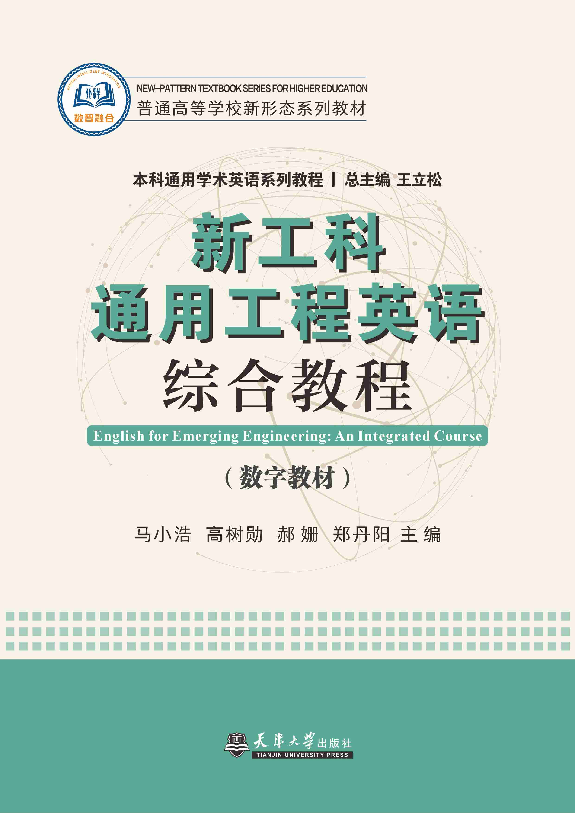

### 丛书名

本科通用学术英语系列教程

### 丛书总主编

王立松

### 主　编

马小浩　高树勋　郝　姗　郑丹阳

### 策划编辑

黎恋恋　李源

### 责任编辑

黎恋恋

### 出版单位

天津大学出版社有限责任公司

### ISBN

978-7-89574-383-0

### 出版时间

2026年9月

### 定 价

49.00元

### 内容简介

本书为面向新工科人才培养的大学英语教材，由天津大学外国语学院教师团队精心编写。全书紧扣新工科建设背景下工科专业学生英语应用能力的核心需求，系统培养学生在工程场景中的英语沟通、文献研读与报告撰写等综合能力。教材融合通用工程英语与专门用途英语教学理念，通过听说、读写一体化设计，帮助学生掌握工程领域通用表达，切实提升其在技术交流、项目协作及学术研究等场景中的英语实际运用能力。本书适用于普通高等院校工科类本科生及低年级研究生使用，亦可作为大学英语拓展课程的教学材料，或供有需求的学习者自主学习使用。

---

## 全书结构图

英文对照：[[EN-03 Map of the Book|Map of the Book]]

<table>
  <tr>
    <td rowspan="3">第 1 单元 传感与感知</td>
    <td>A 篇</td>
    <td>课文：传感器与智能——自主机器人的基础 像工程师一样思考：技术可靠性与公众信任</td>
  </tr>
  <tr>
    <td>B 篇</td>
    <td>课文：从触觉到行动——人造皮肤如何帮助机器人 工程决策：水下机器人的传感器选择</td>
  </tr>
  <tr>
    <td>项目任务</td>
    <td>为一个智能系统制作可视化工作流程与设计说明</td>
  </tr>
</table>

<table>
  <tr>
    <td rowspan="3">第 2 单元 互联工厂</td>
    <td>A 篇</td>
    <td>课文：当生产成为「软件问题」 像工程师一样思考：追踪信息失效</td>
  </tr>
  <tr>
    <td>B 篇</td>
    <td>课文：数据驱动的车间——让机器成为「会说话」的资产 工程决策：智能化改造中的速度与可靠性</td>
  </tr>
  <tr>
    <td>项目任务</td>
    <td>制作五格智慧校园方案图</td>
  </tr>
</table>

<table>
  <tr>
    <td rowspan="3">第 3 单元 具身智能</td>
    <td>A 篇</td>
    <td>课文：具身人工智能——从数字智能到物理机器 像工程师一样思考：机器人部署中的多因素平衡</td>
  </tr>
  <tr>
    <td>B 篇</td>
    <td>课文：AI 芯片与计算的未来 工程决策：在真实场景中部署技术</td>
  </tr>
  <tr>
    <td>项目任务</td>
    <td>为校园岗位推介一款机器人</td>
  </tr>
</table>

<table>
  <tr>
    <td rowspan="3">第 4 单元 新材料与智能结构</td>
    <td>A 篇</td>
    <td>课文：新材料，新可能 像工程师一样思考：评估先进材料</td>
  </tr>
  <tr>
    <td>B 篇</td>
    <td>课文：智能结构——会思考的建筑 工程决策：技术设计与维护现实</td>
  </tr>
  <tr>
    <td>项目任务</td>
    <td>设计一张材料或结构工程主题海报</td>
  </tr>
</table>

<table>
  <tr>
    <td rowspan="3">第 5 单元 智能系统</td>
    <td>A 篇</td>
    <td>课文：探索深渊——揭开海洋的奥秘 像工程师一样思考：极端环境工程的挑战</td>
  </tr>
  <tr>
    <td>B 篇</td>
    <td>课文：智能钢材与技术革新海洋探索 工程决策：复杂工程项目的团队建设</td>
  </tr>
  <tr>
    <td>项目任务</td>
    <td>展示一项极端环境工程成就</td>
  </tr>
</table>

<table>
  <tr>
    <td rowspan="3">第 6 单元 明日能源</td>
    <td>A 篇</td>
    <td>课文：储能——清洁能源未来背后的隐藏力量 像工程师一样思考：不同储能模式的特点</td>
  </tr>
  <tr>
    <td>B 篇</td>
    <td>课文：迈向净零世界的绿色电力 工程决策：紧预算下的工程决策</td>
  </tr>
  <tr>
    <td>项目任务</td>
    <td>为一个社区提出储能方案</td>
  </tr>
</table>

<table>
  <tr>
    <td rowspan="3">第 7 单元 人机融合</td>
    <td>A 篇</td>
    <td>课文：脑机接口——从神经信号到控制系统 像工程师一样思考：工程设计中的用户体验</td>
  </tr>
  <tr>
    <td>B 篇</td>
    <td>课文：神经康复工程 工程决策：工程经费分配的循证决策</td>
  </tr>
  <tr>
    <td>项目任务</td>
    <td>设计一张中国脑机接口成就信息图</td>
  </tr>
</table>

<table>
  <tr>
    <td rowspan="3">第 8 单元 化学工程与生物制造</td>
    <td>A 篇</td>
    <td>课文：规模化化学工程——从反应到可靠生产 像工程师一样思考：应急场景下的技术决策与取舍</td>
  </tr>
  <tr>
    <td>B 篇</td>
    <td>课文：生物制造与药品质量 工程决策：应急工程中平衡速度与安全</td>
  </tr>
  <tr>
    <td>项目任务</td>
    <td>为一款产品制定从实验室走向市场的计划</td>
  </tr>
</table>

---

## 听力原文

英文对照：[[EN-04 Audio Scripts|Audio Scripts]]

### 第1单元

#### 音频 1：工程对话｜同伴的实验经历

（林静就温度传感器实验报告向学长王浩请教。）

林静：嘿，王浩！你有空吗？我的传感器实验报告实在写不下去了。

王浩：当然，怎么了？

林静：上周我们做了那个温度传感器实验，我完全糊涂了。我的数据乱七八糟！你看这些数字——它们本该测的是室温，可读数每隔几秒就从 22 度跳到 24 度再跳回来。我不知道是传感器坏了，还是我操作错了。

王浩：啊，经典的大一传感器实验问题！别担心，你的传感器多半没坏。你看到的现象叫噪声。

林静：噪声？你是说……声音吗？

王浩：不是那种噪声。在工程里，噪声指测量中的随机波动。可以把它想成收音机里的杂音——是让信号变得不清晰的干扰。

林静：哦！所以出现这种波动是正常的？

王浩：完全正常。所有传感器都有噪声，来源各不相同。比如附近设备的电磁干扰——像是有人的手机离你的传感器太近；再比如温度漂移——测量期间室温发生了变化；甚至传感器自身也会产生内部噪声。

林静：有道理，可我在报告里怎么解释呢？教授要我们分析误差，我都不知道从哪儿下手。

王浩：好，你需要这样做。第一，在误差分析部分，找出实验中可能的噪声来源。问问自己：什么会影响我的测量？实验室的门是不是一直开开关关？旁边是不是有电脑在运行？把这些写下来。

林静：明白，然后呢？

王浩：第二，用统计方法看你的数据。计算所有读数的平均值——它很可能接近真实温度。再看读数的波动范围。如果大多数数据点落在 22 到 24 度之间，你就可以说测量结果是「23 度，上下浮动 1 度」。

林静：哦！所以我不该只挑一个数？

王浩：正是！真实测量永远存在不确定度，这在工程里再正常不过。

林静：好，这有帮助。可还有一件事——助教提到了「校准」，我完全不知道是什么意思。

王浩：校准非常重要。简单说就是确认你的传感器读数准确。就像用一件你确信正好一千克的东西去检验一台秤准不准。

林静：所以……是把你的传感器和一个你确信正确的东西做比较？

王浩：对！对你的温度传感器来说，可以拿一支高质量的基准温度计来比较。如果你的传感器显示 21 度，而基准温度计显示 22 度，你就知道传感器偏低了 1 度，然后就可以对所有读数做修正。

林静：等等，那我是不是应该在实验之前就校准传感器？

王浩：理想情况下是的。但如果没做，在报告里说明就好。你可以写：「本实验未包含校准步骤，这可能增加了测量不确定度。」教授很欣赏你能认识到实验的局限。

林静：哦，那我就放心了！我还以为自己彻底搞砸了。

王浩：完全没有！来，给你一个误差分析部分的速成结构。第一，描述你观察到的误差——比如你提到的那些波动。第二，解释误差的可能来源——干扰噪声、缺少校准等等。第三，提出下次改进实验的办法——比如先校准，或者多测几次取平均来抵消噪声。

林静：太清楚了！我还能再问一个问题吗？我到底应该测多少次？我只测了十个读数左右。

王浩：对基础实验来说，十次大概够了，但永远是越多越好。如果噪声很大，测 20 或 30 次再取平均，结果会更可靠。就像多拍几张照片，挑最清楚的那张。

林静：太有道理了！真希望有人在实验前就给我讲这些。

王浩：是啊，传感器实验一开始总是让人迷糊。但弄懂了噪声和校准，其余的都会变简单。相信我，到大三这些就是你的本能了。

林静：希望如此！太感谢了，王浩。你救了我的周末——我本来打算整个周末都盯着数据发呆！

王浩：不客气！学长就是干这个用的。报告加油！

#### 音频 2：工程决策｜水下机器人的传感器选择

（苏菲和王浩为水下机器人比赛挑选传感器。）

苏菲：嗨，王浩！我很期待我们的水下机器人项目，但我们得尽快选定传感器了。我们社团只有大约 3000 元经费。

王浩：我比较过几个方案，觉得应该用声呐。它在几乎任何水质条件下都能工作。

苏菲：声呐要多少钱？

王浩：基础款大约 1800 元。它能在 30 米内探测障碍物，即使在浑浊的水里也行。

苏菲：那要花掉一半还多的预算。摄像头呢？不是更便宜吗？

王浩：是的，水下摄像头大约 450 元。但比赛在湖里举行，湖水往往很浑浊，摄像头可能什么都看不清。

苏菲：可如果花 1800 元买声呐，就只剩大约 1200 元买电机、电池和机器人本体了。

王浩：我理解。但如果机器人在浑水中探测不到障碍物，就可能撞毁。去年雨后有三个队伍的机器人就撞坏了，因为他们的摄像头看不清。

苏菲：真的吗？我们能不能在比赛前到湖里测试机器人？

王浩：不行。规则只允许在大学泳池里测试，而泳池水非常清澈，所以在那里测摄像头暴露不出真正的问题。

苏菲：那我们先买摄像头，以后再升级成声呐呢？

王浩：比赛只剩两个月了。决定得太晚，就没有足够时间把声呐集成进去并充分测试。

苏菲：有更便宜的声呐吗？

王浩：有。我找到一款更简单的声呐，大约 900 元。探测距离 15 米，但对小型比赛场地应该够用。

苏菲：这听起来好多了，那样我们还能剩大约 2100 元。

王浩：没错。我们可以两种传感器都用：声呐 900 元，摄像头 450 元，一共 1350 元，还剩 1650 元买其他东西。

苏菲：为什么要两种都用？

王浩：它们互相补充。声呐在浑水中测距离，摄像头在清水中提供视觉细节，比如标记物或彩色目标。

苏菲：所以是一套备份系统，一个传感器出了问题，另一个还能顶上。

王浩：对。这就是传感器融合——多个传感器协同工作，让系统更可靠。

苏菲：好，我支持双传感器方案，但剩下的 1650 元必须精打细算。

王浩：同意。我们来给电机、电池和外壳做一份详细预算。基础的传感器融合程序我可以来做。

苏菲：那么我们的最终决定是：基础声呐 900 元，加水下摄像头 450 元，剩下 1650 元用于其余部分。

王浩：没错。这样我们的机器人在清水和浑水里都能工作。明天就把方案讲给指导老师听吧。

### 第2单元

#### 音频 1：工程对话｜智能工厂项目的破局之路

（王浩、林静和苏菲就智慧工厂系统项目开小组会。）

王浩：好，各位，我们得解决智慧工厂系统项目里的主要问题了。仪表盘看着挺漂亮，可数字和我们在车间里看到的对不上。

林静：哪个数据点偏差最大？

王浩：OEE（设备综合效率）。机器人明明在忙，仪表盘却把它标成「空闲」。传感器在发数据，但系统的解读好像错了。

苏菲：可能是数据定义的问题。我们对数控机床、传送带和机器人工作单元的「运行」「空闲」「停机」定义一致吗？

王浩：不太一致。我们直接用了网关的默认标签，我以为数据本身已经有明确含义。

林静：那这就是我们的第一项任务。在智能制造里，数据质量是生产质量的一部分。定义不统一，OEE 和排产决策就都不可靠。

苏菲：在上 AI 之前，我们需要一份共享的标签字典。「空闲」在所有机器上必须含义相同，或者为每类机器明确定义。

王浩：同意。但截止日期之前，我们不可能重建整个系统。

林静：那就缩小范围：一条产线、一个瓶颈、一个问题。我们选机器人工作单元，问「为什么交付延迟」。

苏菲：数据管道应该是：传感器数据 → 网关 → 存储 → 仪表盘 → 校验。我们把仪表盘状态和车间实地观察做对比。

王浩：好。那预测性维护呢？教授希望我们把它包含进去。

林静：我们把它作为后续扩展来写。只有当我们信任时间戳、机器状态和故障标签时，AI 才有用，否则模型预测出来的就是无意义的结果。

苏菲：所以我们的核心观点是：没有干净的数据，就没有有用的 AI。

王浩：正是。既诚实又专业。

林静：还应该提一下边缘计算。对低延迟决策，比如异常报警，一部分处理应该发生在边缘侧，而不是全放在云端。

苏菲：还有网络安全。联网产线需要网络分段、身份认证和审计追踪，尤其是任何能修改机器人程序或生产配方的操作。

王浩：这和我们的按单生产演示是连着的。如果产品型号变了，产线必须加载正确的程序，一个错误的版本就可能造成安全或质量问题。

林静：对，这就是数字主线为什么重要。订单号、设计版本、工艺参数、机器人程序和质量记录应该始终关联在一起。

苏菲：那么我们修改后的逻辑是：先定义数据，建一条可靠的数据管道，校验 OEE，加上边缘报警和网络安全，然后再讨论预测性维护。

王浩：很好。林静，请你来做标签字典和 OEE 定义。

林静：好。我来为机器人工作单元定义「运行」「空闲」「停机」和「报警状态」。

王浩：苏菲，仪表盘和数据管道图交给你？

苏菲：没问题。我会画出从传感器到网关、存储、仪表盘和校验的流程，并标出边缘处理发生的位置。

王浩：我负责网络安全和数字主线部分。

林静：这比单纯说「我们把机器连上并用了 AI」有力多了，现在我们展示的是工程推理。

苏菲：而且如果仪表盘还在「说谎」，我们也不会先去怪传感器。

王浩：对，我们会先检查数据的含义。好了各位——一个瓶颈、一条管道、干净的定义，然后才是 AI。今晚我们把幻灯片改出来。

#### 音频 2：工程决策｜智慧工厂升级中的速度与可靠性

（王浩、张晨和林静讨论把一家工厂升级为智能制造系统。）

王浩：张晨，你看——如果我们给每台机器都装上传感器、全部接入云端，就能给整个车间做实时仪表盘了。预测性维护、自动排产……一整套智慧工厂配置。

张晨：「全部接入」说来容易。可我们上次演示已经暴露了问题：「空闲」标签有一半时间是错的。状态信号一团糟，你的实时排产就是垃圾，只不过是把混乱自动化了。

王浩：所以才要采集更多数据。传感器越多，真相越多。

林静：或者是噪声越多。在谈「更多数据」之前，我们对定义达成一致了吗？什么才算停机？什么算换型？如果每个班组标注事件的标准都不同，就建不起可靠的数字主线。

王浩：好吧，定义确实重要。但工厂现在就要见效果。按单生产的型号越来越多，他们正在丢订单。升级慢了就会落后。

张晨：快速升级会带来新风险。把老设备联网，等于扩大了网络安全的攻击面。一个弱密码、一台没打补丁的网关——就可能有人篡改机器人程序或生产配方。

王浩：你是说……真的会有攻击？

张晨：也可能是「好心办坏事」。技术员加载了错误版本的配方，产线在没人察觉之前用错误的零件生产了 500 件产品。没有可追溯性，你甚至不知道哪些客户拿到了哪个批次。

林静：还有人的因素。如果系统不停地重排任务，操作工可能就不再信任它；或者盲目跟着仪表盘走，丧失对现场实际情况的判断。智慧工厂需要「人在回路」的设计，而不只是自动化。

王浩：那我们怎么办——什么都不做？总不能一直人工干下去。

张晨：不是什么都不做，而是分优先级。先从一个瓶颈工位做起，在边缘侧建一条干净的数据管道：准确的状态、时间戳和质量检查，然后再扩展。而且，在万物互联之前先把网络分段。

林静：正是。目标不是「技术拉满」，而是决策可信。一个能正常工作的小系统，胜过一个「说谎」的大系统。

王浩：好吧……所以两难就在于速度与可靠性。太快，可能破坏信任和安全；太慢，可能失去竞争力。

### 第3单元

#### 音频 1：工程对话｜开始一项具身智能范围综述

（林静请张晨帮忙规划一篇关于具身智能的范围综述。）

林静：张晨，你有空吗？我这门具身智能的作业实在头大。老师要我们对文献做一篇范围综述（scoping review），可说实话，我从没做过，都不知道从哪儿下手。

张晨：范围综述？我懂你的感受，一开始听起来确实复杂。最让你困惑的是哪部分？

林静：几乎全都困惑。我是不是直接在网上搜「具身智能」，搜到什么读什么就行？文章、会议论文、报告太多了，我不知道哪些才是真正有用的。

张晨：我上学期也遇到同样的问题。第一步不是尽可能多地收集论文，而是要先想清楚你想探讨什么问题。比如，你关心的是机器人如何感知世界、AI 模型如何控制机器人，还是具身智能在现实中如何应用？

林静：所以研究问题能帮我决定需要什么信息。

张晨：正是。想清楚之后，检索就可以更系统。大学数据库、学术期刊和会议论文，通常比随便一个网站更靠谱。

林静：可我怎么判断一篇论文是否可靠？有些文章看起来非常专业。

张晨：问得好。可以看几点：谁发表的、是否提供了证据、方法是否解释得清楚，以及它与你的主题是否紧密相关。如果你的重点是人与机器人交互，一篇讲机器人硬件的论文可能帮助不大。

林静：有道理。另一个问题是最后的报告，我是不是把每篇论文挨个总结一遍就行？

张晨：不行，那样只会变成一份长长的清单。好的综述应该呈现规律：研究者在关注什么、用了哪些方法、还有哪些挑战没有解决。

林静：我可以用 AI 工具帮忙吗？我正想让 AI 替我总结论文。

张晨：AI 有用，但要谨慎使用。它可以帮忙生成关键词、整理笔记、解释难懂的概念。但我们仍然要核对原始论文，作出自己的判断。

林静：所以 AI 可以帮我探索这个领域，但不能取代我的理解。

张晨：正是。尤其是具身智能这样的新兴领域，工程师需要学会自己查找信息、评估证据、建立理解。

林静：我想我知道怎么开始了。先确定问题，再检索和评估资料，最后梳理主要观点。

张晨：思路对了。学习一项新技术，不只是要知道答案，还要知道如何找到可靠的答案。

#### 音频 2：工程决策｜宇树人形机器人该放在哪里

（张晨、林静和一名国际生同学讨论把十台宇树 H2 人形机器人部署在校园的什么位置。）

张晨：任务是这样的。学校买了十台宇树 H2 人形机器人，我们来决定它们去哪儿——图书馆、教学楼还是学生活动中心——并且要论证这个决定。好处和问题都要讲清楚。

林静：十台。可以每栋楼放三台，还剩一台备用。

国际生同学：这算一个答案，甚至可能是对的答案。但教授会问：十台集中在一栋楼，能做到三台做不到的什么事？

张晨：那就先说图书馆。整架上书。人形机器人不用梯子就能够到最高一层书架，能走进推车转不开身的小巷道，还能把书放回正确的位置——前提是它能读懂索书号、能捏住薄薄的书脊。

林静：「前提是」。你看过它拿书吗？难的是手，不是腿。

国际生同学：而且它必须安静。阅览室里十台机器人一起工作……

张晨：可假设我们把十台都放那里：每本还书当天就能重新上架，学生按目录找书就能找得到。这是实实在在的改变，而且可以量化。

林静：可量化很好。而且这也是三个地点里唯一不需要人跟它说话的。

张晨：再说教学楼。它们站在实验课上当助教——回答问题、指黑板、在课桌间走动、发放器材。

林静：如果任务只是回答问题，那为什么要买腿？墙上一块屏幕也能回答问题。我们等于花钱买了一个没人用得上身体的躯体。

张晨：……这个问题问得有道理。

国际生同学：也不全是。身体可以示范一个动作，可以在学生从下方观察时稳稳托住一个零件。屏幕做不到这些。

林静：那学生活动中心呢。那才是学生真正会开口求助的地方——表格、教室、丢了的校园卡，什么都问。

国际生同学：而那恰恰是最容易出事的地方。人形机器人长得像人，人们就会像对人一样跟它说话。他们会问它答不上来的问题，而且不会像原谅一块屏幕那样原谅它。

张晨：所以说，外形抬高了期望。

国际生同学：外形抬高了期望。而且在人堆里，总会有人推它一把，看看会发生什么。

林静：这意味着要有人监管。十台机器人、三栋楼——谁来充电？晚上九点有一台卡在门道里时，谁在现场？

张晨：所以我们其实不是在选楼，而是在选我们愿意向学校解释哪一种失败。

林静：把这句话记下来。

国际生同学：那然后写到……哪里？

### 第4单元

#### 音频 1：工程对话｜是什么让材料「智能」

（材料科学课堂上，李教授在讲解自修复混凝土，张晨和苏菲在听课。）

李教授：……总结一下，当混凝土出现微裂缝时，内嵌的胶囊会破裂并释放修复剂——通常是细菌溶液或环氧树脂——自动填充并封闭裂缝。那么，谁能告诉我这对基础设施为什么重要？好——张晨？

张晨：是不是因为人工修补桥梁和公路极其昂贵？如果材料能自己修复，整个结构寿命期内就能省下大量维护费用。

李教授：完全正确。全寿命周期成本会显著下降。有估计认为，五十年内的维护支出可以减少 30% 到 40%。而且这不只是钱的问题——想想干扰。每次为了修补一条裂缝封闭高速公路的一条车道，都会造成交通延误、怠速车辆的碳排放，以及维修人员的安全风险。自修复材料能避免这一切。现在，我想请大家思考一个问题：如果修复剂用完了——比如经历了几轮「开裂-修复」循环之后——结构会怎么样？

苏菲：李教授，我有个问题。胶囊用完之后，材料会不会变弱？就是说，它会退回到普通混凝土的状态吗？

李教授：这个问题问得很尖锐，苏菲。简短的回答是：会的。胶囊耗尽之后，自修复功能就消失了。混凝土本身还在，但再也无法修复新的裂缝。这正是研究者们目前最大的挑战之一——如何让修复机制可再生。大家有什么解决思路吗？

张晨：我上周读到一篇论文，说可以用血管网络代替胶囊——就像在混凝土里布满细小的管道，能从外部补充修复剂。这是可行的方案吗？

李教授：很好，你提前读了文献。血管系统很有前景，但会增加复杂性。管道会随时间堵塞；如果管径太大，还会削弱混凝土；而且往高速公路中间的桥面板里泵送修复剂也并不方便。所以这里存在真实的工程权衡：更好的修复能力，对更高的结构风险和维护难度。

苏菲：所以有点像……把材料做得越「智能」，可能出问题的地方就越多？

李教授：这个概括非常有洞察力。在工程上，我们称之为复杂性-可靠性权衡。你给材料增加的每一项功能，都是一个新的潜在失效模式。一根简单的混凝土梁失效方式很少——要么扛得住荷载，要么扛不住。但一套带血管网络的自修复混凝土呢？你要操心胶囊耗尽、管道堵塞、修复剂化学降解、温度敏感性——问题清单还会更长。

张晨：那是不是意味着，即使存在智能方案，工程师有时也会故意选择更简单的材料？

李教授：当然。这一点我特别希望大家记住。在真实的工程里，最好的材料不一定是最先进的材料，而是针对具体应用，在性能、成本、可靠性和可维护性之间平衡得最好的材料。自修复混凝土也许非常适合难以派人维修的海底隧道；但对一个普通停车场来说，定期巡检的普通混凝土可能是更「聪明」的选择——工程意义上的聪明，而不是材料科学意义上的聪明。

苏菲：这确实很有道理。我之前一直默认「越新越好」。

李教授：这是非常常见的假设，也是值得在职业生涯早期就放下的假设。好，说到能响应环境的智能材料——我们接着讲形状记忆合金。这类金属能「记住」自己原来的形状……

#### 音频 2：工程决策｜第二十年的钱谁来出？

（项目评审会上，张晨、林静和他们的导师王教授评审一座地标人行桥的初步设计。）

王教授：业主想要一座地标桥——玻璃桥面、CFRP（碳纤维增强复合材料）拉索、单桥塔，非常炫。张晨，给我讲讲你的结构概念。

张晨：我提议用 CFRP 拉索代替钢索。它们更轻、不腐蚀，还能大幅缩小桥塔尺寸，视觉效果很强。

王教授：性能确实出色。但我问你一个问题：第 15 年谁来检查这些拉索？全中国每个维护班组都会处理钢索，而 CFRP 需要专门的设备和受过培训的技术员。在一个三线城市，这样的技术员有几个？

张晨：我没想过这一点，我关注的是结构性能。

王教授：这正是我看到年轻工程师常犯的错误。你们为「第一天」设计——剪彩那天。但桥梁要活到第七千天。而第七千天是个星期二的早晨，一位本地工人需要更换一个部件，手册上却写着「请联系深圳的原厂」。林静，你有问题吗？

林静：王教授，我意识到玻璃桥面也有同样的问题。我算过账——如果玻璃板每八年更换一次，五十年的维护费用将接近初始建设预算的 40%。而且每次更换都意味着封桥。

王教授：那解决方案是什么？我们是否要把桥做得更「智能」？

林静：可以嵌入结构健康监测——光纤传感器接入数字孪生系统。不用昂贵的定期巡检，系统能准确告诉你何时、何处需要介入，从「按时间维护」转向「按状态维护」。

张晨：但监测系统本身也需要维护。传感器会坏，软件要更新。我们是在解决问题，还是把一个问题换成了另一个问题？

王教授：这是我十五年来的心得：分层设计。基础结构必须能用常规方法安全地维护——不依赖任何技术。智能层叠加在上面，是增强，而不是依赖。哪怕明天所有传感器都失效，桥也必须能被普通班组用标准工具检查。我称之为「星期二早晨测试」：如果你的设计只有在对口的专家在场时才能运转，它在现实世界里一定会失败。

林静：所以智能系统让维护更好，但结构的安全性不应该依赖它们。

王教授：正是。还有一点：向业主汇报设计时，要展示五十年总成本——建造加巡检加维修加更换。一个不那么炫的设计，如果能帮城市在五十年里省下 3000 万元维护费，这些钱就能变成学校和医院。这就是工程责任。工程并不总是建造最令人惊叹的东西，有时是建造最诚实的东西。

### 第5单元

#### 音频 1：工程对话｜演示中如何平衡趣味性与专业性

（答疑时间，张晨就一次课堂演示向陈教授请教。）

张晨：陈教授，您现在有几分钟吗？我在准备我们组的海洋资源与环境演示，拿不准该怎么平衡专业性和吸引听众。

陈教授：当然可以，张晨。你具体担心什么？

张晨：我们的主题是海洋保护、气候变化和可持续资源。内容应该严肃准确，但如果太技术化，我怕听众会失去兴趣。

陈教授：这是很常见的顾虑。好的学术演示不应该枯燥，但也不能变成没有内涵的娱乐表演。

张晨：那加入幽默、动画或者互动环节可以吗？

陈教授：可以，但前提是它们服务于信息本身。幽默能拉近距离，视觉效果能讲清复杂的概念，互动能让听众参与进来，但它们绝不能喧宾夺主、分散对科学内容的注意力。

张晨：我们想用一张互动珊瑚礁地图，或者一小段污染模拟。会不会太花哨？

陈教授：只要每个工具都对应一个知识点，就不会。珊瑚礁地图可以展示生物多样性的丧失，污染模拟可以展示人类活动如何影响海洋生态系统。

张晨：所以问题不在于用不用创意元素，而在于它们是否支撑论点。

陈教授：正是。要自问：这个元素有没有帮助听众理解、记住或关心这个问题？有就保留，只是装饰就去掉。

张晨：我还担心过度简化。如果把演示做得太通俗，会不会失去技术上的准确性？

陈教授：通俗易懂不等于去掉证据。语言可以清晰平实，但术语、数据和来源必须准确。比如讲珊瑚白化，解释可以简单，但仍要提到温度胁迫、共生藻类和生态系统影响。

张晨：也就是说，要让解释易懂，而不是浅薄。

陈教授：完全正确。一场有力的演示有三层：准确的科学、清晰的结构、用心的表达。

张晨：那我们的结构可以是：提出问题、展示真实数据、解释环境影响，然后给出可能的工程或政策解决方案。

陈教授：这样很好。还可以在开头问听众一个简短的问题，比如他们认为哪个海洋问题最紧迫，再用他们的回答引出你们的数据。

张晨：这比硬塞笑话好多了，既让听众参与，又保持主题的严肃性。

陈教授：正是。吸引力不等于娱乐化，它可以是相关性、清晰度、视觉证据和有意义的听众参与。

张晨：我明白了。我们不是在专业性和创意之间二选一，而是用创意让专业内容更易懂。

陈教授：说得好。让演示对专家足够准确，对外行足够清楚。

张晨：谢谢您，陈教授。我会先按证据修改幻灯片，只在支撑信息的地方使用创意元素。

陈教授：好。定稿之前，对每一张图、每一个活动都问一句：这能帮助听众理解什么？

张晨：我会的。这下方向清楚多了。

#### 音频 2：工程决策｜理解工程的同与异

（王浩和苏菲在比较深海、深地与极地环境中的工程。）

王浩：苏菲，我以前觉得深海探索和深地探索完全不同，一个下海洋，一个往地底。

苏菲：我也是。但读完这两份报告，我觉得它们在很多方面是相似的工程问题。两种情况下，工程师都要把设备送进人类难以进入、难以维修的地方。

王浩：对。第一个共同的挑战是压力。像「海燕」这样的深海水下滑翔机必须承受巨大的水压，深部钻探系统必须承受岩层和地下流体的高压。

苏菲：而且两种系统都需要坚固的结构和可靠的材料。在海洋里，材料必须耐海水腐蚀；在地下，钻具要面对高温、强振动、摩擦和磨损。环境不同，但设计问题是相似的：当环境不断「攻击」系统时，它如何持续工作？

王浩：能源是另一个问题。「海燕」要用有限的电池长时间航行，所以它靠改变浮力滑行，而不是全程靠螺旋桨。深地钻探同样需要稳定的能源供给，来驱动钻进、传感、冷却和监测系统。

苏菲：数据也很难。水下通信受限，卫星信号到不了深水；地下信号也难以穿透岩层传输。所以两类项目都需要传感器、数据处理，以及把有用信息传回来的巧妙办法。

王浩：这让我想到极地考察，它也是同一类问题吗？

苏菲：部分是。极地考察同样发生在极端而遥远的环境里，设备必须扛住低温、冰雪、强风、能源供给有限和通信困难。东西一旦坏了，维修可能很慢，甚至根本无法进行。

王浩：但主要威胁不同。深海系统对抗压力和腐蚀；深地系统对抗高温、高压、振动和钻具磨损；极地系统对抗严寒、冰体运动、风暴和漫长的极夜。

苏菲：正是。极地考察往往比深海深地更容易到达，因为人可以在地表工作，但天气不确定性更强、后勤保障更难。极地科考站、巡视车或破冰船都高度依赖运输、庇护、电力和应急预案。

王浩：所以共同点不是「海洋」「地下」或「冰雪」，而是要为高风险、难到达、信息不完整的地方设计可靠的系统。

苏菲：而且没有哪个单一专业能解决这些问题。机械工程师设计结构和运动部件，材料科学家挑选高强耐蚀的材料，自动化工程师设计控制系统，仪表专家制造传感器，计算机科学家处理数据，环境科学家评估影响，安全工程师为失效做预案。

王浩：这么说，极端环境工程其实是压力之下的团队协作。

苏菲：是的，完全没错。

### 第6单元

#### 音频 1：工程对话｜攻克储能课程

（王浩向苏菲请教储能课程的学习方法。）

王浩：苏菲，这门《21 世纪储能策略》我真的学得很吃力。大家都说它重要，但说实话，我就是学不明白。教材里全是信息，什么都记不住。

苏菲：你不孤单，王浩。我当初上这门课也是这种感觉，它是我们专业最难的课之一。到底是什么让你困惑？

王浩：几乎所有东西。教材里全是术语——储热、超级电容、固态电池、氢燃料电池，读一页都觉得累。数学更糟，那些公式看得我头晕。

苏菲：我懂。但那些公式不是用来吓唬你的，它们是描述真实物理过程的工具。一旦理解了背后的思想，方程就好对付多了。

王浩：可我该怎么入门呢？每次翻开书都觉得喘不过气。

苏菲：从小处开始。别想着一口气读完整章，挑一节，比如锂离子电池，只专注这一块。每读一段，就用自己的话写一句总结，相当于把教材翻译成你自己的语言。

王浩：这可能有用。我通常都是一路读下来，可能根本没真正消化。

苏菲：对。你还可以借助短视频或信息图。看到能量如何在系统里流动，比如充电和放电，概念会具体得多。

王浩：那数学呢？我最常卡在那里。

苏菲：做题之前，先问这个公式代表什么。比如能量密度，想想每个符号的物理含义：它描述每千克或每单位体积能储存多少能量。它不只是数字，而是一种语言。

王浩：也许我一直把数学当怪物，而不是当语言。

苏菲：正是。一旦明白它想「说」什么，它就没那么可怕了。

王浩：你自己当时也学得吃力吗？

苏菲：当然。我第一次小测就没及格，差点放弃。后来我和几个同学组成了学习小组，大家分专题、互相讲解、每周碰一次头。这改变了一切。

王浩：学习小组……我大部分时间都是一个人学，也许这正是问题所在。

苏菲：一定要试试。当你大声给别人讲解时，很快就能发现自己哪里懂、哪里不懂。而且不用一个人扛，压力会小很多。

王浩：听起来很棒。我去问问大家，看有没有人愿意组队。

苏菲：好主意。卡住的时候就去问教授或助教，他们通常很乐意帮忙，尤其看到你确实在努力。

王浩：我之前大概是不好意思问，总以为别人全都懂了。

苏菲：相信我，他们没有。大多数人同样一头雾水，只是藏得更好。所以要勇敢开口。

王浩：谢谢你，苏菲。我没那么绝望了。我会从小处做起、做笔记、加入学习小组，需要时主动求助。

苏菲：这就对了。理解需要时间，但坚持会有回报。说不定哪天你还会开始享受这门课。

王浩：先别说到那一步！不过说真的，谢谢你，下次咖啡我请。

苏菲：一言为定。别忘了下周之前复习第二章，实验课要用。

王浩：好，一次一章，记住了。

#### 音频 2：工程决策｜净零困境

（张晨和林静讨论如何在城市智能电网与农村能源可及性之间分配投资。）

张晨：林静，我刚写完全球能源倡议的最终提案。如果优先发展特大城市的智能电网，五年内就能削减 40% 的碳排放，这是实现净零目标最有效的方式。

林静：40% 是个惊人的数字，张晨。但是哪些城市呢？我在看中非的基础设施地图，那里大多数农村连稳定的国家电网都接不上，更别说「智能」电网了。

张晨：这正是关键！我们必须去密度高的地方。如果为一座千万人口城市优化负荷平衡，碳减排的投资回报率是巨大的。这是基本的工程逻辑：让每一块钱的产出最大化。

林静：但这种逻辑忽视了能源公平。城市享受高科技自动化的同时，一千个农村还留在黑暗里。他们地处偏远，传统技术的维护成本本来就高。如果我们现在不为他们投资分布式「光伏+储能」，他们就被迫再用十年柴油发电机。

张晨：我理解人文关怀的一面，但分布式系统大规模维护起来是噩梦。一千个站点各自的物流、零件和专业人力成本？还没做完头一百个，整个预算就耗光了。

林静：所以只因为他们「不划算」，就把他们抛下？工程不只是最优的数学，更是对人最优的影响。如果我们的「可持续未来」只存在于富裕城市，它还真的可持续吗？

张晨：静，我们的预算有限。如果都想救一点，最后可能谁都救不了。必须做出选择，而数据表明城市能带来最快、可衡量的结果。

林静：我同意必须选择，只是不认为「效率」应该是方程里唯一的变量。可及性、公平、长期韧性和本地维护能力也应该算进去。

张晨：所以你是说，提案不仅要问哪里减碳最多，还要问谁被排除在这场转型之外。

林静：正是。净零不应该意味着某些社区还要再等十年才能用上基本的电力。更好的方案必须在碳效率与能源正义之间取得平衡。

### 第7单元

#### 音频 1：工程对话｜准备脑机接口课程展示

（林静、王浩和张晨在为生物医学工程课程的脑机接口展示做准备。）

林静：好，我们下周三要做 BCI（脑机接口）信号采集方法的展示。我一直在读 EEG（脑电图）的资料，说实话，比我想象的复杂。

王浩：是吧？我知道神经信号很微弱，但没想到是微伏级的——百万分之一伏特。这要怎么处理？

张晨：这差不多就是问题的核心了。工程挑战在于把真正的脑信号从各种噪声里分离出来——肌肉运动、心跳、房间里的电磁干扰，本质上是一个信噪比问题。

林静：对，教材还说 EEG 的空间分辨率比较低，因为信号要穿过头骨。所以你得到的是模糊的大致图像，而不是精确的图。

王浩：那为什么不干脆用侵入式方法？把电极直接植入大脑，信号肯定好得多，对吧？

张晨：当然，但想想那意味着什么——那是开颅手术。风险巨大：感染、组织损伤，电极还会随时间退化。消费级产品不可能这么做。

林静：其实我读到过很有意思的东西。中国科学院的一个团队植入了超薄柔性电极——我记得他们说每根电极的直径不到人发的百分之一——患者几周内就能用意念控制轮椅。

王浩：等等，真的？太厉害了。但长期稳定性呢？大脑在颅腔里会有轻微移动，对吧？电极会不会移位？

张晨：这其实是这个领域最大的问题之一，也就是所谓的信号漂移。神经模式随时间变化，系统的解码精度就会下降。不过中科院团队好像开发了一种在线重校准系统，可以实时调整。

林静：这就说到解码部分了。我们应该解释算法如何处理原始信号并把它变成指令。比如系统要学会：运动皮层的某个特定模式意味着「向左移」。

王浩：而且它得持续学习，因为大脑每次产生的模式并不完全一样。我想这就是机器学习登场的地方。

张晨：没错。然后还有反馈回路——闭环设计。用户需要知道自己的意图动作是否真的完成了，否则就像闭着眼睛打字。

林静：这个比喻太好了。那我们的展示不如按管道来组织：信号采集、解码、然后是反馈与控制？

王浩：我喜欢。而且可以在每个环节比较三类侵入程度——展示它们的取舍：非侵入式更安全但不够精确，侵入式精确但有风险，半侵入式介于两者之间。

张晨：听起来不错。解码部分交给我，我最近一直在看算法这一侧。林静，你负责信号采集？

林静：好。王浩，你做反馈与闭环部分？

王浩：成交。周四我们碰头把幻灯片拼起来。也许还应该加上中科院那个案例，会让展示具体得多。

张晨：同意，真实案例总是有帮助的。好，开工吧。

#### 音频 2：工程决策｜升级名额给谁？

（李教授、苏菲和王浩在决定该采购哪一套 BCI 康复系统。）

李教授：好，说正事。我们拿到了 80 万元经费，要在人民医院开展 BCI 康复试点，这笔钱只够买一套系统。问题是：买什么样的系统，给哪些患者用？

苏菲：明显的答案是我们最新的「神工」上肢外骨骼，配高密度 EEG 帽。解码精度在 90% 以上，我们已经发表了三篇论文。

王浩：话是这么说，但那套系统要将近 60 万元，就只剩 20 万元用于全年的安装、培训和维护，现实吗？

苏菲：可如果买便宜的系统，精度就下来了，我们不是牺牲了患者的康复效果吗？

王浩：也许吧，但想想患者是谁。医院告诉我们，大多数是年迈的脑卒中患者。他们需要的是易安装、皮实耐用、不需要博士生才能操作的系统。

李教授：说得好。我们的高端系统校准要 40 分钟，中端系统只要 15 分钟，治疗师参加两天培训就能操作。

苏菲：但如果中端系统的效果只是中等，医院可能得出结论说 BCI 康复没用，那会拖累整个领域在这里的发展。

王浩：反过来，如果高端系统因为没人会维护而坏掉，那更糟，患者就彻底没得用了。

李教授：还有一个公平问题。用高端系统，因为准备时间长，我们一天大约只能治疗 8 名患者；用中端系统，能治 15 到 20 名。是把最好的治疗给 8 个人更符合伦理，还是把不错的治疗给 20 个人？

王浩：而且别忘了这是试点。如果效果好，省里明年可能再资助十套系统，可扩展性很重要。

李教授：正是。我希望你们每个人带一个建议回来——用工程证据来论证，而不是只凭直觉。

### 第8单元

#### 音频 1：工程对话｜竞赛前的最后挑战

（校园生物制造竞赛前两天，林静、王浩和一名国际生同学开小组会。）

林静：离校园生物制造竞赛只有两天了，我们的海报看起来还像是三个不相干的项目硬拼在一起。

王浩：昨晚我做了工艺流程部分，写进了上游处理、下游纯化、灌装、GMP（药品生产质量管理规范）和批记录。技术含量应该够了吧？

国际生同学：内容很重要，但现在观众可能看不懂这个故事。我们到底在推销什么产品？

林静：一款用于社区健康筛查的快速诊断试剂。可我们的引言一会儿讲疫苗、一会儿讲抗体、一会儿讲细胞培养，太宽泛了。

王浩：那是因为我让 AI「把海报改得更专业」，它加了一堆高大上的术语。

国际生同学：问题恰恰在这。AI 能让语言听起来专业，但也可能让项目失焦。逻辑必须我们自己把控。

林静：所以我们应该先从用户需求出发？比如：社区诊所需要一种快速、稳定、便于分发的检测方法。

国际生同学：对。然后工艺流程应该支撑这个产品。可以用五步来展示：细胞或酶的生产、收获、纯化、制剂、灌装。

王浩：质量控制方面，我们写上鉴别、纯度、效价、无菌和稳定性？

国际生同学：没错。但不要只罗列，要解释为什么重要。比如效价告诉我们试剂是否仍然有效，无菌保护使用者，稳定性关系到储存和运输。

林静：放大生产呢？评委很可能问我们的方案能不能从实验室规模走向生产规模。

王浩：可以提一个瓶颈：纯化能力。下游纯化太慢，整条生产线都会被拖住。

国际生同学：好。还应该有一个风险控制方案，比如灌装环节的污染风险，通过洁净室规程、批记录和环境监测来控制。

林静：这就清晰多了。那现在该怎么用 AI？我不想它再把所有内容改写成含糊的营销话术。

国际生同学：让 AI 做具体的小任务。比如：「把这个流程转成五个适合工科本科生的简短海报标签」，或者「从质控工程师的角度向我们提五个评审问题」。

王浩：所以不是「帮我写海报」，而是「帮我针对特定受众改进这一部分」。

国际生同学：正是。而且 AI 给出建议之后，每个技术点都要对照课件和教材核实。

林静：那我们分工。我来重写产品需求和公共卫生价值；王浩，你把工艺流程理干净？

王浩：好。我删掉多余的术语，保留五个主要步骤，再加上纯化瓶颈。

国际生同学：我负责质量检查和风险控制。然后我们可以用 AI 生成可能的评委问题，练习回答。

林静：好。我们的海报不仅要展示产品是什么，还要展示我们如何安全、可靠地把它造出来。

#### 音频 2：工程决策｜快速部署 VS 证明安全

（课堂讨论中，王教授、张晨、苏菲讨论疫情暴发期间生物药品的部署问题。）

王教授：核心问题是：当一种产品被急需时，工程师应该快速部署它，还是等待更充分的安全与质量证据？

张晨：王教授，您指的是疫情暴发、医院突然需要更多药品或诊断产品的时候吗？

王教授：正是。想象一种新型呼吸道感染正在扩散，医院急需一种关键的生物药。快速放大产能可以帮助更多患者更早得到治疗。

苏菲：但如果生产扩得太快，工艺可能没有得到充分验证。

王教授：对。速度很重要，但速度不能代替证明。工程师需要证据证明每一批产品都是安全、稳定、有效的，并且在受控条件下生产。

张晨：所以冲突并不是简单的「快就是好」或者「慢就是安全」。

王教授：正是。我们必须平衡收益、风险、伦理、成本、可及性和公众信任。等得太久，患者可能得不到药；放行太早，患者可能受到伤害。

苏菲：公众还可能因此对医院、企业和监管机构失去信任。

王教授：对。所以我们需要质量证据：鉴别、效价、纯度、无菌、稳定性、批记录和冷链控制。

张晨：做更多检验要花时间花钱，但一个坏批次的代价可能更大。

王教授：非常好。成本控制意味着在保护使用者的前提下负责任地使用资源。不可靠的工艺可能造成浪费、召回、法律纠纷和信任流失。

苏菲：有没有中间方案，比如有限部署？

王教授：有。受控的有限部署可能是负责任的：限定批次、限定医院，同时进行持续检验和监测。

张晨：那被选中的医院就需要有受训的人员、清晰的记录、冷链监测和反馈收集？

王教授：对。还需要清晰的沟通：在严格条件下使用该是因为需求紧急，而不是因为忽视了质量控制。

苏菲：所以更好的问法是：「在什么条件下，部署才是负责任的？」

王教授：正是。你们的任务里，要把冲突讲清楚，识别利益相关方，比较风险与收益，并为你们的决定给出论证。

张晨：患者需要用药，医院需要供应，监管者需要证据，操作者需要规程，物流团队需要冷链控制，公众需要信任。

王教授：总结得很好。负责任的工程，意味着让产品在真实世界中安全、公平、可负担、可靠地发挥作用。

苏菲：那我们就把快速放大、追加检验和受控有限部署三个方案放在一起比较。

王教授：对。要问：还缺什么证据？什么风险可以接受？谁受益、谁可能受害？怎样才是负责任的沟通？

---

## 参考文献

英文对照：[[EN-05 References|References]]

[1] MURPHY R R. Introduction to AI robotics[M]. 2nd ed. Cambridge, MA: MIT Press, 2019.

[2] YOUSEF H, BOUKALLEL M, ALTHOEFER K. Tactile sensing for dexterous in-hand manipulation in robotics—A review[J]. Sensors and Actuators A: Physical, 2011, 167(2): 171-187.

[3] ZHENG Q, ZHANG D, BU T, et al. A bioinspired deep-sea iontronic skin for underwater robotic tactile sensing[J]. npj Flexible Electronics, 2026, 10: 8.

[4] JD LOGISTICS. JD deploys 100+ 5G-powered AGVs at Changsha Asia No.1[EB/OL]. (2022-07-06)[2026-08-18]. https://jdcorporateblog.com/jd-deploys-100-5g-powered-agvs-at-changsha-asia-no-1/.

[5] LU Y, LIU C, WANG K I K, et al. Digital Twin-driven smart manufacturing: Connotation, reference model, applications and research issues[J]. Robotics and Computer-Integrated Manufacturing, 2020, 61: 101837.

[6] INTERNATIONAL ORGANIZATION FOR STANDARDIZATION. Automation systems and integration—Digital twin framework for manufacturing—Part 1: Overview and general principles: ISO 23247-1:2021[S/OL]. Geneva: ISO, 2021[2026-08-18]. ISO.

[7] PFEIFER R, BONGARD J. How the body shapes the way we think: A new view of intelligence[M]. Cambridge, MA: MIT Press, 2006.

[8] DUAN J, YU S, TAN H L, et al. A survey of embodied AI: From simulators to research tasks[J]. IEEE Transactions on Emerging Topics in Computational Intelligence, 2022, 6(2): 230-244.

[9] PEI J, DENG L, SONG S, et al. Towards artificial general intelligence with hybrid Tianjic chip architecture[J]. Nature, 2019, 572(7767): 106-111.

[10] VAN TITTELBOOM K, DE BELIE N. Self-healing in cementitious materials—A review[J]. Materials, 2013, 6(6): 2182-2217.

[11] MOHD JANI J, LEARY M, SUBIC A, et al. A review of shape memory alloy research, applications and opportunities[J]. Materials & Design, 2014, 56: 1078-1113.

[12] PENG H, GE Y P, YANG Z T, et al. Mechanical properties and microstructure of graphene oxide reinforced cement-based composites[J]. 复合材料学报, 2018, 35(8): 2132-2139.

[13] ZHAO J, JI P, LI Y, et al. Ultrahigh-mobility semiconducting epitaxial graphene on silicon carbide[J]. Nature, 2024, 625(7993): 60-65.

[14] LI G, CHEN X, ZHOU F, et al. Self-powered soft robot in the Mariana Trench[J]. Nature, 2021, 591(7848): 66-71.

[15] RUDNICK D L. Ocean research enabled by underwater gliders[J]. Annual Review of Marine Science, 2016, 8: 519-541.

[16] LUO X, WANG J, DOONER M, et al. Overview of current development in electrical energy storage technologies and the application potential in power system operation[J]. Applied Energy, 2015, 137: 511-536.

[17] CLARKE L, WEI Y M, DE LA VEGA NAVARRO A, et al. Energy systems[M]//SHUKLA P R, SKEA J, SLADE R, et al. Climate change 2022: Mitigation of climate change. Cambridge: Cambridge University Press, 2022: 613-746.

[18] CERVERA M A, SOEKADAR S R, USHIBA J, et al. Brain-computer interfaces for post-stroke motor rehabilitation: A meta-analysis[J]. Annals of Clinical and Translational Neurology, 2018, 5(5): 651-663.

[19] HAN J, XU M, XIAO X, et al. A high-speed hybrid brain-computer interface with more than 200 targets[J]. Journal of Neural Engineering, 2023, 20(1): 016025.

[20] 天津市科学技术局. 天津这样掀起「脑机风暴」[EB/OL]. (2025-07-18)[2026-08-18]. 天津市科技局官网.

[21] TOWLER G, SINNOTT R. Chemical engineering design: Principles, practice and economics of plant and process design[M]. 3rd ed. Kidlington: Butterworth-Heinemann, 2021.

[22] INTERNATIONAL COUNCIL FOR HARMONISATION OF TECHNICAL REQUIREMENTS FOR PHARMACEUTICALS FOR HUMAN USE. Pharmaceutical development: Q8(R2)[EB/OL]. (2009-08). ICH官方文件.

### 视频与图像来源

[23] RealPars, Smart Sensor Explained | Different Types and Applications, https://www.youtube.com/watch?v=5b5xJu8KYrc.

[24] Mitsubishi Electric, Digital manufacturing at work: Mass customization I Mitsubishi Electric, https://www.youtube.com/watch?v=jA-z78MDjWU.

[25] Google DeepMind, Gemini Robotics 2 brings whole body intelligence to robots, https://www.youtube.com/watch?v=4lSQnrMC6nY.

[26] TED-Ed, The material that could change the world... for a third time, https://ed.ted.com/lessons/the-material-that-could-change-the-world-for-a-third-time.

[27] Sabin Civil Engineering, Underwater Constructions | How do Engineers Make Them? https://www.youtube.com/watch?v=t5cJB6JL0_k.

[28] Dhorlin, Six types of offshore rig, https://www.reddit.com/r/Infographics/comments/13gh74i/six_types_of_offshore_rig/.

[29] Ormazabal, How do energy storage systems work? https://www.youtube.com/watch?v=5sk02v7LKG4.

[30] CGTN, Exploring breakthroughs in China's Brain-Computer Interface technologies, https://news.cgtn.com/news/2023-07-11/Breakthroughs-in-China-s-Brain-Computer-Interface-technologies-1llIxMVhYbu/index.html.

[31] TED-Ed / Rod Phillips, A brief history of alcohol, https://www.youtube.com/watch?v=y5XEwTDlriE.

[32] Corinne D. Scown, Prospects for carbon-negative biomanufacturing (Figure 1: Carbon flows from feedstock through biomanufacturing and product end of life), https://doi.org/10.1016/j.tibtech.2022.09.004.

---

## 第1单元 · 单元预览

英文对照：[[EN-U01-1 Unit Preview|Unit 1 · Unit Preview]]

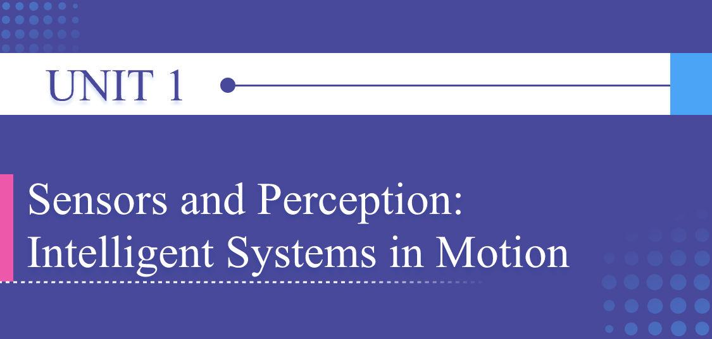

### 学习目标

在英语口语和书面表达中，准确运用与传感器、信号处理、感知系统和自主决策相关的关键技术词汇。

从关于智能感知系统、精密仪器和自主机器的多模态材料中提取、概括和比较信息。

分析自主系统中的工程取舍，包括精度、速度、安全、可靠性、成本和人工监督。

制作一份可视化的「感知-控制」工作流程图并撰写简短设计说明，做到结构清晰、技术语言得当。

### 单元挑战

自主系统正在成为日常工程的一部分：驾驶辅助系统探测行人，巡检机器人扫描工业设备，农业无人机监测作物长势，智能仪器测量人眼无法直接看到的信号。这些系统并不是简单地自己在「思考」：它们感知世界、处理数据、做出有限的决策，并在真实约束下行动。

你的任务：以小组为单位，选择一个与中国工程发展相关的智能感知或自主系统，例如移动机器人、自动驾驶车辆、智能巡检装置、精密测量仪器或农业无人机。制作一份可视化的「感知-控制」工作流程图并撰写简短设计说明。最终成果应包括：（1）系统感知什么；（2）它如何处理信息；（3）它支持什么决策或动作；（4）人工监督或安全检查出现在哪里；（5）要让系统安全、可靠、有用，必须管理好哪一对取舍。

### 学习旅程

---

## 第1单元 · A. 感知世界，自主决策

英文对照：[[EN-U01-2 A. Sensing the World, Deciding Alone|Unit 1 · A. Sensing the World, Deciding Alone]]

### 视频探索

想想你身边的设备：手机、智能手表、笔记本电脑摄像头、电梯，或者校园里的配送机器人。它们中的许多都在悄悄地采集环境信号。请思考三个问题：（1）设备在做出响应之前需要感知什么？（2）哪一步更难：采集数据、解读数据，还是决定下一步做什么？（3）如果传感器在实验室里很准，实际使用中却不可靠，可能会出什么问题？

你知道吗？你身边的许多设备一直在「感知」世界。从会自动旋转屏幕的手机，到会提醒你前方有障碍的汽车，传感器都在默默收集信息，帮助机器对环境作出反应。请观看这段关于传感器工作原理的短视频，并准备好回答问题。

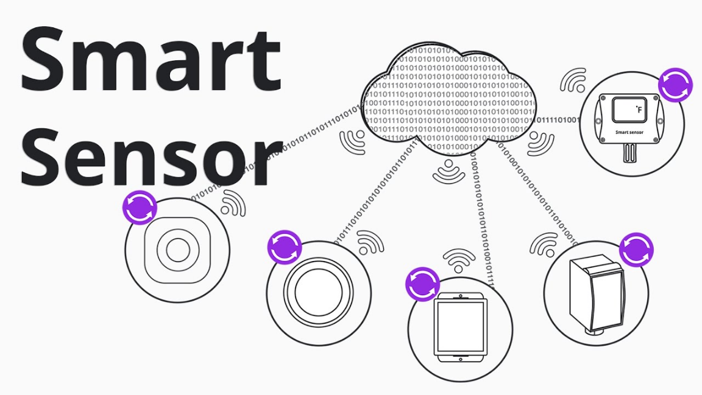

> [!note] 视频：智能传感器详解｜类型与应用
> [在平台中打开视频](https://reader-v2.tdtianwen.com/ed-svc2/fp/book-file/01a07ed5-183a-7988-9937-71969beb4158.mp4?t=oss_download&pack_id=01a0b332-5e0c-7783-8f78-485f17f3f2a0&platform=td)
> ![[U01-视频-智能传感器详解.mp4]]

> [!note] 互动练习：视频理解检查
> [在平台中完成此题](https://reader-v2.tdtianwen.com/lg-viewer-v2/reader/standard?platform=td&pack_id=01a0b332-5e0c-7783-8f78-485f17f3f2a0&bookid=01a013c4-e4f0-750f-be8a-7de89b6353d1&section_id=01a013f0-aa53-7c53-a21b-0f6a8ec0d129)

### 工程阅读

阅读课文，理解传感器与智能处理如何让自主机器人在复杂环境中感知、决策和行动。

### 传感器与智能：自主机器人的基础

想象这样一个世界：机器与人并肩工作——在繁忙的仓库里搬运货物、把包裹送到你家门口，或者在你入睡时安静地打扫房间。这不是科幻，而是自主机器人的现实：它们无需人工干预就能在环境中行动。但是，是什么让这些机器人能够自己「看」、「想」、「做决定」？答案在于传感器与处理器的强大组合——它们是机器人的眼睛、耳朵和大脑。

#### 什么才是真正的机器人自主

自主机器人远不止是遥控机器。真正的自主，要求机器人独立执行一系列复杂任务：首先，它必须感知并理解自己在已建地图环境中的位置——这个过程叫定位；接着，它要动态检测障碍物，既包括货架之类的静止物体，也包括行人或其他机器人等移动目标；然后，机器人必须跟踪这些障碍物，规划抵达目的地的最优路线，并精确控制动作以按计划行进。

然而，自主不止于导航。现代机器人必须能够安全地在与人共享的环境中工作，保障人员、财产以及自身的安全。随着机器人从封闭的车间走进与人并肩工作的场所，这一要求变得尤为关键。要达到这样的可靠性，机器人必须满足严格的功能安全标准，因此选择合适的传感器和处理器就成了头等大事。

#### 机器人的眼睛：视觉传感器

视觉传感器也许是最直观的传感技术，因为它模仿人类的视觉。配备视觉系统的机器人可以像人一样识别物体、在空间中导航。视觉传感器有几个鲜明优势：其一，它提供高分辨率的空间覆盖，生成机器人周边的细致图像；更重要的是，视觉传感器不仅能发现物体的存在，还能判断它是什么——区分纸箱、叉车还是人类作业员。

视觉系统擅长解决定位、避障与防碰撞这类挑战。与激光雷达等其他传感技术相比，视觉传感器也更具成本效益，对商业应用很有吸引力。不过这项技术有一个重大挑战：计算量大。处理视觉数据需要大量算力，而传统的中央处理器（CPU）或图形处理器（GPU）会消耗惊人的能量——对电池供电的移动机器人来说，这是关键问题。

解决之道在于为视觉应用专门设计的处理器。现代片上系统（SoC）架构能够以极低功耗高速处理视觉信息。这类处理器集成多种专用部件：计算机视觉单元、面向人工智能的深度学习加速器、用于深度感知的立体视觉处理器，以及视频分析引擎——它们在一个兼顾性能与能效的异构架构中协同工作。

#### 超越视觉：毫米波雷达感知

在机器人感知的讨论中，视觉传感器风头正劲，而另一项从汽车行业借鉴来的技术正在革新机器人感知：毫米波（mmWave）雷达。毫米波雷达最初是为汽车高级驾驶辅助系统（ADAS）研发的，如今正在机器人领域找到创新应用。

雷达感知带来与视觉系统互补的独特能力。与摄像头不同，雷达传感器可以直接同时测量三项关键信息：目标的距离、速度和到达角（方向）。这种多维数据让机器人对周边环境获得极其细致的了解。

丰富的数据支撑起复杂的决策。机器人可以计算行人的轨迹是否会与自己的路径相交，预测相交何时发生，并决定恰当的回应：安全通过、减速，或完全停下。在共享空间中实现安全的人机协作，这种预测能力不可或缺。

此外，毫米波雷达在恶劣环境中具有实用优势。与视觉传感器不同，雷达性能不受光照影响——无论烈日当空、伸手不见五指，还是粉尘弥漫的工业现场。雷达信号还能穿透某些材料，探测到摄像头视野中被部分遮挡的物体。

#### 传感器融合与边缘 AI 的力量

随着自主机器人承担的任务日益复杂，工程师们发现，依赖单一类型的传感器存在根本性局限——每种感知技术都有长短。传感器融合就是解决之道：它汇集多种类型传感器的数据，形成对环境更完整、更可靠的感知。采用传感器融合的机器人，可能用摄像头识别物体、读取标识，用雷达测量精确的距离与速度，再用其他传感器补齐剩余盲区。通过处理并整合这些多样化的数据，机器人获得对环境更稳健的理解——正如人类综合多种感官的信息来认识世界。

更进一步，边缘人工智能（AI）——即直接在机器人上而非远端云服务器中进行的 AI 处理——把机器人从被动反应的机器变成智能体。边缘 AI 让机器人不仅检测物体，还能理解情境并做出明智决策。例如在繁忙的仓库中穿行时，具备 AI 能力的机器人能区分静止的托盘、缓慢移动的叉车和快速走动的人，并针对不同情形恰当地调整行为。

实现边缘 AI 需要精心的软硬件设计。处理器必须内置专用硬件加速器，能够实时执行计算密集的 AI 算法而不过度耗电。同样重要的是，开发者需要易用的软件工具，简化训练 AI 模型并部署到机器人硬件的过程，缩短从概念到可用系统的时间。

#### 前路展望

随着传感技术走向成熟、AI 能力不断扩展，我们有理由期待自主机器人变得更能干、更廉价、更普及。先进感知、智能处理与复杂算法的融合，正在造就真正能感知、能决策、能行动的机器——让我们离这样的未来更近一步：机器人成为工业与日常生活中可靠的伙伴，提升人类的生产力与生活质量。

（全文约 993 词）

### 理解信息

> [!note] 互动练习：任务 1：用 1–3 个英文单词填空。
> [在平台中完成此题](https://reader-v2.tdtianwen.com/lg-viewer-v2/reader/standard?platform=td&pack_id=01a0b332-5e0c-7783-8f78-485f17f3f2a0&bookid=01a013c4-e4f0-750f-be8a-7de89b6353d1&section_id=01a013f0-aa53-7c53-a21b-0f6a8ec0d129)

> [!note] 互动练习：任务 2：就课文细节为下列问题选择最佳答案。
> [在平台中完成此题](https://reader-v2.tdtianwen.com/lg-viewer-v2/reader/standard?platform=td&pack_id=01a0b332-5e0c-7783-8f78-485f17f3f2a0&bookid=01a013c4-e4f0-750f-be8a-7de89b6353d1&section_id=01a013f0-aa53-7c53-a21b-0f6a8ec0d129)

### 像工程师一样思考

阅读下面两则简短报道，同时思考技术可靠性与公众信任。

报告一

京东在中国运营大型自动化仓储系统，移动机器人在履约中心内搬运货物。这些机器人常以视觉传感器结合地面标记或其他定位辅助手段进行导航。这一方案在受控的仓库中可以很高效，但它依赖稳定的照明、洁净的地面、可靠的标记、受训的人员和精确的系统协调。

报告二

美团已在城市社区和校园中测试并部署自动配送机器人。这些机器人必须应对人行道、斑马线、行人、坡道、雨夜、停放的自行车和不断变化的光照条件。为提高可靠性，它们可能综合使用摄像头、激光雷达、超声波传感器、GPS 或地图信息，以及边缘 AI 处理。

从上述报道中任选一个机器人系统，探索下面一个或多个问题的答案。

（1）感知与安全：机器人需要检测什么？哪些条件可能让它的传感器变得不可靠？如果机器人获得了错误信息，会发生什么？

（2）工程方案：工程师可以做些什么，让机器人更安全、更可靠？请从传感器、软件、维护或工作环境等方面思考。

（3）环境与用户：设计机器人时，工程师必须考虑哪些人、物体或环境条件？如果机器人换到别的环境工作，需要做什么改变？

> [!note] 延伸阅读：参考答案
> [在平台中查看](https://reader-v2.tdtianwen.com/lg-viewer-v2/reader/standard?platform=td&pack_id=01a0b332-5e0c-7783-8f78-485f17f3f2a0&bookid=01a013c4-e4f0-750f-be8a-7de89b6353d1&section_id=01a013f0-aa53-7c53-a21b-0f6a8ec0d129)

### 工程对话

### 传感器实验报告的困惑

> [!note] 音频：同伴的实验经历
> [在平台中打开音频](https://reader-v2.tdtianwen.com/ed-svc2/fp/book-file/019fc5b7-2ac9-734c-83fa-0d258e71b740.mp3?t=oss_download&pack_id=01a0b332-5e0c-7783-8f78-485f17f3f2a0&platform=td)
> ![[U01-音频1-同伴的实验经历.mp3]]

> [!note] 互动练习：任务 1：理解检查
> [在平台中完成此题](https://reader-v2.tdtianwen.com/lg-viewer-v2/reader/standard?platform=td&pack_id=01a0b332-5e0c-7783-8f78-485f17f3f2a0&bookid=01a013c4-e4f0-750f-be8a-7de89b6353d1&section_id=01a013f0-aa53-7c53-a21b-0f6a8ec0d129)

> [!note] 互动练习：任务 2：词汇拓展
> [在平台中完成此题](https://reader-v2.tdtianwen.com/lg-viewer-v2/reader/standard?platform=td&pack_id=01a0b332-5e0c-7783-8f78-485f17f3f2a0&bookid=01a013c4-e4f0-750f-be8a-7de89b6353d1&section_id=01a013f0-aa53-7c53-a21b-0f6a8ec0d129)

> [!note] 互动练习：任务 3：谈谈你的实验经历
> [在平台中完成此题](https://reader-v2.tdtianwen.com/lg-viewer-v2/reader/standard?platform=td&pack_id=01a0b332-5e0c-7783-8f78-485f17f3f2a0&bookid=01a013c4-e4f0-750f-be8a-7de89b6353d1&section_id=01a013f0-aa53-7c53-a21b-0f6a8ec0d129)

### 生词与表达

| 英文 | 词性 | 释义 |
| --- | --- | --- |
| autonomous | adj. | 无需外部控制即可独立运行的；自主的 |
| intervention | n. | 介入某一局面以影响事态的行为；干预、介入 |
| localization | n. | 在已建地图环境中确定自身位置的过程；定位 |
| paramount | adj. | 高于一切的；至关重要的、首要的 |
| obstacle detection | n. | 识别可能阻挡路径的物体的过程；障碍物检测 |
| collision avoidance | n. | 避免与物体或人发生碰撞的能力；避碰、防撞 |
| lidar | n. | 激光雷达，利用激光测量距离的传感技术 |
| heterogeneous architecture | n. | 组合不同类型处理器以优化性能的计算机系统；异构架构 |
| millimeter-wave radar | n. | 利用高频无线电波探测目标并测量其特性的传感技术；毫米波雷达 |
| complement | v. | 对某物加以补充，使其更好或更完整；补充、使完整 |
| sophisticated | adj. | 高度发展且复杂的；复杂精密的、先进的 |
| trajectory | n. | 运动物体在空间中行进的路径；轨迹 |
| penetrate | v. | 进入或穿过某物；穿透、渗透 |
| sensor fusion | n. | 融合多种传感器数据以形成更完整认知的过程；传感器融合 |
| edge AI | n. | 在设备本机而非云端进行的人工智能处理；边缘人工智能 |
| navigate | v. | 规划并指引船舶、飞机、车辆等的航向；导航 |
| execute | v. | 做一项工作、履行职责、实施计划等；实行、执行 |
| accessible | adj. | 易于理解的；易懂的 |
| commonplace | adj. | 经常发生或随处可见、毫不稀奇的；普遍的 |

### 平台交互内容

本章还有 6 道互动练习、1 处延伸阅读、1 段音频、1 段视频。音频与视频已下载到本地并内嵌在正文，可离线播放；互动练习需登录平台作答：[在平台中打开本章](https://reader-v2.tdtianwen.com/lg-viewer-v2/reader/standard?platform=td&pack_id=01a0b332-5e0c-7783-8f78-485f17f3f2a0&bookid=01a013c4-e4f0-750f-be8a-7de89b6353d1&section_id=01a013f0-aa53-7c53-a21b-0f6a8ec0d129)

---

## 第1单元 · B. 人造皮肤：赋予机器人触觉

英文对照：[[EN-U01-3 B. Artificial Skin - Giving Robots a Sense of Touch|Unit 1 · B. Artificial Skin: Giving Robots a Sense of Touch]]

### 图像探索

观察图片并回答问题。

（1）夹爪要不压坏、不掉落水果，需要哪些信息？（2）图中展示的哪些条件可能让触觉信号变得不可靠？

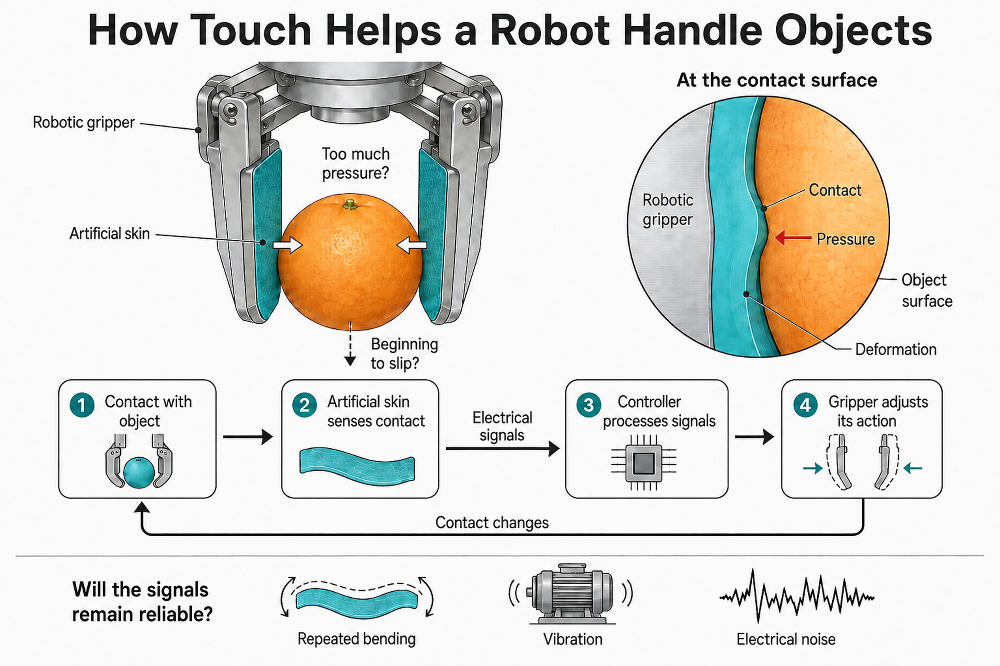

### 工程阅读

阅读课文，理解人造皮肤如何帮助智能机器人感知接触、安全地处理物体，并在真实工程任务中做出更好的决策。

### 从触觉到行动：人造皮肤如何帮助机器人

机器人正在成为智能工厂、仓库、实验室、医院和公共服务场所的常见伙伴。它们能搬运货物、检测产品、分拣包裹、协助完成重复性工作，并处理需要速度或精度的物体。然而，许多机器人仍有一个基本弱点：它们能看、能量、能移动，却往往不能「摸」。没有触觉，机器人可能抓漏一个小物件、把易碎品捏得太紧，或者察觉不到夹爪正在打滑。在共享工作空间里，这不是小小的不便——它决定了任务能否安全完成、产品是否受损、人们能否信任这套系统。

来自华中科技大学与中国科学院沈阳自动化研究所的中国研究团队，报道了一种用于机器人触觉传感的仿生离子电子皮肤。这项研究与「让智能机器人在复杂物理环境中工作」这一更大目标紧密相连。团队没有把触觉当作简单的附加功能，而是设计了一层感知层，让机器人夹爪能够检测接触、压力和物体特性。这种触觉感知能力可以帮助机器人从简单的机械动作走向更安全、更具适应性的交互。

「仿生」这个词在这里很关键。人的皮肤不仅覆盖身体，也在收集信息。我们端起玻璃杯、触摸柔软的水果、感到工具在手中滑动时，皮肤会发送信号，帮助大脑调整力道和动作。工程师希望机器人拥有类似的能力，尽管实现机制完全不同。机器人皮肤不会像人一样感到疼痛或质地，它把物理接触转换成可测量的信号，交由软件解读。这样，触觉就成为机器人感知系统的一部分，与视觉、力传感器、接近传感器和控制算法协同工作。

团队采用了离子电子（iontronic）感知设计。简单来说，当压力或形变发生时，离子电子传感器利用离子的移动或分布产生电学变化。人造皮肤被按压时，接触会改变感知层的电学响应。这些信号可以被测量，并转换为关于力或触摸的信息。这种方案很适合机器人：它可以做得柔韧、灵敏，并贴合手指、夹爪或软体机器人部件等弯曲表面。

真实的机器人作业比简单的实验室测试要求苛刻得多。器件可能要面对反复弯折、振动、粉尘、温度变化、表面磨损以及邻近机器的电噪声。在洁净测试台上表现良好的传感器，可能在数千次抓取之后或物体表面变化时失灵。因此，工程师必须关注耐久性和信号稳定性。有用的人造皮肤不应只检测过一次接触，而要在反复接触、形变和使用之后仍能产生清晰、可靠的信号。

该设计还应对了不确定性条件下的触摸问题。在实际应用中，机器人必须把有用的接触信息与背景噪声区分开。如果每一丝振动或意外碰触都呈现为一个大信号，机器人就无法判断夹爪是在托着柔软的包裹、碰到硬工具，还是开始打滑。离子电子皮肤既能检测触觉变化，又能在柔性机器人表面上保持功能，这让机器人在操作过程中更有把握地判断接触力和物体特征。

为了演示系统效果，研究人员把人造皮肤集成到机器人夹爪上。夹爪可以与物体交互，并在接触过程中采集触觉数据。这一点至关重要，因为人造皮肤的真正价值不只在材料本身，更在完整的「感知-行动」闭环：机器人必须接触物体、采集信号、处理数据、调整动作、避免损伤。因此，一只好用的机器人夹爪必须把机械设计、柔性材料、保护性封装、信号处理和控制决策结合起来。

这项研究还展示了触觉感知如何与智能数据分析协作。触觉信号往往复杂多变：力、形状、接触面积、速度、表面纹理和物体刚度都会让信号改变。机器学习可以帮助识别这些信号中的模式。例如，系统可以学会区分不同物体、检测打滑、估计夹爪的按压力度。这并不意味着机器人会魔法般地一夜之间完全自主，而是意味着材料感知与数据驱动的解读可以协同工作，为机器人提供更可靠的反馈。

对智能制造和服务机器人来说，这种触觉传感有许多可能的用途。机器人可以更小心地处理易碎产品，分拣柔软或形状不规则的物体，装配精密电子零件，协助实验室自动化，或支持医疗与康复设备。在工业作业中，触觉反馈可以减少产品损坏、提升检修质量、让人机协作更安全。在所有这些场景中，触觉支撑着负责任的行动：机器人不只是够到物体，而是充分理解接触状况，做到有控制地行动。

与此同时，人造皮肤也带来工程责任。传感器必须在反复弯曲和接触之后保持可靠；其信号必须免受噪声、材料疲劳、温度变化和信号漂移的干扰。操作者需要清晰的反馈，触觉数据才能在任务过程中指导决策。工程师还必须考虑成本、维修、校准和可迁移性：一套适用于实验室夹爪的设计，要用于仓储机器人、医院助理机器人、救援机器人或商业检测系统之前，可能需要修改。

对智能系统方向的学生来说，这个案例说明，感知并不限于摄像头和雷达——机器人还需要与世界的物理交互。在真实环境中工作的机器人，必须感知重要的信息、处理不确定的数据、调整自己的行动，并支撑人类的信任。因此，电子皮肤远不只是一种软传感器，它是连接材料科学、机械设计、机器人学、信号处理和人工智能的桥梁。它提醒未来的工程师：智能机器不仅需要更锐利的眼睛和更快的处理器，还需要更安全、更灵敏地触摸世界的方式。

（全文约 1008 词）

### 理解信息

> [!note] 互动练习：任务 1：根据课文为每个问题选择最佳答案。
> [在平台中完成此题](https://reader-v2.tdtianwen.com/lg-viewer-v2/reader/standard?platform=td&pack_id=01a0b332-5e0c-7783-8f78-485f17f3f2a0&bookid=01a013c4-e4f0-750f-be8a-7de89b6353d1&section_id=01a013f1-a6fe-764e-9733-923895473a5b)

> [!note] 互动练习：任务 2：判断下列各句正误（T/F）。
> [在平台中完成此题](https://reader-v2.tdtianwen.com/lg-viewer-v2/reader/standard?platform=td&pack_id=01a0b332-5e0c-7783-8f78-485f17f3f2a0&bookid=01a013c4-e4f0-750f-be8a-7de89b6353d1&section_id=01a013f1-a6fe-764e-9733-923895473a5b)

> [!note] 互动练习：任务 3：技术词汇——把课文中的术语或表达与其正确释义连线。
> [在平台中完成此题](https://reader-v2.tdtianwen.com/lg-viewer-v2/reader/standard?platform=td&pack_id=01a0b332-5e0c-7783-8f78-485f17f3f2a0&bookid=01a013c4-e4f0-750f-be8a-7de89b6353d1&section_id=01a013f1-a6fe-764e-9733-923895473a5b)

### 工程决策

听一段对话：一个工程团队必须在预算约束下做出艰难的设计决策。

> [!note] 音频：水下机器人的传感器选择
> [在平台中打开音频](https://reader-v2.tdtianwen.com/ed-svc2/fp/book-file/019fc648-59d5-72b0-a2e0-43ba9cf632a1.mp3?t=oss_download&pack_id=01a0b332-5e0c-7783-8f78-485f17f3f2a0&platform=td)
> ![[U01-音频2-水下机器人的传感器选择.mp3]]

> [!note] 互动练习：任务 1：理解检查
> [在平台中完成此题](https://reader-v2.tdtianwen.com/lg-viewer-v2/reader/standard?platform=td&pack_id=01a0b332-5e0c-7783-8f78-485f17f3f2a0&bookid=01a013c4-e4f0-750f-be8a-7de89b6353d1&section_id=01a013f1-a6fe-764e-9733-923895473a5b)

> [!note] 互动练习：任务 2：在类似情境中做出你的决策
> [在平台中完成此题](https://reader-v2.tdtianwen.com/lg-viewer-v2/reader/standard?platform=td&pack_id=01a0b332-5e0c-7783-8f78-485f17f3f2a0&bookid=01a013c4-e4f0-750f-be8a-7de89b6353d1&section_id=01a013f1-a6fe-764e-9733-923895473a5b)

### 交流与反思

### 打造你的单元挑战成果

回到单元挑战，开始起草你们小组的可视化「感知-控制」工作流程图和设计说明。

（1）工作流程图应展示：系统感知什么；使用了哪些传感器或感知方式；数据如何被处理或融合；系统支持什么决策或动作；安全检查、人工监督或不确定性出现在哪里。

（2）简短的设计说明应阐述一个工程挑战，以及你们的设计如何应对它。

（3）你们的作品至少要使用本单元的 3 个术语或表达。

> [!note] 延伸阅读：示例参考答案
> [在平台中查看](https://reader-v2.tdtianwen.com/lg-viewer-v2/reader/standard?platform=td&pack_id=01a0b332-5e0c-7783-8f78-485f17f3f2a0&bookid=01a013c4-e4f0-750f-be8a-7de89b6353d1&section_id=01a013f1-a6fe-764e-9733-923895473a5b)

### 学习档案反思

> [!note] 互动页面：学习档案反思
> [打开互动页面](https://zhihuiware.com/api/webapp/embed/8727b8e4-287a-4289-be46-26cf70e346a7)

### 生词与表达

| 英文 | 词性 | 释义 |
| --- | --- | --- |
| warehouse | n. | 储存货物的建筑物；仓库 |
| precision | n. | 相同条件下重复测量结果的一致程度；精度、准确度 |
| gripper | n. | 用来夹持、抓取或操控物体的机器人部件；机械夹爪 |
| bioinspired | adj. | 通过学习生物系统而设计的；仿生的 |
| iontronic | adj. | 利用离子产生、控制或测量电信号的；离子电子的 |
| tactile | adj. | 与触觉有关的；触觉的 |
| add-on | n. | 添加到其他事物上的东西；附加物 |
| mechanism | n. | 传感器、代谢通路或反应的工作原理；机制、原理 |
| texture | n. | 表面触摸起来的感觉；质地、手感 |
| proximity sensor | n. | 无需物理接触即可探测附近物体的传感器；接近传感器 |
| deformation | n. | 由力或压力引起的形状改变；变形 |
| manipulation | n. | 有意识地控制、调节或操作物质、传感器或实验参数；调控、操控 |
| delicate | adj. | 易损坏或敏感、需要小心处理的；精密的、易碎的 |
| rehabilitation | n. | 使受损设备、传感器、生物组织或系统恢复原有功能的过程；修复、康复 |

### 平台交互内容

本章还有 5 道互动练习、1 处延伸阅读、1 段音频、1 个交互页面。音频与视频已下载到本地并内嵌在正文，可离线播放；互动练习需登录平台作答：[在平台中打开本章](https://reader-v2.tdtianwen.com/lg-viewer-v2/reader/standard?platform=td&pack_id=01a0b332-5e0c-7783-8f78-485f17f3f2a0&bookid=01a013c4-e4f0-750f-be8a-7de89b6353d1&section_id=01a013f1-a6fe-764e-9733-923895473a5b)

---

## 第2单元 · 单元预览

英文对照：[[EN-U02-1 Unit Preview|Unit 2 · Unit Preview]]

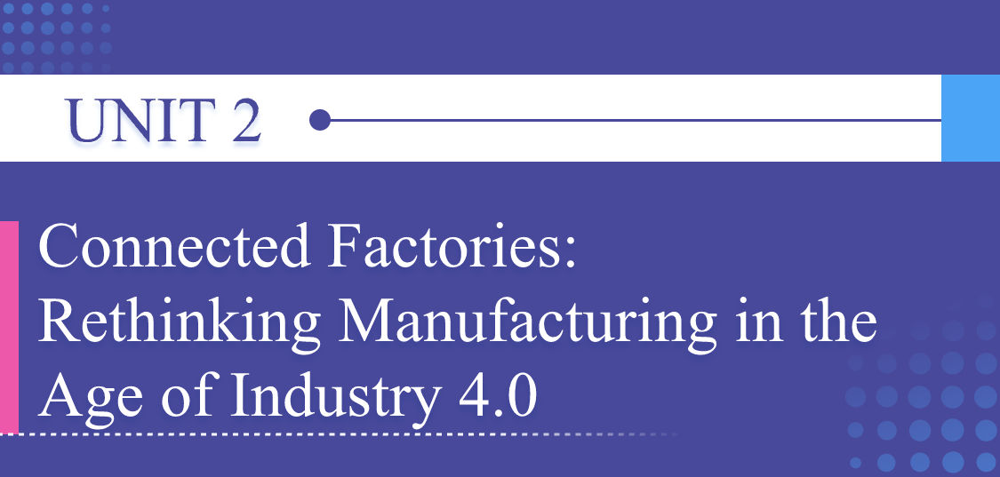

### 学习目标

在英语口语和书面表达中，准确运用与智能工厂、工业 4.0 和工业物联网（IIoT）相关的关键技术词汇。

理解来自视频、录音、技术阅读和信息图等关于智能制造的多模态材料中的信息。

分析数据、连接和自动化如何重塑生产系统，包括灵活性与复杂性、效率与安全、自动化与人工监督之间的取舍。

制定一份简单的可视化方案来改进一项熟悉的校园服务，并说明如何检验其成效。

### 单元挑战

智能系统可以改进我们熟悉的校园服务。一次有用的升级，始于一个清晰的问题，使用一个可管理的数据源，让人始终参与其中，并能衡量结果。

你的任务：以小组为单位，选择一个熟悉的校园问题：快递站的长队、食堂的久等，或者图书馆里说不清的座位情况。制作一份由四个方框组成的「智慧校园方案图」，展示问题、系统使用的信息、智能动作和人工核验。

### 学习旅程

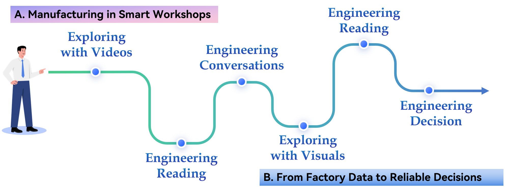

---

## 第2单元 · A. 智能车间中的制造

英文对照：[[EN-U02-2 A. Manufacturing in Smart Workshops|Unit 2 · A. Manufacturing in Smart Workshops]]

### 视频探索

想象你经营一家生产定制产品的小工厂，比如刻字设备，或者不同尺寸和颜色的自行车车架。

讨论两个问题：（1）哪个问题最难管理：频繁换型、订单跟踪，还是质量控制？为什么？（2）要管理好这个问题，你会最先收集什么数据？

在智能制造中，机器人、传感器和数字控制系统正协同应对这一类问题。观看这段关于大规模定制的短视频，看看生产线如何做到「每一件产品都不一样」。

> [!note] 视频：机器人实现大规模定制
> [在平台中打开视频](https://reader-v2.tdtianwen.com/ed-svc2/fp/book-file/01a02883-9d39-7447-8565-bccb752003c4.mp4?t=oss_download&pack_id=01a0b332-5e0c-7783-8f78-485f17f3f2a0&platform=td)
> ![[U02-视频-机器人实现大规模定制.mp4]]

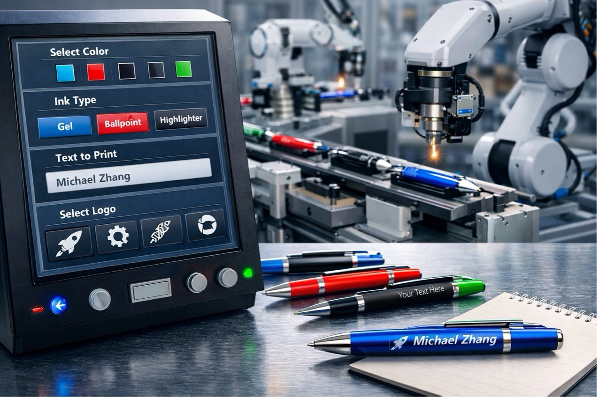

> [!note] 互动练习：视频理解检查
> [在平台中完成此题](https://reader-v2.tdtianwen.com/lg-viewer-v2/reader/standard?platform=td&pack_id=01a0b332-5e0c-7783-8f78-485f17f3f2a0&bookid=01a013c4-e4f0-750f-be8a-7de89b6353d1&section_id=01a013f2-f63a-7519-9bfe-c465d4e230a4)

### 工程阅读

阅读课文，理解智能制造系统的现状与未来前景。

### 当生产成为「软件问题」

传统生产线像一条高速公路：快速、稳定，为一个固定终点而优化。零件按固定顺序到达，机器重复同样的动作，质检按同一规格逐件检查。这适合备货型生产——产品提前造好、入库，等顾客购买。但当顾客要的是多样性——定制颜色、可选模块或个性化刻字——这条高速公路就会堵车。

另一种选择是机器人产线：由机器人、传送带和软件连接起来的可重构生产单元，专为快速切换任务而设计。机器人成为网络节点，接收订单、读取产品标识、取用工具、汇报状态。按单生产的工厂依赖机器、数据与决策三者的协同。把信息视为生产的一部分，而不只是机械层面的事情，决定了接下来的一切。

#### 从订单到指令：数字主线

在按单制造中，一张订单就是一组参数：尺寸、颜色、固件版本、包装规则和检验标准。为了让它们保持一致，工厂构建数字主线——把设计、计划、生产和质量记录连在一起的数据链。系统随后生成生产配方，指明部件、程序和公差。二维码、RFID 标签或序列号让每件产品在流经产线时都拥有数据身份。

没有数字主线，多品种生产就有风险：机器人可能装错零件，操作工可能照着过期的指令干，测试工位可能套用了错误的判定标准。有了互联互通的记录，产线可以显示正确的指令、加载经批准的机器人程序，并把结果写入可追溯的数据库。日后发现缺陷，就能追溯到具体批次、刀具、班次、元件批号或软件版本——前提是标识与记录完整、准确。

#### 灵活是有代价的：换型、排产与瓶颈

灵活从来不是免费的。第一笔成本是换型时间：从一种产品变体切换到另一种。传统产线靠大批量生产来回避换型；机器人产线则用模块化工装、快换夹爪和参数化机器人程序来缩短换型。目标是让换型更像「调参数」，而不是「重装硬件」。

第二笔成本是排产复杂性。备货型计划可以长期保持稳定，而按单计划会因为客户改单、来料迟到或插单而随时变化。实时排产根据设备可用性、在制品数量和交付期限更新计划——就像机场在情况变化时把航班（订单）重新分配到廊桥（设备）。但排产软件的可靠性超不过其数据的可靠性：一台停机的机器如果上报「运行中」，就会污染整个计划；噪声偏大的传感器会触发误报。数据质量是生产质量的一部分。

#### 机器人产线的耳目：边缘侧的 IIoT 感知

柔性产线必须知道自己正在做什么，工业物联网（IIoT）提供了这种感知能力。传感器测量振动、温度、电流、扭矩、压力和图像。高频数据通常在边缘侧、靠近机器的地方处理，因为把每一个原始信号都送上云端会增加延迟、带宽占用和成本。边缘设备可以过滤和压缩数据、检测异常振动、执行基于视觉的安全区域管控，或确认螺钉是否拧对。安全功能仍然需要与其风险等级相称的架构和验证。

同样的数据还可以支撑 OEE（设备综合效率），它综合了可用性、性能与质量三个要素。在按单生产的产线上，改进不只取决于速度：减少瓶颈工序的波动、缩短换型时间、提升一次合格率、重新设计以便装配——这些带来的收益可能更大。OEE 是一种诊断性指标，并不能完整描述客户价值、安全、员工劳动条件或能耗表现。

#### 数字孪生：先「试改」工厂，再真改工厂

随着产品多样性增加，在运行中的产线上做试验可能造成延误、报废甚至安全风险。数字孪生——连接了运行数据的机器、生产单元或车间的虚拟模型——把一部分试验搬进仿真。在改动实体系统之前，工程师可以测试新品种，估计节拍时间或队列长度可能在哪里变长；如果某个工位过载，可以比较重新分配工作量、更改缓冲区、重新设计任务或增配设备等方案。孪生模型必须适合其用途，并对照现实加以验证；不准确的模型会造成虚假的信心。

#### 人的角色不会消失——而是改变

智能工厂重新分配人的工作，而不是取消它。操作工花在重复动作上的时间更少，花在监督、排障和改进流程上的时间更多；工程师花在追查纸质记录上的时间更少，花在建可靠数据管道、解读仪表盘上的时间更多。

联网扩大了网络安全的攻击面；复杂自动化可能以意想不到的方式失效；对系统建议言听计从的操作工，可能丧失对现场态势的感知。设计良好的系统会通过清晰的报警、易读的指示、明确的权限、培训和安全的手动接管，把人留在回路里。人工监督不是自动化不行的借口，而是有意识的风险控制的一部分。

按单生产推动工厂走向柔性、互联和数据驱动。机器人产线提供了硬件，但更深层的变化是软件化的思维——一个数据、决策与物理行动始终保持关联的工厂。制造业仍然离不开钢铁与电机，但越来越取决于在它们之间流动的信息的质量。

（全文约 849 词）

### 理解信息

> [!note] 互动练习：任务 1：用 1–3 个英文单词填空。
> [在平台中完成此题](https://reader-v2.tdtianwen.com/lg-viewer-v2/reader/standard?platform=td&pack_id=01a0b332-5e0c-7783-8f78-485f17f3f2a0&bookid=01a013c4-e4f0-750f-be8a-7de89b6353d1&section_id=01a013f2-f63a-7519-9bfe-c465d4e230a4)

> [!note] 互动练习：任务 2：就课文细节为下列问题选择最佳答案。
> [在平台中完成此题](https://reader-v2.tdtianwen.com/lg-viewer-v2/reader/standard?platform=td&pack_id=01a0b332-5e0c-7783-8f78-485f17f3f2a0&bookid=01a013c4-e4f0-750f-be8a-7de89b6353d1&section_id=01a013f2-f63a-7519-9bfe-c465d4e230a4)

### 像工程师一样思考

阅读下面两则与中国相关的智能工厂报道。针对每一则报道，追踪一个信息问题如何演变成生产问题。

报告一

天津一家自行车工厂希望提供 30 种车架尺寸与颜色组合，并承诺两天交付。按单生产服务上线后，工厂只有 60% 的订单达成交付目标。工程师发现：喷涂工位换型很慢，频繁换色造成返工，工人也不总能及时拿到最新的排产信息。工厂考虑增加自动调漆系统、为喷到一半的车架设一个小缓冲区，并上线一块显示各工序实时队列长度与换型时间的仪表盘。

报告二

深圳一家手机配件工厂用二维码让每张订单携带其产品变体信息。一次软件升级后，不良率上升了：部分产品因刷入错误的固件版本而未通过终检。质量团队怀疑某个工作站在用旧的配方文件，但追溯数据库无法把扫码记录、固件哈希、操作员确认和终检结果清晰地关联起来。工厂考虑在烧录工位增加自动版本校验，并在出货前设置一道人在回路的确认环节。

两人一组讨论。假设你是其中一家工厂的老板，选择其中一家，讨论下面三个问题。

（1）修复信息流：你如何确保正确的信息在正确的时间到达正确的人手里？

（2）选择第一步：你没有条件一下子做完所有事。你会先做哪项改进？为什么？

（3）准备应对新问题：解决了主要问题之后，可能出现哪些新问题？你会如何应对？

> [!note] 延伸阅读：参考答案
> [在平台中查看](https://reader-v2.tdtianwen.com/lg-viewer-v2/reader/standard?platform=td&pack_id=01a0b332-5e0c-7783-8f78-485f17f3f2a0&bookid=01a013c4-e4f0-750f-be8a-7de89b6353d1&section_id=01a013f2-f63a-7519-9bfe-c465d4e230a4)

### 工程对话

### 智能工厂项目的破局之路

> [!note] 音频：智能工厂项目的破局之路
> [在平台中打开音频](https://reader-v2.tdtianwen.com/ed-svc2/fp/book-file/01a0226c-0918-7949-b942-f7fd9a3e4eb5.mp3?t=oss_download&pack_id=01a0b332-5e0c-7783-8f78-485f17f3f2a0&platform=td)
> ![[U02-音频1-智能工厂项目的破局之路.mp3]]

> [!note] 互动练习：任务 1：理解检查
> [在平台中完成此题](https://reader-v2.tdtianwen.com/lg-viewer-v2/reader/standard?platform=td&pack_id=01a0b332-5e0c-7783-8f78-485f17f3f2a0&bookid=01a013c4-e4f0-750f-be8a-7de89b6353d1&section_id=01a013f2-f63a-7519-9bfe-c465d4e230a4)

> [!note] 互动练习：任务 2：词汇拓展
> [在平台中完成此题](https://reader-v2.tdtianwen.com/lg-viewer-v2/reader/standard?platform=td&pack_id=01a0b332-5e0c-7783-8f78-485f17f3f2a0&bookid=01a013c4-e4f0-750f-be8a-7de89b6353d1&section_id=01a013f2-f63a-7519-9bfe-c465d4e230a4)

> [!note] 互动练习：任务 3：谈谈你的大学生活
> [在平台中完成此题](https://reader-v2.tdtianwen.com/lg-viewer-v2/reader/standard?platform=td&pack_id=01a0b332-5e0c-7783-8f78-485f17f3f2a0&bookid=01a013c4-e4f0-750f-be8a-7de89b6353d1&section_id=01a013f2-f63a-7519-9bfe-c465d4e230a4)

### 生词与表达

| 英文 | 词性 | 释义 |
| --- | --- | --- |
| made-to-stock | adj. | 提前生产、入库待售的；备货生产的 |
| module | n. | 可与其他单元组合或替换的标准化单元；模块、模组 |
| engraving | n. | 在硬质表面上切割或刻印图案的过程；雕刻、蚀刻 |
| robotic line | n. | 连接机器人、传送带与软件的可重构生产线；机器人产线 |
| reconfigurable | adj. | 能够重新组合或适应新任务的；可重配置的 |
| conveyor | n. | 连续输送物料的装置；传送装置、传送带 |
| made-to-order | adj. | 收到具体客户订单后才生产的；按单生产的 |
| firmware | n. | 存储在设备中、控制底层硬件功能的软件；固件 |
| digital thread | n. | 连通设计、计划、生产与质量的数据链；数字主线 |
| traceable | adj. | 能够追查其历史或过程记录的；可追溯的 |
| changeover | n. | 将设备切换到另一产品或任务所需的过程或时间；换型、转换 |
| real-time scheduling | n. | 利用当前设备与订单数据更新生产计划；实时排产 |
| Industrial Internet of Things (IIoT) | n. | 相互连接、交换数据的工业机器与传感器；工业物联网 |
| edge computing | n. | 在靠近机器处处理数据，而非把全部原始数据送上云端；边缘计算 |
| latency | n. | 信号与响应之间的延迟；延迟 |
| digital twin | n. | 与运行数据相连、用于监控或仿真的虚拟模型；数字孪生 |
| simulation | n. | 通过计算机或数学模型检验真实过程；仿真、模拟 |
| troubleshooting | n. | 找出并纠正故障的过程；故障排查 |
| manual override | n. | 允许人员暂停自动功能的控制；手动接管 |
| human oversight | n. | 人对自动化系统的监督与权限；人工监督 |

### 平台交互内容

本章还有 6 道互动练习、1 处延伸阅读、1 段音频、1 段视频。音频与视频已下载到本地并内嵌在正文，可离线播放；互动练习需登录平台作答：[在平台中打开本章](https://reader-v2.tdtianwen.com/lg-viewer-v2/reader/standard?platform=td&pack_id=01a0b332-5e0c-7783-8f78-485f17f3f2a0&bookid=01a013c4-e4f0-750f-be8a-7de89b6353d1&section_id=01a013f2-f63a-7519-9bfe-c465d4e230a4)

---

## 第2单元 · B. 从工厂数据到可靠决策

英文对照：[[EN-U02-3 B. From Factory Data to Reliable Decisions|Unit 2 · B. From Factory Data to Reliable Decisions]]

### 图像探索

观察图片并回答问题。

给下列各项分类：安全性写 S，成本效益写 C，可持续性写 G。

（1）自动报警

（2）停机时间减少

（3）能源优化

（4）事故预防

（5）资源优化

（6）废弃物减少

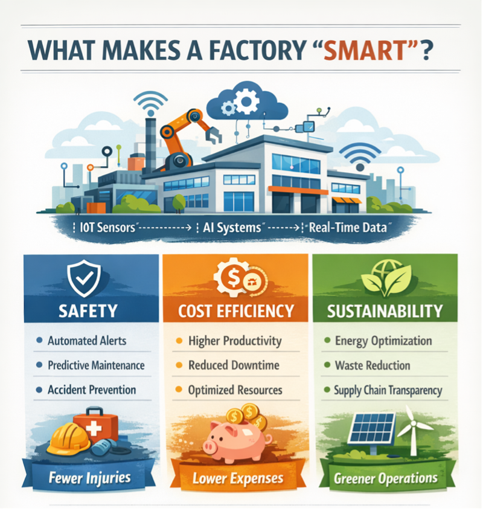

### 工程阅读

阅读下文，理解数据驱动的车间如何运转，以及为什么它难以建成。

### 数据驱动的车间：让机器成为「会说话」的资产

走进传统车间，你会看到皮带在转、叉车在举、工人在工位间穿行。然而最有价值的流动是看不见的——那是信息的流动。在数据驱动的车间里，机器不只是运转；它们通过传感器、日志和网络消息汇报自己在做什么、做得怎么样、接下来可能做什么。

目标是更好、更快的决策，但车间是杂乱的：刀具会磨损，材料有差异，操作工会临场应变，加急订单会打乱计划。数据驱动的制造并不能消除这些波动，它要做的是在还来得及行动的时候去测量、建模并作出响应。

#### 从传感器到洞察：数据管道

当一个车间建立起可靠的数据管道，它才开始数据驱动。管道始于设备层：传感器测量振动、温度、功率、压力和位置；控制器记录循环计数、报警和设定值；视觉系统检查表面、尺寸或标签位置；工业网络和网关负责收集这些信号。由于设备可能使用不同的通信协议，集成互联本身就是一项重大工程任务。

接下来是处理。有些决策必须即时完成，比如检测刀具碰撞、在机器人靠近人时让它停住，或在零件流向下一工位之前剔除废品。这类动作要求低延迟，通常采用边缘计算。另一些决策，比如寻找质量漂移中的长期趋势，可以集中计算或放在云端。计算发生在哪里，应该与决策的时间尺度相匹配。

最后是「洞察层」：仪表盘、报警和模型。仪表盘展示实时状态和关键绩效指标（KPI）；当变量越过阈值时触发报警；模型则更进一步，识别模式、预测结果并建议行动。

#### 预测性维护：坏之前就修好

车间数据最实用的用途之一是预测性维护。它既不是等设备坏了再修（事后维护），也不是按日历定期保养（预防性维护），而是根据状态数据估计故障风险。如果电机轴承的振动加剧，或同样负载下温度升高，模型就可能标记异常。维护团队便可以在计划停机期间安排修理、提前订好备件，避免意外停机。

不过，预测性维护的水平取决于标签和上下文的质量。如果数据集没有清楚记录故障发生的时间和原因，模型可能学到错误的模式；如果运行条件变了——换了新材料、新转速、新刀具或新操作员——模型可能变得不可靠。因此，工程师必须把维护分析当作一个持续演进的过程：清洗数据、定期重训、请领域专家验证。

#### 质量分析：尽早抓住缺陷

数据驱动的车间也在改变质量控制。传统检验往往放在最后，等产品做完再查。智能质量管理把合适的检查项前移——移到上游和生产过程之中。视觉系统可以测量尺寸或表面特征，扭矩传感器可以核紧装配操作，声学信号可以反映刀具磨损。更早发现问题能减少报废与返工——当然，测量系统本身也必须经过验证。

早期检测也会推高数据量，并引出一个问题：哪些信号才是真正重要的？工程师可以从一个假设出发——例如「主轴振动与表面光洁度有关」——再通过实验和特征选择去检验它。有效的模型应当结合工艺的物理机制、有代表性的数据和验证，而不是只靠相关性。

#### 车间数字孪生：当监测遇上仿真

车间数字孪生不止是一个静态的 3D 模型。它把运行数据与模型相连，可用来检验各种「如果……会怎样」：来了加急订单会怎样？某台机器变慢，瓶颈会转移到哪里？批量大小一变，在制品（WIP）会不会急剧增长？把监测与仿真结合起来，孪生模型能帮助计划人员比较各种方案，在不牺牲质量的前提下提高产出。

搭建孪生不只是软件任务。它需要合适的设备模型、可信的数据同步、必要的验证和明确的目的。为能源优化而建的孪生可能聚焦功率与温度；为排产而建的孪生可能聚焦工序时间、队列和资源。想用一个模型回答所有问题，往往造出一个昂贵、难验证、难使用的系统。

#### 隐藏的挑战：数据治理与网络安全

当车间联网之后，新的问题出现了：数据归谁所有？谁有权修改？应该保存多久？如果各团队使用不一致的名称和定义，记录就难以汇总和分析。因此，数据治理——涵盖定义、质量、权限、留存和标准——会成为工程工作的一部分。

网络安全同样至关重要。联网的车间可能包含从未按联网设计的老旧设备。若无防护，攻击者可能窃取配方、扰乱生产，或引发危险动作。良好实践包括网络分段、身份认证、补丁管理和持续监测。换句话说，数据驱动的车间必须同时是有网络安全意识的车间。

#### 数据驱动的思维方式

归根结底，数据驱动的车间既是技术问题，也是心态问题：测量要紧的事，凭证据做决策，设计让系统持续改进的反馈回路。最好的智慧车间从不淹没在数据里，它们把数据提炼成少数可靠信号，帮助人和机器协同工作——更安全、更快速、更聪明。

（全文约 856 词）

### 理解信息

> [!note] 互动练习：任务 1：根据课文为每个问题选择最佳答案。
> [在平台中完成此题](https://reader-v2.tdtianwen.com/lg-viewer-v2/reader/standard?platform=td&pack_id=01a0b332-5e0c-7783-8f78-485f17f3f2a0&bookid=01a013c4-e4f0-750f-be8a-7de89b6353d1&section_id=01a013f3-1d61-7499-9c2a-64bfd00941f1)

> [!note] 互动练习：任务 2：判断下列各句正误（T/F）。
> [在平台中完成此题](https://reader-v2.tdtianwen.com/lg-viewer-v2/reader/standard?platform=td&pack_id=01a0b332-5e0c-7783-8f78-485f17f3f2a0&bookid=01a013c4-e4f0-750f-be8a-7de89b6353d1&section_id=01a013f3-1d61-7499-9c2a-64bfd00941f1)

> [!note] 互动练习：任务 3：把课文中的术语或表达与其正确释义连线。
> [在平台中完成此题](https://reader-v2.tdtianwen.com/lg-viewer-v2/reader/standard?platform=td&pack_id=01a0b332-5e0c-7783-8f78-485f17f3f2a0&bookid=01a013c4-e4f0-750f-be8a-7de89b6353d1&section_id=01a013f3-1d61-7499-9c2a-64bfd00941f1)

### 工程决策

听一段对话，探讨「快速升级」与「让数据、安全和信任保持可靠」之间的张力。

> [!note] 音频：智慧工厂升级中的速度与可靠性
> [在平台中打开音频](https://reader-v2.tdtianwen.com/ed-svc2/fp/book-file/01a0226a-c3d9-7b72-b198-26eafa111231.mp3?t=oss_download&pack_id=01a0b332-5e0c-7783-8f78-485f17f3f2a0&platform=td)
> ![[U02-音频2-智慧工厂升级中的速度与可靠性.mp3]]

> [!note] 互动练习：任务 1：理解检查
> [在平台中完成此题](https://reader-v2.tdtianwen.com/lg-viewer-v2/reader/standard?platform=td&pack_id=01a0b332-5e0c-7783-8f78-485f17f3f2a0&bookid=01a013c4-e4f0-750f-be8a-7de89b6353d1&section_id=01a013f3-1d61-7499-9c2a-64bfd00941f1)

> [!note] 互动练习：任务 2：拯救开放日的创客空间
> [在平台中完成此题](https://reader-v2.tdtianwen.com/lg-viewer-v2/reader/standard?platform=td&pack_id=01a0b332-5e0c-7783-8f78-485f17f3f2a0&bookid=01a013c4-e4f0-750f-be8a-7de89b6353d1&section_id=01a013f3-1d61-7499-9c2a-64bfd00941f1)

### 交流与反思

### 打造你的单元挑战成果

回到单元挑战，制作一页「智慧校园方案图」。从快递站长队、食堂久等或图书馆座位情况不明中选一个问题，使用不超过五个方框，内容包括：

（1）校园问题：用一句话描述问题。

（2）数据来源：展示系统收集什么信息，例如扫码记录、排队计数或座位传感器信号。

（3）智能动作：说明系统为改进服务而采取的一个动作。

（4）人工核验：展示由学生或教职工在哪一步核对信息或纠正系统。

> [!note] 延伸阅读：示例参考答案
> [在平台中查看](https://reader-v2.tdtianwen.com/lg-viewer-v2/reader/standard?platform=td&pack_id=01a0b332-5e0c-7783-8f78-485f17f3f2a0&bookid=01a013c4-e4f0-750f-be8a-7de89b6353d1&section_id=01a013f3-1d61-7499-9c2a-64bfd00941f1)

### 学习档案反思

> [!note] 互动页面：学习档案反思
> [打开互动页面](https://zhihuiware.com/api/webapp/embed/1f849630-18e0-4275-a431-9d54106cf219)

### 生词与表达

| 英文 | 词性 | 释义 |
| --- | --- | --- |
| data-driven | adj. | 用数据做决策或控制过程的；数据驱动的 |
| log | n. | 对事件或活动的正式记录；日志 |
| improvise | v. | 在没有充分预案的情况下利用现有条件临时应对；即兴处理 |
| gateway | n. | 连接不同网络或系统的设备；网关 |
| protocol | n. | 设备之间交换数据的一套规则；协议 |
| latency | n. | 动作与响应之间的时间延迟；延迟 |
| threshold | n. | 触发动作、报警或变化的临界水平；阈值、临界值 |
| anomaly | n. | 不寻常、可能预示问题的现象；异常 |
| downtime | n. | 机器或系统不运转的时间；停机时间 |
| in-process | adj. | 在生产过程中进行，而非仅在末尾；制程中的 |
| hypothesis | n. | 作为解释提出并待检验的想法；假设 |
| WIP | n. | 在制品，已进入生产但尚未完成的物品 |
| throughput | n. | 给定时间内生产或处理的量；产出率 |
| data governance | n. | 管理数据质量与访问权限的规则和职责；数据治理 |

### 平台交互内容

本章还有 5 道互动练习、1 处延伸阅读、1 段音频、1 个交互页面。音频与视频已下载到本地并内嵌在正文，可离线播放；互动练习需登录平台作答：[在平台中打开本章](https://reader-v2.tdtianwen.com/lg-viewer-v2/reader/standard?platform=td&pack_id=01a0b332-5e0c-7783-8f78-485f17f3f2a0&bookid=01a013c4-e4f0-750f-be8a-7de89b6353d1&section_id=01a013f3-1d61-7499-9c2a-64bfd00941f1)

---

## 第3单元 · 单元预览

英文对照：[[EN-U03-1 Unit Preview|Unit 3 · Unit Preview]]

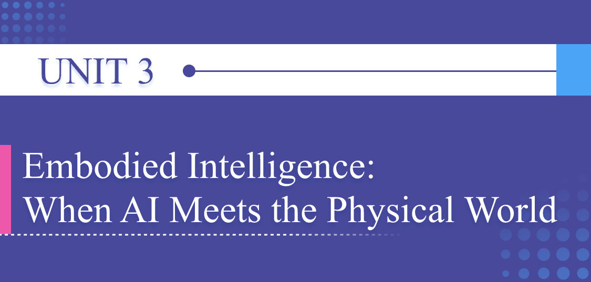

### 学习目标

在英语口语和书面表达中，运用与具身智能、机器人学、人工智能和 AI 硬件相关的关键技术词汇。

练习从多模态材料中理解有关具身智能系统、智能机器人及其支撑计算技术的信息。

分析具身智能中的工程取舍，包括感知精度、算力、能效、安全性、可靠性和人机交互。

准备一份具身智能系统的提案，说明其任务、传感器、AI 能力、硬件组成与安全考量。

### 单元挑战

你们大学获得了一笔资助，用于在校园里部署具身智能机器人。但有一个条件：机器人必须做真实有用的工作，而不是只会作秀。后勤部门有三个岗位空缺：图书馆夜间巡逻、食堂餐盘回收和教学楼窗户清洁。他们现在邀请机器人供应商参加「机器人招聘会」。

你的任务：你们小组代表一家供应商。从人形、四足、轮式加机械臂、固定机械臂四种机器人形态中，选择一个岗位和一种机器人本体，然后准备一段三分钟的竞聘陈述，说服招聘委员会（你们的同学）：你们的机器人是最合适的人选。

### 学习旅程

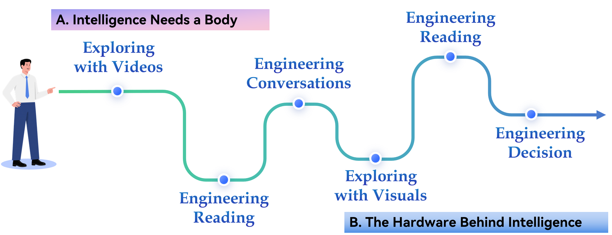

---

## 第3单元 · A. 智能需要身体

英文对照：[[EN-U03-2 A. Intelligence Needs a Body|Unit 3 · A. Intelligence Needs a Body]]

### 视频探索

想想日常生活中的智能机器，例如酒店里的配送机器人和自动驾驶出租车。

想象一个机器人正在你的家里或教室里工作。它需要具备哪些能力，才能与人、与物体安全地互动？

你知道吗？新一代 AI 系统正在走进物理世界。这段视频介绍具身智能——一项把 AI 模型、传感器和机器人本体结合起来，让机器在真实世界中执行复杂任务的技术。

> [!note] 视频：Gemini Robotics 2 为机器人带来全身智能
> [在平台中打开视频](https://reader-v2.tdtianwen.com/ed-svc2/fp/book-file/01a07f73-e749-7e0d-bdc6-75f5c0596554.mp4?t=oss_download&pack_id=01a0b332-5e0c-7783-8f78-485f17f3f2a0&platform=td)
> ![[U03-视频-GeminiRobotics2全身智能.mp4]]

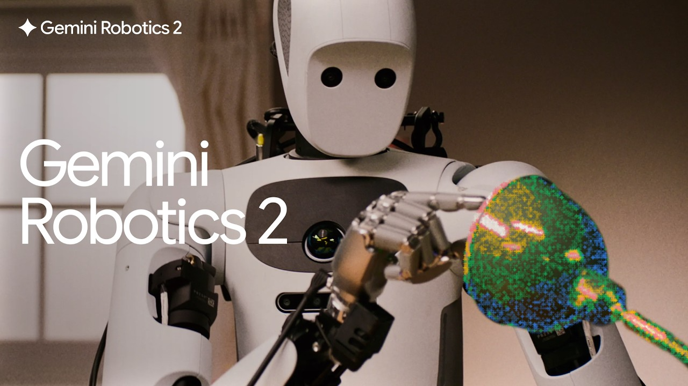

> [!note] 互动练习：视频理解检查
> [在平台中完成此题](https://reader-v2.tdtianwen.com/lg-viewer-v2/reader/standard?platform=td&pack_id=01a0b332-5e0c-7783-8f78-485f17f3f2a0&bookid=01a013c4-e4f0-750f-be8a-7de89b6353d1&section_id=01a013f4-d2e7-77c6-b397-17bccdbe61d3)

### 工程阅读

阅读课文，理解具身智能如何把传感器、计算硬件与机器人系统结合起来，帮助机器在真实世界中行动。

### 具身智能：从数字智能到物理机器

#### 从数字 AI 到物理 AI

近年来，人工智能取得了长足进步。大语言模型（LLM）能回答问题、撰写文章、生成图像，并协助人们解决各种难题。然而，大多数 AI 系统仍然主要存在于数字环境中：它们处理信息，却不与物理世界直接互动。

新一代 AI 正在走出屏幕、进入真实环境。这一发展常被称为具身智能（embodied AI）。与传统 AI 只分析数据不同，具身智能把人工智能与物理身体结合起来，让机器能够感知周围环境、做出决策并执行动作。

中国的宇树科技（Unitree）就是这一新兴领域的代表之一。它的四足机器人、人形机器人及其他机器人平台，通过行走、奔跑、平衡和与人互动的演示吸引了公众目光。一些宇树机器人还登上了春节联欢晚会，展示机器人正在变得越来越强的运动与交互能力。

然而，会动的机器人不一定智能。每一场成功演示的背后，都是一套复杂的工程系统，涉及传感器、AI 模型、计算硬件、机械设计与控制算法。具身智能的目标不只是造出会动的机器，而是要创造能理解并回应物理世界的机器。

#### 让机器拥有对世界的感知

具身智能面临的第一个挑战是感知。人类通过多种感官理解环境：我们看见物体、听见声音、摸到质地，并借助经验理解情境。机器人也需要类似的能力，只不过要通过工程系统来实现。

现代机器人使用多种传感器收集信息。摄像头让机器人识别物体和环境；激光雷达（LiDAR）与深度传感器帮助估计距离、构建三维地图；力传感器与触觉传感器让机器人察觉物理接触——比如是否握得太紧，或有什么正从手中滑落。

然而，单有感知还不够。机器人必须把不同传感器的信息组合起来，并解读这些信息的含义。人可以立刻明白：椅子是用来坐的，杯子是用来握的，易碎的东西要小心拿放。而对机器人来说，这些在人类看来简单的动作，需要复杂的感知和理解过程。

这就是为什么具身智能依赖感知、计算与人工智能的整合。机器人不仅要有眼睛和耳朵，还要有能力理解它所感知到的一切。

#### 从识别到行动

传统 AI 系统往往侧重识别：辨认物体、分类图像或生成回答。具身智能还要多走一步——把理解变成行动。

在真实世界中运行的机器人必须回答实际问题：我在哪里？周围有什么？我下一步该做什么？怎样才能安全地完成任务？为此，具身智能系统把感知与规划、控制结合起来：AI 模型帮助机器人解读情境、决定恰当的动作；控制系统再通过电机、关节和机械结构，把这些决策转化为物理运动。

例如，一个被要求「拿起杯子」的家用机器人，不能只是认出这个物体。它必须定位杯子、估计其形状和位置、计算机械臂如何移动、调整抓握力度，并在杯子意外移动时做出反应。智能与物理行动之间的这种联结，正是具身智能区别于传统数字 AI 的地方。

#### 在交互中学习

具身智能的一个重要特点是：机器人可以在与环境的交互中不断进步。人类的许多技能都是从经验中学来的——我们学会了拿东西该用多大力、在不同地面上该怎么走路、情况变化时该如何调整动作。

同样，机器人可以通过反复交互收集数据来学习。借助仿真、真实环境实验和机器学习技术，机器人可以不断提升执行任务的能力。

例如，一只机械手起初可能很难抓好各种物体。通过分析失败与成功，AI 系统能逐渐学到更优的策略。这个过程让机器人变得更有适应性，而不是只靠固定程序行事。

这种能力尤为重要，因为真实世界无法预测。在工厂、医院或家庭中工作的机器人，必须应对工程师无法完全预先定义的情形。

#### 前方的挑战

尽管具身智能发展迅速，仍有许多挑战。一大挑战是计算。智能机器人需要强大的 AI 模型，而运行这些模型要消耗大量能源与算力。因此，工程师需要更高效的硬件，包括专用 AI 芯片和让机器人在本地处理信息的边缘计算系统。

另一个挑战是可靠性与安全性。在公共环境中运行的机器人必须做出准确决策，避免伤人或损坏物品。工程师不仅要考虑技术性能，还要考虑人的信任与接受度。

成本也是一个重要问题。先进机器人需要昂贵的传感器、处理器和机械部件。要让具身智能得到广泛使用，工程师必须想办法让智能机器更便宜、更实用。

具身智能的未来将取决于多个领域的协作，包括人工智能、机器人学、机械工程、电子学、材料科学和以人为中心的设计。最终目标不是取代人类，而是创造能够与人安全、有效协同工作的智能机器。

（全文约 894 词）

### 理解信息

> [!note] 互动练习：任务 1：用 1–3 个英文单词填空。
> [在平台中完成此题](https://reader-v2.tdtianwen.com/lg-viewer-v2/reader/standard?platform=td&pack_id=01a0b332-5e0c-7783-8f78-485f17f3f2a0&bookid=01a013c4-e4f0-750f-be8a-7de89b6353d1&section_id=01a013f4-d2e7-77c6-b397-17bccdbe61d3)

> [!note] 互动练习：任务 2：就课文细节为下列问题选择最佳答案。
> [在平台中完成此题](https://reader-v2.tdtianwen.com/lg-viewer-v2/reader/standard?platform=td&pack_id=01a0b332-5e0c-7783-8f78-485f17f3f2a0&bookid=01a013c4-e4f0-750f-be8a-7de89b6353d1&section_id=01a013f4-d2e7-77c6-b397-17bccdbe61d3)

### 像工程师一样思考

阅读关于具身智能应用的两则简短报道，思考如何平衡智能、成本、安全与实际效用。

报告一

宇树科技已成功把一系列机器人产品商业化，面向个人消费者和企业。四足机器人（如 Go2、Go1）2023 至 2025 年销量超过 33000 台，被部署在多样的真实场景：个人用户用于陪伴和娱乐，企业用于展厅展示和活动展览。在人形机器人方面，宇树仅 2025 年就售出 5500 多台，其中约 70% 由高校和实验室购买用于科研与教学，但企业前台、高端零售展示中也越来越多地出现它们的身影，甚至成为科技爱好者的高端玩物。

报告二

2025 年，全球人形机器人出货量达到约 18000 台，同比增长 508%。值得注意的是，其中绝大多数仍用于科研、数据采集和娱乐，只有约 10% 真正部署在定义清晰的商业场景中。在特斯拉，50 多台 Optimus Gen-3 已在上海超级工厂投入实际运行，当前主要场景是在自家工厂内执行座椅安装、零件搬运和质量检测等任务，长期目标是进入家庭服务领域，包括养老护理和家务清洁。

两人一组讨论。结合具身智能的应用，探索下面一个（或多个）方面的答案。

（1）公共价值：具身智能应当优先解决哪些问题？这些技术应该让谁受益？

（2）成本与可及性：哪些因素可能阻碍具身智能机器人普及？

（3）标准与信任：需要哪些规则或测试，才能确保具身智能机器人安全可信？

> [!note] 延伸阅读：参考答案
> [在平台中查看](https://reader-v2.tdtianwen.com/lg-viewer-v2/reader/standard?platform=td&pack_id=01a0b332-5e0c-7783-8f78-485f17f3f2a0&bookid=01a013c4-e4f0-750f-be8a-7de89b6353d1&section_id=01a013f4-d2e7-77c6-b397-17bccdbe61d3)

### 工程对话

### 开始一项具身智能范围综述

> [!note] 音频：开始一项具身智能范围综述
> [在平台中打开音频](https://reader-v2.tdtianwen.com/ed-svc2/fp/book-file/01a02719-2309-79e3-81b9-878d331ac2ae.mp3?t=oss_download&pack_id=01a0b332-5e0c-7783-8f78-485f17f3f2a0&platform=td)
> ![[U03-音频1-开始一项具身智能范围综述.mp3]]

> [!note] 互动练习：任务 1：摘要重构
> [在平台中完成此题](https://reader-v2.tdtianwen.com/lg-viewer-v2/reader/standard?platform=td&pack_id=01a0b332-5e0c-7783-8f78-485f17f3f2a0&bookid=01a013c4-e4f0-750f-be8a-7de89b6353d1&section_id=01a013f4-d2e7-77c6-b397-17bccdbe61d3)

> [!note] 互动练习：任务 2：词汇拓展
> [在平台中完成此题](https://reader-v2.tdtianwen.com/lg-viewer-v2/reader/standard?platform=td&pack_id=01a0b332-5e0c-7783-8f78-485f17f3f2a0&bookid=01a013c4-e4f0-750f-be8a-7de89b6353d1&section_id=01a013f4-d2e7-77c6-b397-17bccdbe61d3)

> [!note] 互动练习：任务 3：谈谈你的学习困难
> [在平台中完成此题](https://reader-v2.tdtianwen.com/lg-viewer-v2/reader/standard?platform=td&pack_id=01a0b332-5e0c-7783-8f78-485f17f3f2a0&bookid=01a013c4-e4f0-750f-be8a-7de89b6353d1&section_id=01a013f4-d2e7-77c6-b397-17bccdbe61d3)

### 生词与表达

| 英文 | 词性 | 释义 |
| --- | --- | --- |
| digital AI | n. | 主要在数字环境中处理文本、图像或数据等信息的 AI 系统；数字人工智能 |
| embodied AI | n. | 拥有物理身体的 AI 系统；具身智能 |
| humanoid | n./adj. | 外形和行为像人的机器；人形的、仿人机器人 |
| robotic platform | n. | 面向特定任务、由硬件、软件与控制部件构成的机器人系统；机器人平台 |
| texture | n. | 表面或物质触摸时的感觉；质地、手感 |
| LiDAR | n. | 激光雷达：利用激光测距并构建三维地图的技术 |
| tactile sensor | n. | 让机器人检测物理接触、压力或触摸的传感器；触觉传感器 |
| recognition | n. | 认出某人或辨识某物的行为；认出、识别 |
| control system | n. | 管理和调节机器运动或运行的系统；控制系统 |
| motor | n. | 把电能转化为运动的装置；电动机 |
| joint | n. | 两个部件相连、可弯曲和活动的位置；关节 |
| grip | n. | 紧握某人或某物的动作；紧握、紧抓 |
| technique | n. | 完成任务的方法；技术、方法 |
| computing power | n. | 计算机系统处理信息和执行运算的能力；计算能力 |
| edge computing | n. | 在靠近数据产生处进行处理的计算方式，而不只依赖远端云服务器；边缘计算 |

### 平台交互内容

本章还有 6 道互动练习、1 处延伸阅读、1 段音频、1 段视频。音频与视频已下载到本地并内嵌在正文，可离线播放；互动练习需登录平台作答：[在平台中打开本章](https://reader-v2.tdtianwen.com/lg-viewer-v2/reader/standard?platform=td&pack_id=01a0b332-5e0c-7783-8f78-485f17f3f2a0&bookid=01a013c4-e4f0-750f-be8a-7de89b6353d1&section_id=01a013f4-d2e7-77c6-b397-17bccdbe61d3)

---

## 第3单元 · B. 智能背后的硬件

英文对照：[[EN-U03-3 B. The Hardware Behind Intelligence|Unit 3 · B. The Hardware Behind Intelligence]]

### 图像探索

观察图片并回答问题。

（1）在两套系统中，「思考」分别发生在哪里？各部件之间需要传输什么？（2）对一个在医院走廊里工作的机器人，你会信任哪种布局？选择它你要放弃什么？

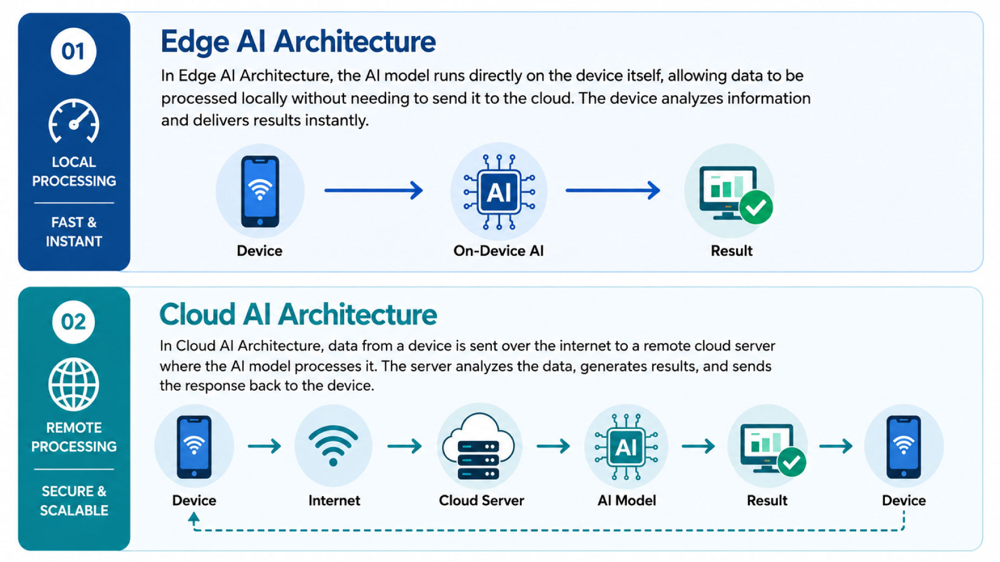

> [!note] 延伸阅读：示例参考答案
> [在平台中查看](https://reader-v2.tdtianwen.com/lg-viewer-v2/reader/standard?platform=td&pack_id=01a0b332-5e0c-7783-8f78-485f17f3f2a0&bookid=01a013c4-e4f0-750f-be8a-7de89b6353d1&section_id=01a013f5-2675-762c-b35f-0ca5df32730b)

### 工程阅读

阅读下文，理解智能机器为什么需要新型计算硬件，以及工程师如何决定计算应当发生在哪里。

### AI 芯片与计算的未来

一个人形机器人走过实验室，跨上一根线缆，拿起一只纸杯却没有捏扁它。这个画面里没有一样东西看起来像「计算」。然而，在这段行走的每一秒里，机器都在处理多个摄像头的图像、估计前方每个物体的距离，并不知多少次重新计算手指上的力道。智能显现在动作里，计算却隐藏在芯片中。这就引出一个问题：什么样的计算机才能做到这一切？它能不能小到、凉到足以跟着机器一起行动？

#### AI 为什么需要新硬件

在计算历史的大部分时间里，工作都由中央处理器（CPU）完成。CPU 拥有少量强大的核心，以极高速度逐条执行指令。这种设计适合有明确先后的任务，比如打开文件、计算表格。但神经网络完全不是这个样子。

神经网络让信息穿过一层层简单的计算单元，每一层同一时刻都要做数百万次乘法和加法。要紧的不是一条指令能多快完成，而是能同时完成多少条——这就是并行计算。最早适合它的硬件是图形处理器（GPU）：为在屏幕上绘制图像而生，内含数千个可同时工作的小核心。

不过，GPU 耗电大、发热多。因此工程师开发了 AI 加速器，常被称为神经网络处理器（NPU）——一种只为「运行神经网络」这一件事设计的芯片。由于专一，AI 加速器每消耗一瓦能量，能换来的有效计算多得多。对靠电池运行的机器来说，能效决定了机器人停机前能工作多久。

#### 从云端 AI 到边缘 AI

绕开功耗问题有一个明显的办法：把计算放到别处。机器人可以把摄像头画面发送到远方的数据中心，让那里的强力计算机去「思考」，再等指令返回。这就是云计算，对许多应用来说非常好用。

但对具身系统而言，有三个约束横在路上。第一是延迟：信号一来一回可能要数百毫秒，这对翻译应用毫无察觉，对一只正要合拢在人手上的机械臂却不可接受。第二是带宽：摄像头、深度传感器和激光雷达持续产生数据流，没有任何网络能保证时时刻刻都传得动。第三是隐私：家庭护理机器人或医院设备会拍下人们在私密时刻的影像，把这些影像送过公共网络，会引发许多用户不愿接受的问题。

工程上的回应是边缘计算：在靠近数据产生地的设备本身上处理数据。采用这种方式，芯片跟着机器人走。实践中，设计良好的系统通常划分工作：紧急的感知与控制在机上运行，训练和长期分析放在云端。正是这种分工，让 AI 芯片的设计与智能机器的设计再也无法分开。

#### 真实设备中的 AI 芯片

这些影响在马路上已经看得见。自动驾驶汽车必须持续处理摄像头、雷达和激光雷达数据，刹车决策等不得网络恢复，所以车载推理芯片在车内完成决策。服务机器人和工业机器人遵循同样的模式：另设一个更简单的独立控制器负责安全，AI 系统失效也不能让紧急停机失灵。

可穿戴与医疗设备把极限推得更远。戴在身上或贴近组织的设备，必须在极小的功率预算内运行算法——因为芯片消耗的能量几乎都会变成热，而人体组织旁的热是一个临床问题。

#### 超越硅

到目前为止讲到的芯片都建立在硅晶体管组成的刚性集成电路上。如今，两个超越硅的方向正在探索之中。其一是类脑芯片：电路不再连续处理每一个输入，而是在没有变化时保持「安静」；其人工神经元通过短脉冲（锋电位）通信。一个例子是清华大学研发的天机芯（Tianjic），它同时支持人工神经网络和脉冲神经网络，曾在一辆自平衡自行车上演示：跟随语音指令、追踪行人并躲避障碍——全部在一颗芯片上完成。

第二个方向是柔性电子：把电路建在可弯曲的基底而非刚性电路板上，让计算可以布置在弯曲且运动的表面上——机器人手、关节或一片人造皮肤。与触觉感知结合之后，它预示着一种感知与处理分布于全身的机器。

（全文约 830 词）

### 理解信息

> [!note] 互动练习：任务 1：根据课文为每个问题选择最佳答案。
> [在平台中完成此题](https://reader-v2.tdtianwen.com/lg-viewer-v2/reader/standard?platform=td&pack_id=01a0b332-5e0c-7783-8f78-485f17f3f2a0&bookid=01a013c4-e4f0-750f-be8a-7de89b6353d1&section_id=01a013f5-2675-762c-b35f-0ca5df32730b)

> [!note] 互动练习：任务 2：判断下列各句正误（T/F）。
> [在平台中完成此题](https://reader-v2.tdtianwen.com/lg-viewer-v2/reader/standard?platform=td&pack_id=01a0b332-5e0c-7783-8f78-485f17f3f2a0&bookid=01a013c4-e4f0-750f-be8a-7de89b6353d1&section_id=01a013f5-2675-762c-b35f-0ca5df32730b)

> [!note] 互动练习：任务 3：把课文中的术语或表达与其正确释义连线。
> [在平台中完成此题](https://reader-v2.tdtianwen.com/lg-viewer-v2/reader/standard?platform=td&pack_id=01a0b332-5e0c-7783-8f78-485f17f3f2a0&bookid=01a013c4-e4f0-750f-be8a-7de89b6353d1&section_id=01a013f5-2675-762c-b35f-0ca5df32730b)

### 工程决策

听一段对话：三名学生对在大学的哪些位置部署人形机器人各持己见。

> [!note] 音频：宇树人形机器人该放在哪里？
> [在平台中打开音频](https://reader-v2.tdtianwen.com/ed-svc2/fp/book-file/01a023a4-d6fd-7056-b38b-e2d1530ae079.mp3?t=oss_download&pack_id=01a0b332-5e0c-7783-8f78-485f17f3f2a0&platform=td)
> ![[U03-音频2-宇树人形机器人该放在哪里.mp3]]

> [!note] 互动练习：任务 1：理解检查
> [在平台中完成此题](https://reader-v2.tdtianwen.com/lg-viewer-v2/reader/standard?platform=td&pack_id=01a0b332-5e0c-7783-8f78-485f17f3f2a0&bookid=01a013c4-e4f0-750f-be8a-7de89b6353d1&section_id=01a013f5-2675-762c-b35f-0ca5df32730b)

> [!note] 互动练习：任务 2：在类似情境中做出你的决策
> [在平台中完成此题](https://reader-v2.tdtianwen.com/lg-viewer-v2/reader/standard?platform=td&pack_id=01a0b332-5e0c-7783-8f78-485f17f3f2a0&bookid=01a013c4-e4f0-750f-be8a-7de89b6353d1&section_id=01a013f5-2675-762c-b35f-0ca5df32730b)

### 交流与反思

### 打造你的单元挑战成果

回到单元挑战，为「机器人招聘会」准备你的三分钟竞聘陈述。陈述必须包括：

（1）三页幻灯片或三页手绘图：其一「岗位」：你竞聘哪个岗位？这个岗位为什么在校园里重要？其二「为什么选这种本体」：你为什么为这个岗位选择这种机器人类型？说出机器人使用的至少两种传感器（如摄像头、激光雷达、触觉传感器），并解释各自的作用。其三「诚实的取舍」：你的机器人有哪件事做不完美？你的备用方案是什么？同时给出一个简单的成本估算（购置＋维护），并解释为什么物有所值。

（2）三分钟竞聘陈述：陈述中至少使用本单元的两个技术术语（例如延迟、边缘计算、推理、感知、控制系统、神经网络、可靠性）。

> [!note] 延伸阅读：示例参考答案
> [在平台中查看](https://reader-v2.tdtianwen.com/lg-viewer-v2/reader/standard?platform=td&pack_id=01a0b332-5e0c-7783-8f78-485f17f3f2a0&bookid=01a013c4-e4f0-750f-be8a-7de89b6353d1&section_id=01a013f5-2675-762c-b35f-0ca5df32730b)

### 学习档案反思

> [!note] 互动页面：学习档案反思
> [打开互动页面](https://zhihuiware.com/api/webapp/embed/9b041d26-0aed-4554-bf63-a3324a363911)

### 生词与表达

| 英文 | 词性 | 释义 |
| --- | --- | --- |
| force | n. | 使物体以特定方式运动的作用；力 |
| visible | adj. | 能看见的；看得见的 |
| core | n. | CPU 内部的处理单元；处理器核心 |
| neural network | n. | 由相互连接的单元层组成的计算模型，灵感来自大脑；神经网络 |
| multiplication | n. | 数与数相乘的运算；乘法 |
| addition | n. | 把两个或多个数相加求总和的运算；加法 |
| parallel computing | n. | 同时执行多项计算的方法；并行计算 |
| graphics processing unit | n. | 拥有许多小核心、最初为图形设计的处理器；图形处理器 |
| accelerator | n. | 专为运行 AI 计算设计的芯片；加速器 |
| neural processing unit | n. | 为高效执行神经网络运算而造的处理器；神经网络处理器 |
| energy efficiency | n. | 每单位能量消耗所产生的有用功；能效 |
| cloud computing | n. | 通过经网络访问的远程服务器存储和处理数据；云计算 |
| constraint | n. | 限制某事物的因素；限制、约束 |
| latency | n. | 输入与系统响应之间的延迟；延迟 |
| server | n. | 在网络上提供数据或服务的计算机；服务器 |
| bandwidth | n. | 网络在给定时间内能传输的数据量；带宽 |
| inference | n. | 使用训练好的 AI 模型从新数据得出结果的阶段；推理 |
| transistor | n. | 控制电流的微型开关，芯片的基本构件；晶体管 |
| integrated circuit | n. | 建在一小片半导体材料上的电子电路；集成电路 |
| neuromorphic chip | n. | 结构模仿生物神经元处理和传输信号方式的芯片；类脑芯片 |
| spike | n. | 神经元用来传递信息的短暂电脉冲；脉冲 |
| spiking neural network | n. | 单元间通过脉冲而非连续值通信的网络；脉冲神经网络 |
| flexible electronics | n. | 建在可弯曲或可拉伸材料上的电子电路；柔性电子 |
| substrate | n. | 构建电子电路所用的基底材料；基底 |

### 平台交互内容

本章还有 5 道互动练习、2 处延伸阅读、1 段音频、1 个交互页面。音频与视频已下载到本地并内嵌在正文，可离线播放；互动练习需登录平台作答：[在平台中打开本章](https://reader-v2.tdtianwen.com/lg-viewer-v2/reader/standard?platform=td&pack_id=01a0b332-5e0c-7783-8f78-485f17f3f2a0&bookid=01a013c4-e4f0-750f-be8a-7de89b6353d1&section_id=01a013f5-2675-762c-b35f-0ca5df32730b)

---

## 第4单元 · 单元预览

英文对照：[[EN-U04-1 Unit Preview|Unit 4 · Unit Preview]]

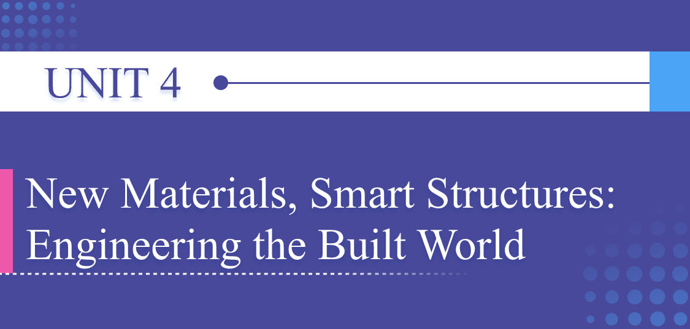

### 学习目标

运用关键技术词汇描述材料性能与结构行为。

练习从多模态材料中理解材料科学与结构工程主题的信息。

在小组讨论中分析和评估涉及材料选择与结构设计的工程方案。

设计一张学术海报，用有效的语言介绍中国在材料或结构工程领域的一项成就。

### 单元挑战

中国已成为材料与结构工程领域的全球创新者。超高性能混凝土、破纪录的桥梁设计等技术，展示了工程如何改变基础设施。

你的任务：以小组为单位，选择一项中国近期在材料或结构工程领域的成就，制作一张学术海报：1）说明这项成就解决了什么问题；2）展示其材料、结构或智能系统如何工作；3）包含数据点或可视化证据；4）阐释这项成就为何对基础设施、公众利益、可持续性或者国家工程创新具有重要意义。

### 学习旅程

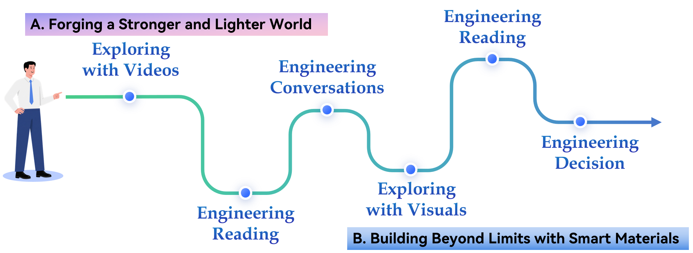

---

## 第4单元 · A. 锻造更强更轻的世界

英文对照：[[EN-U04-2 A. Forging a Stronger and Lighter World|Unit 4 · A. Forging a Stronger and Lighter World]]

### 视频探索

想象你正在执行火星任务。环顾四周，选择五种常见材料（例如木材、玻璃、塑料、金属、橡胶、陶瓷、皮革）。

按照「如果要用在火星上，你最担心什么」给这五种材料排序，并简要解释你的排序（考虑极端低温、沙尘暴、撞击、温度变化等）。

混凝土是世界上使用最广泛的材料之一，构成了道路、桥梁和建筑等现代基础设施的骨架。在这段视频中，你将探索混凝土为什么既必不可少又问题重重，以及科学家如何致力于开发更可持续的替代方案。

> [!note] 视频：这种材料可能改变世界
> [在平台中打开视频](https://reader-v2.tdtianwen.com/ed-svc2/fp/book-file/01a02849-eac1-79b8-a191-74ef087fc574.mp4?t=oss_download&pack_id=01a0b332-5e0c-7783-8f78-485f17f3f2a0&platform=td)
> ![[U04-视频-这种材料可能改变世界.mp4]]

> [!note] 互动练习：视频理解检查
> [在平台中完成此题](https://reader-v2.tdtianwen.com/lg-viewer-v2/reader/standard?platform=td&pack_id=01a0b332-5e0c-7783-8f78-485f17f3f2a0&bookid=01a013c4-e4f0-750f-be8a-7de89b6353d1&section_id=01a013f5-f96d-7189-9183-353c35fa1951)

### 工程阅读

阅读课文，理解先进材料如何从分子层面开始改变工程。

### 新材料，新可能

每一座结构都始于一次材料选择。支撑桥梁的钢梁、摩天楼上的玻璃幕墙、水管内壁的聚合物衬里——它们被选中，都是因为其性能匹配了某项具体的工程需求。在整个 20 世纪的大部分时间里，这份材料「菜单」相对稳定：强度用钢，受压用混凝土，轻质用铝，透明用玻璃。但 21 世纪已把这份菜单彻底重写。研究者如今在原子和分子层面设计材料，创造出比上一代任何材料都更轻、更强、更多能的物质。

想想碳纤维。这种最初为航空航天开发的材料，由碳原子以晶体结构键合成的细丝组成，其强度约为钢的五倍，重量却只有钢的一小部分。碳纤维增强聚合物（CFRP）如今已是赛车、自行车架和飞机机身的标配。最近，土木工程师开始用 CFRP 筋加固桥面和停车结构，取代会随时间锈蚀的传统钢筋。

再缩小一个尺度，石墨烯——排成二维蜂窝状的单层碳原子——自 2004 年被分离出来，就吸引了海量研究关注。以厚度论，石墨烯异常坚固；它导电导热的效率惊人，而且几乎透明。中国多所大学的研究者已开发出石墨烯增强混凝土，其抗压强度有所提高、开裂有所减少。虽然量产仍然昂贵，但在防腐涂层和导电薄膜方面的试点应用表明，石墨烯终将走出实验室、进入日常建设。

并非所有创新都瞄准「更强」，一些最激动人心的工作是让材料「更聪明」。自修复材料内嵌着装有修复剂的胶囊——常为环氧树脂或细菌溶液；裂缝一旦形成，修复剂便被释放出来，填充并封闭裂缝，无需人工干预就恢复了结构的完整性。代尔夫特理工大学的研究者开发出利用产石灰石细菌的自修复混凝土；中国东南大学的团队正在高速公路路面上测试类似系统——在那里，人工修补的成本极其高昂。

形状记忆合金（SMA）代表智能材料的另一个分支。这些金属合金——通常是镍钛合金——被变形之后，一经加热就能恢复原状。工程师把 SMA 丝嵌入桥梁拉索和建筑节点，地震之后结构便能部分「自我复位」。在日本和中国，基于 SMA 的阻尼器已经装进高层建筑，无需传统液压系统的笨重和维护，就能减小地震振动。

仿生材料把创新推向又一个方向。大自然花了数百万年，为强度、柔韧和资源效率优化结构。珍珠母——软体动物壳内那层虹彩衬里——是一种天然复合材料：脆性的文石片由薄薄的有机层黏结而成。尽管组分相对脆弱，珍珠母却异常坚韧，因为其层状微观结构能偏转并吸收裂纹。材料科学家用氧化铝和聚合物复刻了这种「砖-泥」结构，制出合成珍珠母，正被探索用于轻质装甲、防护外壳和电动汽车的抗冲击板。

可持续性也在重塑材料选择。例如超高性能混凝土（UHPC）通过在微观层面优化颗粒堆积，抗压强度超过 150 兆帕——大约相当于普通混凝土的六到十倍。正因为它如此之强，工程师只需少得多的用量，于是诞生了更薄、更轻的结构构件：用料更少，碳排放更低。中国长沙开福区人行桥采用 UHPC 板建造，在保持同等承载力的同时，自重显著小于常规混凝土桥。

新兴的可编程物质领域把材料科学推得更远。研究者正在开发这样的材料：其性能——形状、刚度、导热性——可以通过热、光或电场等外部刺激按需改变。另一项了不起的成果是四维（4D）打印：作为增材制造的延伸，它用智能聚合物打印出能在打印后折叠、弯曲或膨胀的物体。虽然目前大多数 4D 打印结构还是小尺度原型，但这项技术在可展开庇护所、自组装家具和随天气变化的自适应建筑立面等方面潜力明确。

所有这些进展有一条共同线索：它们正在消解材料与其所服务结构之间的旧边界。一块自修复混凝土板不再只是建筑构件，它本身就是一套维护系统；一根 SMA 拉索不再只是结构部件，它是一件安全装置。当材料成为工程性能的主动参与者而非被动原料，「结构」这个概念本身必须扩展——把随时间展开的行为也纳入其中，而不只是某一时刻的强度。

对本科工科生而言，这种融合意味着材料科学不再是一门「修完即可忘掉」的先修课，而是一门活的、持续演进的学科，与结构分析、环境工程、数字建造乃至生物学交叉。那些不仅懂得材料能做什么、还懂得它为什么这样做——一直深入到分子尺度——的学生，将会是锻造一个更强、更轻、更可持续的建成世界的人。

（全文约 842 词）

### 理解信息

> [!note] 互动练习：任务 1：用 1–3 个英文单词填空。
> [在平台中完成此题](https://reader-v2.tdtianwen.com/lg-viewer-v2/reader/standard?platform=td&pack_id=01a0b332-5e0c-7783-8f78-485f17f3f2a0&bookid=01a013c4-e4f0-750f-be8a-7de89b6353d1&section_id=01a013f5-f96d-7189-9183-353c35fa1951)

> [!note] 互动练习：任务 2：就课文细节为下列问题选择最佳答案。
> [在平台中完成此题](https://reader-v2.tdtianwen.com/lg-viewer-v2/reader/standard?platform=td&pack_id=01a0b332-5e0c-7783-8f78-485f17f3f2a0&bookid=01a013c4-e4f0-750f-be8a-7de89b6353d1&section_id=01a013f5-f96d-7189-9183-353c35fa1951)

### 像工程师一样思考

阅读关于先进材料近期突破的两则简短报道，分析性能变量与潜在应用。

报告一

2024 年，天津大学团队宣布在石墨烯半导体方面取得突破。研究人员利用独创的「准平衡退火」技术，克服了石墨烯的「零带隙」问题——正是这一特性一直阻碍石墨烯用作半导体。团队在碳化硅衬底上实现了 0.6 eV 的带隙，室温电子迁移率超过 5000 cm²/Vs——约为硅的十倍、常规二维材料的二十倍。这一结果开辟了通往性能提升十倍以上纳米级芯片的道路，为后摩尔时代的芯片材料提供了解决方案。

报告二

2025 年，一个跨学科团队在《自然》（Nature）上发表了超高能量密度锂金属电池的研究。通过创新的「离域电解质」设计，团队在软包电芯中实现 600 Wh/kg、在模组层面实现 480 Wh/kg——跻身迄今报道过的最高能量密度之列。该电池已装备于三款微型无人机（UAV），使续航时间延长 2.8 倍。一条从材料到成品电芯全链自主可控的中试生产线也已建立。

两人一组讨论。从上述报道中任选一种材料，探索下面一个（或多个）方面的答案。

（1）安全与标准：如果材料失效、退化、过热、开裂或表现与预期不同，可能出什么问题？

（2）成本与维护：安装之后会出现哪些成本，例如检查、维修、更换或监测？

（3）可迁移性：如果把这种材料用在芯片、无人机、桥梁、建筑或水下系统上，哪些设计选择需要改变？

> [!note] 延伸阅读：参考答案
> [在平台中查看](https://reader-v2.tdtianwen.com/lg-viewer-v2/reader/standard?platform=td&pack_id=01a0b332-5e0c-7783-8f78-485f17f3f2a0&bookid=01a013c4-e4f0-750f-be8a-7de89b6353d1&section_id=01a013f5-f96d-7189-9183-353c35fa1951)

### 工程对话

### 是什么让材料「智能」

> [!note] 音频：是什么让材料「智能」
> [在平台中打开音频](https://reader-v2.tdtianwen.com/ed-svc2/fp/book-file/01a02325-9de0-73db-addc-5191692e9c27.mp3?t=oss_download&pack_id=01a0b332-5e0c-7783-8f78-485f17f3f2a0&platform=td)
> ![[U04-音频1-是什么让材料智能.mp3]]

> [!note] 互动练习：任务 1：理解检查
> [在平台中完成此题](https://reader-v2.tdtianwen.com/lg-viewer-v2/reader/standard?platform=td&pack_id=01a0b332-5e0c-7783-8f78-485f17f3f2a0&bookid=01a013c4-e4f0-750f-be8a-7de89b6353d1&section_id=01a013f5-f96d-7189-9183-353c35fa1951)

> [!note] 互动练习：任务 2：词汇拓展
> [在平台中完成此题](https://reader-v2.tdtianwen.com/lg-viewer-v2/reader/standard?platform=td&pack_id=01a0b332-5e0c-7783-8f78-485f17f3f2a0&bookid=01a013c4-e4f0-750f-be8a-7de89b6353d1&section_id=01a013f5-f96d-7189-9183-353c35fa1951)

> [!note] 互动练习：任务 3：谈谈你的大学生活
> [在平台中完成此题](https://reader-v2.tdtianwen.com/lg-viewer-v2/reader/standard?platform=td&pack_id=01a0b332-5e0c-7783-8f78-485f17f3f2a0&bookid=01a013c4-e4f0-750f-be8a-7de89b6353d1&section_id=01a013f5-f96d-7189-9183-353c35fa1951)

### 生词与表达

| 英文 | 词性 | 释义 |
| --- | --- | --- |
| polymer | n. | 由小的简单分子组合成大分子构成的物质；聚合物 |
| property | n. | 某物具有的性质或特征；性质、特性 |
| compression | n. | 受到挤压力的状态；受压、挤压 |
| versatile | adj. | 能适应或用于多种用途的；多功能的、用途广泛的 |
| filament | n. | 极细的天然或合成纤维；细丝、细线 |
| fuselage | n. | 飞机的中央主体；机身 |
| tendon | n. | 高强度抗拉结构构件，通常由钢或先进复合材料制成；索筋、预应力钢束 |
| rebar | n. | 用于加固混凝土结构的钢筋 |
| graphene | n. | 构成二维晶格的单层碳原子；石墨烯 |
| conductive | adj. | 能够传导热或电的；导电的、导热的 |
| self-healing | adj. | 无需外部干预即可自动修复损伤的；自愈合的 |
| epoxy | n. | 工程中使用的一类高强度黏结树脂；环氧树脂 |
| integrity | n. | 完整、完好、未受损的状态；完整性 |
| damper | n. | 减小结构振动或振荡的装置；阻尼器、减震器 |
| seismic | adj. | 与地震或地振动有关的；地震的 |
| composite | n. | 由两种或多种不同性质物质构成的材料；复合材料 |
| deflect | v. | 改变方向或使某物改变方向；偏移、转向 |
| megapascal | n. | 等于一百万帕斯卡的压力单位（MPa）；兆帕 |
| stiffness | n. | 材料或结构抵抗弹性变形的能力；刚度、刚性 |
| façade | n. | 建筑物的正面或外表面；建筑立面 |
| slab | n. | 厚而平的石材、木材或其他硬质材料板件；厚板 |
| fabrication | n. | 用各种材料制造产品、设备等的过程；制造、加工 |

### 平台交互内容

本章还有 6 道互动练习、1 处延伸阅读、1 段音频、1 段视频。音频与视频已下载到本地并内嵌在正文，可离线播放；互动练习需登录平台作答：[在平台中打开本章](https://reader-v2.tdtianwen.com/lg-viewer-v2/reader/standard?platform=td&pack_id=01a0b332-5e0c-7783-8f78-485f17f3f2a0&bookid=01a013c4-e4f0-750f-be8a-7de89b6353d1&section_id=01a013f5-f96d-7189-9183-353c35fa1951)

---

## 第4单元 · B. 用智能材料突破建造极限

英文对照：[[EN-U04-3 B. Building Beyond Limits with Smart Materials|Unit 4 · B. Building Beyond Limits with Smart Materials]]

### 图像探索

观察图片并回答问题。

（1）哪项设计特征能减小建筑所受的风力？（2）调谐质量阻尼器的作用是什么？（3）这座塔楼使用了一万多个传感器，你认为它们会收集哪些信息？

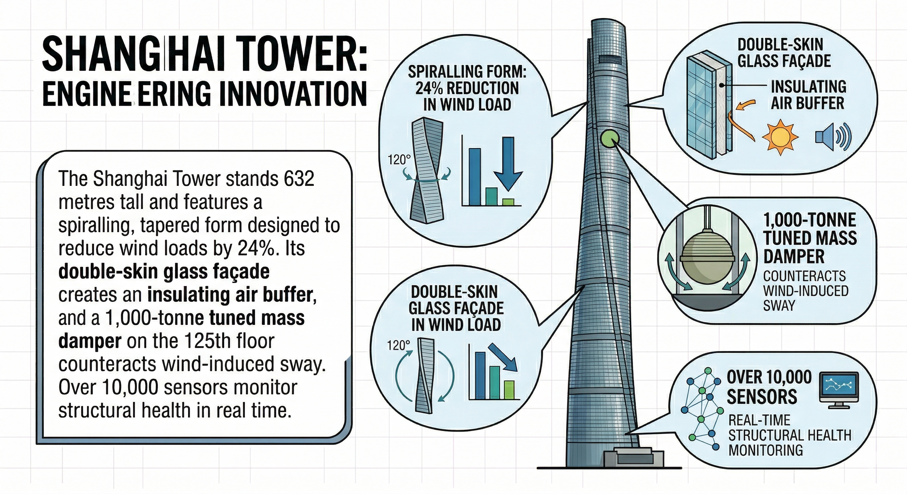

> [!note] 延伸阅读：示例参考答案
> [在平台中查看](https://reader-v2.tdtianwen.com/lg-viewer-v2/reader/standard?platform=td&pack_id=01a0b332-5e0c-7783-8f78-485f17f3f2a0&bookid=01a013c4-e4f0-750f-be8a-7de89b6353d1&section_id=01a013f6-32ee-74ef-a9c0-99b1dc0a458c)

### 工程阅读

阅读课文，理解智能结构如何集感知、处理与驱动于一体，造就具有自适应能力的基础设施。

### 智能结构：会思考的建筑

2022 年，中国建筑科学研究院在北京揭幕了一座示范展馆，它的墙体可以实时调节保温性能。嵌入式传感器每三十秒测量一次室外温度、风速和太阳辐射，中央控制器则启动墙板内的微通道，让热水或冷水循环流动。与同等规模的传统建筑相比，这座建筑的采暖制冷能耗低了约 40%。它不只是一栋建筑，而是一台能「思考」自己围护结构的机器。

这座展馆代表了结构工程更广泛的转变：智能结构的兴起。智能结构能够感知环境变化、处理这些信息，并通过调整自身物理性能作出响应。这一概念借鉴自生物学——正如人的皮肤通过调节毛孔大小来调控体温，智能建筑通过调节通风、遮阳和结构刚度来适应变化的条件。要做到这一点，需要三个相互集成的层次：感知、处理与驱动。

感知层依赖嵌入式传感器网络。例如，光纤应变传感器可以在浇筑时直接编织进混凝土；混凝土固化之后，这些传感器就能持续测量内部应力、温度甚至含水率。在港珠澳大桥——世界上最长的跨海工程之一——上，一万多个传感器全天候监测结构健康。一旦桥梁任何区段出现异常应力，工程师就会收到警报，从而在小问题变成大故障之前安排维护。这种被称为结构健康监测（SHM）的做法，已经改变了工程师思考大型基础设施寿命的方式。

处理层把原始传感数据变成可付诸行动的洞察。现代智能结构将数据输入数字孪生——随实时数据更新的物理结构虚拟副本。例如，一栋摩天楼的数字孪生能在台风到来前数小时模拟建筑的响应，让工程师预先张紧拉索、把电梯锁定在安全楼层或启动辅助阻尼器。机器学习算法进一步增强了这种能力：它们能识别出人工监控可能漏掉的传感数据模式——比如钢节点中细微而反复出现的振动，那是疲劳裂纹早期的信号。

驱动层把决策变成物理响应。压电致动器能把电信号转换成精确的机械运动，在毫秒之间调节拉索张力或遮阳百叶的角度。电致变色玻璃——施加电压时透明度会变化——让建筑立面能随阳光强度在通透与遮阳之间切换。上海中心大厦第 125 层装有一台重达 1000 吨的调谐质量阻尼器，摆动之间抵消风致摇晃，即使狂风阵阵也能把楼内舒适度保持在可接受范围内。

智能结构不限于摩天楼，这一概念同样适用于桥梁、隧道乃至单个结构构件。例如自感知混凝土内含导电碳纤维，混凝土受压或开裂时其电阻率会变化：只要测量楼板两端的电阻，工程师无需任何外部传感设备就能发现损伤。哈尔滨工业大学的中国研究者已在高速公路路面中演示了自感知混凝土板——这种材料一边承载交通荷载，一边向中央监测站报告自身状况。

智能材料与智能结构的融合，造就了一些研究者所称的自适应基础设施——随数据积累不断演化行为的系统。例如，一座自适应桥梁可以把交通荷载逐渐从变弱的桥跨转移到更强的桥跨，使桥梁服役寿命延长数十年；一套自适应建筑围护结构可以学习使用者的日常作息，在人们到达之前预先调好室温、照明和通风，在提升舒适度的同时降低能耗。

可持续是这项工作背后的重要动力。建筑约占全球能源消耗的 40%、温室气体排放的近三分之一。智能结构通过把浪费降到最低来直面这一问题：随太阳位置调整遮阳百叶的立面，省去了多余的空调；能自我报告状况的桥梁，避免了过早更换带来的巨大材料与能源开销。循环经济原则——为拆解、复用和回收而设计——也因嵌入式传感器而更进一步：回收的构件可以凭传感数据认证其剩余强度。

挑战依然存在。智能系统增加了复杂性，而复杂性带来新的失效模式：给出错误读数的传感器可能触发不必要且昂贵的干预；针对楼宇控制网络的攻击可能瘫痪关键安全系统。因此，工程师必须把冗余设计纳入智能结构——备用传感器、手动接管和安全的通信协议——确保「智能」不以牺牲可靠性为代价。

对即将进入结构或土木工程领域的学生来说，智能结构代表着学科要求的根本转变。现代结构工程师不仅要懂受力和材料，还要懂数据科学、控制系统和信息物理安全。未来的结构不只是矗立在那里，它们会感知、会思考、会适应——而建造它们的工程师，需要一套跨越传统学科边界的词汇和思维。

（全文约 862 词）

### 理解信息

> [!note] 互动练习：任务 1：根据课文为每个问题选择最佳答案。
> [在平台中完成此题](https://reader-v2.tdtianwen.com/lg-viewer-v2/reader/standard?platform=td&pack_id=01a0b332-5e0c-7783-8f78-485f17f3f2a0&bookid=01a013c4-e4f0-750f-be8a-7de89b6353d1&section_id=01a013f6-32ee-74ef-a9c0-99b1dc0a458c)

> [!note] 互动练习：任务 2：判断下列各句正误（T/F）。
> [在平台中完成此题](https://reader-v2.tdtianwen.com/lg-viewer-v2/reader/standard?platform=td&pack_id=01a0b332-5e0c-7783-8f78-485f17f3f2a0&bookid=01a013c4-e4f0-750f-be8a-7de89b6353d1&section_id=01a013f6-32ee-74ef-a9c0-99b1dc0a458c)

> [!note] 互动练习：任务 3：把课文中的术语或表达与其正确释义连线。
> [在平台中完成此题](https://reader-v2.tdtianwen.com/lg-viewer-v2/reader/standard?platform=td&pack_id=01a0b332-5e0c-7783-8f78-485f17f3f2a0&bookid=01a013c4-e4f0-750f-be8a-7de89b6353d1&section_id=01a013f6-32ee-74ef-a9c0-99b1dc0a458c)

### 工程决策

听一段对话，探讨雄心勃勃的结构设计与长期维护现实之间的张力。

> [!note] 音频：第二十年的钱谁来出？
> [在平台中打开音频](https://reader-v2.tdtianwen.com/ed-svc2/fp/book-file/01a023a0-4479-7c5f-992f-53c0cf0ff960.mp3?t=oss_download&pack_id=01a0b332-5e0c-7783-8f78-485f17f3f2a0&platform=td)
> ![[U04-音频2-第二十年的钱谁来出.mp3]]

> [!note] 互动练习：任务 1：理解检查
> [在平台中完成此题](https://reader-v2.tdtianwen.com/lg-viewer-v2/reader/standard?platform=td&pack_id=01a0b332-5e0c-7783-8f78-485f17f3f2a0&bookid=01a013c4-e4f0-750f-be8a-7de89b6353d1&section_id=01a013f6-32ee-74ef-a9c0-99b1dc0a458c)

> [!note] 互动练习：任务 2：在类似情境中做出你的决策
> [在平台中完成此题](https://reader-v2.tdtianwen.com/lg-viewer-v2/reader/standard?platform=td&pack_id=01a0b332-5e0c-7783-8f78-485f17f3f2a0&bookid=01a013c4-e4f0-750f-be8a-7de89b6353d1&section_id=01a013f6-32ee-74ef-a9c0-99b1dc0a458c)

### 交流与反思

### 打造你的单元挑战成果

回到单元挑战，开始制作学术海报。海报应包括：

（1）标题与作者：一个清晰、具体的标题，以及你们的小组成员。

（2）引言：用两三句话说明所选技术针对的问题。

（3）技术阐释：用清晰的语言、图示或插图说明该技术如何工作。

（4）关键数据：用图表、表格或数据框呈现数据点（性能指标、成本对比、效率百分比）。

（5）意义：这项成就为什么重要——把它与可持续性、成本效益、可维护性或中国的创新战略联系起来。

> [!note] 延伸阅读：示例参考答案
> [在平台中查看](https://reader-v2.tdtianwen.com/lg-viewer-v2/reader/standard?platform=td&pack_id=01a0b332-5e0c-7783-8f78-485f17f3f2a0&bookid=01a013c4-e4f0-750f-be8a-7de89b6353d1&section_id=01a013f6-32ee-74ef-a9c0-99b1dc0a458c)

### 学习档案反思

> [!note] 互动页面：学习档案反思
> [打开互动页面](https://zhihuiware.com/api/webapp/embed/bd180b0b-b76b-425c-93a0-4addc3cca068)

### 生词与表达

| 英文 | 词性 | 释义 |
| --- | --- | --- |
| pavilion | n. | 轻巧、开敞或半封闭的建筑，常用于公共活动和展览；展馆、临时展厅 |
| insulation | n. | 防止热、声或电传入传出的材料或方法；隔热、绝缘 |
| panel | n. | 构成墙体一部分的平整硬质板材；板材、面板 |
| envelope | n. | 分隔室内外环境的建筑外壳；建筑围护结构 |
| actuation | n. | 使机器或装置运转的过程；驱动、执行 |
| embedded | adj. | 牢固深埋于周围物质之中的；嵌入式的 |
| cure | v. | 使新浇筑的混凝土保持湿润并在受控温度下硬化；养护、熟化 |
| digital twin | n. | 用实时数据更新的实物虚拟副本；数字孪生 |
| replica | n. | 与原件高度一致或完全相同的复制品；复制品、仿制品 |
| algorithm | n. | 计算或解题时遵循的一套规则；算法 |
| fatigue | n. | 反复应力循环导致的材料弱化；（材料）疲劳 |
| piezoelectric | adj. | 受机械压力时产生电压的；压电的 |
| opacity | n. | 材料阻挡光线的程度；不透明度 |
| resistivity | n. | 材料阻碍电流能力的量度；电阻率 |
| adaptive | adj. | 能够适应新条件或新要求的；自适应的 |
| ventilation | n. | 室内外空气的交换；通风、换气 |
| excess | adj. | 超出必要数量的；过量的 |
| redundancy | n. | 为保可靠而设置备用部件的做法；冗余设计 |

### 平台交互内容

本章还有 5 道互动练习、2 处延伸阅读、1 段音频、1 个交互页面。音频与视频已下载到本地并内嵌在正文，可离线播放；互动练习需登录平台作答：[在平台中打开本章](https://reader-v2.tdtianwen.com/lg-viewer-v2/reader/standard?platform=td&pack_id=01a0b332-5e0c-7783-8f78-485f17f3f2a0&bookid=01a013c4-e4f0-750f-be8a-7de89b6353d1&section_id=01a013f6-32ee-74ef-a9c0-99b1dc0a458c)

---

## 第5单元 · 单元预览

英文对照：[[EN-U05-1 Unit Preview|Unit 5 · Unit Preview]]

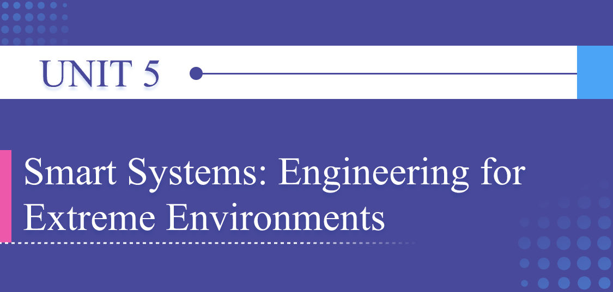

### 学习目标

在英语口语和书面表达中，准确运用与极端环境工程和机械系统相关的关键语言。

练习从视频、录音、技术阅读和信息图等关于极端环境工程的多模态材料中理解信息。

在跨学科团队中高效协作，讨论机械设计、材料和传感器如何在复杂工程任务中协同工作。

用恰当的语言和视觉材料，就中国对极端环境工程的一项贡献做一场演示。

### 单元挑战

极端环境工程把知识和技术推向难以到达、充满危险甚至无法企及的地方。中国的一些成就包括：「蛟龙」号和「奋斗者」号载人潜水器、「深海勇士」号深潜器、「海燕」水下滑翔机系列、深地钻探与地下工程、月球与火星探测任务，以及极地科考平台。这些任务发生在不同环境，却面临相似的工程挑战：压力、温度、能源供给、通信限制、导航等。

你的任务：以小组为单位，选择中国的一项极端环境工程成就，准备一场三分钟的演示。

### 学习旅程

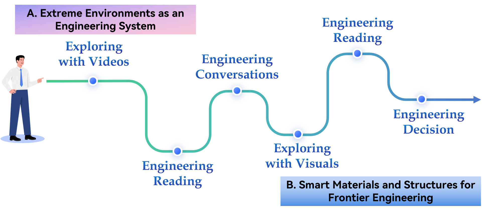

---

## 第5单元 · A. 作为工程系统的极端环境

英文对照：[[EN-U05-2 A. Extreme Environments as an Engineering System|Unit 5 · A. Extreme Environments as an Engineering System]]

### 视频探索

想象你在设计一台小型水下机器人，它的任务是下潜到海面以下 2 公里处拍照并带回数据。从下面三个问题中选出你认为最难解决的一个，并简要说明理由。（1）如何防止机器人被水压压扁；（2）如何确保机器人在返回之前不耗尽电力；（3）如何帮助机器人在漆黑一片、水下又没有 GPS 信号的环境中找到路。

建造桥墩这类水下结构会用到复杂的工程技术，其中最有名的是「围堰」法。观看这段关于水下施工技术的短视频，并准备好回答问题。

> [!note] 视频：水下建筑｜工程师如何建造它们？
> [在平台中打开视频](https://reader-v2.tdtianwen.com/ed-svc2/fp/book-file/01a09e53-7cd0-74a5-bd00-c0868a9d3a3d.mp4?t=oss_download&pack_id=01a0b332-5e0c-7783-8f78-485f17f3f2a0&platform=td)
> ![[U05-视频-水下建筑如何建造.mp4]]

> [!note] 互动练习：视频理解检查
> [在平台中完成此题](https://reader-v2.tdtianwen.com/lg-viewer-v2/reader/standard?platform=td&pack_id=01a0b332-5e0c-7783-8f78-485f17f3f2a0&bookid=01a013c4-e4f0-750f-be8a-7de89b6353d1&section_id=01a013f7-2f45-721a-8106-4e268404f96c)

### 工程阅读

阅读课文，理解海洋探索为什么重要、难在哪里，以及海底测绘和水下技术如何拓展科学知识。

### 探索深渊：揭开海洋的奥秘

尽管海洋无比广阔，其大部分仍是谜。虽然生命在这些深处繁盛，科学家对这个复杂生态系统的了解仍然有限。海洋在调节地球气候、支撑生物多样性和提供造福人类的资源方面扮演着关键角色，因此探索海洋的需求空前迫切。然而，探索这个大半未知的世界，既带来巨大挑战，也带来非凡机遇。

之所以要探索海洋，原因有很多。海洋通过重新分配热量和水分影响全球气候系统，并在碳循环中发挥重要作用；它调节着温度格局和天气系统，其影响从农业一直延伸到人类生计。此外，海洋资源对人类生存至关重要：海洋生物产生的生化化合物在医药领域具有应用潜力，包括癌症治疗和抗衰老药物。通过探索海洋，我们打开了发现之门——这些发现可能彻底改变我们对地球生命的理解，并改善人类的未来。

然而，探索海洋是一项极其复杂、技术要求极高的任务。海洋探索的主要障碍之一是它的体量和深度：超过 90% 的海洋属于「深海」，深度大于 200 米。这些深度的条件——极端压力、低温和完全黑暗——对研究者和探索者构成重大挑战。尽管技术多年来不断进步，探索这些极端环境仍然困难且昂贵。潜水器和遥控无人潜航器（ROV）是海洋探索的关键工具，让科学家得以在曾经无法到达的深度采集样本、观察海洋生物。然而，即便技术在进步，被详细考察过的海洋仍然只占很小一部分。

测绘海底是探索的关键第一步。卫星可以提供海面的宏观图像，却无法给出理解海底所需的细节。利用声呐技术绘制海底详细图像的海底测绘，是探索水下世界的主要方法。截至 2025 年 6 月，全球约 27.3% 的海底已用多波束声呐系统等高分辨率声呐技术完成测绘。这些系统安装在考察船上，能细致呈现海山（水下山脉）和海沟等水下地貌。尽管已有进展，仍有大片海底——尤其是偏远海域——未被测绘。现代测绘技术虽然长足进步，但必须认识到：高分辨率测绘仍处于起步阶段，只有很小一部分深海被精细测绘过。要理解海洋的地质特征与生态系统，更详细的测绘必不可少。通过测绘海底，科学家可以识别生物多样性丰富的区域，例如支撑独特海洋生物的热液喷口和珊瑚礁；这些区域也可能富含矿产、石油和天然气等资源。测绘还有助于识别地质灾害，比如水下火山和断裂带，为地震、海啸等自然灾害的预测提供依据。尽管技术在进步，要完全摸清海底的形态与结构，显然还有大量工作要做。

深海尤其让科学家着迷，因为它是地球上一些最独特、最神秘的生命形式的家园。生活在深海的生物必须适应极端压力、冰点温度和完全黑暗。其中一些生物演化出了令人惊叹的适应机制，比如生物发光——让它们能够自己发光。理解生命如何在这样的条件下繁盛，可以为生命在其他极端环境中的适应能力提供洞见，包括其他行星上存在生命的可能性。

除了丰富的生物，海洋还藏着理解地球过去的钥匙。海底的沉积层保存着过去气候事件的记录，例如冰期、火山喷发和海平面变化。通过研究这些沉积物，科学家能够更好地理解地球气候在数百万年间如何演变。海洋还保存着历史宝藏，比如古代沉船和被淹没的城市，它们能为人类历史与文化提供宝贵线索。探索这些被淹没的考古遗址，帮助我们理解自己的过去，理解人类与海洋互动的漫长历史。

探索的成功取决于这些技术如何协同工作。潜水器可以携带摄像头和传感器，但它需要可靠的电力、导航、通信和回收系统。工程师必须测试每个部件以及部件之间的接口，因为任何一个环节失效都可能限制整个任务。这种系统化的方法，把观察变成可依赖的科学证据。

尽管困难重重，海洋探索仍在进步。自主水下航行器（AUV）等新技术，正让人类更容易探索海洋的偏远区域：它们无需人工干预就能长时间航行，沿途收集数据和样本。此外，政府、科研机构与企业之间的国际合作，也在推动海洋探索不断向前。

（全文约 850 词）

### 理解信息

> [!note] 互动练习：任务 1：用 1–3 个英文单词填空。
> [在平台中完成此题](https://reader-v2.tdtianwen.com/lg-viewer-v2/reader/standard?platform=td&pack_id=01a0b332-5e0c-7783-8f78-485f17f3f2a0&bookid=01a013c4-e4f0-750f-be8a-7de89b6353d1&section_id=01a013f7-2f45-721a-8106-4e268404f96c)

> [!note] 互动练习：任务 2：就课文细节为下列问题选择最佳答案。
> [在平台中完成此题](https://reader-v2.tdtianwen.com/lg-viewer-v2/reader/standard?platform=td&pack_id=01a0b332-5e0c-7783-8f78-485f17f3f2a0&bookid=01a013c4-e4f0-750f-be8a-7de89b6353d1&section_id=01a013f7-2f45-721a-8106-4e268404f96c)

### 像工程师一样思考

阅读下面两则关于中国极端环境工程贡献的简短报道。想一想：当工程师为人类难以到达的地方设计系统时，这些系统面临哪些共同的挑战？

报告一

由天津大学多年协同攻关研发的「海燕」（Haiyan/Petrel）水下滑翔机系列，显著提升了深海观测能力。滑翔机不靠螺旋桨全程推进，而是通过改变浮力在水中滑行，以低能耗实现长距离航行。海燕系列提升了中国开展长周期、大深度、大范围海洋观测的能力，可用于深渊观测、环境监测和国际海洋研究。但工程师仍须管理四组挑战：结构耐久性（抗压、密封与防腐）；系统可靠性（传感器、电池与导航）；任务运行（数据传输与回收）；以及负责任的部署（环境影响、维护与成本）。

报告二

深地探测是极端环境工程的另一个重要领域。中国在塔里木盆地钻探的「深地塔科 1 井」，是全国首口地下深度超过 10000 米的科学探索井。该项目旨在支撑超深地质研究、探索地球内部结构与演化，并检验深地钻探的关键技术与装备。2025 年 2 月，该井在 10910 米深度完钻，创下多项工程纪录，并提供了来自超深地下的宝贵地质数据。工程师须管理四组挑战：物理环境（高温、高压与复杂岩层）；装备耐久性（振动与钻具磨损）；监测与控制（井下通信受限与实时数据）；以及负责任的运行（安全、环境影响与成本）。

两人一组讨论。从上述报道中任选一个项目，探索下面一个或多个方面。

（1）压力与结构强度：分析压力和结构载荷如何影响深海与深地项目。

（2）温度与材料耐受：分析温度和材料耐受性如何影响深海与深地项目。

（3）能源供给与长期运行：分析能源约束如何影响深海与深地项目的设计与长期运行。

> [!note] 延伸阅读：参考答案
> [在平台中查看](https://reader-v2.tdtianwen.com/lg-viewer-v2/reader/standard?platform=td&pack_id=01a0b332-5e0c-7783-8f78-485f17f3f2a0&bookid=01a013c4-e4f0-750f-be8a-7de89b6353d1&section_id=01a013f7-2f45-721a-8106-4e268404f96c)

### 工程对话

### 演示中平衡趣味性与专业性

> [!note] 音频：演示中平衡趣味性与专业性
> [在平台中打开音频](https://reader-v2.tdtianwen.com/ed-svc2/fp/book-file/01a02374-3ef9-7004-a319-291539a686cb.mp3?t=oss_download&pack_id=01a0b332-5e0c-7783-8f78-485f17f3f2a0&platform=td)
> ![[U05-音频1-演示中平衡趣味性与专业性.mp3]]

> [!note] 互动练习：任务 1：理解检查
> [在平台中完成此题](https://reader-v2.tdtianwen.com/lg-viewer-v2/reader/standard?platform=td&pack_id=01a0b332-5e0c-7783-8f78-485f17f3f2a0&bookid=01a013c4-e4f0-750f-be8a-7de89b6353d1&section_id=01a013f7-2f45-721a-8106-4e268404f96c)

> [!note] 互动练习：任务 2：词汇拓展
> [在平台中完成此题](https://reader-v2.tdtianwen.com/lg-viewer-v2/reader/standard?platform=td&pack_id=01a0b332-5e0c-7783-8f78-485f17f3f2a0&bookid=01a013c4-e4f0-750f-be8a-7de89b6353d1&section_id=01a013f7-2f45-721a-8106-4e268404f96c)

> [!note] 互动练习：任务 3：谈谈你的大学生活
> [在平台中完成此题](https://reader-v2.tdtianwen.com/lg-viewer-v2/reader/standard?platform=td&pack_id=01a0b332-5e0c-7783-8f78-485f17f3f2a0&bookid=01a013c4-e4f0-750f-be8a-7de89b6353d1&section_id=01a013f7-2f45-721a-8106-4e268404f96c)

### 生词与表达

| 英文 | 词性 | 释义 |
| --- | --- | --- |
| vastness | n. | 某物极大的规模或范围；广阔 |
| redistribute | v. | 改变某物在特定群体中的分配方式；重新分配 |
| compound | n. | 两种或多种元素经化学结合形成的物质；化合物 |
| revolutionise | v. | 彻底改变某事的进行方式；彻底改变、彻底改革 |
| barrier | n. | 使某事无法实现的问题；障碍、壁垒 |
| submersible | n. | 可在水下航行的小型载具，尤指用于科研或探索的潜水器 |
| seafloor | n. | 海洋的底部；海底、海床 |
| mount | v. | 把某物固定到某物上；安装、装载 |
| trench | n. | 海底狭长深陷的沟槽；海沟 |
| stride | n. | 某事物发展上的进步；进展 |
| hydrothermal | adj. | 与地球内部热水有关的；热液的、水热的 |
| hazard | n. | 可能造成危险或损害的事物；危险、危害 |
| adaptation | n. | 使物种更适应环境的行为或结构变化；适应 |
| bioluminescence | n. | 萤火虫、深海鱼等生物产生光的现象；生物发光 |
| sediment | n. | 沉在液体底部的固体物质；沉积物、沉淀物 |
| shipwreck | n. | 在海上失事或损毁的船；沉船 |

### 平台交互内容

本章还有 6 道互动练习、1 处延伸阅读、1 段音频、1 段视频。音频与视频已下载到本地并内嵌在正文，可离线播放；互动练习需登录平台作答：[在平台中打开本章](https://reader-v2.tdtianwen.com/lg-viewer-v2/reader/standard?platform=td&pack_id=01a0b332-5e0c-7783-8f78-485f17f3f2a0&bookid=01a013c4-e4f0-750f-be8a-7de89b6353d1&section_id=01a013f7-2f45-721a-8106-4e268404f96c)

---

## 第5单元 · B. 面向前沿工程的智能材料与结构

英文对照：[[EN-U05-3 B. Smart Materials and Structures for Frontier Engineering|Unit 5 · B. Smart Materials and Structures for Frontier Engineering]]

### 图像探索

观察图片并回答问题。

（1）每种钻井平台类型有什么独特之处？（2）根据图中呈现的设计特征，哪些技术可以让这些平台在极端海况下更安全、更可靠？

> [!note] 延伸阅读：示例参考答案
> [在平台中查看](https://reader-v2.tdtianwen.com/lg-viewer-v2/reader/standard?platform=td&pack_id=01a0b332-5e0c-7783-8f78-485f17f3f2a0&bookid=01a013c4-e4f0-750f-be8a-7de89b6353d1&section_id=01a013f7-4944-7322-a403-cee36befc5d6)

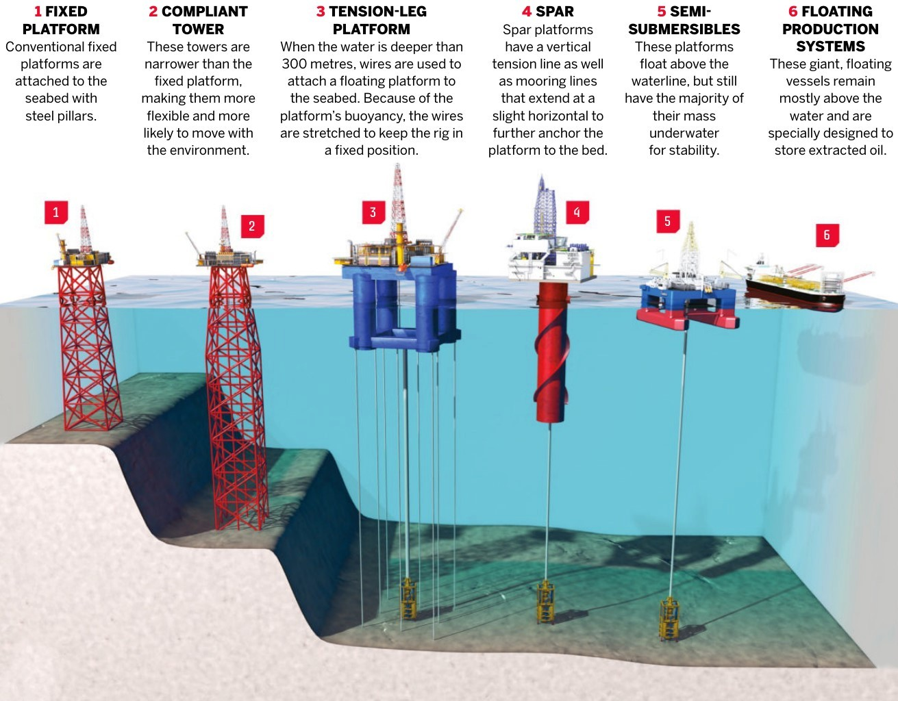

### 工程阅读

阅读下文，探索创新技术如何改变海洋探索。

### 智能钢材与技术革新海洋探索

海洋覆盖了地球表面的 70% 以上，而深海仍是人类最不了解的疆域之一。要抵达深海，需要能承受压力、黑暗、低温、盐水和隔绝环境的材料与机器。因此，新型结构和数字工具在海洋探索中扮演着关键角色。智能钢材、先进海上平台、潜水器、水下机器人和联网传感器，正在帮助工程师抵达更深的海域、采集科学证据，并以更强的控制力开展资源开采。核心挑战不只是「走得更远」，而是让探索更安全、更有信息量、更负责任。

海上结构必须在重载荷、恶劣天气和腐蚀性盐水中运行多年。传统检查往往要到损伤显现才能发现，而派人去远海平台既昂贵又危险。智能钢材把承载材料与嵌入式传感器结合起来应对这一问题：传感器测量温度、压力、振动和应力，持续为操作者提供结构完整性的信息。反复加载会引起疲劳，局部腐蚀会削弱节点和保护面。如果读数出现异常变化，工程师就能在小缺陷演成大故障之前检查受影响区域或调整运行。这种做法并不能取消维护，但能让维护更有针对性：延长平台寿命、减少意外停机、提升海上钻塔的安全性。

现代平台除生产之外还支撑科研。浮式生产储卸油装置（FPSO）和钻井平台可以在固定式结构无法企及的深水作业。它们在支持海上开采的同时，也收集海流、盐度、温度、海底状况和海洋生物的信息。水下传感器和数据分析把这些测量变成科学家可以跨时间、跨地点比较的证据。由此得到的高分辨率数据能改进海底地图，揭示海山、海沟和断裂带等特征。反复采集的测量还能揭示单次考察会错过的季节性变化。这些证据帮助研究者考察人类活动与自然变化如何影响海洋环境。

探索载具与平台同步发展。载人潜水器、遥控或自主水下机器人配备坚固的耐压壳体、摄像头、采样工具和导航系统，能在海面以下数千米作业。轻质复合材料在不增加多余重量的前提下提高强度，耐蚀材料在长航次任务中保护部件。这些选择改善了结构完整性，也为电池、传感器和科学仪器留出了更多余量。冗余密封、备用电源和应急回收装置非常重要，因为一个小故障在水下可能根本无法在潜航期间修复。这些载具可以勘察陌生地形、采集水样和岩样，并观察那些无法在近海面存活的生物。因此，它们的价值取决于整体系统：材料、能源、感知、控制、通信和回收预案必须协同工作。

数据采集同样在快速变化。安装在平台、载具和浮标上的物联网（IoT）传感器可以测量温度、盐度、压力、海流和化学状况。实时传输造就连续的数据流，取代了过去偶尔一次科考航次留下的孤立观察。AI 与机器学习系统随后可以识别模式、检测异常，并支持对海流和环境变化的预报。把不同仪器的读数结合起来，还可以降低把单个故障传感器误判为真实事件的风险。这些工具也改善了应急响应：当传感器检测到溢油、异常压力或水下地震活动时，操作者可以更早调查、限制损害。由于水下通信困难，一部分处理可能在载具本身上进行，让它先筛选重要信息再传输。

环境保护必须与探索一并考虑。碳捕集与封存（CCS）部署在海上平台时，可以捕集二氧化碳并将其注入海床之下合适的地质构造。它的主要目的是减少排放，而不是降低开采成本。这类系统仍需要谨慎的选址、监测和风险管理，确保被封存的碳不会逸出。与此同时，环境传感器可以跟踪平台周边的变化，显示作业是否正在影响水质和海洋生态系统。技术能力必须有环境责任与之匹配。

能源设计是可持续性的另一部分。一些现代平台把高效设备与风力发电机、太阳能板等可再生能源结合起来。可再生能源并不总能满足全部运行需求，但可以减少燃料消耗，支撑传感器、通信设备或辅助系统。电池和能源管理软件可以储存电力，并在情况变化时把它导向最重要的功能。工程师必须平衡能源可得性、可靠性、维护可达性和环境影响，而不是把任何单一技术当作完整解决方案。

总而言之，智能材料、先进载具、联网感知与更清洁的能源，正在让海洋探索变得更安全、更具科学价值。它们没有让深海变得简单、没有风险，而是让工程师在管理压力、腐蚀、能源约束、设备故障和环境影响时拥有更好的证据。每一项进步也带来关于成本、维护、数据质量和意外后果的新问题。只有把这些技术当作集成系统的一部分来运用，人类才能更有担当地研究海洋、利用海洋资源，同时为子孙后代保护海洋生态系统。负责任的集成，始终必不可少。

（全文约 850 词）

### 理解信息

> [!note] 互动练习：任务 1：根据课文为每个问题选择最佳答案。
> [在平台中完成此题](https://reader-v2.tdtianwen.com/lg-viewer-v2/reader/standard?platform=td&pack_id=01a0b332-5e0c-7783-8f78-485f17f3f2a0&bookid=01a013c4-e4f0-750f-be8a-7de89b6353d1&section_id=01a013f7-4944-7322-a403-cee36befc5d6)

> [!note] 互动练习：任务 2：判断下列各句正误（T/F）。
> [在平台中完成此题](https://reader-v2.tdtianwen.com/lg-viewer-v2/reader/standard?platform=td&pack_id=01a0b332-5e0c-7783-8f78-485f17f3f2a0&bookid=01a013c4-e4f0-750f-be8a-7de89b6353d1&section_id=01a013f7-4944-7322-a403-cee36befc5d6)

> [!note] 互动练习：任务 3：把课文中的术语或表达与其正确释义连线。
> [在平台中完成此题](https://reader-v2.tdtianwen.com/lg-viewer-v2/reader/standard?platform=td&pack_id=01a0b332-5e0c-7783-8f78-485f17f3f2a0&bookid=01a013c4-e4f0-750f-be8a-7de89b6353d1&section_id=01a013f7-4944-7322-a403-cee36befc5d6)

### 工程决策

听一段对话，为每个问题选择最佳答案。

> [!note] 音频：理解工程的同与异
> [在平台中打开音频](https://reader-v2.tdtianwen.com/ed-svc2/fp/book-file/01a023c3-e32a-7973-8dfc-cc64b77ed49a.mp3?t=oss_download&pack_id=01a0b332-5e0c-7783-8f78-485f17f3f2a0&platform=td)
> ![[U05-音频2-理解工程的同与异.mp3]]

> [!note] 互动练习：任务 1：理解检查
> [在平台中完成此题](https://reader-v2.tdtianwen.com/lg-viewer-v2/reader/standard?platform=td&pack_id=01a0b332-5e0c-7783-8f78-485f17f3f2a0&bookid=01a013c4-e4f0-750f-be8a-7de89b6353d1&section_id=01a013f7-4944-7322-a403-cee36befc5d6)

> [!note] 互动练习：任务 2：在类似情境中做出你的决策
> [在平台中完成此题](https://reader-v2.tdtianwen.com/lg-viewer-v2/reader/standard?platform=td&pack_id=01a0b332-5e0c-7783-8f78-485f17f3f2a0&bookid=01a013c4-e4f0-750f-be8a-7de89b6353d1&section_id=01a013f7-4944-7322-a403-cee36befc5d6)

### 交流与反思

### 打造你的单元挑战成果

是时候展示你整个单元一直在准备的演示了。你的演示应当：

（1）介绍中国的一项极端环境工程成就；

（2）说明它服务的任务，以及这项任务为什么重要；

（3）指出让任务成为可能的结构、载具、平台或装备；

（4）把它作为跨学科机械系统来分析——说明材料、传感器、能源系统、控制方法、数据系统和安全措施如何协同工作；

（5）指出一个主要的技术约束，并解释工程师如何应对。

> [!note] 延伸阅读：示例参考答案
> [在平台中查看](https://reader-v2.tdtianwen.com/lg-viewer-v2/reader/standard?platform=td&pack_id=01a0b332-5e0c-7783-8f78-485f17f3f2a0&bookid=01a013c4-e4f0-750f-be8a-7de89b6353d1&section_id=01a013f7-4944-7322-a403-cee36befc5d6)

### 学习档案反思

> [!note] 互动页面：学习档案反思
> [打开互动页面](https://zhihuiware.com/api/webapp/embed/8ffa1e89-8479-4f5f-813c-7ab496119c51)

### 生词与表达

| 英文 | 词性 | 释义 |
| --- | --- | --- |
| pivotal | adj. | 因其他事物依赖于它而极其重要的；关键性的、核心的 |
| offshore | adj. | 发生在或存在于近海的；海上的、近海的 |
| extraction | n. | 从某处取出或获得某物的行为或过程；提取、开采 |
| corrosive | adj. | 倾向于（尤其通过化学作用）缓慢毁坏某物的；腐蚀性的 |
| integrity | n. | 完整、完好、能够安全发挥功能的状态；完整性 |
| rig | n. | 用于从地下或海中开采油气的大型结构；钻塔、钻井设备 |
| analytics | n. | 对数据中有意义模式的发现与传达；数据分析 |
| resolution | n. | 图像或数据集中能看到或记录的细节程度；分辨率 |
| composite | n. | 由不同部件或材料组合而成的东西；复合材料 |
| IoT (Internet of Things) | n. | 接入互联网、可相互共享数据的物体网络；物联网 |
| buoy | n. | 在海上标示位置或搭载监测设备的漂浮物；浮标 |
| stream | n. | 某物持续不断的流动；流、数据流 |
| implement | v. | 使正式决定的事情开始发生或被使用；实施 |
| turbine | n. | 从液体、气体或空气流动中获得动力的机器；涡轮机 |
| endeavour | n. | 做某事的尝试，尤指新颖或困难之事；努力 |
| harness | v. | 控制和利用某物的力量来产生动力或达成目标；利用、驾驭 |

### 平台交互内容

本章还有 5 道互动练习、2 处延伸阅读、1 段音频、1 个交互页面。音频与视频已下载到本地并内嵌在正文，可离线播放；互动练习需登录平台作答：[在平台中打开本章](https://reader-v2.tdtianwen.com/lg-viewer-v2/reader/standard?platform=td&pack_id=01a0b332-5e0c-7783-8f78-485f17f3f2a0&bookid=01a013c4-e4f0-750f-be8a-7de89b6353d1&section_id=01a013f7-4944-7322-a403-cee36befc5d6)

---

## 第6单元 · 单元预览

英文对照：[[EN-U06-1 Unit Preview|Unit 6 · Unit Preview]]

### 学习目标

在英语口语和书面表达中，准确运用与储能和净零排放相关的关键技术词汇。

从视频、录音、技术阅读和信息图中提取、概括和比较有关能源系统的信息。

在小组讨论中运用证据，分析和评估能源工程方案及其现实取舍。

制定并发表一个三分钟演示，为选定社区提出一份储能方案。

### 单元挑战

你们的大学与一项清洁能源倡议合作，帮助两个偏远社区提高供电可靠性。一个是宁夏的沙漠边缘社区，阳光充足但电网容量有限；另一个是浙江的海岛社区，海风稳定，但柴油发电昂贵、电网接入有限。

你的任务：以小组形式组成能源工程团队，选择一个社区，运用本单元的一种储能技术提出解决方案。准备一个三分钟的演示，说明需求、技术、支持证据和主要的工程取舍。

### 学习旅程

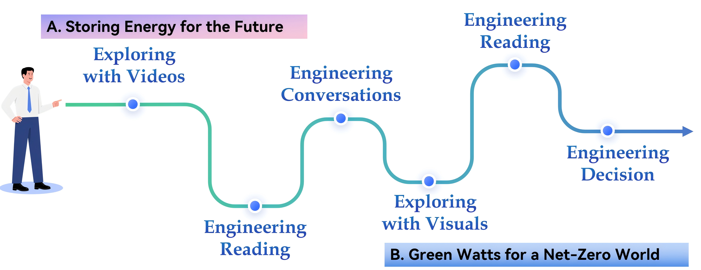

---

## 第6单元 · A. 为未来储能

英文对照：[[EN-U06-2 A. Storing Energy for the Future|Unit 6 · A. Storing Energy for the Future]]

### 视频探索

想象你的城市突然停电 48 小时。环顾四周，选出三个你最担心的设备或电器（例如手机、电脑、电梯、空调）。

按照「断电后多快会成为严重问题」给这三个设备排序，简要解释你的排序，并想想备用电源耗尽之后会发生什么。

你知道吗？人类「储存」能量已有几个世纪——从冰窖到智能手机电池。观看这段关于储能技术的短视频，准备好回答问题。

> [!note] 视频：储能系统如何工作？
> [在平台中打开视频](https://reader-v2.tdtianwen.com/ed-svc2/fp/book-file/01a02852-37ac-7303-a0bb-564c67212e5c.mp4?t=oss_download&pack_id=01a0b332-5e0c-7783-8f78-485f17f3f2a0&platform=td)
> ![[U06-视频-储能系统如何工作.mp4]]

> [!note] 互动练习：视频理解检查
> [在平台中完成此题](https://reader-v2.tdtianwen.com/lg-viewer-v2/reader/standard?platform=td&pack_id=01a0b332-5e0c-7783-8f78-485f17f3f2a0&bookid=01a013c4-e4f0-750f-be8a-7de89b6353d1&section_id=01a013f8-23e3-7264-8685-86b4b54d891f)

### 工程阅读

阅读课文，理解储能的现状与未来前景。

### 储能：清洁能源未来背后的隐藏力量

太阳能出力集中在白天，风电出力随天气变化，而用电高峰的时间又常常错开。因此，弥合「能量产生时」与「能量需要时」之间的缺口，是清洁电力系统的核心挑战。储能可以提供帮助，但没有哪种方法适合所有情况。在选定技术之前，工程师要比较存储时长、功率、容量、效率、安全性、成本、选址和环境影响。

历史最悠久、应用最广的电网级方式是抽水蓄能。电力富余时，把水从下水库抽到上水库；需求升高时，水流回下并推动水轮机发电。其往返效率通常在 70%–85% 之间，电站可运行数十年。抽水蓄能可以提供数小时乃至更长的存储，但合适的站址、环境评审、漫长的建设期和高昂的初始投资限制了它能够建在哪里。

锂离子电池最早在便携式电子产品中商业化，后来在电动汽车和电网储能中广泛采用。许多电网级系统可提供约一至八小时的灵活调节能力，当前项目以二至四小时居多。锂离子在电极之间移动，实现能量的存储与释放；其模块化特性让系统可以通过增加单元来扩容。不过，电芯化学体系、温度控制、老化和热失控风险，都要求精心的设计、监测和消防保护。

钠离子电池使用储量丰富的钠，可以降低对锂和其他一些关键材料的依赖。其能量密度通常低于顶尖锂离子电芯，但在许多固定式应用场景中，重量和体积的限制较小。一些钠离子体系的低温性能也不错。成本、循环寿命、安全性和制造规模仍因设计而异。

如果需要更长的放电时间，液流电池很有吸引力。在全钒氧化还原液流电池中，两种液态电解质存放在各自的储罐里，被泵送通过电堆。储罐与电堆分开设计，因此能量容量和功率可以比常规电池更独立地扩展。系统效率通常在 65%–85% 之间，取决于设计和运行条件；循环寿命长，容量衰减有限。

压缩空气储能可以在拥有合适地下洞穴或人工储气装置的地方提供长时储能。富余电力把空气压缩储存；放电时，空气膨胀驱动发电设备。其性能在很大程度上取决于压缩热如何管理。传统电站的往返效率相对不高，而先进设计正尝试回收并再利用热量，以提高效率、减少或避免燃料消耗。

对于以周或季节计的储能，氢是一个候选方案。富余的低碳电力可以通过电解把水分解为氢和氧；氢随后被储存起来，日后用于燃料电池、燃气轮机或工业过程。电-氢-电转换的往返效率低，通常不适合日常的隔夜充放循环。它的价值在于能够大量、长期储存能量，并在电力、工业、交通和燃料市场之间转移能量——前提是基础设施和安全要求得到满足。

并非所有储能都输出电力。储热把能量以热或冷的形式保存起来供日后使用。熔盐、陶瓷砖、水、冰或砂都可以为建筑和工业过程储存热能。热对热的效率可以很高，但它与电对电的往返效率不可直接比较。最佳设计取决于温度、时长、保温损耗，以及用户需要的到底是热、冷还是电。

所有这些技术都依赖控制系统来决定何时充电、何时放电、何时持能。通过结合天气预报、需求数据、设备限值和市场信号，运营者可以在保障安全和资产寿命的同时安排储能运行。数字孪生——用运行数据持续更新的虚拟模型——可以支持场景测试、维护计划和故障诊断，但其建议的可靠性不会超过底层模型与数据的可靠性。

对有志于投身这一领域的人来说，机会远不止电气工程。化学家开发能在宽温区内保持稳定的电解质，材料科学家研究电极、隔膜、腐蚀与回收；机械与土木工程师设计压力容器、洞穴、水库、换热器、基础和消防系统；控制工程师和软件专家构建预测、优化、通信与网络安全工具；技术员和运行人员需要巡检、测试、应急响应和安全隔离的规程；经济学家、规划者和监管者评估市场规则、许可、土地和水资源使用、供应链，以及升级费用由谁承担。社区也需要关于收益、风险、施工影响和报废责任的清晰信息。这种多学科协作之所以重要，是因为一台实验室效率漂亮的装置，如果缺少备件、维护技能、资金、安全标准或公众接受度，作为真实项目仍可能失败。因此，成功的储能既取决于技术，也取决于让它长期运转的制度安排。现场示范还必须在本地的温度、充放循环、电网条件和维护实践下检验性能，之后设计才能大规模推广。

从抽水蓄能到新兴电池和氢系统，储能技术在时长、规模、响应速度、效率、安全性、选址和成本等方面回答着不同的问题。持续的研究和审慎的系统设计可以让可再生电力更可靠、让能源可及性更广，但每个项目仍然需要基于证据的权衡。

（全文约 858 词）

### 理解信息

> [!note] 互动练习：任务 1：用 1–3 个英文单词填空。
> [在平台中完成此题](https://reader-v2.tdtianwen.com/lg-viewer-v2/reader/standard?platform=td&pack_id=01a0b332-5e0c-7783-8f78-485f17f3f2a0&bookid=01a013c4-e4f0-750f-be8a-7de89b6353d1&section_id=01a013f8-23e3-7264-8685-86b4b54d891f)

> [!note] 互动练习：任务 2：就课文细节为下列问题选择最佳答案。
> [在平台中完成此题](https://reader-v2.tdtianwen.com/lg-viewer-v2/reader/standard?platform=td&pack_id=01a0b332-5e0c-7783-8f78-485f17f3f2a0&bookid=01a013c4-e4f0-750f-be8a-7de89b6353d1&section_id=01a013f8-23e3-7264-8685-86b4b54d891f)

### 像工程师一样思考

阅读下面两则简短报道，分析电网级集中式储能与分布式储能作为系统方案有何不同。

报告一

电网级电池储能——例如南澳大利亚 150 兆瓦的霍恩斯代尔电力储备（Hornsdale Power Reserve）——在电网层面运行。这类系统可以存储富余电力，并在供需失衡时快速响应。快速响应支撑频率调节和短期电网稳定，储存的能量则可以被转移到高峰时段使用。此类设施能够减少对部分化石燃料调峰机组的依赖，但其价值取决于存储时长、市场设计、网络约束和电网所需的服务类型。

报告二

分布式储能把小型储能单元——家用电池、社区系统或具备条件的电动汽车电池——布置在用电侧附近。装有屋顶光伏的家庭可以把白天的电存起来晚上用。当大量设备被协调起来时，它们可以像虚拟电厂一样运行，在高峰时段提供服务。在线路和控制允许孤岛运行的前提下，分布式系统能提升本地的供电韧性。其代价包括更高的协调复杂性、多元的产权结构、网络安全、电池的可用性，以及对可互操作软件和市场规则的需求。

> [!note] 互动练习：为下列每个表述选择对应的储能模式。
> [在平台中完成此题](https://reader-v2.tdtianwen.com/lg-viewer-v2/reader/standard?platform=td&pack_id=01a0b332-5e0c-7783-8f78-485f17f3f2a0&bookid=01a013c4-e4f0-750f-be8a-7de89b6353d1&section_id=01a013f8-23e3-7264-8685-86b4b54d891f)

### 工程对话

### 攻克储能课程

> [!note] 音频：攻克储能课程
> [在平台中打开音频](https://reader-v2.tdtianwen.com/ed-svc2/fp/book-file/01a0232c-f35b-7f04-b371-8e9ecf831d61.mp3?t=oss_download&pack_id=01a0b332-5e0c-7783-8f78-485f17f3f2a0&platform=td)
> ![[U06-音频1-攻克储能课程.mp3]]

> [!note] 互动练习：任务 1：理解检查
> [在平台中完成此题](https://reader-v2.tdtianwen.com/lg-viewer-v2/reader/standard?platform=td&pack_id=01a0b332-5e0c-7783-8f78-485f17f3f2a0&bookid=01a013c4-e4f0-750f-be8a-7de89b6353d1&section_id=01a013f8-23e3-7264-8685-86b4b54d891f)

> [!note] 互动练习：任务 2：词汇拓展
> [在平台中完成此题](https://reader-v2.tdtianwen.com/lg-viewer-v2/reader/standard?platform=td&pack_id=01a0b332-5e0c-7783-8f78-485f17f3f2a0&bookid=01a013c4-e4f0-750f-be8a-7de89b6353d1&section_id=01a013f8-23e3-7264-8685-86b4b54d891f)

> [!note] 互动练习：任务 3：制作一张学习策略卡
> [在平台中完成此题](https://reader-v2.tdtianwen.com/lg-viewer-v2/reader/standard?platform=td&pack_id=01a0b332-5e0c-7783-8f78-485f17f3f2a0&bookid=01a013c4-e4f0-750f-be8a-7de89b6353d1&section_id=01a013f8-23e3-7264-8685-86b4b54d891f)

### 生词与表达

| 英文 | 词性 | 释义 |
| --- | --- | --- |
| power system | n. | 发电、输电、配电、储电和用电的网络；电力系统 |
| pumped hydro | n. | 利用上下两个水库的储能系统；抽水蓄能 |
| excess | adj. | 超出所需或可用的；富余的、过剩的 |
| lithium | n. | 一种质轻的银白色软金属元素，用于电池和合金；锂 |
| electrode | n. | 电流进出电池或其他电气设备的导体；电极 |
| modularity | n. | 由可组合、可替换的独立标准单元构成的特性；模块化 |
| thermal runaway | n. | 可能导致电池起火或损毁的快速自热现象；热失控 |
| sodium | n. | 一种银白色软金属，天然以食盐等化合物形式存在；钠 |
| flow battery | n. | 把液态电解质存放在外部储罐中的可充电电池；液流电池 |
| vanadium | n. | 用于某些液流电池电解液的金属元素；钒 |
| electrolyte | n. | 溶解或熔融状态下含可移动离子、能导电的物质；电解质 |
| round-trip efficiency | n. | 充电放电之后可取回能量的比例；往返效率 |
| hydrogen | n. | 化学元素，所有元素中最轻的气体；氢、氢气 |
| electrolysis | n. | 让电流通过液体、将其分解为化学组分的过程；电解 |
| thermal storage | n. | 以热或冷的形式保存能量供日后使用；储热 |
| molten salt | n. | 加热至液态的盐，用于电力系统热能储存；熔盐 |
| operator | n. | 运营电厂、能源系统或电网的公司或个人；运营商 |
| digital twin | n. | 用物理系统数据持续更新的虚拟模型；数字孪生 |
| end-of-life responsibility | n. | 设备退役后的复用、回收或安全处置责任；报废阶段责任 |
| multidisciplinary | adj. | 涉及多个学术或专业领域的；多学科的 |
| evidence-based trade-off | n. | 基于相关证据在相互竞争的利益与成本之间做出的取舍；基于证据的权衡 |

### 平台交互内容

本章还有 7 道互动练习、1 段音频、1 段视频。音频与视频已下载到本地并内嵌在正文，可离线播放；互动练习需登录平台作答：[在平台中打开本章](https://reader-v2.tdtianwen.com/lg-viewer-v2/reader/standard?platform=td&pack_id=01a0b332-5e0c-7783-8f78-485f17f3f2a0&bookid=01a013c4-e4f0-750f-be8a-7de89b6353d1&section_id=01a013f8-23e3-7264-8685-86b4b54d891f)

---

## 第6单元 · B. 迈向净零世界的绿色电力

英文对照：[[EN-U06-3 B. Green Watts for a Net-Zero World|Unit 6 · B. Green Watts for a Net-Zero World]]

### 图像探索

观察图片并回答问题。

（1）通向净零排放的六大策略领域分别展示了哪些行动？（2）你所在的地区应优先推进哪两个领域？为什么？

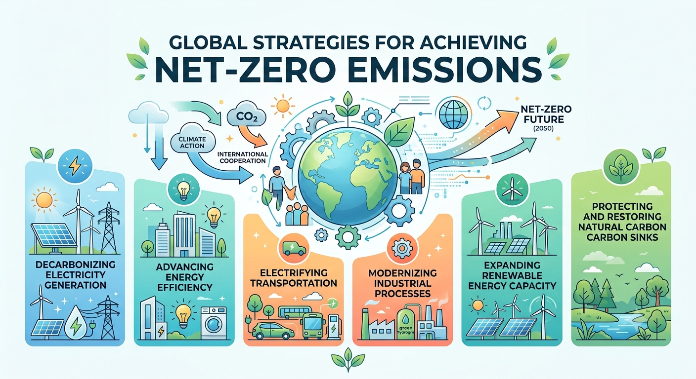

> [!note] 延伸阅读：示例参考答案
> [在平台中查看](https://reader-v2.tdtianwen.com/lg-viewer-v2/reader/standard?platform=td&pack_id=01a0b332-5e0c-7783-8f78-485f17f3f2a0&bookid=01a013c4-e4f0-750f-be8a-7de89b6353d1&section_id=01a013f8-5ca1-7551-a46a-f6c47714f8a7)

### 工程阅读

阅读下文，理解迈向净零排放的现有解决路径。

### 迈向净零世界的绿色电力

在世界全力应对气候变化这一紧迫课题之际，向绿色能源转型是创造可持续未来的必由之路。

#### 通往净零排放之路

实现温室气体净零排放，需要在能源、工业、交通、建筑和农业等领域深度减排。暂时无法消除的剩余排放，必须以持久性的碳移除来平衡——可能包括生态修复，或「直接空气捕集+封存」等工程手段。碳捕集与封存（CCS）也能减少部分工业源的排放，但它并不能取代直接减排。因此，这场转型将改变社会生产、存储、输送和使用能源的方式。

#### 绿色能源：净零世界的支柱

在日常用语中，绿色能源通常指可再生能源或其他低排放能源。风电、光伏和水电在运行期间几乎不产生温室气体排放，尽管制造、施工、土地利用和供应链仍会带来全生命周期影响。实现碳中和目标，既需要更清洁的供给，也需要一个负担得起、可靠运行、对环境负责的能源系统。

光伏、风电、水电等低排放技术可以替代相当规模的化石能源发电。工程上的挑战在于：随着波动性可再生能源大规模并网，如何保持系统可靠。光伏出力跟随日照和天气，风电出力随大气条件变化，因此电力系统需要一整套灵活性资源：更坚强的电网、储能、灵活调节电源、需求响应和更好的预测。

#### 储能与智能电网的作用

储能可以在供给充裕时吸收电力，在需求升高或出力下降时释放。电池特别适合快速响应和短时灵活调节，其他技术则可以承担更长的时长。储能可以支撑频率调节、减少弃电、增强可靠性，但它本身并不能把每一种可再生能源都变成恒定的基荷电源，也不能保证杜绝停电。

在储能之外，智能电网的演进是净零转型中另一项改变格局的发展。智能电网是数字化的网络，利用先进传感器和数据分析来管理电力潮流、优化能源分配、提升可再生能源的消纳能力。它们让发电与用电的管理更高效，实现更好的需求响应，并把能源浪费降到最低。此外，智能电网能更好地接纳分布式可再生能源，帮助实时平衡供需，在提高电网稳定性的同时优化跨部门的能源使用。

#### 绿色能源与电动汽车产业

交通电动化可以减少石油消费和尾气排放，但电动汽车的完整气候效益取决于电力结构、车辆效率、电池生产、车辆尺寸、使用模式和报废管理。随着电力系统越来越清洁，电动轿车、公交和卡车能带来更大的全生命周期减排。因此，充电基础设施和有序充电，是交通规划与电力规划共同的重要组成。

电动汽车与电力系统还可以互动。有序充电可以把需求从紧张的时段转移出去；在硬件、电池质保、市场规则和用户需求允许的条件下，车网互动（V2G）系统可让合适停放状态的电动汽车提供有限的电网服务。这些联系创造了潜在的协同，但需要标准、网络安全、消费者知情同意，以及对电池衰减的审慎评估。

中国规模庞大的电动汽车和电池产业，展示了交通、制造与电力储能如何协同发展。电网侧电池可以帮助消纳波动性可再生电力，电动汽车则能减少对汽油和柴油的直接依赖。不过，其对中国 2060 碳中和目标的总体贡献，取决于更清洁的电力、高效的车辆、负责任的供应链、电池的梯次利用或回收，以及可信的排放计量。

#### 实现净零的挑战与前路

绿色能源的潜力巨大，但资金、技术、可靠电网和技能工人的可及性仍然不均。能源公平要问：谁获得了可靠、负担得起的能源？谁承担了环境和经济成本？谁参与了决策？低收入和中等收入地区可能需要优惠资金、本地能力建设，以及针对自身资源与制度设计的方案，而不是照搬别处的做法。

输配电网、储能、可再生发电、充电系统、高效建筑和工业设备同样需要巨额投资。但仅有资金不够：项目需要规划、许可、技术标准、受训工人、可靠供应链，以及能够数十年运营和维护资产的制度。政府可以制定政策、保护消费者；企业可以开发和融资项目；国际组织可以支持技术转移和优惠资金；社区可以提出本地需求和风险。成本分摊同样重要，因为设计不当的电价或补贴可能让低收入用户承担过重的负担。因此，协同行动必须把基础设施交付与可负担性、韧性、人才培养、环境保护和透明的成效计量联系起来。

#### 共建可持续的未来

净零不是一项技术或一个部门就能实现的目标。它需要快速减排、更清洁的电力、能效提升、电气化、储能和其他灵活性资源、在适宜场合使用可持续燃料、对难以消除的剩余排放进行碳管理，以及国际合作。目标是建成一个更低排放、更有韧性、更加包容的能源系统。这一目标能否实现，取决于基于证据的政策、负责任的工程、持续的投资和公众的继续参与。

（全文约 847 词）

### 理解信息

> [!note] 互动练习：任务 1：根据课文为每个问题选择最佳答案。
> [在平台中完成此题](https://reader-v2.tdtianwen.com/lg-viewer-v2/reader/standard?platform=td&pack_id=01a0b332-5e0c-7783-8f78-485f17f3f2a0&bookid=01a013c4-e4f0-750f-be8a-7de89b6353d1&section_id=01a013f8-5ca1-7551-a46a-f6c47714f8a7)

> [!note] 互动练习：任务 2：判断下列各句正误（T/F）。
> [在平台中完成此题](https://reader-v2.tdtianwen.com/lg-viewer-v2/reader/standard?platform=td&pack_id=01a0b332-5e0c-7783-8f78-485f17f3f2a0&bookid=01a013c4-e4f0-750f-be8a-7de89b6353d1&section_id=01a013f8-5ca1-7551-a46a-f6c47714f8a7)

> [!note] 互动练习：任务 3：技术词汇——把课文中的术语或表达与其正确释义连线。
> [在平台中完成此题](https://reader-v2.tdtianwen.com/lg-viewer-v2/reader/standard?platform=td&pack_id=01a0b332-5e0c-7783-8f78-485f17f3f2a0&bookid=01a013c4-e4f0-750f-be8a-7de89b6353d1&section_id=01a013f8-5ca1-7551-a46a-f6c47714f8a7)

### 工程决策

听一段对话，探讨先进清洁能源系统与现实能源公平之间的张力。

> [!note] 音频：净零困境
> [在平台中打开音频](https://reader-v2.tdtianwen.com/ed-svc2/fp/book-file/01a0235f-1d1b-7ad0-8086-abe2b351ca78.mp3?t=oss_download&pack_id=01a0b332-5e0c-7783-8f78-485f17f3f2a0&platform=td)
> ![[U06-音频2-净零困境.mp3]]

> [!note] 互动练习：任务 1：理解检查
> [在平台中完成此题](https://reader-v2.tdtianwen.com/lg-viewer-v2/reader/standard?platform=td&pack_id=01a0b332-5e0c-7783-8f78-485f17f3f2a0&bookid=01a013c4-e4f0-750f-be8a-7de89b6353d1&section_id=01a013f8-5ca1-7551-a46a-f6c47714f8a7)

> [!note] 互动练习：任务 2：在类似情境中做出你的决策
> [在平台中完成此题](https://reader-v2.tdtianwen.com/lg-viewer-v2/reader/standard?platform=td&pack_id=01a0b332-5e0c-7783-8f78-485f17f3f2a0&bookid=01a013c4-e4f0-750f-be8a-7de89b6353d1&section_id=01a013f8-5ca1-7551-a46a-f6c47714f8a7)

### 交流与反思

### 打造你的单元挑战成果

回到单元挑战，为「海岛与沙漠能源方案」准备你的三分钟演示。演示应包括：

一、三页幻灯片：

（1）社区与需求：说明场景、当地的用电问题和受影响的用户。

（2）储能方案：解释所选技术如何工作，为何契合当地的资源、气候、地理和电网接入条件。

（3）证据与现实：至少包含一个相关数据点，指出一个关键取舍，并说明安装、运行、维护、安全和人力需求。

二、三分钟陈述：准确使用本单元至少三个技术术语，并以清晰的建议收尾。

> [!note] 延伸阅读：示例参考答案
> [在平台中查看](https://reader-v2.tdtianwen.com/lg-viewer-v2/reader/standard?platform=td&pack_id=01a0b332-5e0c-7783-8f78-485f17f3f2a0&bookid=01a013c4-e4f0-750f-be8a-7de89b6353d1&section_id=01a013f8-5ca1-7551-a46a-f6c47714f8a7)

### 学习档案反思

> [!note] 互动页面：学习档案反思
> [打开互动页面](https://zhihuiware.com/api/webapp/embed/b1860410-0fb7-4114-8eb6-7a2d0ca20b24)

### 生词与表达

| 英文 | 词性 | 释义 |
| --- | --- | --- |
| grapple with | phr. | 努力应对困难的问题或挑战；竭力应对 |
| combat | v. | 采取行动阻止或处理问题；应对、解决 |
| residual emissions | n. | 在可行的减排之后仍然存在的排放；剩余排放 |
| removals | n. | 从大气中移除二氧化碳的过程；碳移除 |
| life-cycle | n. | 涵盖产品或系统的全部阶段；全生命周期 |
| incorporate | v. | 把某物纳入更大的整体或系统；纳入、整合 |
| flexibility | n. | 电力系统响应供需变化的能力；灵活性 |
| curtailment | n. | 因电力无法消纳或输送而减少可用发电量；弃电、限发 |
| reliability | n. | 系统提供稳定服务的能力；可靠性 |
| baseload | n. | 电网持续存在的最低用电需求；基础负荷 |
| managed charging | n. | 把电动汽车充电转移到更适合电力系统的时段；智能有序充电 |
| vehicle-to-grid | n. | 允许合适的电动汽车向电力系统提供服务的系统；车网互动 |
| synergy | n. | 两个或多个主体协同产生的额外能量、力量或成效；协同作用 |
| energy equity | n. | 公平获得可靠且负担得起的能源，公平分担成本；能源公平 |
| cost allocation | n. | 项目或系统成本在用户或群体间的分摊方式；成本分摊 |
| coordinated action | n. | 让不同群体有效协作的有组织的行动；协同行动 |
| resilient | adj. | 能从困难或冲击中快速恢复的；有韧性的 |

### 平台交互内容

本章还有 5 道互动练习、2 处延伸阅读、1 段音频、1 个交互页面。音频与视频已下载到本地并内嵌在正文，可离线播放；互动练习需登录平台作答：[在平台中打开本章](https://reader-v2.tdtianwen.com/lg-viewer-v2/reader/standard?platform=td&pack_id=01a0b332-5e0c-7783-8f78-485f17f3f2a0&bookid=01a013c4-e4f0-750f-be8a-7de89b6353d1&section_id=01a013f8-5ca1-7551-a46a-f6c47714f8a7)

---

## 第7单元 · 单元预览

英文对照：[[EN-U07-1 Unit Preview|Unit 7 · Unit Preview]]

### 学习目标

在交际情境中运用与脑机接口（BCI）和生物医学康复系统相关的关键技术词汇。

从多模态材料中提取、概括和比较有关人机融合与神经康复的信息。

分析神经康复技术中的工程取舍，包括侵入程度、成本效益和患者安全。

设计一张信息图，用有效的语言和视觉元素介绍中国在脑机接口或神经康复工程领域的一项成就。

### 单元挑战

中国已成为脑机接口研究与神经康复工程的重要贡献者。天津大学的「神工」康复机器人、BrainTalker 脑机接口芯片、基于医院的卒中康复平台、可穿戴康复设备和智能医疗器械等技术，展示了脑信号如何转化为临床和辅助应用。这些成就令人振奋，但工程师必须考虑四个相互关联的方面：患者体验（尊严与舒适）、临床责任（安全、隐私与验证）、可及性（负担能力、医院可得性与家庭支持）以及落地实施（人员配备、维护与长期使用）。

你的任务：以小组为单位，选择中国在脑机接口技术或神经康复工程领域的一项近期成就，制作一张信息图，解释该技术如何工作、为什么重要，以及它将如何贡献于医疗保健的未来。

### 学习旅程

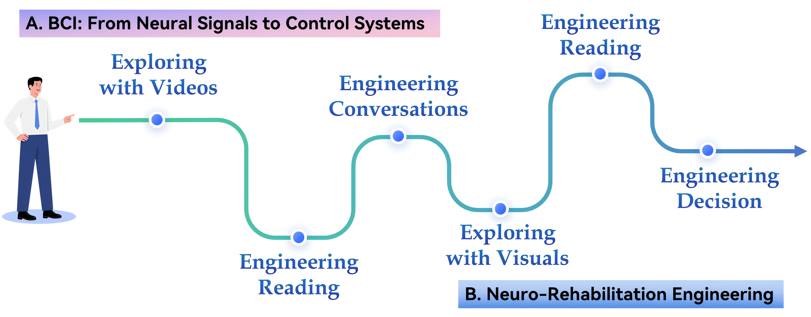

---

## 第7单元 · A. 脑机接口：从神经信号到控制系统

英文对照：[[EN-U07-2 A. BCI - From Neural Signals to Control Systems|Unit 7 · A. BCI: From Neural Signals to Control Systems]]

### 视频探索

想象你某天醒来，发现自己无法动弹、无法说话，唯一还能控制的只有思想。再想象有一台设备能读取你的脑信号，并把它们变成指令。（1）如果你能用意念控制一样东西——手机、电灯开关、轮椅、机械臂或其他——你会选什么？为什么？（2）如果设备误读了你的想法会出什么问题？比如你想关灯它却开了灯，或者机械臂朝错误的方向移动？

在这期 CGTN BizFocus 节目中，记者走访了多家处于脑机接口技术前沿的中国企业。视频介绍了脑机接口（BCI），探讨它如何快速发展，以及对残障人士或脑部疾病患者的潜在应用。

> [!note] 视频：CGTN BizFocus——中国的脑机接口技术
> [在平台中打开视频](https://reader-v2.tdtianwen.com/ed-svc2/fp/book-file/01a028a8-9dc6-778c-b30c-be10dd72ced6.mp4?t=oss_download&pack_id=01a0b332-5e0c-7783-8f78-485f17f3f2a0&platform=td)
> ![[U07-视频-CGTN中国脑机接口技术.mp4]]

> [!note] 互动练习：视频理解检查
> [在平台中完成此题](https://reader-v2.tdtianwen.com/lg-viewer-v2/reader/standard?platform=td&pack_id=01a0b332-5e0c-7783-8f78-485f17f3f2a0&bookid=01a013c4-e4f0-750f-be8a-7de89b6353d1&section_id=01a013f9-27ad-7d73-8a23-5dce9d8e3829)

### 工程阅读

阅读课文，理解脑机接口如何捕获、解码并利用神经信号控制外部设备。

### 脑机接口：从神经信号到控制系统

如果你不动一块肌肉就能打字发消息、驾驶轮椅或玩电子游戏，会怎样？这不是科幻，而是脑机接口（BCI）的核心承诺：把大脑的电活动翻译成机器的指令。过去十年间，脑机接口已从实验室里的好奇事物，发展成为正在改变生活的系统，而中国已成为这个快速演进领域的活跃贡献者。

#### 大脑的语言

你的每一个动作——伸手拿杯子、说出一个词，甚至只是想象一个动作——都始于大脑中的一组电信号模式。数十亿神经元通过被称为动作电位的瞬时电压变化相互通信。当大量神经元一起放电时，便产生了可测量的电活动模式。BCI 系统要捕获并解读的，正是这些模式。

但读取大脑的「电语言」并不简单。神经信号极其微弱——常以微伏（百万分之一伏特）计量——而且很容易被肌肉运动、心跳和周围环境的噪声污染。BCI 工程的核心挑战之一，就是从这种嘈杂背景中提取有意义的信号，这个过程称为信号采集。

#### 通向大脑的三扇窗

BCI 系统最根本的差异在于如何获取神经信号，研究者一般按侵入程度把它们分为三类。最常见的是非侵入式系统，把传感器放在头皮表面。最有名的技术是脑电图（EEG）：用一列小电极隔着颅骨探测大脑的电场。EEG 安全、便携、相对便宜，从康复到消费电子的众多应用都对它青眼有加。不过，由于信号必须穿过头骨和头皮，EEG 记录的空间分辨率有限——它捕捉到的是活动的大致区域，而不是单个神经元的行为。

另一个极端是侵入式 BCI：通过手术把微电极阵列植入脑组织。这类设备能高精度记录单个神经元，实现更精细的控制。在 2025 年由中国科学院和华山医院牵头的临床试验中，直径约为人发百分之一的超薄柔性电极被植入重度运动障碍参与者体内。经过训练，参与者仅凭意念就能操作计算机任务或电动轮椅；系统端到端延迟低于 100 毫秒，在交互任务中支撑起了响应迅速的控制。

两个极端之间是半侵入式方案：电极放在大脑表面（颅骨之下），但不刺入脑组织。这种方法叫皮层脑电图（ECoG），是一种折中——信号质量优于 EEG，手术风险低于全侵入式植入。

#### 从原始信号到可用指令

捕获神经信号只是第一步。原始数据还必须经过处理、转化为指令——这一阶段称为信号解码。现代 BCI 系统严重依赖算法——通常由机器学习驱动——去学习哪种脑活动模式对应哪种意图动作。例如，解码算法可能学到：运动皮层的某个特定模式，对应用户「把光标向左移」的意图。

解码格外困难，因为大脑不是静止的。神经模式会随疲劳、学习或注意力变化而漂移——工程师称之为信号漂移。为了解决这个问题，中国科学院的研究者开发了「在线重校准」技术：在日常活动中实时调整系统参数，而不需要用户停下来手动校准。这种自适应能力被视为 BCI 走向日常实用化的重要一步。

#### 闭合回路

最先进的 BCI 系统不只单向发送指令，它们还会把信息返回给用户，形成工程师所说的闭环系统。在闭环 BCI 中，用户获得视觉、听觉甚至触觉反馈，确认意图动作是否成功执行。这种反馈让用户能实时调整自己的心理策略，随练习不断提高准确率和速度。

对于精度至上的应用——比如控制机械臂抓取物体，或驾驶轮椅穿过拥挤空间——闭环设计必不可少。它在康复中也发挥关键作用：当卒中患者尝试移动瘫痪的手，而 BCI 驱动的设备响应并辅助完成这一动作时，同步发生的脑部努力和物理反馈可以促进神经可塑性——大脑通过形成新的神经连接来重组自身的能力。

#### 一个正在前进的领域

脑机接口技术正在快速进步。2026 年 3 月，中国批准了由博睿康（Neuracle）与清华大学联合研发的 NEO 手部运动功能代偿系统上市，成为首个获批的可植入 BCI 医疗器械。天津大学则把基于稳态视觉诱发电位（SSVEP）的指令集扩展到 200 个以上。进步也带来伦理追问：神经数据归谁所有？可及性如何保持公平？当人类认知与机器控制连接得越来越紧密，会发生什么？

这些并不是遥远的问题。它们是工程挑战——而且属于你们这一代人。

（全文约 840 词）

### 理解信息

> [!note] 互动练习：任务 1：用 1–3 个英文单词填空。
> [在平台中完成此题](https://reader-v2.tdtianwen.com/lg-viewer-v2/reader/standard?platform=td&pack_id=01a0b332-5e0c-7783-8f78-485f17f3f2a0&bookid=01a013c4-e4f0-750f-be8a-7de89b6353d1&section_id=01a013f9-27ad-7d73-8a23-5dce9d8e3829)

> [!note] 互动练习：任务 2：就课文细节为下列问题选择最佳答案。
> [在平台中完成此题](https://reader-v2.tdtianwen.com/lg-viewer-v2/reader/standard?platform=td&pack_id=01a0b332-5e0c-7783-8f78-485f17f3f2a0&bookid=01a013c4-e4f0-750f-be8a-7de89b6353d1&section_id=01a013f9-27ad-7d73-8a23-5dce9d8e3829)

### 像工程师一样思考

阅读关于真实世界 BCI 与生物医学设备的两则简短报道。想一想：这些技术如何影响真正使用它们的人——他们的舒适度、安全性和日常体验。

报告一

侵入式 BCI 植入物需要通过脑外科手术，把电极放进大脑内部或表面。这类设备解码精度高，但患者面临的风险包括感染、组织瘢痕和电极的逐渐退化。植入的硬件通常需要再次手术才能升级。一些系统还要求患者在头部佩戴外置发射器：每次都要精确定位，数月使用后还可能刺激皮肤。目前靠电池供电的植入物需要定期充电——在某些设计中，患者每天必须在无线充电板旁静坐最长一小时。

报告二

基于 EEG 的非侵入式康复系统完全避开了手术，但也有自己的用户体验难题。患者必须佩戴电极帽，每个传感点都要涂导电膏——过程凌乱又耗时，每次训练前可能要花 20–40 分钟。凝胶在使用中会变干，长时间训练会让信号质量下降。对行动不便的老年卒中患者来说，戴着电极帽保持僵直坐姿可能让身体不堪重负。有患者反映多次训练后出现头痛或头皮不适，而整套设备的复杂性意味着必须由受训操作员全程在场。

两人一组讨论。从上述报道中选择一种 BCI 技术，探索下面一个（或多个）方面的答案。

（1）用户体验：这项技术给患者的日常生活带来哪些不便——比如设备安装时间、不适感或活动受限？

（2）可靠性与安全性：日常使用中可能出什么问题——例如信号丢失、皮肤刺激、设备故障或感染风险？

（3）长期可行性：使用数月或数年后，这项技术表现如何？请考虑电池寿命、硬件退化、升级需求，以及患者能否在没有专业人员持续协助的情况下自行管理。

> [!note] 延伸阅读：参考答案
> [在平台中查看](https://reader-v2.tdtianwen.com/lg-viewer-v2/reader/standard?platform=td&pack_id=01a0b332-5e0c-7783-8f78-485f17f3f2a0&bookid=01a013c4-e4f0-750f-be8a-7de89b6353d1&section_id=01a013f9-27ad-7d73-8a23-5dce9d8e3829)

### 工程对话

### 准备脑机接口课程展示

> [!note] 音频：准备脑机接口课程展示
> [在平台中打开音频](https://reader-v2.tdtianwen.com/ed-svc2/fp/book-file/01a023b7-7e0d-7036-9c9f-ceeb3b6d2d43.mp3?t=oss_download&pack_id=01a0b332-5e0c-7783-8f78-485f17f3f2a0&platform=td)
> ![[U07-音频1-准备脑机接口课程展示.mp3]]

> [!note] 互动练习：任务 1：理解检查
> [在平台中完成此题](https://reader-v2.tdtianwen.com/lg-viewer-v2/reader/standard?platform=td&pack_id=01a0b332-5e0c-7783-8f78-485f17f3f2a0&bookid=01a013c4-e4f0-750f-be8a-7de89b6353d1&section_id=01a013f9-27ad-7d73-8a23-5dce9d8e3829)

> [!note] 互动练习：任务 2：词汇拓展
> [在平台中完成此题](https://reader-v2.tdtianwen.com/lg-viewer-v2/reader/standard?platform=td&pack_id=01a0b332-5e0c-7783-8f78-485f17f3f2a0&bookid=01a013c4-e4f0-750f-be8a-7de89b6353d1&section_id=01a013f9-27ad-7d73-8a23-5dce9d8e3829)

> [!note] 互动练习：任务 3：谈谈一次类似的经历
> [在平台中完成此题](https://reader-v2.tdtianwen.com/lg-viewer-v2/reader/standard?platform=td&pack_id=01a0b332-5e0c-7783-8f78-485f17f3f2a0&bookid=01a013c4-e4f0-750f-be8a-7de89b6353d1&section_id=01a013f9-27ad-7d73-8a23-5dce9d8e3829)

### 生词与表达

| 英文 | 词性 | 释义 |
| --- | --- | --- |
| neuron | n. | 神经系统中传输电信号的神经细胞；神经元 |
| action potential | n. | 沿神经元传导的短暂电脉冲；动作电位 |
| microvolt | n. | 等于一百万分之一伏特的电位单位；微伏 |
| signal acquisition | n. | 从大脑捕获神经信号的过程；信号采集 |
| non-invasive | adj. | 传感器置于体外、无需手术的；非侵入式的 |
| electroencephalography (EEG) | n. | 从头皮记录脑电活动的非侵入式方法；脑电图 |
| spatial resolution | n. | 区分两个邻近活动源的能力；空间分辨率 |
| microelectrode array | n. | 含大量微型电极、用于记录脑组织神经信号的装置；微电极阵列 |
| electrocorticography (ECoG) | n. | 从大脑表面记录电活动的半侵入式方法；皮层脑电图 |
| signal decoding | n. | 解读神经信号并把它们转换为指令的过程；信号解码 |
| algorithm | n. | 用于解决问题或执行运算的一套规则或步骤；算法 |
| signal drift | n. | 神经信号模式随时间的逐渐变化；信号漂移 |
| recalibration | n. | 重新调整系统设置以保持精度的过程；重新校准 |
| closed-loop | adj. | 输出被反馈为输入以改进性能的系统；闭环的 |
| neuroplasticity | n. | 大脑根据经验重组自身结构与功能的能力；神经可塑性 |

### 平台交互内容

本章还有 6 道互动练习、1 处延伸阅读、1 段音频、1 段视频。音频与视频已下载到本地并内嵌在正文，可离线播放；互动练习需登录平台作答：[在平台中打开本章](https://reader-v2.tdtianwen.com/lg-viewer-v2/reader/standard?platform=td&pack_id=01a0b332-5e0c-7783-8f78-485f17f3f2a0&bookid=01a013c4-e4f0-750f-be8a-7de89b6353d1&section_id=01a013f9-27ad-7d73-8a23-5dce9d8e3829)

---

## 第7单元 · B. 神经康复工程

英文对照：[[EN-U07-3 B. Neuro-Rehabilitation Engineering|Unit 7 · B. Neuro-Rehabilitation Engineering]]

### 图像探索

观察图片并回答问题。

（1）BrainTalker 芯片的主要特点是什么？（2）「神工」系列如何帮助患者从神经功能障碍中恢复？

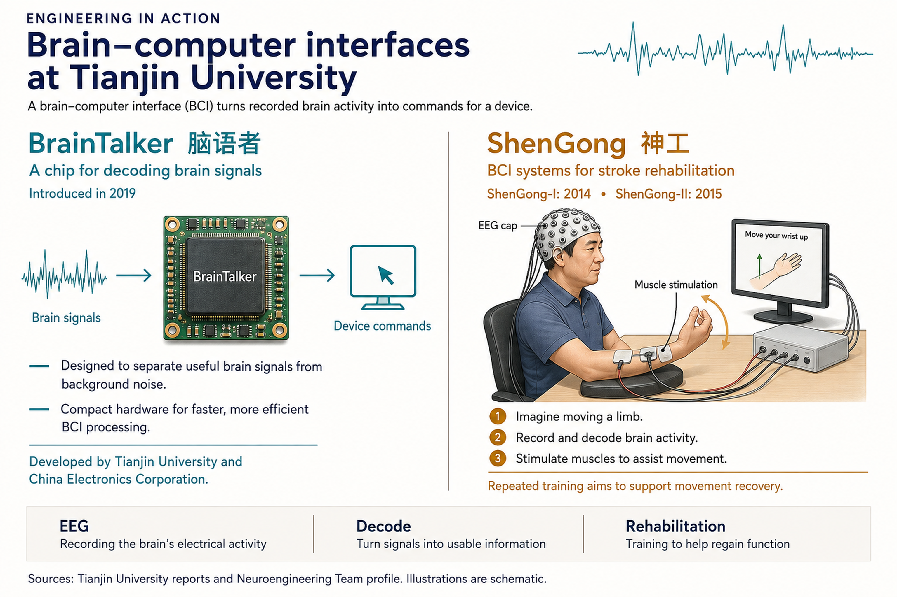

> [!note] 延伸阅读：示例参考答案
> [在平台中查看](https://reader-v2.tdtianwen.com/lg-viewer-v2/reader/standard?platform=td&pack_id=01a0b332-5e0c-7783-8f78-485f17f3f2a0&bookid=01a013c4-e4f0-750f-be8a-7de89b6353d1&section_id=01a013f9-58b1-7962-9266-5ab5af00abff)

### 工程阅读

阅读课文，理解脑机接口如何应用于神经康复与辅助技术。

### 神经康复工程：从控制系统到功能恢复

在天津市环湖医院的康复病房里，一位 58 岁的卒中幸存者戴着轻便的 EEG 电极帽坐在屏幕前。一副机器人外骨骼支撑着她的右臂——这条手臂她已经六个月无法自主移动。屏幕上出现一只动画手。她想象自己张开拳头；几秒之后，设备伸展开了她的手指。自受伤以来的第一次，她的大脑和身体重新协同工作，而机器就是它们之间的桥梁。

让这一幕成为可能的，是神经康复工程：它使用脑机接口，不只是替代失去的功能，更是帮助神经系统把功能找回来。如果大脑能与受损的运动通路重建连接，部分自主运动就可能恢复。工程上的挑战在于：系统必须足够精准、足够灵敏、足够安全，经受得住日复一日的重复训练。

#### 意图驱动的治疗

传统康复常常依赖被动运动：治疗师搬动患者的肢体，完成一系列动作。这能保持关节灵活性，但对重建控制自主运动的神经通路作用有限。BCI 驱动的康复走的是完全不同的路：患者必须主动调动大脑——想象或尝试完成动作——只有当神经信号中出现真实的运动意图时，辅助设备才会响应。正是这种「意图-动作」耦合让 BCI 康复成为主动康复而非被动康复；而这种主动参与，被认为是驱动神经可塑性的关键。

天津大学的「神工」康复机器人正是这一路线的典型代表。系统使用非侵入式 EEG 电极帽来检测事件相关去同步（ERD）——人在想象移动肢体时出现的特定脑电变化。当系统检测到 ERD 超过设定阈值，便启动机器人外骨骼辅助完成相应动作。患者亲眼看到、亲身感到自己的手臂响应自身的意念而动，反馈回路就此闭合，神经连接得到强化。

#### 超越手臂：多样的应用

神经康复远不止上肢恢复。BCI 驱动的步态训练系统用下肢外骨骼帮助脊髓损伤患者练习行走：患者的脑信号触发每一步，外骨骼则提供承重和保持平衡所需的物理支撑。早期研究表明，持续的 BCI 辅助步态训练能同时改善行走能力和本体感觉——身体对自身空间位置的感知。

言语与交流是另一个前沿。对因神经损伤丧失说话能力的患者，BCI 拼写器让他们仅凭脑信号就能在屏幕上选择字母或单词。天津大学基于 SSVEP 的拼写器系统检测大脑对闪烁视觉刺激的反应，指令集已超过 200 个不同输入——位居世界前列。最近，侵入式 BCI 还让患有严重构音障碍的患者，通过对言语相关脑活动的神经解码产生可辨识的语音。

#### 可穿戴传感器与日常监测

神经康复并非都发生在医院里。越来越多的可穿戴设备把监测和治疗延伸到日常生活之中。中国研究团队开发的非侵入式可穿戴血压贴片，用柔性传感器无需袖带即可连续跟踪心血管健康。太赫兹光声传感器——另一项中国创新——实现了无创血钠测量，这对长期服药的患者至关重要。可吞咽的光电胶囊能从体内为胃肠道成像，并把数据无线传输给外部接收器。

这些可穿戴和可吞服设备与 BCI 康复系统有着共同的设计理念：让人体内部状态实时可见、可干预。当可穿戴传感器检测到异常读数，就能同时提醒患者和临床医生，在危机酿成之前实现早期干预。

#### 临床证据

BCI 康复真的有效吗？临床证据正在积累。多项随机对照试验表明，对卒中患者而言，BCI 辅助训练比单纯的常规疗法带来更大的运动功能改善。一项关键发现是：当训练足够密集、持续数周，并由治疗师密切督导、随患者进步调整难度时，收益最大。「神工」系统已在全国二十多家医院部署，积累了大量临床数据，研究者正在分析这些数据，以确定哪些患者群体反应最好。

#### 挑战与前路

尽管结果令人鼓舞，重大挑战仍然存在。BCI 康复系统价格昂贵，并非所有医院都有能有效操作它们的受训人员。非侵入式系统的信号质量因人而异——有些人产生清晰易解码的脑信号，有些人却不能，研究者称之为「BCI 失读症」。设备可用性是另一个担忧：一套每次使用前需要 30 分钟准备工作的系统，在繁忙的康复病房里可能并不实用。

展望未来，研究者设想的是完全集成的神经康复平台：把 BCI 控制、机器人辅助、虚拟现实环境和实时生理监测融为一个系统。目标是个性化康复——根据每个患者的进展、脑状态和临床需要自动调整的治疗。要实现它，需要的工程师不仅懂信号处理和控制理论，还要懂人体生理、临床流程，以及与直接作用于人类神经系统的技术相伴的伦理责任。这样的团队协作，要求与患者和临床医生进行细致的沟通。

（全文约 855 词）

### 理解信息

> [!note] 互动练习：任务 1：根据课文为每个问题选择最佳答案。
> [在平台中完成此题](https://reader-v2.tdtianwen.com/lg-viewer-v2/reader/standard?platform=td&pack_id=01a0b332-5e0c-7783-8f78-485f17f3f2a0&bookid=01a013c4-e4f0-750f-be8a-7de89b6353d1&section_id=01a013f9-58b1-7962-9266-5ab5af00abff)

> [!note] 互动练习：任务 2：判断下列各句正误（T/F）。
> [在平台中完成此题](https://reader-v2.tdtianwen.com/lg-viewer-v2/reader/standard?platform=td&pack_id=01a0b332-5e0c-7783-8f78-485f17f3f2a0&bookid=01a013c4-e4f0-750f-be8a-7de89b6353d1&section_id=01a013f9-58b1-7962-9266-5ab5af00abff)

> [!note] 互动练习：任务 3：把课文中的术语或表达与其正确释义连线。
> [在平台中完成此题](https://reader-v2.tdtianwen.com/lg-viewer-v2/reader/standard?platform=td&pack_id=01a0b332-5e0c-7783-8f78-485f17f3f2a0&bookid=01a013c4-e4f0-750f-be8a-7de89b6353d1&section_id=01a013f9-58b1-7962-9266-5ab5af00abff)

### 工程决策

听一段对话，为每个问题选择最佳答案。

> [!note] 音频：升级名额给谁？
> [在平台中打开音频](https://reader-v2.tdtianwen.com/ed-svc2/fp/book-file/01a026d7-5a1c-780e-88c5-fc1451bfa91e.mp3?t=oss_download&pack_id=01a0b332-5e0c-7783-8f78-485f17f3f2a0&bookid=01a013c4-e4f0-750f-be8a-7de89b6353d1&section_id=01a013f9-58b1-7962-9266-5ab5af00abff)
> ![[U07-音频2-升级名额给谁.mp3]]

> [!note] 互动练习：任务 1：理解检查
> [在平台中完成此题](https://reader-v2.tdtianwen.com/lg-viewer-v2/reader/standard?platform=td&pack_id=01a0b332-5e0c-7783-8f78-485f17f3f2a0&bookid=01a013c4-e4f0-750f-be8a-7de89b6353d1&section_id=01a013f9-58b1-7962-9266-5ab5af00abff)

> [!note] 互动练习：任务 2：在类似情境中做出你的决策
> [在平台中完成此题](https://reader-v2.tdtianwen.com/lg-viewer-v2/reader/standard?platform=td&pack_id=01a0b332-5e0c-7783-8f78-485f17f3f2a0&bookid=01a013c4-e4f0-750f-be8a-7de89b6353d1&section_id=01a013f9-58b1-7962-9266-5ab5af00abff)

### 交流与反思

### 打造你的单元挑战成果

是时候制作你的信息图了。信息图不是配了插图的短文——它是一种为快速、清晰传达复杂想法而设计的视觉文档。读者应该能在两分钟之内看懂核心信息。

结构指引：

（1）标题：一个简洁、抓人眼球的标题（例如「从意念到动作：中国神工康复机器人」）。

（2）挑战：一小节（1–2 句话或一个带说明的图标），解释该技术针对的医学或工程挑战。

（3）工作原理：一幅简化的示意图或编号的步骤流程（配图标或插图），展示技术的核心机制，善用标注和说明文字。

（4）关键数据：使用对比条、高亮数字、前后对比图或简单图表。

（5）为何重要：一段简短陈述（2–3 句话或一个文本框），把技术与更宏大的主题联系起来：患者可及性、成本效益、可持续性或者国家创新。

> [!note] 延伸阅读：示例参考答案
> [在平台中查看](https://reader-v2.tdtianwen.com/lg-viewer-v2/reader/standard?platform=td&pack_id=01a0b332-5e0c-7783-8f78-485f17f3f2a0&bookid=01a013c4-e4f0-750f-be8a-7de89b6353d1&section_id=01a013f9-58b1-7962-9266-5ab5af00abff)

### 学习档案反思

> [!note] 互动页面：学习档案反思
> [打开互动页面](https://zhihuiware.com/api/webapp/embed/8906ccec-c58b-481a-bad6-32236a5f0c08)

### 生词与表达

| 英文 | 词性 | 释义 |
| --- | --- | --- |
| ward | n. | 医院中收治同类病症患者的独立房间或区域；病房 |
| stroke | n. | 脑部血管破裂或堵塞引起的突发重病；脑卒中、中风 |
| exoskeleton | n. | 穿在身上、辅助或增强运动的外部支撑框架；外骨骼 |
| neuro-rehabilitation | n. | 损伤或疾病后恢复神经系统功能的过程；神经康复 |
| motor intention | n. | 大脑产生特定动作的计划或意愿；运动意图 |
| exemplify | v. | 是某事物的典型例子；是……的典型 |
| event-related desynchronisation (ERD) | n. | 人在想象或执行动作时出现的脑电功率下降；事件相关去同步 |
| threshold | n. | 触发响应所需达到的信号最低水平；阈值 |
| gait training | n. | 为改善患者行走能力设计的治疗；步态训练 |
| proprioception | n. | 身体感知自身位置和运动的能力；本体感觉 |
| frontier | n. | 对某一学科或活动已知范围的界限；（学科的）前沿 |
| speller | n. | 让用户凭脑信号选择字母或单词的 BCI 系统；拼写器 |
| dysarthria | n. | 因说话相关肌肉无力导致的言语障碍；构音障碍 |
| wearable | adj./n. | 设计为穿在身上的；可穿戴的；可穿戴设备 |
| cardiovascular | adj. | 与心脏和血管有关的；心血管的 |
| transmit | v. | 发送电子信号、无线电或电视广播等；传送、发射 |
| intervention | n. | 为改善医疗状况而采取的行动；干预 |
| randomised controlled trial | n. | 将受试者随机分组以检验治疗效果的实验；随机对照试验 |
| illiteracy | n. | 对某一领域所知甚少；（对某学科）外行 |
| usability | n. | 设备或系统能被有效使用的容易程度；可用性 |
| therapy | n. | 对身体问题或疾病的治疗；治疗、疗法 |

### 平台交互内容

本章还有 5 道互动练习、2 处延伸阅读、1 段音频、1 个交互页面。音频与视频已下载到本地并内嵌在正文，可离线播放；互动练习需登录平台作答：[在平台中打开本章](https://reader-v2.tdtianwen.com/lg-viewer-v2/reader/standard?platform=td&pack_id=01a0b332-5e0c-7783-8f78-485f17f3f2a0&bookid=01a013c4-e4f0-750f-be8a-7de89b6353d1&section_id=01a013f9-58b1-7962-9266-5ab5af00abff)

---

## 第8单元 · 单元预览

英文对照：[[EN-U08-1 Unit Preview|Unit 8 · Unit Preview]]

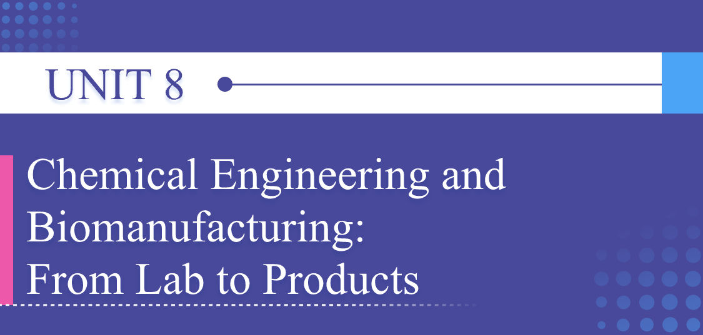

### 学习目标

在英语口语和书面表达中，运用与化工过程放大、生物制造和制药工程相关的关键词汇。

从关于化学工程、生物制造、合成生物学和产品安全投放的多模态材料中提取并核实信息。

分析工艺设计中的工程取舍，包括收率、安全、成本、验证、可持续性、用户体验和公众信任。

运用语言和视觉材料，制定一份负责任的「从实验室走向市场」计划。

### 单元挑战

一个来自实验室的好想法，必须经过严格受控的工程化过程，才能走进医院、诊所、社区和公众。在中国，化学工程与制药工程在公共卫生、生物制造、应急响应和医疗创新中扮演着日益重要的角色。从大规模疫苗生产和诊断试剂，到酶制品、给药系统和健康相关材料，工程师们帮助把实验室里的发现变成能够服务真实社会需求的可靠产品。

你的任务：以小组为单位，选择一个化学或制药工程场景，例如快速诊断试剂、酶制品、疫苗组分、生物制造药品、3D 打印剂型或公共卫生应急物资，为所选场景制定一份「从实验室走向市场」的计划。

### 学习旅程

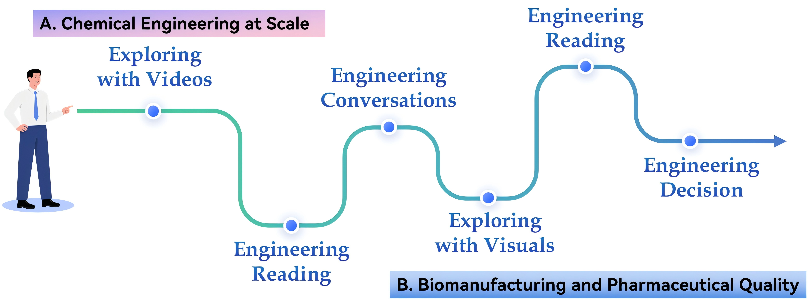

---

## 第8单元 · A. 规模化化学工程

英文对照：[[EN-U08-2 A. Chemical Engineering at Scale|Unit 8 · A. Chemical Engineering at Scale]]

### 视频探索

想象你要把 100 千克玉米变成乙醇。你知道玉米含有淀粉，淀粉可以变成糖，糖可以变成酒精。（1）你会怎么开始？把玉米整粒放着、弄碎，还是用别的方式处理？（2）中间会发生什么？需要加水吗？需要加热吗？需要加点什么来帮助反应吗？（3）得到含酒精的液体后，你怎样把酒精和其他东西分开？要做什么才能确保最终产品纯得足以在汽车发动机里燃烧？

观看一段视频，了解酒精如何通过发酵——一种基本的生物制造工艺——生产出来，然后回答问题。

> [!note] 视频：酒精简史
> [在平台中打开视频](https://reader-v2.tdtianwen.com/ed-svc2/fp/book-file/01a08044-ea29-7d41-97eb-8929164b4816.mp4?t=oss_download&pack_id=01a0b332-5e0c-7783-8f78-485f17f3f2a0&platform=td)
> ![[U08-视频-酒精简史.mp4]]

> [!note] 互动练习：视频理解检查
> [在平台中完成此题](https://reader-v2.tdtianwen.com/lg-viewer-v2/reader/standard?platform=td&pack_id=01a0b332-5e0c-7783-8f78-485f17f3f2a0&bookid=01a013c4-e4f0-750f-be8a-7de89b6353d1&section_id=01a013fa-27ec-7f00-8763-dd829be9302f)

### 工程阅读

阅读课文，理解实验室里的反应如何变成可靠的生产过程，以及放大、分离、过程控制和取舍为什么在工程决策中至关重要。

### 规模化化学工程：从反应到可靠生产

化学工程往往从一个看似简单得具有迷惑性的问题开始：如果一个有用的反应在烧杯里能成，它能不能安全地、可重复地、经济地为成千上万乃至千百万人服务？在成为真正的产品之前，反应必须经过放大、控制、测试、包装、运输，并符合法规要求。简言之，化学工程把分子层面的变化，翻译成社会所需规模上的可靠生产。

在中国，这门学科与国家工业成长相伴发展了近一个世纪。它早年支撑炼油、化肥生产和重工业，如今延伸到新能源材料、锂电池、碳捕集、精细化工和生物制造。研究对象变了，底层的问题没有变：过程如何表现？能否被控制？在规模上是否安全？

#### 跨学科视角下的化学工程

这种以过程为导向的视角格外宝贵。化工专业的学生盯着反应器和反应动力学；机械专业的学生注意到泵、换热器和压力容器；自动化专业的学生追踪传感器和反馈回路；材料专业的学生关心纯度和粒径；环境专业的学生则追问排放和废水去了哪里。在真实的工厂里，这些关切都汇聚在同一个互联系统之中——而化学工程通过单元操作、工艺流程等概念，提供了把它们连起来的共同语言。

小规模下，化学家可以合理地只关心「反应能否进行、产出什么」。化学工程师必须进一步发问：反应进行多快？放热还是吸热？反应器放大一百倍后，温度还控制得住吗？会生成哪些杂质，去除的难易如何？溶剂能否回收？泵坏了、传感器报错读数了会怎样？这些问题决定了一个过程在实验室之外是否值得信赖。

#### 放大：从烧瓶到工厂

放大是这门学科的标志性挑战。小烧瓶里散热很快；大型工业反应器里，移除反应热会成为严重的工程问题。一个在台架上表现温和的反应，若热量积累快过冷却带走的速度，就可能变得危险。因此，在投入全面工业生产之前，工程师要依靠中试装置——过程的中间规模版本。

#### 分离与纯化

分离与纯化同样值得重视。在许多工艺中，制得目标产物只完成了一半工作；另一半是把它从未反应的原料、催化剂、溶剂、副产物和废液中分离出来。蒸馏、过滤、结晶、萃取、膜分离和色谱各有策略，在能耗与选择性上也各有取舍。在制药和精细化工生产中，哪怕痕量杂质都可能损害安全性或药效；在电池材料和电子化学品中，纯度或粒径的细微变化会明显改变性能。因此，分离不是事后补救，而是产品设计的有机组成部分。

#### 过程控制与质量管理

过程控制让现代连续生产成为可能。传感器实时监测温度、压力、流量、pH 和浓度，控制系统则自动调节阀门、泵、加热、冷却和进料速率，让过程保持在安全操作窗口之内。更先进的工厂采用过程分析技术（PAT）——在生产过程中而非仅在最后测量关键质量属性——并以「质量源于设计」（QbD）为支撑：质量从一开始就被设计进过程，而不是只靠终检来验证。

#### 更安全、更绿色的过程

安全与可持续性塑造着每一个负责任的过程。工程师必须直面火灾、爆炸、毒性、腐蚀、压力、废物和工人暴露，以及全生命周期的影响：原料获取、能源使用、废物处理和碳排放。绿色化学工程致力于设计使用更安全溶剂、产生更少废物、提高原子经济性、降低环境负担的过程。

#### 约束下的经济决策

在实践中，经济决策同样是工程决策。一个纯度出色的过程，如果依赖稀有溶剂或极高的能量投入，可能得不偿失。工程师比较备选方案时依据的是物料衡算与能量衡算、设备成本、风险评估和质量数据，而不是直觉。这些衡算揭示物料和能量从何处进入、离开、积累或变成废物，帮助工程师在选择生产工艺之前比较效率。一份站得住脚的技术建议，必须说清得到了什么、牺牲了什么，以及为什么由此形成的取舍经得起辩护。从这个角度看，化学工程师的工作是科学发现与社会之间的桥梁：科学家也许能识别一个有前景的分子，但它能否成为可靠的产品，要靠工程师来判断。

#### 从发现到可靠生产

化学工程的内核，是一种思考「约束下的转化」的方式：它追问物质如何变化、系统如何表现、决策如何影响成本、质量、安全和可持续性。无论最终产品是精细化学品、碳捕集材料、电池组件还是生物法生产的药品，工程任务都一样——把一个有前景的想法，变成在实践中稳定运行的过程。下一篇文章将展示同一种思维方式如何延伸到生物制造与药品质量：在那里，「反应器」可能是活细胞，「产品」则是患者最终要摄入体内的东西。

（全文约 852 词）

### 理解信息

> [!note] 互动练习：任务 1：用 1–3 个英文单词填空。
> [在平台中完成此题](https://reader-v2.tdtianwen.com/lg-viewer-v2/reader/standard?platform=td&pack_id=01a0b332-5e0c-7783-8f78-485f17f3f2a0&bookid=01a013c4-e4f0-750f-be8a-7de89b6353d1&section_id=01a013fa-27ec-7f00-8763-dd829be9302f)

> [!note] 互动练习：任务 2：就课文细节为下列问题选择最佳答案。
> [在平台中完成此题](https://reader-v2.tdtianwen.com/lg-viewer-v2/reader/standard?platform=td&pack_id=01a0b332-5e0c-7783-8f78-485f17f3f2a0&bookid=01a013c4-e4f0-750f-be8a-7de89b6353d1&section_id=01a013fa-27ec-7f00-8763-dd829be9302f)

### 像工程师一样思考

阅读下面两则简短报道。识别技术决策背后的现实因素，评估可能的取舍，并提出一个负责任的第一步行动。

报告一

一个团队为某种新型呼吸道感染开发了快速检测试剂盒。在实验室里，检测既快又准。但在社区诊所试点使用时出现了一些问题：一家诊所的储物间变得又热又潮，试剂盒的结果线变得模糊；一些用户因为说明书难懂而过早判读结果。团队必须决定：立即投放试剂盒、先改进设计，还是只在具备合适储存条件和受训人员的诊所使用。

报告二

公共卫生应急期间，医院需要更多检测试剂盒用的诊断试剂。正常情况下，试剂由大型工厂生产，经质控人员检测、冷藏，然后配送到医院。为加快供应，医院网络想在主要医院附近的临时洁净间里小批量配制。但过程中很容易出问题：大工厂慢一些，却更可靠；本地小洁净间快一些，却更难控制。团队必须决定：只用大工厂、只用本地小洁净间，还是两者结合。

两人一组讨论。从上述报道中任选一则，探索下面一个（或多个）方面的答案。

（1）找出失效点：在你选择的系统里，具体哪些环节可能出问题？不仅要考虑技术本身，还要考虑环境、使用者和供应链。

（2）评估取舍：你们团队面临的决策中，核心冲突是什么？例如速度与准确、成本与可靠、可及性与严格控制。你会优先哪一边？为什么？

（3）提出负责任的行动：基于你们的分析，最负责任的第一步是什么：立即投放、先重新设计，还是限定条件使用？清晰说明理由，并指出一个你们仍愿意接受的风险。

> [!note] 延伸阅读：参考答案
> [在平台中查看](https://reader-v2.tdtianwen.com/lg-viewer-v2/reader/standard?platform=td&pack_id=01a0b332-5e0c-7783-8f78-485f17f3f2a0&bookid=01a013c4-e4f0-750f-be8a-7de89b6353d1&section_id=01a013fa-27ec-7f00-8763-dd829be9302f)

### 工程对话

### 竞赛前的最后挑战

> [!note] 音频：竞赛前的最后挑战
> [在平台中打开音频](https://reader-v2.tdtianwen.com/ed-svc2/fp/book-file/01a01e51-d43e-7592-898d-82b1ab16bc90.mp3?t=oss_download&pack_id=01a0b332-5e0c-7783-8f78-485f17f3f2a0&platform=td)
> ![[U08-音频1-竞赛前的最后挑战.mp3]]

> [!note] 互动练习：任务 1：理解检查
> [在平台中完成此题](https://reader-v2.tdtianwen.com/lg-viewer-v2/reader/standard?platform=td&pack_id=01a0b332-5e0c-7783-8f78-485f17f3f2a0&bookid=01a013c4-e4f0-750f-be8a-7de89b6353d1&section_id=01a013fa-27ec-7f00-8763-dd829be9302f)

> [!note] 互动练习：任务 2：词汇拓展
> [在平台中完成此题](https://reader-v2.tdtianwen.com/lg-viewer-v2/reader/standard?platform=td&pack_id=01a0b332-5e0c-7783-8f78-485f17f3f2a0&bookid=01a013c4-e4f0-750f-be8a-7de89b6353d1&section_id=01a013fa-27ec-7f00-8763-dd829be9302f)

> [!note] 互动练习：任务 3：讨论备赛经历
> [在平台中完成此题](https://reader-v2.tdtianwen.com/lg-viewer-v2/reader/standard?platform=td&pack_id=01a0b332-5e0c-7783-8f78-485f17f3f2a0&bookid=01a013c4-e4f0-750f-be8a-7de89b6353d1&section_id=01a013fa-27ec-7f00-8763-dd829be9302f)

### 生词与表达

| 英文 | 词性 | 释义 |
| --- | --- | --- |
| deceptively | adv. | 以给人误导印象的方式；看似……实则不然 |
| beaker | n. | 实验室中盛放或量取液体的广口玻璃容器；烧杯 |
| economically | adv. | 使用金钱、时间或材料时不浪费；经济地、节约地 |
| scale up | v. | 把化工过程从实验室实验扩大到工业生产；放大生产 |
| regulatory compliance | n. | 遵守与业务或过程相关的法律法规的状态；合规 |
| fertiliser | n. | 施入土壤以提高肥力、促进植物生长的物质；肥料、化肥 |
| reactor | n. | 进行化学反应或核反应的容器或装置；反应器、反应堆 |
| reaction kinetics | n. | 研究化学反应速率与机理的学科；反应动力学 |
| converge | v. | 向一点移动或在一点相遇；汇聚、集中 |
| process flow | n. | 把原料转化为成品的一系列步骤和操作；工艺流程 |
| yield | v. | 生产或提供产品；产出 |
| impurity | n. | 化合物或成品中不需要的物质；杂质 |
| solvent | n. | 能溶解其他物质的液体；溶剂 |
| flask | n. | 实验室用的细颈玻璃容器；烧瓶 |
| dissipate | v. | 散开或散热消散；消散 |
| pilot plant | n. | 在全面商业化生产前测试和优化化工过程的小型工业装置；中试工厂 |
| distillation | n. | 通过汽化再冷凝分离液体混合物组分的过程；蒸馏 |
| filtration | n. | 从液体或气体中分离固体颗粒的过程；过滤 |
| crystallisation | n. | 从溶液、熔体或蒸气中形成固体晶体的过程；结晶 |
| extraction | n. | 用选择性溶剂从混合物中分离目标组分的过程；萃取、提取 |
| membrane | n. | 化学分离过程中使用的薄的半透性材料；膜 |
| chromatography | n. | 分离混合物各组分的分离技术；色谱法、层析法 |
| trade-off | n. | 需要在相互竞争的利益或成本之间求得平衡的局面；权衡、取舍 |
| pharmaceutical | adj. | 与药品研发或制造有关的；制药的 |
| process analytical technology (PAT) | n. | 对关键过程属性进行实时测量与控制；过程分析技术 |
| quality by design (QbD) | n. | 从起始就把质量构建进过程的方法；质量源于设计 |
| atom economy | n. | 反应物原子进入目标产物的比例；原子经济性 |
| material balance | n. | 对过程中物料进入、离开、积累或成为废物的核算；物料衡算 |

### 平台交互内容

本章还有 6 道互动练习、1 处延伸阅读、1 段音频、1 段视频。音频与视频已下载到本地并内嵌在正文，可离线播放；互动练习需登录平台作答：[在平台中打开本章](https://reader-v2.tdtianwen.com/lg-viewer-v2/reader/standard?platform=td&pack_id=01a0b332-5e0c-7783-8f78-485f17f3f2a0&bookid=01a013c4-e4f0-750f-be8a-7de89b6353d1&section_id=01a013fa-27ec-7f00-8763-dd829be9302f)

---

## 第8单元 · B. 生物制造与药品质量

英文对照：[[EN-U08-3 B. Biomanufacturing and Pharmaceutical Quality|Unit 8 · B. Biomanufacturing and Pharmaceutical Quality]]

### 图像探索

观察图片并回答问题。

（1）示意图中展示的主要输入、过程和输出是什么？（2）产品与碳在使用和废弃阶段可能发生什么？

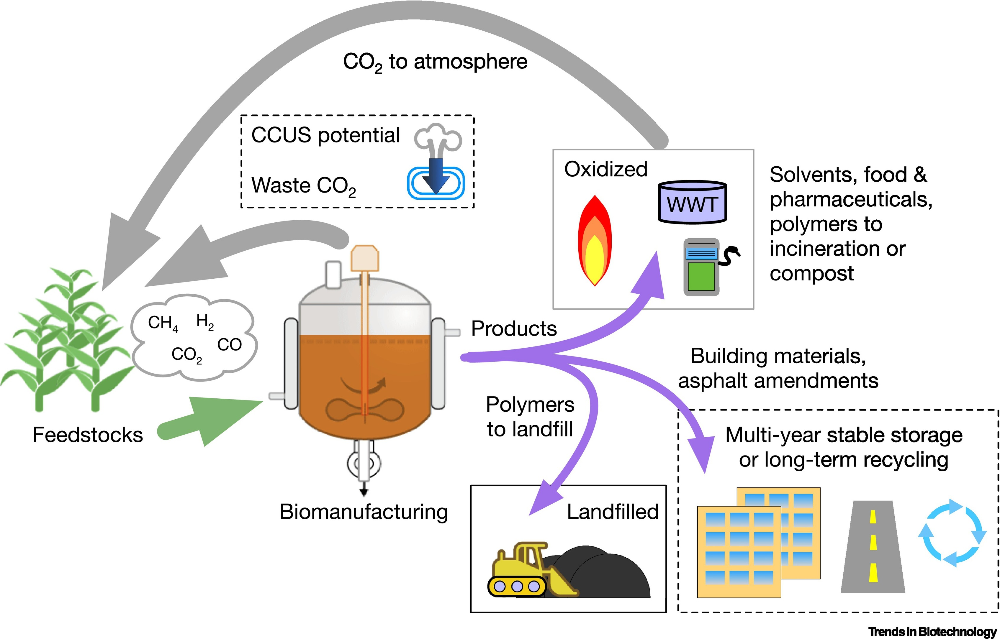

> [!note] 延伸阅读：示例参考答案
> [在平台中查看](https://reader-v2.tdtianwen.com/lg-viewer-v2/reader/standard?platform=td&pack_id=01a0b332-5e0c-7783-8f78-485f17f3f2a0&bookid=01a013c4-e4f0-750f-be8a-7de89b6353d1&section_id=01a013fa-5140-7924-95f8-b849bfdd25d4)

### 工程阅读

阅读下文，理解生物制造如何从实验室台面走向真实世界的快速响应。

### 生物制造与药品质量

生物制造延伸了化学工程长期关注的核心问题：如何通过受控、可重复的过程，把原材料转化为有用的产品？如今的生产系统可能包含活细胞、酶、工程化的基因线路，或无细胞机器。在工程师眼中，细胞就是一座小工厂：它摄取营养、遵循遗传指令，生产蛋白质、疫苗、原料药、食品成分或特种化学品。要负责任地运营这座工厂，仍然需要传质、传热、反应工程、分离、过程控制、质量保证和放大等经典工具。底物也许是生物性的，但核心问题依旧：过程可控吗？可重复吗？能安全放大吗？当最终产品要进入患者体内时，这些问题变得更加苛刻——而且产品还必须在那里赢得信任。

#### 学科的交汇点

正因为借助的工具众多，生物制造并不是生物学学生的狭窄专业，而是多个工程传统的交汇点：化工工程师贡献反应器设计与分离技术；制药工程师带来质量与法规意识；AI 专家分析数据、优化代谢通路；仪表工程师设计传感器；机械与自动化工程师改进设备、机器人和无菌操作。这些能力合在一起，把一个生物学想法变成工程化的生产路线。没有任何单一学科能独自管理所有这些依赖关系。

#### 上游加工：生物反应器中的细胞

上游加工始于选择细胞或微生物，必要时对其进行工程化改造，然后在生物反应器中、在给定的营养供给、供氧、温度、pH、搅拌和无菌条件下培养。受到胁迫或被污染的细胞，目标产物产量会降低，杂质谱也会改变。而且，在实验室烧瓶里长势良好的培养物，到了工业规模可能失灵：传氧、混合时间、剪切应力、泡沫和移热都随设备变大而变化。一个参数的微小改变就可能影响细胞生长和后续纯化。虽然反应器里装的是活细胞，但这些都是熟悉的化学工程问题，必须先解决它们，生产才谈得上可靠。

#### 下游加工与药品质量

下游加工要从细胞、蛋白质、DNA 片段、盐分、营养物和副产物构成的复杂混合物中，回收并纯化目标分子。对生物药而言，纯化保护的是患者，而不仅是产品的外观。工程师可以用离心、过滤、色谱、沉淀或超滤去除杂质、浓缩产品。每增加一步都可能提高纯度，但也可能降低收率、推高成本或损伤敏感分子。这里的决策还会约束制剂和最终产品质量。因此，设计良好的过程要在纯度、回收率、时间、成本和稳健性之间求得平衡，而不是把单一指标最大化。

在产品到达患者之前，制药工程施加了严格的质量要求。药品生产质量管理规范（GMP）要求清晰的规程、受训的操作者、经过验证的设备、受控的环境、完整的批记录和数据完整性：记录必须完整、一致、可追溯归属，并防范不当更改。检测必须确证鉴别、效价、纯度、无菌和稳定性，必要时还包括溶出或释放。这些控制防止被污染、效力不足、效力过强、不稳定或标签错误的药品流入使用者手中。因此，质量既是技术职责，也是伦理责任。

#### 合成生物学、AI 与设计-构建-测试-学习循环

合成生物学让工程师能够重新设计微生物、构建基因线路，用温和的酶促步骤替代苛刻的化学步骤。AI 工具帮助预测 DNA 序列、优化代谢通路和解读数据；自动化则加快设计-构建-测试-学习（DBTL）循环——工程师借助数据来设计、构建、测试和改进生物系统。但更快的设计并不免除验证的需要：生物系统可能突变、放大后行为改变，或以模型未曾预测的方式与环境相互作用。因此，工程判断必须把计算指导、受控实验和来自预期生产条件的证据结合起来。

最终用户从来不是抽象的。一个效力不足或被污染的批次，可能延误治疗、伤害患者、挫伤公众对公共卫生响应的信心。工程师必须把过程数据与人的后果联系起来。冷链（控温储存与运输）中的一次温度偏离、一份缺失的批记录、一次未经验证的配方变更，都可能决定一批产品能否放行。可追溯性支撑放行决策和事后调查。负责任的工程需要技术上的精确、伦理上的审慎和可追踪的决策。

#### 可持续性与公共卫生响应

生物路线可以减少对石油基原料、苛刻反应条件和有毒试剂的依赖。酶可以在温和的温度和压力下工作，发酵可以把可再生资源转化为有价值的化学品。但生物制造仍然消耗水、能源、营养物、无菌材料和纯化资源，也产生废物和污染风险。一个过程并不因为用了细胞就自动「绿色」。能量、水和物料的回收能改善环境表现。工程师必须评估它的全生命周期，并用证据比较替代方案。

公共卫生应急让速度与严谨之间的张力更加尖锐。对疫苗、生物药、诊断试剂或应急药品的需求可能骤然上升，但紧迫不能代替安全证据。工程师可以比较多种模式：模块化生产、本地化制造、横向扩容（scale-out）以及医院联动的配制。集中式大厂质量控制成熟，但响应可能较慢；小型分布式单元可更快服务患者，但需要严格验证、受训人员、冷链控制和可靠数据。负责任的选择取决于产品、风险、供应链、监管预期和公众信任。无论采用哪种模式，工程师都必须规划监测、维护、操作员培训和透明沟通，让快速可及不以削弱长期质量保证为代价。

（全文约 850 词）

### 理解信息

> [!note] 互动练习：任务 1：根据课文为每个问题选择最佳答案。
> [在平台中完成此题](https://reader-v2.tdtianwen.com/lg-viewer-v2/reader/standard?platform=td&pack_id=01a0b332-5e0c-7783-8f78-485f17f3f2a0&bookid=01a013c4-e4f0-750f-be8a-7de89b6353d1&section_id=01a013fa-5140-7924-95f8-b849bfdd25d4)

> [!note] 互动练习：任务 2：判断下列各句正误（T/F）。
> [在平台中完成此题](https://reader-v2.tdtianwen.com/lg-viewer-v2/reader/standard?platform=td&pack_id=01a0b332-5e0c-7783-8f78-485f17f3f2a0&bookid=01a013c4-e4f0-750f-be8a-7de89b6353d1&section_id=01a013fa-5140-7924-95f8-b849bfdd25d4)

> [!note] 互动练习：任务 3：把课文中的术语或表达与其正确释义连线。
> [在平台中完成此题](https://reader-v2.tdtianwen.com/lg-viewer-v2/reader/standard?platform=td&pack_id=01a0b332-5e0c-7783-8f78-485f17f3f2a0&bookid=01a013c4-e4f0-750f-be8a-7de89b6353d1&section_id=01a013fa-5140-7924-95f8-b849bfdd25d4)

### 工程决策

听一段对话，为每个问题选择最佳答案。

> [!note] 音频：快速部署 VS 证明安全
> [在平台中打开音频](https://reader-v2.tdtianwen.com/ed-svc2/fp/book-file/01a021cf-741f-7d20-8ae3-3f1952a8e337.mp3?t=oss_download&pack_id=01a0b332-5e0c-7783-8f78-485f17f3f2a0&platform=td)
> ![[U08-音频2-快速部署VS证明安全.mp3]]

> [!note] 互动练习：任务 1：理解检查
> [在平台中完成此题](https://reader-v2.tdtianwen.com/lg-viewer-v2/reader/standard?platform=td&pack_id=01a0b332-5e0c-7783-8f78-485f17f3f2a0&bookid=01a013c4-e4f0-750f-be8a-7de89b6353d1&section_id=01a013fa-5140-7924-95f8-b849bfdd25d4)

> [!note] 互动练习：任务 2：在类似情境中做出你的决策
> [在平台中完成此题](https://reader-v2.tdtianwen.com/lg-viewer-v2/reader/standard?platform=td&pack_id=01a0b332-5e0c-7783-8f78-485f17f3f2a0&bookid=01a013c4-e4f0-750f-be8a-7de89b6353d1&section_id=01a013fa-5140-7924-95f8-b849bfdd25d4)

### 交流与反思

### 打造你的单元挑战成果

是时候制定你的「从实验室走向市场」计划了。

准备清单：

（1）产品与用户需求。介绍产品，并说明谁需要它——医院、诊所、检验机构、社区卫生中心、应急响应团队或普通公众。

（2）质量与安全计划。明确质量或安全检查项，例如鉴别、纯度、效价、稳定性、污染控制、储存条件、批次一致性或用户安全。

（3）放大策略。说明产品如何从小规模实验室生产走向中试或更大规模的制造，并指出一个可能的瓶颈：原料、纯化能力、设备、冷链运输等。

（4）风险与缓释。识别一个主要风险，并说明工程师或决策者可以如何管理它。可能的风险包括污染、活性成分不稳定、使用不当、误导性信息、供应短缺、冷链失效、数据完整性问题或可及性不均。

> [!note] 延伸阅读：示例参考答案
> [在平台中查看](https://reader-v2.tdtianwen.com/lg-viewer-v2/reader/standard?platform=td&pack_id=01a0b332-5e0c-7783-8f78-485f17f3f2a0&bookid=01a013c4-e4f0-750f-be8a-7de89b6353d1&section_id=01a013fa-5140-7924-95f8-b849bfdd25d4)

### 学习档案反思

> [!note] 互动页面：学习档案反思
> [打开互动页面](https://zhihuiware.com/api/webapp/embed/e1ce422b-b00f-4ca1-83f9-49dc71e81234)

### 生词与表达

| 英文 | 词性 | 释义 |
| --- | --- | --- |
| reproducible | adj. | 能一致重复并获得相同结果的；可再现的 |
| enzyme | n. | 由生物体产生、加速化学反应的生物催化剂；酶 |
| nutrient | n. | 为生物体生长提供必需养料的物质；营养物质 |
| substrate | n. | （1）酶作用的物质；（2）细胞生长或附着其上的材料或表面；基质、培养基 |
| specialty | n. | 狭窄的研究或工作分支；专业领域、细分学科 |
| metabolic | adj. | 与生物体维持生命的化学过程有关的；新陈代谢的 |
| sterile | adj. | 不含细菌、病毒和真菌的；无菌的 |
| microbe | n. | 包括细菌、真菌、古菌和病毒在内的微观生物；微生物 |
| bioreactor | n. | 用于培养细胞、微生物或组织的装置或系统；生物反应器 |
| culture | n. | 在受控营养介质中生长的细胞或微生物群体；培养物 |
| shear stress | n. | 平行作用于表面的单位面积力，由生物反应器中的搅拌或流体流动产生；剪切应力 |
| mixture | n. | 未经化学结合、可用物理方法分离的物质组合；混合物 |
| centrifugation | n. | 利用离心力分离混合物组分的技术；离心分离 |
| precipitation | n. | 把溶解的物质转化为不溶固体的过程；沉淀 |
| robustness | n. | 在环境条件变化时仍能保持性能的能力；稳健性 |
| potency | n. | 药品、酶或产品生物活性的量度；生物活性、效价 |
| pathway | n. | 生物体内把起始分子转化为最终产物的一系列化学反应；通路、代谢通路 |
| mutate | v. | 改变生物体的遗传物质；变异、突变 |
| batch | n. | 在相同条件下一次生产运行中产出的物料量；批次 |
| excursion | n. | 过程参数的暂时偏离；偏离、参数漂移 |
| feedstock | n. | 供给生物或化学过程的原料或起始物料；原料 |
| reagent | n. | 在化学反应中用于检测、测量或生成其他物质的物质；试剂 |
| fermentation | n. | 微生物把物质转化为目标产物的代谢过程；发酵 |
| rigour | n. | 科学研究中的严格与周密；严谨性 |

### 平台交互内容

本章还有 5 道互动练习、2 处延伸阅读、1 段音频、1 个交互页面。音频与视频已下载到本地并内嵌在正文，可离线播放；互动练习需登录平台作答：[在平台中打开本章](https://reader-v2.tdtianwen.com/lg-viewer-v2/reader/standard?platform=td&pack_id=01a0b332-5e0c-7783-8f78-485f17f3f2a0&bookid=01a013c4-e4f0-750f-be8a-7de89b6353d1&section_id=01a013fa-5140-7924-95f8-b849bfdd25d4)

