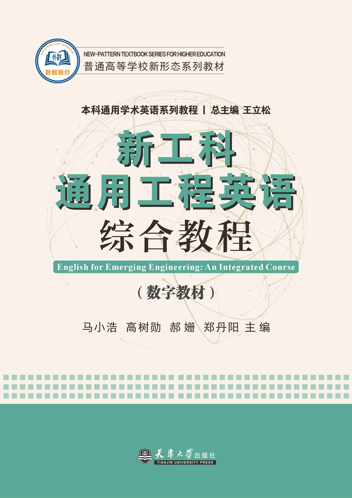

# Copyright

中文对照：[[英语资料#版权信息|版权信息]]

### 丛书名

本科通用学术英语系列教程

### 丛书总主编

王立松

### 主　编

马小浩　高树勋　郝　姗　郑丹阳

### 策划编辑

黎恋恋　李源

### 责任编辑

黎恋恋

### 出版单位

天津大学出版社有限责任公司

### ISBN

978-7-89574-383-0

### 出版时间

2026年9月

### 定 价

49.00元

## 内容简介

本书为面向新工科人才培养的大学英语教材，由天津大学外国语学院教师团队精心编写。全书紧扣新工科建设背景下工科专业学生英语应用能力的核心需求，系统培养学生在工程场景中的英语沟通、文献研读与报告撰写等综合能力。教材融合通用工程英语与专门用途英语教学理念，通过听说、读写一体化设计，帮助学生掌握工程领域通用表达，切实提升其在技术交流、项目协作及学术研究等场景中的英语实际运用能力。本书适用于普通高等院校工科类本科生及低年级研究生使用，亦可作为大学英语拓展课程的教学材料，或供有需求的学习者自主学习使用。
