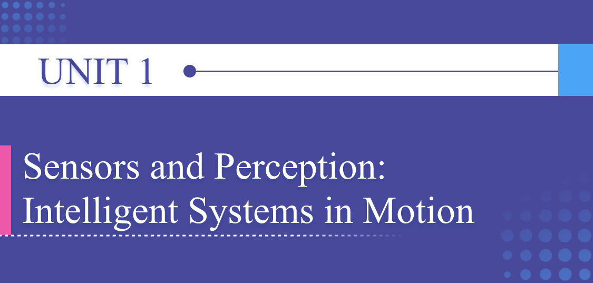
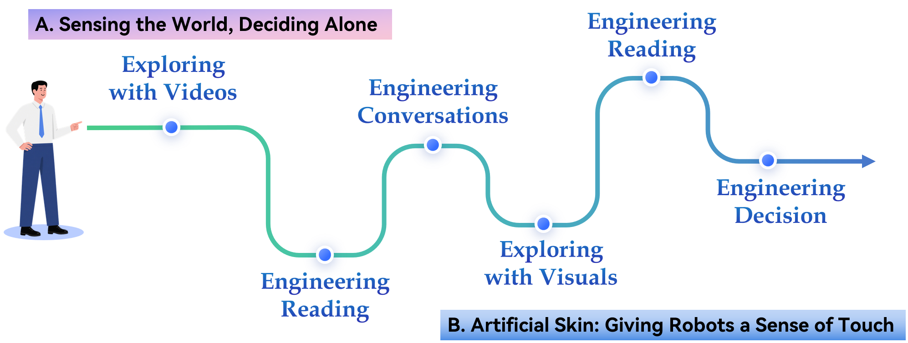

# Unit Preview

中文对照：[[英语资料#第1单元 · 单元预览|第1单元 · 单元预览]]

### Learning Objectives

Use key technical vocabulary related to sensors, signal processing, perception systems, and autonomous decision-making in spoken and written English.

Extract, summarize, and compare information from multimodal sources on intelligent sensing systems, precision instruments, and autonomous machines.

Analyze engineering trade-offs in autonomous systems, including accuracy, speed, safety, reliability, cost, and human oversight.

Create a visual sensing-and-control workflow with a short design brief, using clear structure and appropriate technical language.

### Unit Challenge

Autonomous systems are becoming part of everyday engineering: driver-assistance systems detect pedestrians, inspection robots scan industrial equipment, agricultural drones monitor crop health, and smart instruments measure signals that can’t be directly seen by humans. These systems do not simply “think” on their own. They sense the world, process data, make limited decisions, and act under real constraints.

Your mission: Work in groups. You shall choose one intelligent sensing or autonomous system related to China’s engineering development, such as a mobile robot, autonomous vehicle, smart inspection device, precision measurement instrument, or agricultural drone. Create a visual sensing-and-control workflow with a short design brief. Your final product should include: (1) what the system senses, (2) how it processes information, (3) what decision or action it supports, (4) where human oversight or safety checks appear, and (5) what trade-off must be managed to make the system safe, reliable, and useful.

### Learning Journey

