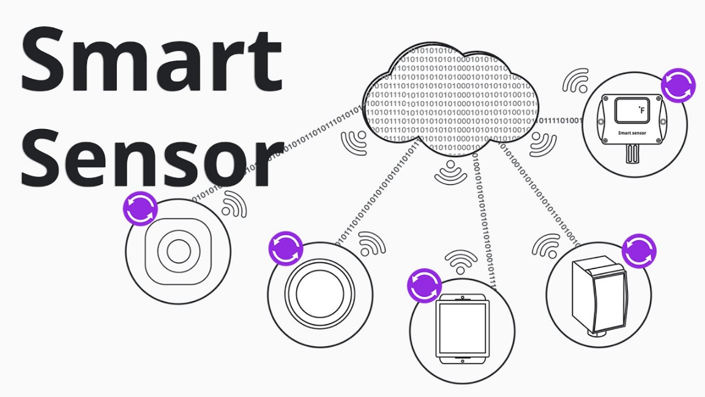

# A. Sensing the World, Deciding Alone

中文对照：[[英语资料#第1单元 · A. 感知世界，自主决策|第1单元 · A. 感知世界，自主决策]]

### Exploring with Videos

Think about the devices around you: your phone, smartwatch, laptop camera, elevator, or a delivery robot on campus. Many of them are quietly collecting signals from the environment. Think about these three questions: (1) What does the device need to sense before it can respond? (2) Which step is more difficult: collecting data, interpreting data, or deciding what to do next? (3) What could go wrong if the sensor is accurate in the lab but unreliable in real use?

Did you know that many of the devices around you are constantly “sensing” the world? From the phone that rotates its screen to the car that warns you of obstacles, sensors quietly collect information and help machines respond to their environment. Watch the short video on how sensors work, and be ready to answer the questions.

> [!note] Video: Smart Sensor Explained | Different Types and Applications
> [Watch the video on the platform](https://reader-v2.tdtianwen.com/ed-svc2/fp/book-file/01a07ed5-183a-7988-9937-71969beb4158.mp4?t=oss_download&pack_id=01a0b332-5e0c-7783-8f78-485f17f3f2a0&platform=td)
> ![[U01-视频-智能传感器详解.mp4]]

> [!note] Interactive Exercise: Video Comprehension Check
> [Do this exercise on the platform](https://reader-v2.tdtianwen.com/lg-viewer-v2/reader/standard?platform=td&pack_id=01a0b332-5e0c-7783-8f78-485f17f3f2a0&bookid=01a013c4-e4f0-750f-be8a-7de89b6353d1&section_id=01a013f0-aa53-7c53-a21b-0f6a8ec0d129)

### Engineering Reading

Read the passage to understand how sensors and intelligent processing enable autonomous robots to perceive, decide, and act in complex environments.

### Sensors and Intelligence: The Foundation of Autonomous Robots

Imagine a world where machines work alongside humans, moving goods through busy warehouses, delivering packages to your doorstep, or quietly vacuuming your home while you sleep. This is not science fiction—it is the reality of autonomous robots, intelligent machines capable of navigating their environment without human intervention. But what enables these robots to “see”, “think”, and “decide” on their own? The answer lies in the powerful combination of sensors and processors that serve as their eyes, ears, and brain.

What Makes a Robot Truly Autonomous?

An autonomous robot is far more than a remotely controlled machine. True autonomy requires a robot to perform a complex series of tasks independently. First, it must sense and understand its position within a mapped environment—a process called localization. Next, it needs to detect obstacles dynamically, whether stationary objects like shelves or moving targets such as people or other robots. The robot must then track these obstacles, plan an optimal route to reach its destination, and precisely control its movements to follow that plan.

However, autonomy goes beyond navigation. Modern robots must operate safely in environments shared with humans, ensuring the safety and security of people, property or themselves. This requirement becomes especially critical as robots move from isolated factory floors into spaces where they work shoulder-to-shoulder with human workers. To achieve this level of reliability, robots must meet rigorous functional safety standards, making the selection of appropriate sensors and processors a matter of paramount importance.

The Eyes of the Robot: Vision Sensors

Vision sensors are perhaps the most intuitive sensing technology because they mimic human sight. Robots equipped with vision systems can achieve similar capabilities to recognize objects and navigate space just like humans. These sensors offer several distinct advantages. First, they provide high-resolution spatial coverage, creating detailed images of the robot’s surroundings. More importantly, vision sensors can not only detect that an object is present, but also classify what that object is—distinguishing between a cardboard box, a forklift, or a human worker.

Vision systems excel at solving challenges like localization, obstacle detection, and collision avoidance. Compared to other sensing technologies such as lidar, vision sensors are also more cost-effective, making them attractive for commercial applications. However, this technology comes with a significant challenge: computational intensity. Processing visual data requires substantial computing power, and traditional central processing units (CPUs) or graphics processing units (GPUs) can consume enormous amounts of energy—a critical concern for battery-powered mobile robots.

The solution lies in specialized processors designed specifically for vision applications. Modern system-on-chip (SoC) architectures can process visual information at high speeds while consuming minimal power. These processors integrate multiple specialized components: units for computer vision, deep learning accelerators for artificial intelligence, stereo vision processors for depth perception, and video analysis engines—all working together in a heterogeneous architecture optimized for both performance and energy efficiency.

Beyond Vision: Millimeter-Wave Radar Sensing

While vision sensors dominate discussions of robot perception, another technology borrowed from the automotive industry is revolutionizing robotic sensing: millimeter-wave (mmWave) radar. Originally developed for advanced driver assistance systems (ADAS) in cars, mmWave radar is now finding innovative applications in robotics.

Radar sensing brings unique capabilities that complement vision systems. Unlike cameras, radar sensors can directly measure three critical pieces of information simultaneously: the range (distance) to an object, its velocity (speed), and its angle of arrival (direction). This multidimensional data provides robots with extraordinarily detailed information about their surroundings.

This rich data enables sophisticated decision-making. The robot can calculate whether the person’s trajectory will intersect with its own path, predict when this might occur, and decide on an appropriate response: continue safely, slow down, or stop completely. This predictive capability is essential for safe human-robot collaboration in shared workspaces.

Moreover, mmWave radar offers practical advantages in challenging environments. Unlike vision sensors, radar performance remains unaffected by lighting conditions, whether in bright sunlight, complete darkness, or dusty industrial settings. Radar signals can also penetrate certain materials, detecting objects that might be partially obscured from camera view.

The Power of Sensor Fusion and Edge AI

As autonomous robots tackle increasingly complex tasks, engineers have discovered that relying on a single type of sensor has fundamental limitations. Each sensing technology has strengths and weaknesses. Sensor fusion is the solution: it combins data from multiple sensor types to create a more complete and reliable perception of the environment. A robot employing sensor fusion might use cameras to classify objects and read signs, radar to measure precise distances and velocities, and additional sensors to fill remaining gaps. By processing and integrating this diverse data, the robot gains a more robust understanding of its surroundings, much like humans combine information from multiple senses to navigate the world.

Taking this concept further, artificial intelligence (AI) at the edge—meaning AI processing performed directly on the robot rather than in a distant cloud server—transforms robots from reactive machines into intelligent agents. Edge AI enables robots to not merely detect objects but to understand context and make informed decisions. For example, when navigating a busy warehouse, an AI-enabled robot can distinguish between a stationary pallet, a slowly moving forklift, and a quickly moving person, adjusting its behavior appropriately for each scenario.

Implementing edge AI requires careful hardware and software design. Processors must include specialized hardware accelerators that can execute computationally intensive AI algorithms in real time without excessive power consumption. Equally important, developers need accessible software tools that simplify the process of training AI models and deploying them to robot hardware, reducing the time from concept to working system.

The Road Ahead

As sensor technologies mature and AI capabilities expand, we can expect autonomous robots to become more capable, affordable, and commonplace. The convergence of advanced sensing, intelligent processing, and sophisticated algorithms is creating machines that can truly perceive, decide, and act—bringing us closer to a future where robots are reliable partners in both industry and daily life, enhancing human productivity and quality of life.

(word count: 993)

### UnderstandiContinue: Focus Continue Chatng Information

> [!note] Interactive Exercise: TASK 1: Use 1-3 English words to fill in each blank.
> [Do this exercise on the platform](https://reader-v2.tdtianwen.com/lg-viewer-v2/reader/standard?platform=td&pack_id=01a0b332-5e0c-7783-8f78-485f17f3f2a0&bookid=01a013c4-e4f0-750f-be8a-7de89b6353d1&section_id=01a013f0-aa53-7c53-a21b-0f6a8ec0d129)

> [!note] Interactive Exercise: TASK 2: Choose the best answer to each of the following questions about details of the passage.
> [Do this exercise on the platform](https://reader-v2.tdtianwen.com/lg-viewer-v2/reader/standard?platform=td&pack_id=01a0b332-5e0c-7783-8f78-485f17f3f2a0&bookid=01a013c4-e4f0-750f-be8a-7de89b6353d1&section_id=01a013f0-aa53-7c53-a21b-0f6a8ec0d129)

### Thinking Like an Engineer

Read the two short reports below. Think about both technical reliability and public trust. 

Report 1

JD.com operates large autonomous warehouse systems in China, where mobile robots move goods across fulfillment centers. These robots often use vision sensors together with ground-based markers or other positioning aids for navigation. The approach can be efficient in a controlled warehouse, but it depends on stable lighting, clean floors, reliable markers, trained staff, and accurate system coordination.

Report 2

Meituan has tested and deployed autonomous delivery robots in urban communities and campuses. These robots must navigate sidewalks, crossings, pedestrians, ramps, rainy evenings, parked bicycles, and changing light conditions. To improve reliability, they may combine cameras, lidar, ultrasonic sensors, GPS or map information, and edge AI processing.

Choose one robotic system from the reports above. Explore answers to one or more questions below.

(1) Sensing and safety: What does the robot need to detect? What conditions may make its sensors less reliable? What could happen if the robot gets the wrong information?

(2) Engineering solutions: What could engineers do to make the robot safer and more reliable? Think about sensors, software, maintenance, or the working environment.

(3) Environment and users: What people, objects, or environmental conditions must engineers consider when designing the robot? Would the robot need any changes if it worked in a different environment?

> [!note] Extended Reading: Reference Answers
> [View it on the platform](https://reader-v2.tdtianwen.com/lg-viewer-v2/reader/standard?platform=td&pack_id=01a0b332-5e0c-7783-8f78-485f17f3f2a0&bookid=01a013c4-e4f0-750f-be8a-7de89b6353d1&section_id=01a013f0-aa53-7c53-a21b-0f6a8ec0d129)

### Engineering Conversations

### Struggling with Sensor Lab Reports

> [!note] Audio: Peers’ Lab Experiences
> [Listen to the audio on the platform](https://reader-v2.tdtianwen.com/ed-svc2/fp/book-file/019fc5b7-2ac9-734c-83fa-0d258e71b740.mp3?t=oss_download&pack_id=01a0b332-5e0c-7783-8f78-485f17f3f2a0&platform=td)
> ![[U01-音频1-同伴的实验经历.mp3]]

> [!note] Interactive Exercise: TASK 1: Comprehension Check
> [Do this exercise on the platform](https://reader-v2.tdtianwen.com/lg-viewer-v2/reader/standard?platform=td&pack_id=01a0b332-5e0c-7783-8f78-485f17f3f2a0&bookid=01a013c4-e4f0-750f-be8a-7de89b6353d1&section_id=01a013f0-aa53-7c53-a21b-0f6a8ec0d129)

> [!note] Interactive Exercise: TASK 2: Vocabulary Extension
> [Do this exercise on the platform](https://reader-v2.tdtianwen.com/lg-viewer-v2/reader/standard?platform=td&pack_id=01a0b332-5e0c-7783-8f78-485f17f3f2a0&bookid=01a013c4-e4f0-750f-be8a-7de89b6353d1&section_id=01a013f0-aa53-7c53-a21b-0f6a8ec0d129)

> [!note] Interactive Exercise: TASK 3: Talking About Your Lab Experiences
> [Do this exercise on the platform](https://reader-v2.tdtianwen.com/lg-viewer-v2/reader/standard?platform=td&pack_id=01a0b332-5e0c-7783-8f78-485f17f3f2a0&bookid=01a013c4-e4f0-750f-be8a-7de89b6353d1&section_id=01a013f0-aa53-7c53-a21b-0f6a8ec0d129)

## Vocabulary and Expressions

| Term | Part of Speech | Definition |
| --- | --- | --- |
| autonomous | adj. | Capable of operating independently without external control 自主的 |
| intervention | n. | The act of being involved in a situation in order to influence what happens 干预；介入 |
| localization | n. | The process of determining one's position within a mapped environment 定位；位置确定 |
| paramount | adj. | More important than anything else; supreme 至关重要的；首要的 |
| obstacle detection | n. | The process of identifying objects that may block a path 障碍物检测 |
| collision avoidance | n. | The ability to prevent impact with objects or people 避碰；防撞 |
| lidar | n. | Light Detection and Ranging; a sensing technology that uses laser light to measure distances激光雷达 |
| heterogeneous architecture | n. | A computer system that combines different types of processors to optimize performance 异构架构 |
| millimeter-wave radar | n. | A sensing technology that uses high-frequency radio waves to detect objects and measure their properties 毫米波雷达 |
| complement | v. | To add to something in a way that improves it or makes it more complete补充；使完整 |
| sophisticated | adj. | Highly developed and complex; advanced 复杂精密的；先进的 |
| trajectory | n. | The path that a moving object follows through space 轨迹；运动路径 |
| penetrate | v. | To go into or through something 穿透；渗透 |
| sensor fusion | n. | The process of combining data from multiple types of sensors to create a more complete understanding 传感器融合 |
| edge AI | n. | Artificial intelligence processing performed on the device itself rather than in the cloud边缘人工智能 |
| navigate | v. | to plan and direct the course of ship, plane, car etc., for example by using a map导航 |
| execute | v. | to do a piece of work, perform a duty, put a plan into action, etc.实行；执行 |
| accessible | adj. | easy to understand容易理解的；易懂的 |
| commonplace | adj. | done very often, or existing in many places, and therefore not unusual普遍的 |

## Platform Interactions

This chapter also has 6 interactive exercises, 1 extended reading, 1 audio track and 1 video. Audio and video are downloaded locally and embedded in these notes for offline playback; only the interactive exercises need the platform: [Open this chapter on the platform](https://reader-v2.tdtianwen.com/lg-viewer-v2/reader/standard?platform=td&pack_id=01a0b332-5e0c-7783-8f78-485f17f3f2a0&bookid=01a013c4-e4f0-750f-be8a-7de89b6353d1&section_id=01a013f0-aa53-7c53-a21b-0f6a8ec0d129)
