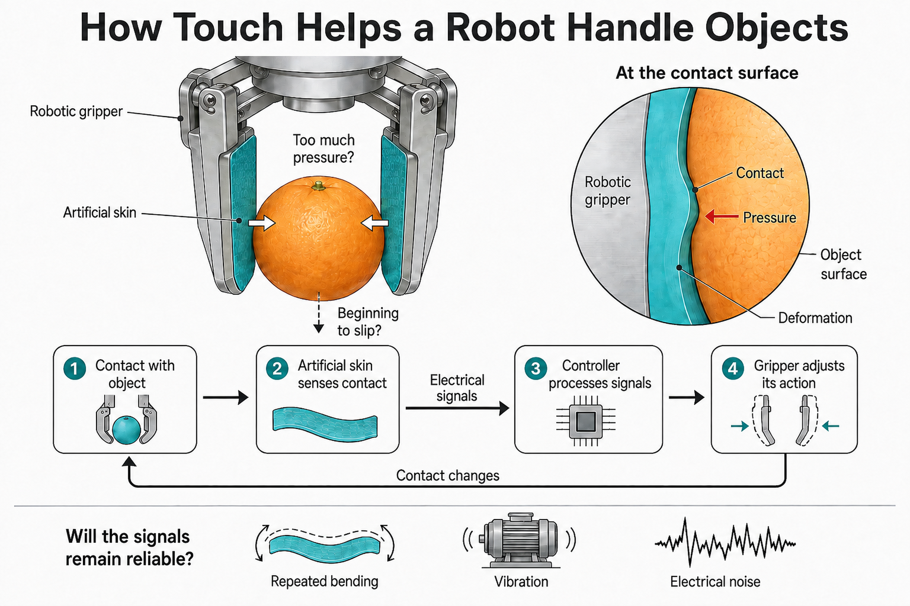

# B. Artificial Skin: Giving Robots a Sense of Touch

中文对照：[[英语资料#第1单元 · B. 人造皮肤：赋予机器人触觉|第1单元 · B. 人造皮肤：赋予机器人触觉]]

### Exploring with Visuals

Study the visual and answer the questions.

(1) What information does the gripper need to hold the fruit without crushing or dropping it? (2) Which conditions shown could make touch signals less reliable?

### Engineering Reading

Read the passage to understand how artificial skin can help intelligent robots sense contact, handle objects safely, and make better decisions in real-world engineering tasks.

### From Touch to Action: How Artificial Skin Helps Robots

Robots are becoming common partners in smart factories, warehouses, laboratories, hospitals, and public-service settings. They can move goods, inspect products, sort packages, assist with repetitive work, and handle objects that require speed or precision. Yet many robots still have a basic weakness: they can see, measure, and move, but they often cannot feel. Without touch, a robot may miss a small object, squeeze a fragile item too hard, or fail to notice that its gripper is slipping. In a shared workspace, this weakness is not a small inconvenience. It decides whether a task is completed safely, whether a product is damaged, or whether people can trust the system.

A Chinese research team from Huazhong University of Science and Technology and the Shenyang Institute of Automation, Chinese Academy of Sciences, has reported a bioinspired iontronic skin for robotic tactile sensing. The study is closely connected to the larger goal of building intelligent robots that can work in complex physical environments. Instead of treating touch as a simple add-on, the team designed a sensing layer that allows a robotic gripper to detect contact, pressure, and object properties. This kind of tactile sensing can help robots move from simple mechanical action toward safer and more adaptive interaction.

The word bioinspired is important here. Human skin does not only cover the body; it also collects information. When we pick up a glass, touch a soft fruit, or feel a tool slipping, our skin sends signals that help the brain adjust force and movement. Engineers want robots to have a similar ability, although the mechanism is very different. A robotic skin does not feel pain or texture like a human. It converts physical contact into measurable signals that software can interpret. This makes touch part of the robot’s sensing system, together with vision, force sensors, proximity sensors, and control algorithms.

The team used an iontronic sensing design. In simple terms, iontronic sensors use the movement or distribution of ions to create electrical changes when pressure or deformation occurs. When the artificial skin is pressed, the contact changes the electrical response of the sensing layer. These signals can be measured and converted into information about force or touch. This approach is useful for robots because it can be made flexible, sensitive, and suitable for curved robotic surfaces such as fingers, grippers, or soft robotic parts.

Real-world robotic work creates harsher requirements than simple laboratory testing. A device may face repeated bending, vibration, dust, temperature changes, surface wear, and electrical noise from nearby machines. A sensor that works well in a clean test bench may fail after thousands of grasping actions or when the object surface changes. For this reason, engineers must pay attention to durability and signal stability. A useful artificial skin should not only detect touch once; it should continue to produce clear and reliable signals after repeated contact, deformation, and use.

The design also addresses the problem of touch under uncertainty. In real applications, a robot must distinguish useful contact information from background noise. If every small vibration or accidental contact looks like one large signal, the robot cannot tell whether its gripper is holding a soft package, touching a hard tool or beginning to slip. The iontronic skin is designed to detect tactile changes while remain functional on flexible robotic surfaces. This gives the robot a better chance to judge contact force and object features during manipulation.

To demonstrate the system, the researchers integrated the artificial skin with a robotic gripper. The gripper could interact with objects and collect tactile data during contact. This is important because the real value of artificial skin is not only in the material itself, but in the complete sensing-and-action loop. The robot must touch an object, collect signals, process data, adjust its movement, and avoid damage. A useful robotic gripper must therefore combine mechanical design, flexible materials, protective packaging, signal processing, and control decisions.

The study also shows how tactile sensing can work with intelligent data analysis. Tactile signals are often complex: they may change with force, shape, contact area, speed, surface texture, and object stiffness. Machine learning can help identify patterns in these signals. For example, a system may learn to distinguish different objects, detect slipping and estimate how strongly the gripper is pressing. This does not mean the robot becomes fully autonomous by magic. It means that material sensing and data-driven interpretation can work together to give the robot more reliable feedback.

For smart manufacturing and service robotics, this kind of tactile sensing has many possible uses. A robot could handle fragile products more carefully, sort soft or irregularly shaped objects, assemble delicate electronic parts, assist in laboratory automation, or support medical and rehabilitation devices. In industrial work, tactile feedback may reduce product damage, improve maintenance quality, and make human-robot collaboration safer. In all these cases, touch supports responsible action: the robot does not merely reach an object; it understands contact well enough to act with control.

At the same time, artificial skin raises engineering responsibilities. The sensor must remain reliable after repeated bending and contact. Its signals must be protected from noise, material fatigue, temperature changes, and signal drift. Operators need clear feedback so that tactile data can guide decisions during a task. Engineers must also think about cost, repair, calibration, and transferability. A design that works for a laboratory gripper may need changes before it can be used in a warehouse robot, a hospital assistant robot, a rescue robot, or a commercial inspection system.

For students of intelligent systems, this case shows that sensing is not limited to cameras and radar. Robots also need physical interaction with the world. A robot working in a real environment must sense what matters, process uncertain data, adjust its action, and support human trust. Electronic skin is therefore more than a soft sensor. It is a bridge between materials science, mechanical design, robotics, signal processing, and artificial intelligence. It reminds future engineers that intelligent machines need not only sharper eyes and faster processors, but also safer, more sensitive ways to touch the world.

(word count: 1008)

### Understanding Information

> [!note] Interactive Exercise: TASK 1: Choose the best answer to each question according to the passage.
> [Do this exercise on the platform](https://reader-v2.tdtianwen.com/lg-viewer-v2/reader/standard?platform=td&pack_id=01a0b332-5e0c-7783-8f78-485f17f3f2a0&bookid=01a013c4-e4f0-750f-be8a-7de89b6353d1&section_id=01a013f1-a6fe-764e-9733-923895473a5b)

> [!note] Interactive Exercise: TASK 2: Decide if each of the following statements is True (T) or False (F).
> [Do this exercise on the platform](https://reader-v2.tdtianwen.com/lg-viewer-v2/reader/standard?platform=td&pack_id=01a0b332-5e0c-7783-8f78-485f17f3f2a0&bookid=01a013c4-e4f0-750f-be8a-7de89b6353d1&section_id=01a013f1-a6fe-764e-9733-923895473a5b)

> [!note] Interactive Exercise: TASK 3: Technical Vocabulary. Match each term or expression from the text with its correct meaning.
> [Do this exercise on the platform](https://reader-v2.tdtianwen.com/lg-viewer-v2/reader/standard?platform=td&pack_id=01a0b332-5e0c-7783-8f78-485f17f3f2a0&bookid=01a013c4-e4f0-750f-be8a-7de89b6353d1&section_id=01a013f1-a6fe-764e-9733-923895473a5b)

### Engineering Decision

Listen to a conversation about an engineering team that must make a difficult design decision under budget constraints. 

> [!note] Audio: Sensor Choice for an Underwater Robot
> [Listen to the audio on the platform](https://reader-v2.tdtianwen.com/ed-svc2/fp/book-file/019fc648-59d5-72b0-a2e0-43ba9cf632a1.mp3?t=oss_download&pack_id=01a0b332-5e0c-7783-8f78-485f17f3f2a0&platform=td)
> ![[U01-音频2-水下机器人的传感器选择.mp3]]

> [!note] Interactive Exercise: TASK 1: Comprehension check
> [Do this exercise on the platform](https://reader-v2.tdtianwen.com/lg-viewer-v2/reader/standard?platform=td&pack_id=01a0b332-5e0c-7783-8f78-485f17f3f2a0&bookid=01a013c4-e4f0-750f-be8a-7de89b6353d1&section_id=01a013f1-a6fe-764e-9733-923895473a5b)

> [!note] Interactive Exercise: TASK 2: Make your decision in a similar situation
> [Do this exercise on the platform](https://reader-v2.tdtianwen.com/lg-viewer-v2/reader/standard?platform=td&pack_id=01a0b332-5e0c-7783-8f78-485f17f3f2a0&bookid=01a013c4-e4f0-750f-be8a-7de89b6353d1&section_id=01a013f1-a6fe-764e-9733-923895473a5b)

### Communication & Reflection

### Building Your Unit Challenge Product

Return to the Unit Challenge and begin to draft your group’s visual sensing-and-control workflow and design brief.

(1) Your workflow should show what the system senses; which sensors or sensing methods are used; how data is processed or fused; what decision or action the system supports; where safety checks, human oversight, or uncertainty appear;

(2) Your short design brief should explain one engineering challenge and how your design manages it.

(3) Your work should use at least three terms or expressions from this unit.

> [!note] Extended Reading: Sample Reference Answer
> [View it on the platform](https://reader-v2.tdtianwen.com/lg-viewer-v2/reader/standard?platform=td&pack_id=01a0b332-5e0c-7783-8f78-485f17f3f2a0&bookid=01a013c4-e4f0-750f-be8a-7de89b6353d1&section_id=01a013f1-a6fe-764e-9733-923895473a5b)

### Portfolio Reflection

> [!note] Interactive Page: Portfolio Reflection
> [Open the interactive page](https://zhihuiware.com/api/webapp/embed/8727b8e4-287a-4289-be46-26cf70e346a7)

## Vocabulary and Expressions

| Term | Part of Speech | Definition |
| --- | --- | --- |
| Warehouse | n. | a large building used for storing products仓库 |
| precision | n. | the degree to which repeated measurements under the same conditions show consistent results 精度；准确度 |
| gripper | n. | a robotic part used to hold, grasp, or manipulate objects 机械夹爪 |
| bioinspired | adj. | designed by learning from biological systems 仿生启发的 |
| iontronic | adj. | using ions to create, control, or measure electrical signals 离子电子的 |
| tactile | adj. | connected with the sense of touch; using your sense of touch触觉的 |
| add-on | n. | a thing that is added to something else附加物 |
| mechanism | n. | the working principle of a sensor, metabolic pathway or reaction 机制；原理 |
| texture | n. | the way a surface feels when you touch it质地、手感 |
| proximity sensor | n. | a sensor that detects the presence of nearby objects without physical contact 接近传感器；距离传感器 |
| deformation | n. | a change in shape caused by force or pressure 变形 |
| manipulation | n. | the action of controlling, adjusting or operating substances, sensors or experimental parameters deliberately调控；操控 |
| delicate | adj. | easily damaged or sensitive; requiring careful handling 精密的；易碎的 |
| rehabilitation | n. | the process of restoring damaged equipment, sens-ors, biological tissues or systems to their original functional state 修复；恢复 |

## Platform Interactions

This chapter also has 5 interactive exercises, 1 extended reading, 1 audio track and 1 interactive page. Audio and video are downloaded locally and embedded in these notes for offline playback; only the interactive exercises need the platform: [Open this chapter on the platform](https://reader-v2.tdtianwen.com/lg-viewer-v2/reader/standard?platform=td&pack_id=01a0b332-5e0c-7783-8f78-485f17f3f2a0&bookid=01a013c4-e4f0-750f-be8a-7de89b6353d1&section_id=01a013f1-a6fe-764e-9733-923895473a5b)
