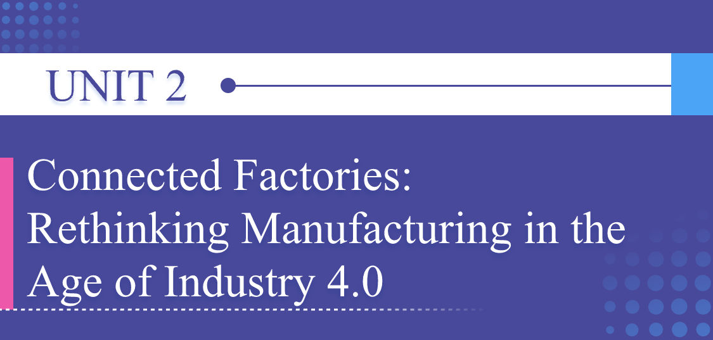
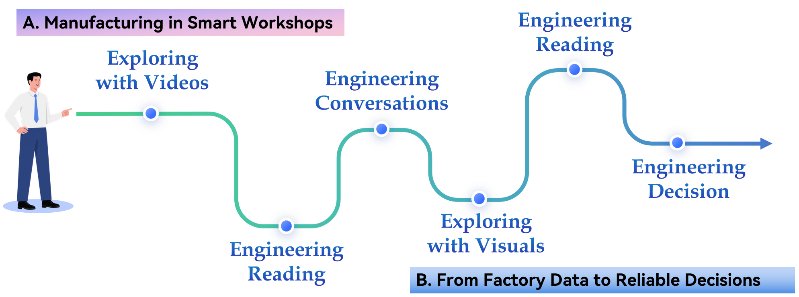

# Unit Preview

中文对照：[[英语资料#第2单元 · 单元预览|第2单元 · 单元预览]]

### Learning Objectives

Use key technical vocabulary related to smart factories, Industry 4.0, and the Industrial Internet of Things (IIoT) accurately in spoken and written English.

Understand information from videos, audio recordings, technical readings, and infographics on smart manufacturing.

Analyse how data, connectivity and automation reshape production systems, including trade-offs between flexibility and complexity, efficiency and security, and automation and human oversight.

Create a simple visual plan for improving a familiar campus service and explain how its success can be checked.

### Unit Challenge

Smart systems can improve familiar campus services. A useful upgrade starts with one clear problem, uses one manageable data source, keeps a person involved, and measures a result.

Your mission: Work in groups. Choose one familiar campus problem: a long queue at the parcel station, a long wait in the canteen, or unclear seat availability in the library. Create a four-box Smart Campus Solution Map showing the problem, the information the system uses, the smart action, and the human check.

### Learning Journey

