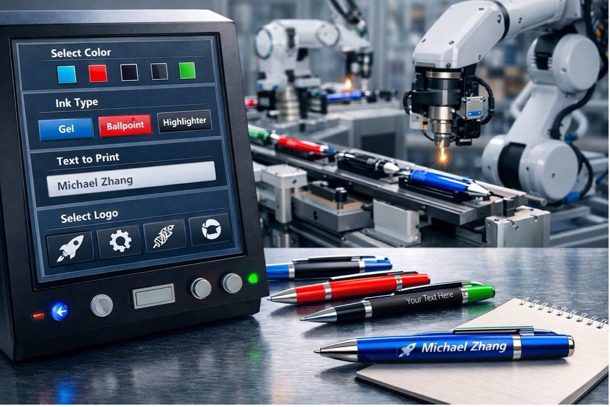

# A. Manufacturing in Smart Workshops

中文对照：[[英语资料#第2单元 · A. 智能车间中的制造|第2单元 · A. 智能车间中的制造]]

### Exploring with Videos

Imagine that you manage a small factory producing customised goods, such as engraved devices or bicycle frames in different sizes and colours.

Discuss two questions. (1) Which problem would be hardest to manage: frequent setup changes, order tracking, or quality control? Why? (2) What data would you collect first to manage that problem?

In smart manufacturing, robots, sensors, and digital control systems work together to handle exactly these problems. Watch the short video on mass customisation to see how a production line can make every product differently.

> [!note] Video: Robots Enable Mass Customisation
> [Watch the video on the platform](https://reader-v2.tdtianwen.com/ed-svc2/fp/book-file/01a02883-9d39-7447-8565-bccb752003c4.mp4?t=oss_download&pack_id=01a0b332-5e0c-7783-8f78-485f17f3f2a0&platform=td)
> ![[U02-视频-机器人实现大规模定制.mp4]]

> [!note] Interactive Exercise: Video Comprehension Check
> [Do this exercise on the platform](https://reader-v2.tdtianwen.com/lg-viewer-v2/reader/standard?platform=td&pack_id=01a0b332-5e0c-7783-8f78-485f17f3f2a0&bookid=01a013c4-e4f0-750f-be8a-7de89b6353d1&section_id=01a013f2-f63a-7519-9bfe-c465d4e230a4)

### Engineering Reading

Read the passage to understand the current landscape and future prospects of smart manufacturing systems.

### When Production Becomes a “Software Problem”

A traditional production line is built like a highway: fast, stable, and optimised for one destination. Parts arrive in a fixed order, machines repeat the same motions, and quality control checks each unit against one specification. This suits made-to-stock products—items produced in advance and stored until customers buy them. But when customers want variety, custom colours, optional modules, or personalised engraving, the highway jams.

The alternative is a robotic line: reconfigurable production cells linked by robots, conveyors, and software, designed to switch tasks quickly. Robots become networked nodes, receiving orders, reading product IDs, fetching tools, and reporting status. A made-to-order factory depends on coordination among machines, data, and decisions. Treating information as part of production, not merely a mechanical concern, shapes everything that follows.

From Orders to Instructions: The Digital Thread

In made-to-order manufacturing, an order is a set of parameters: size, colour, firmware version, packaging rules, and inspection criteria. To keep them aligned, factories build a digital thread—connected data linking design, planning, production, and quality records. The system then generates a production recipe identifying components, programs, and tolerances. QR codes, RFID tags, or serialised IDs give each product a data identity as it moves through the line.

Variety creates risk without the digital thread. A robot may install a wrong part, an operator may follow an outdated instruction, or a test station may apply the wrong limit. Connected records let the line display the correct instruction, load the approved robot program, and write results to a traceable database. A later defect can be traced to a batch, tool, shift, component lot, or software version—provided identifiers and records are complete and accurate.

Flexibility Has a Price: Changeover, Scheduling, and Bottlenecks

Flexibility is never free. Its first cost is changeover time: switching from one variant to another. Traditional lines avoid changeovers by running long batches; a robotic line shortens them using modular tooling, quick-connect grippers and parameterised robot programs. The aim is to make changeover closer to adjusting settings than rebuilding hardware.

The second cost is scheduling complexity. A made-to-stock plan may remain stable for a long run, whereas a made-to-order plan can change when a customer revises an order, material arrives late, or a rush job appears. Real-time scheduling updates the plan according to machine availability, work-in-process, and delivery deadlines—much as an airport reassigns flights (orders) to gates (machines) when conditions change. Yet scheduling software is only as reliable as its data. A machine reporting “running” while stopped can corrupt the plan, and a noisy sensor can trigger false alarms. Data quality is part of production quality.

The Eyes and Ears of a Robotic Line: IIoT Sensing at the Edge

A flexible line must know what it is doing, and the Industrial Internet of Things (IIoT) provides that awareness. Sensors measure vibration, temperature, current, torque, pressure, and images. High-frequency data is often handled through edge computing, near the machine, because sending every raw signal to the cloud adds latency, bandwidth use, and cost. Edge devices can filter and compress data, detect unusual vibration, enforce vision-based safety zones, or confirm the correct screw. Safety functions still require architectures and validation suited to their risk level.

The same data can support Overall Equipment Effectiveness (OEE), which combines availability, performance, and quality. On a made-to-order line, improvement depends on more than speed. Engineers may gain more by reducing variation at a bottleneck, shortening changeover, improving first-pass quality, or redesigning for easier assembly. OEE is a diagnostic measure, not a complete description of customer value, safety, workforce conditions, or energy performance.

Digital Twins: Test the Factory Before Changing the Factory

As product variety grows, experimenting on a live line can cause delay, scrap, or safety risk. A digital twin—a virtual model of a machine, cell, or workshop connected to operating data—moves some experiments into simulation. Engineers can test a new variant and estimate where cycle time or queue length may increase before changing the physical system. If a station becomes overloaded, they can compare redistributing work, changing a buffer, redesigning the task, or adding equipment. The twin must be fit for its purpose and validated against reality; an inaccurate model can create false confidence.

Human Roles Don’t Disappear—They Change

Smart factories redistribute human work rather than remove it. Operators spend less time repeating motions and more time supervising, troubleshooting, and improving processes. Engineers spend less time chasing paper records and more time building reliable data pipelines and interpreting dashboards.

Connectivity widens the cybersecurity attack surface, complex automation can fail unexpectedly, and operators who follow every recommendation may lose situational awareness. Well-designed systems keep people in the loop through clear alarms, understandable indicators, defined authority, training, and a safe manual override. Human oversight is not an excuse for weak automation; it is part of deliberate risk control.

Made-to-order production pushes factories to become flexible, connected, and data-driven. Robotic lines supply the hardware, but the deeper change is software thinking—a factory in which data, decisions, and physical action stay linked. Manufacturing still involves steel and motors, but increasingly depends on the quality of information flowing between them.

(word count: 849)

### Understanding Information

> [!note] Interactive Exercise: TASK 1: Use 1-3 English words to fill in each blank.
> [Do this exercise on the platform](https://reader-v2.tdtianwen.com/lg-viewer-v2/reader/standard?platform=td&pack_id=01a0b332-5e0c-7783-8f78-485f17f3f2a0&bookid=01a013c4-e4f0-750f-be8a-7de89b6353d1&section_id=01a013f2-f63a-7519-9bfe-c465d4e230a4)

> [!note] Interactive Exercise: TASK 2: Choose the best answer to each of the following questions about details of the passage.
> [Do this exercise on the platform](https://reader-v2.tdtianwen.com/lg-viewer-v2/reader/standard?platform=td&pack_id=01a0b332-5e0c-7783-8f78-485f17f3f2a0&bookid=01a013c4-e4f0-750f-be8a-7de89b6353d1&section_id=01a013f2-f63a-7519-9bfe-c465d4e230a4)

### Thinking Like an Engineer

Read the two China-related smart-factory reports below. For each report, trace how an information problem could lead to a production problem.

Report 1

A bicycle factory in Tianjin wants to offer 30 frame-size-and-colour combinations with a two-day delivery promise. After launching the made-to-order service, the factory meets the delivery target only 60% of the time. Engineers discover that changeover at the painting station is slow, frequent colour switches cause rework, and workers do not always receive updated scheduling information in time. The factory considers adding an automated paint-mixing system, a small buffer for partially painted frames, and a dashboard that shows real-time queue length and changeover time.

Report 2

A phone-accessory factory in Shenzhen uses QR codes so that each order carries its variant information. After a software update, the defect rate rises: some units fail the final test because the wrong firmware version is installed. The quality team suspects that one workstation is using an old recipe file, but the traceability database does not clearly connect the QR scan, firmware hash, operator confirmation, and final test result. The factory considers adding automatic version checks at the flashing station and a human-in-the-loop confirmation step before shipment.

Discuss in pairs. Imagine you are the owner of one of the two factories. Choose ONE factory and discuss the following three questions.

(1) Fixing information flow: How would you make sure the right information reaches the right people at the right time?

(2) Choosing the first move: You cannot afford to do everything at once. Which improvement would you make first, and why?

(3) Preparing for new problems: After you fix the main problem, what new issues might appear? How would you deal with them?

> [!note] Extended Reading: Reference Answers
> [View it on the platform](https://reader-v2.tdtianwen.com/lg-viewer-v2/reader/standard?platform=td&pack_id=01a0b332-5e0c-7783-8f78-485f17f3f2a0&bookid=01a013c4-e4f0-750f-be8a-7de89b6353d1&section_id=01a013f2-f63a-7519-9bfe-c465d4e230a4)

### Engineering Conversations

### Finding a Way Through a Smart Factory Project

> [!note] Audio: Finding a Way Through a Smart Factory Project
> [Listen to the audio on the platform](https://reader-v2.tdtianwen.com/ed-svc2/fp/book-file/01a0226c-0918-7949-b942-f7fd9a3e4eb5.mp3?t=oss_download&pack_id=01a0b332-5e0c-7783-8f78-485f17f3f2a0&platform=td)
> ![[U02-音频1-智能工厂项目的破局之路.mp3]]

> [!note] Interactive Exercise: TASK 1: Comprehension Check
> [Do this exercise on the platform](https://reader-v2.tdtianwen.com/lg-viewer-v2/reader/standard?platform=td&pack_id=01a0b332-5e0c-7783-8f78-485f17f3f2a0&bookid=01a013c4-e4f0-750f-be8a-7de89b6353d1&section_id=01a013f2-f63a-7519-9bfe-c465d4e230a4)

> [!note] Interactive Exercise: TASK 2: Vocabulary Extension
> [Do this exercise on the platform](https://reader-v2.tdtianwen.com/lg-viewer-v2/reader/standard?platform=td&pack_id=01a0b332-5e0c-7783-8f78-485f17f3f2a0&bookid=01a013c4-e4f0-750f-be8a-7de89b6353d1&section_id=01a013f2-f63a-7519-9bfe-c465d4e230a4)

> [!note] Interactive Exercise: TASK 3: Talking About Your University Life
> [Do this exercise on the platform](https://reader-v2.tdtianwen.com/lg-viewer-v2/reader/standard?platform=td&pack_id=01a0b332-5e0c-7783-8f78-485f17f3f2a0&bookid=01a013c4-e4f0-750f-be8a-7de89b6353d1&section_id=01a013f2-f63a-7519-9bfe-c465d4e230a4)

## Vocabulary and Expressions

| Term | Part of Speech | Definition |
| --- | --- | --- |
| made-to-stock | adj. | produced in advance and stored for later sale 备货生产的 |
| module | n. | a standardised unit that can be combined with or replaced by another unit模块；模组 |
| engraving | n. | the process of cutting or marking a design on a hard surface 雕刻；蚀刻 |
| robotic line | n. | a reconfigurable production line linking robots, conveyors, and software 机器人产线 |
| reconfigurable | adj. | able to be rearranged or adapted for new tasks 可重配置的 |
| conveyor | n. | a device that transports materials continuously 传送装置；传送带 |
| made-to-order | adj. | produced only after a specific customer order 按单生产的 |
| firmware | n. | software stored in a device that controls low-level hardware functions 固件 |
| digital thread | n. | connected data linking design, planning, production, and quality 数字主线 |
| traceable | adj. | able to have its history, or process records tracked 可追溯的 |
| changeover | n. | the process or time required to switch equipment to another product or task 换型；转换 |
| real-time scheduling | n. | updating production plans using current machine and order data 实时排产 |
| Industrial Internet of Things (IIoT) | n. | connected industrial machines and sensors that exchange data 工业物联网 |
| edge computing | n. | processing data near machines instead of sending all raw data to the cloud 边缘计算 |
| latency | n. | the delay between a signal and a response 延迟 |
| digital twin | n. | a virtual model linked to operating data for monitoring or simulation 数字孪生 |
| simulation | n. | testing a real process through a computer or mathematical model 仿真；模拟 |
| troubleshooting | n. | the process of identifying and correcting faults 故障排查 |
| manual override | n. | a control that allows a person to suspend an automatic function 手动接管 |
| human oversight | n. | human monitoring and authority over an automated system 人工监督 |

## Platform Interactions

This chapter also has 6 interactive exercises, 1 extended reading, 1 audio track and 1 video. Audio and video are downloaded locally and embedded in these notes for offline playback; only the interactive exercises need the platform: [Open this chapter on the platform](https://reader-v2.tdtianwen.com/lg-viewer-v2/reader/standard?platform=td&pack_id=01a0b332-5e0c-7783-8f78-485f17f3f2a0&bookid=01a013c4-e4f0-750f-be8a-7de89b6353d1&section_id=01a013f2-f63a-7519-9bfe-c465d4e230a4)
