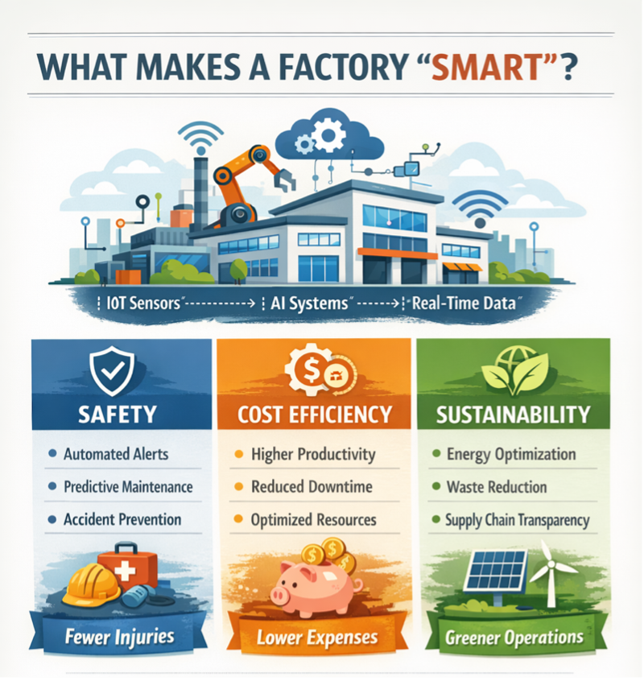

# B. From Factory Data to Reliable Decisions

中文对照：[[英语资料#第2单元 · B. 从工厂数据到可靠决策|第2单元 · B. 从工厂数据到可靠决策]]

### Exploring with Visuals

Study the visual and answer the questions.

Classify the following items. Write S for Safety, C for Cost Efficiency, and G for Sustainability.

(1) automated alerts

(2) reduced downtime

(3) energy optimization

(4) accident prevention

(5) optimised resources

(6) waste reduction

### Engineering Reading

Read the following passage to understand how data-driven workshops work and why they are difficult to build.

### Data-Driven Workshops: Turning Machines into “Speaking” Assets

Walk into a traditional workshop and you see belts moving, forklifts lifting, and people crossing between stations. The most valuable movement, however, is invisible—the flow of information. In a data-driven workshop, machines do not simply run; they report through sensors, logs, and network messages what they are doing, how well they are doing it, and what they are likely to do next.

The goal is better and faster decisions, but workshops are messy. Tools wear out, materials vary, operators improvise, and urgent orders disrupt plans. Data-driven manufacturing does not eliminate variation. It measures, models, and responds while there is still time to act.

From Sensors to Insights: The Data Pipeline

A workshop becomes data-driven when it builds a reliable data pipeline. It starts at machine level: sensors measure vibration, temperature, power, pressure, and position. Controllers record cycle counters, alarms, and setpoints. Vision systems check surfaces, dimensions, or label placement. Industrial networks and gateways collect these signals. Because machines may use different protocols, integration is a major engineering task.

Next comes processing. Some decisions must be immediate, for example, detecting a tool crash, stopping a robot near a person, or rejecting a defective part before the next station. These actions require low latency and often use edge computing. Other decisions, such as finding long-term trends in quality drift, can be computed centrally or in the cloud. Computing location should match the time scale of the decision.

Finally comes the “insight layer”: dashboards, alerts, and models. A dashboard shows real-time status and key performance indicators (KPIs). Alerts trigger when variables cross thresholds. Models go further by detecting patterns, predicting outcomes and recommending actions.

Predictive Maintenance: Fix It Before It Breaks

One of the most practical uses of workshop data is predictive maintenance. Instead of waiting for a machine to fail (reactive maintenance) or servicing it on a fixed calendar (preventive maintenance), predictive maintenance estimates failure risk based on condition data. If vibration increases in a motor bearing, or if temperature rises under the same load, the model may flag an anomaly. Maintenance teams can then plan a repair during a scheduled stop, order parts in advance, and avoid unexpected downtime.

However, predictive maintenance is only as good as its labels and context. If a dataset does not clearly record when failures happened and what caused them, models may learn the wrong patterns. If operating conditions change—through new materials, speeds, tools, or operators—the model may become unreliable. Engineers must therefore treat maintenance analytics as a living process involving data cleaning, periodic retraining, and validation with domain experts.

Quality Analytics: Catching Defects Early

Data-driven workshops also change quality control. Traditional inspection often occurs at the end, after a product is finished. Smart quality moves suitable checks upstream and in-process. Vision systems can measure dimensions or surface features, torque sensors can verify fastening operations, and acoustic signals can indicate tool wear. Detecting problems earlier can reduce scrap and rework, although measurement systems themselves must be validated.

Early detection also increases data volume and raises a question: which signals truly matter? Engineers may begin with a hypothesis—for example, that spindle vibration relates to surface finish—and use experiments and feature selection to test it. Effective models combine process physics, representative data, and validation rather than relying on correlation alone.

Digital Twins for Workshops: Monitoring Meets Simulation

A workshop digital twin goes beyond a static 3D model. It links operating data to a model that can test what-if questions: What happens if a rush order arrives? If one machine slows, where does the bottleneck move? If batch size changes, will work in process (WIP) grow sharply? By combining monitoring and simulation, a twin can help planners compare actions that improve throughput without sacrificing quality.

Building a twin is not only a software task. It requires suitable equipment models, trustworthy data synchronisation, validation, and a clear purpose. A twin for energy optimisation may focus on power and temperature; one for scheduling may focus on process times, queues, and resources. The attempt to make one model answer every question can create an expensive system that is difficult to validate and use.

The Hidden Challenge: Data Governance and Cybersecurity

When a workshop becomes connected, new questions appear: Who owns the data? Who may edit it? How long should it be stored? If teams use inconsistent names and definitions, records become difficult to combine and analyse. Data governance—covering definitions, quality, permissions, retention, and standards—therefore becomes part of engineering work.

Cybersecurity is equally crucial. A connected workshop may include legacy machines never designed for the internet. If not protected, an attacker could steal recipes, disrupt production, or cause unsafe behaviour. Good practice includes network segmentation, authentication, patch management, and monitoring. In other words, a data-driven workshop must also be a cyber-aware workshop.

A Data-Driven Mindset

In the end, a data-driven workshop is about mindset as well as technology: measure what matters, decide from evidence, and design feedback loops that continuously improve the system. The best smart workshops do not drown in data. They turn data into a small set of trustworthy signals that help people and machines work together—safer, faster, and smarter.

(word count: 856)

### Understanding Information

> [!note] Interactive Exercise: TASK 1: Choose the best answer to each question according to the passage.
> [Do this exercise on the platform](https://reader-v2.tdtianwen.com/lg-viewer-v2/reader/standard?platform=td&pack_id=01a0b332-5e0c-7783-8f78-485f17f3f2a0&bookid=01a013c4-e4f0-750f-be8a-7de89b6353d1&section_id=01a013f3-1d61-7499-9c2a-64bfd00941f1)

> [!note] Interactive Exercise: TASK 2: Decide if each of the following statements is True (T) or False (F).
> [Do this exercise on the platform](https://reader-v2.tdtianwen.com/lg-viewer-v2/reader/standard?platform=td&pack_id=01a0b332-5e0c-7783-8f78-485f17f3f2a0&bookid=01a013c4-e4f0-750f-be8a-7de89b6353d1&section_id=01a013f3-1d61-7499-9c2a-64bfd00941f1)

> [!note] Interactive Exercise: TASK 3: Match each term or expression from the text with its correct meaning.
> [Do this exercise on the platform](https://reader-v2.tdtianwen.com/lg-viewer-v2/reader/standard?platform=td&pack_id=01a0b332-5e0c-7783-8f78-485f17f3f2a0&bookid=01a013c4-e4f0-750f-be8a-7de89b6353d1&section_id=01a013f3-1d61-7499-9c2a-64bfd00941f1)

### Engineering Decision

Listen to a conversation exploring the tension between upgrading quickly and keeping data, safety, and trust reliable.

> [!note] Audio: Speed Versus Reliability in a Smart-Factory Upgrade
> [Listen to the audio on the platform](https://reader-v2.tdtianwen.com/ed-svc2/fp/book-file/01a0226a-c3d9-7b72-b198-26eafa111231.mp3?t=oss_download&pack_id=01a0b332-5e0c-7783-8f78-485f17f3f2a0&platform=td)
> ![[U02-音频2-智慧工厂升级中的速度与可靠性.mp3]]

> [!note] Interactive Exercise: TASK 1: Comprehension check
> [Do this exercise on the platform](https://reader-v2.tdtianwen.com/lg-viewer-v2/reader/standard?platform=td&pack_id=01a0b332-5e0c-7783-8f78-485f17f3f2a0&bookid=01a013c4-e4f0-750f-be8a-7de89b6353d1&section_id=01a013f3-1d61-7499-9c2a-64bfd00941f1)

> [!note] Interactive Exercise: TASK 2: Rescue the open-day makerspace
> [Do this exercise on the platform](https://reader-v2.tdtianwen.com/lg-viewer-v2/reader/standard?platform=td&pack_id=01a0b332-5e0c-7783-8f78-485f17f3f2a0&bookid=01a013c4-e4f0-750f-be8a-7de89b6353d1&section_id=01a013f3-1d61-7499-9c2a-64bfd00941f1)

### Communication & Reflection

### Building Your Unit Challenge Product

Return to the Unit Challenge and create a one-page Smart Campus Solution Map. Choose a long pickup queue at the campus parcel station, a long wait in the canteen, or unclear seat availability in the library. Use no more than five boxes. Include:

(1) Campus Problem: Describe the problem in one sentence.

(2) Data Source: Show what information the system collects, such as a QR-code record, a queue count, or a seat-sensor signal.

(3) Smart Action: Explain one action the system takes to improve the service.

(4) Human Check: Show where a student or staff member checks the information or corrects the system.

> [!note] Extended Reading: Sample Reference Answer
> [View it on the platform](https://reader-v2.tdtianwen.com/lg-viewer-v2/reader/standard?platform=td&pack_id=01a0b332-5e0c-7783-8f78-485f17f3f2a0&bookid=01a013c4-e4f0-750f-be8a-7de89b6353d1&section_id=01a013f3-1d61-7499-9c2a-64bfd00941f1)

### Portfolio Reflection

> [!note] Interactive Page: Portfolio Reflection
> [Open the interactive page](https://zhihuiware.com/api/webapp/embed/1f849630-18e0-4275-a431-9d54106cf219)

## Vocabulary and Expressions

| Term | Part of Speech | Definition |
| --- | --- | --- |
| data-driven | adj. | using data to make decisions or control a process数据驱动的 |
| log | n. | an official record of events or activities 日志 |
| improvise | v. | to act using the resources available, without a fully prepared plan 临时应对 |
| gateway | n. | a device that connects different networks or systems 网关 |
| protocol | n. | a set of rules for exchanging data between devices 协议（数据通信规则） |
| latency | n. | the time delay between an action and a response 延迟 |
| threshold | n. | a level at which an action, alert, or change is triggered 阈值；临界值 |
| anomaly | n. | something that is unusual and may indicate a problem异常 |
| downtime | n. | time when a machine or system is not operating 停机时间 |
| in-process | adj. | carried out during production rather than only at the end 在制程中的 |
| hypothesis | n. | an idea that is suggested as an explanation and tested 假设 |
| WIP | n. | work in process; items that have entered production but are not yet finished 在制品 |
| throughput | n. | the amount produced or processed in a given time 产出率 |
| data governance | n. | rules and responsibilities for managing data quality and access 数据治理 |

## Platform Interactions

This chapter also has 5 interactive exercises, 1 extended reading, 1 audio track and 1 interactive page. Audio and video are downloaded locally and embedded in these notes for offline playback; only the interactive exercises need the platform: [Open this chapter on the platform](https://reader-v2.tdtianwen.com/lg-viewer-v2/reader/standard?platform=td&pack_id=01a0b332-5e0c-7783-8f78-485f17f3f2a0&bookid=01a013c4-e4f0-750f-be8a-7de89b6353d1&section_id=01a013f3-1d61-7499-9c2a-64bfd00941f1)
