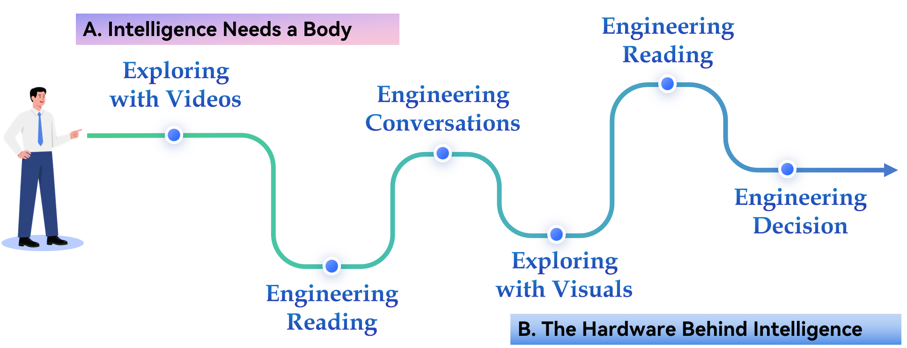

# Unit Preview

中文对照：[[英语资料#第3单元 · 单元预览|第3单元 · 单元预览]]

### Learning Objectives

Use key technical vocabulary related to embodied intelligence, robotics, artificial intelligence, and AI hardware in spoken and written English.

Practice understanding information from multimodal sources on embodied AI systems, intelligent robots, and the computing technologies that support them.

Analyze engineering trade-offs in embodied intelligence, including perception accuracy, computing power, energy efficiency, safety, reliability, and human–machine interaction.

Prepare a proposal for an embodied AI system that explains its tasks, sensors, AI capabilities, hardware components, and safety considerations.

### Unit Challenge

Your university has received a grant to deploy embodied AI robots on campus. But there is one condition: the robots must do real, useful work, not just show off. The Facilities Office has three job openings: Night Library Patrol, Canteen Tray Collector, and Building Window Cleaner. They now invite robot suppliers to participate in The Robot Job Fair.

Your Mission: Your group represents a supplier. Choose one job and one robot body type from four options: humanoid, quadruped, wheeled with an arm, or fixed arm. Then prepare a three-minute pitch to convince the hiring committee (your classmates) that your robot is the best fit.

Learning Journey

