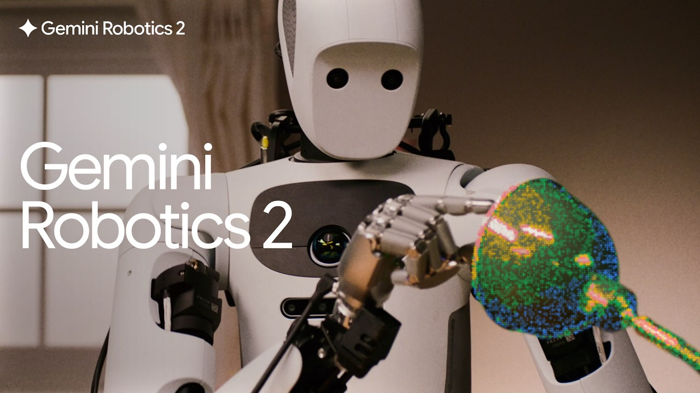

# A. Intelligence Needs a Body

中文对照：[[英语资料#第3单元 · A. 智能需要身体|第3单元 · A. 智能需要身体]]

### Exploring with Videos

Think about the intelligent machines in daily life, for example, delivery robots in hotels and self-driving taxis.

Imagine a robot working in your home or classroom. What abilities would it need to interact safely with people and objects?

Did you know that a new generation of AI systems is entering the physical world? This video introduces embodied AI, a technology that combines AI models, sensors, and robotic bodies to help machines perform complex tasks in the real world.

> [!note] Video: Gemini Robotics 2 brings whole body intelligence to robots
> [Watch the video on the platform](https://reader-v2.tdtianwen.com/ed-svc2/fp/book-file/01a07f73-e749-7e0d-bdc6-75f5c0596554.mp4?t=oss_download&pack_id=01a0b332-5e0c-7783-8f78-485f17f3f2a0&platform=td)
> ![[U03-视频-GeminiRobotics2全身智能.mp4]]

> [!note] Interactive Exercise: Video Comprehension Check
> [Do this exercise on the platform](https://reader-v2.tdtianwen.com/lg-viewer-v2/reader/standard?platform=td&pack_id=01a0b332-5e0c-7783-8f78-485f17f3f2a0&bookid=01a013c4-e4f0-750f-be8a-7de89b6353d1&section_id=01a013f4-d2e7-77c6-b397-17bccdbe61d3)

### Engineering Reading

Read the passage to understand how embodied AI combines sensors, computing hardware, and robotic systems to help machines act in the real world.

### Embodied AI: From Digital Intelligence to Physical Machines

From Digital AI to Physical AI

In recent years, AI has achieved remarkable progress. Large language models (LLMs) can answer questions, write articles, generate images, and assist people in solving problems. However, most AI systems still exist mainly in digital environments. They process information but do not directly interact with the physical world.

A new generation of AI is moving beyond screens and entering real environments. This development is often called embodied intelligence, or embodied AI. Unlike traditional AI systems that only analyze data, embodied AI combines artificial intelligence with a physical body, allowing machines to perceive their surroundings, make decisions, and perform actions.

China’s Unitree Robotics has become one example of this emerging field. Its quadruped robots, humanoid robots, and other robotic platforms have attracted public attention through demonstrations of walking, running, balancing, and interacting with people. Some Unitree robots appeared in the Spring Festival Gala, showing how robots are becoming more capable of movement and interaction.

However, a robot that can move is not necessarily intelligent. Behind every successful demonstration lies a complex engineering system involving sensors, AI models, computing hardware, mechanical design, and control algorithms. The goal of embodied AI is not simply to build machines that move, but to create machines that can understand and respond to the physical world.

Giving Machines a Sense of the World

The first challenge for embodied AI is perception. Humans understand the environment through multiple senses. We see objects, hear sounds, feel textures, and understand situations through experience. Robots need similar abilities, although they achieve them through engineering systems.

Modern robots use different types of sensors to collect information. Cameras allow robots to recognize objects and environments. LiDAR and depth sensors help estimate distance and build three-dimensional maps. Force and tactile sensors allow robots to detect physical contact, such as whether they are holding an object too tightly or whether something is slipping from their hands.

However, sensing alone is not enough. Robots must combine information from different sensors and interpret what that information means. A human can immediately understand that a chair is something to sit on, a cup is something to hold, and a fragile object requires careful handling. For robots, these simple human actions require complex processes of perception and understanding.

This is why embodied AI depends on the integration of sensing, computing, and artificial intelligence. A robot needs not only eyes and ears but also the ability to understand what it perceives.

From Recognition to Action

Traditional AI systems often focus on recognition, including identifying objects, classifying images, or generating responses. Embodied AI requires one more step, that is, turning understanding into action.

A robot operating in the real world must answer practical questions: Where am I? What is around me? What should I do next? How can I complete the task safely? To achieve this, embodied AI systems combine perception with planning and control. AI models help robots interpret situations and decide appropriate actions. Control systems then translate these decisions into physical movements through motors, joints, and mechanical structures.

For example, a household robot asked to pick up a cup cannot simply recognize the object. It must locate the cup, estimate its shape and position, calculate how to move its arm, adjust the force of its grip, and respond if the cup moves unexpectedly. This connection between intelligence and physical action is what makes embodied AI different from traditional digital AI.

Learning Through Interaction

One important feature of embodied AI is that robots can improve through interaction with their environment. Humans learn many skills through experience. We learn how much force to use when holding objects, how to walk on different surfaces, and how to adjust our actions when situations change.

Similarly, robots can learn by collecting data from repeated interactions. Through simulation, real-world experiments, and machine learning techniques, robots can improve their ability to perform tasks.

For example, a robotic hand may initially struggle to grasp different objects. By analyzing failures and successes, an AI system can gradually learn better strategies. This process allows robots to become more adaptable instead of relying only on fixed programming.

This ability is particularly important because the real world is unpredictable. A robot working in a factory, hospital, or home must handle situations that engineers cannot completely define in advance.

Challenges Ahead

Although embodied AI is developing rapidly, many challenges remain. One major challenge is computing. Intelligent robots require powerful AI models, but running these models consumes significant energy and computing power. Engineers therefore need more efficient hardware, including specialized AI chips and edge computing systems that allow robots to process information locally.

Another challenge is reliability and safety. A robot operating in a public environment must make accurate decisions and avoid harming people or damaging objects. Engineers must consider not only technical performance but also human trust and acceptance.

Cost is another important issue. Advanced robots require expensive sensors, processors, and mechanical components. For embodied AI to become widely used, engineers must find ways to make intelligent machines more affordable and practical.

The future of embodied AI will depend on cooperation among many fields, including artificial intelligence, robotics, mechanical engineering, electronics, materials science, and human-centered design. The ultimate goal is not to replace humans, but to create intelligent machines that can safely and effectively work together with people.

(word count: 894)

### Understanding Information

> [!note] Interactive Exercise: TASK 1: Use 1-3 English words to fill in each blank.
> [Do this exercise on the platform](https://reader-v2.tdtianwen.com/lg-viewer-v2/reader/standard?platform=td&pack_id=01a0b332-5e0c-7783-8f78-485f17f3f2a0&bookid=01a013c4-e4f0-750f-be8a-7de89b6353d1&section_id=01a013f4-d2e7-77c6-b397-17bccdbe61d3)

> [!note] Interactive Exercise: TASK 2: Choose the best answer to each of the following questions about details of the passage.
> [Do this exercise on the platform](https://reader-v2.tdtianwen.com/lg-viewer-v2/reader/standard?platform=td&pack_id=01a0b332-5e0c-7783-8f78-485f17f3f2a0&bookid=01a013c4-e4f0-750f-be8a-7de89b6353d1&section_id=01a013f4-d2e7-77c6-b397-17bccdbe61d3)

### Thinking Like an Engineer

Read two short reports on embodied AI applications. Consider how to balance intelligence, cost, safety, and practical usefulness.

Report 1

Unitree Robotics has successfully commercialized a range of robotic products for both individual consumers and enterprises. For quadruped robots (e.g., Go2, Go1), sales from 2023 to 2025 exceeded 33,000 units. These robots are deployed in diverse real-world scenarios. Personal users use them for companionship and entertainment, while businesses use them for showroom displays and event exhibitions. In the humanoid segment, Unitree sold over 5,500 units in 2025 alone. Approximately 70% of these robots are purchased by universities and laboratories for R&D and teaching, but they are also increasingly found in corporate reception areas, high-end retail displays, and even as premium consumer gadgets for tech enthusiasts.

Report 2

In 2025, global shipments of humanoid robots reached approximately 18,000 units, a year‑over‑year increase of 508%. However, it is worth noting that the vast majority of these robots are still used for research, data collection, and entertainment purposes, with only about 10% actually deployed in clearly defined business scenarios. At Tesla, more than 50 Optimus Gen‑3 units have already been put into actual operation at its Shanghai Gigafactory. The primary scenarios currently involve deployment within its own factories, performing tasks such as seat installation, parts handling, and quality inspection. The long‑term goal is to enter the home service sector, including elderly care and household cleaning.

Discuss in pairs. Consider the application of embodied AI and explore answers to one (or more) aspect listed below.

(1) Public value: What problems should embodied AI solve first, and who should benefit from these technologies?

(2) Cost and access: What factors may prevent embodied AI robots from becoming widely available?

(3) Standards and trust: What rules or tests are needed to ensure that embodied AI robots are safe and trustworthy?

> [!note] Extended Reading: Reference Answers
> [View it on the platform](https://reader-v2.tdtianwen.com/lg-viewer-v2/reader/standard?platform=td&pack_id=01a0b332-5e0c-7783-8f78-485f17f3f2a0&bookid=01a013c4-e4f0-750f-be8a-7de89b6353d1&section_id=01a013f4-d2e7-77c6-b397-17bccdbe61d3)

### Engineering Conversations

### Starting a Scoping Review on Embodied AI

> [!note] Audio: Starting a Scoping Review on Embodied AI
> [Listen to the audio on the platform](https://reader-v2.tdtianwen.com/ed-svc2/fp/book-file/01a02719-2309-79e3-81b9-878d331ac2ae.mp3?t=oss_download&pack_id=01a0b332-5e0c-7783-8f78-485f17f3f2a0&platform=td)
> ![[U03-音频1-开始一项具身智能范围综述.mp3]]

> [!note] Interactive Exercise: TASK 1: Summary Reconstruction
> [Do this exercise on the platform](https://reader-v2.tdtianwen.com/lg-viewer-v2/reader/standard?platform=td&pack_id=01a0b332-5e0c-7783-8f78-485f17f3f2a0&bookid=01a013c4-e4f0-750f-be8a-7de89b6353d1&section_id=01a013f4-d2e7-77c6-b397-17bccdbe61d3)

> [!note] Interactive Exercise: TASK 2: Vocabulary Extension
> [Do this exercise on the platform](https://reader-v2.tdtianwen.com/lg-viewer-v2/reader/standard?platform=td&pack_id=01a0b332-5e0c-7783-8f78-485f17f3f2a0&bookid=01a013c4-e4f0-750f-be8a-7de89b6353d1&section_id=01a013f4-d2e7-77c6-b397-17bccdbe61d3)

> [!note] Interactive Exercise: TASK 3: Talking About Your Learning Challenges
> [Do this exercise on the platform](https://reader-v2.tdtianwen.com/lg-viewer-v2/reader/standard?platform=td&pack_id=01a0b332-5e0c-7783-8f78-485f17f3f2a0&bookid=01a013c4-e4f0-750f-be8a-7de89b6353d1&section_id=01a013f4-d2e7-77c6-b397-17bccdbe61d3)

## Vocabulary and Expressions

| Term | Part of Speech | Definition |
| --- | --- | --- |
| digital AI | n. | AI systems that mainly process information in digital environments, such as text, images, or data. 数字人工智能； |
| embodied AI | n. | AI systems with a physical body 具身智能 |
| humanoid | n. | / adj. a machine that looks and behaves like a human 类人、仿真机器人 |
| robotic platform | n. | A system for specific tasks, including its hardware, software, and control components. 由硬件、软件和控制系统组成的机器人系统 |
| texture | n. | the way a surface or substance feels when you touch it  质地；手感 |
|  |  | LiDAR Light Detection and Ranging. A technology that uses laser light to measure distance and create three-dimensional maps. 激光雷达 |
| tactile sensor | n. | A sensor that allows robots to detect physical contact, pressure, or touch. 触觉传感器 |
| recognition | n. | the act of remembering who somebody is when you see them, or of identifying what something is认出；识别 |
| control system | n. | A system that manages and adjusts the movement or operation of a machine. 控制系统 |
| motor | n. | a device that converts electricity into motion 电动机 |
| joint | n. | a place where two parts are joined in a way that enables them to bend and move关节 |
| grip | n. | an act of holding somebody/something tightly紧握；紧抓 |
| technique | n. | a method of doing a task 技术；方法 |
| computing power | n. | The ability of a computer system to process information and perform calculations. 计算能力 |
| edge computing | n. | A computing method that processes data close to where it is generated instead of relying only on distant cloud servers. 边缘计算 |

## Platform Interactions

This chapter also has 6 interactive exercises, 1 extended reading, 1 audio track and 1 video. Audio and video are downloaded locally and embedded in these notes for offline playback; only the interactive exercises need the platform: [Open this chapter on the platform](https://reader-v2.tdtianwen.com/lg-viewer-v2/reader/standard?platform=td&pack_id=01a0b332-5e0c-7783-8f78-485f17f3f2a0&bookid=01a013c4-e4f0-750f-be8a-7de89b6353d1&section_id=01a013f4-d2e7-77c6-b397-17bccdbe61d3)
