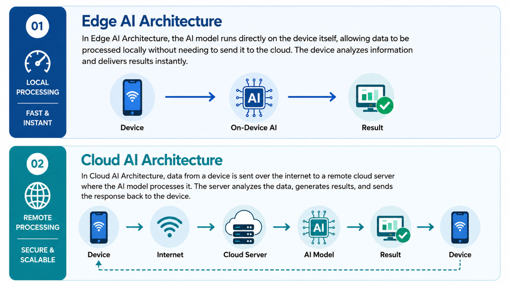

# B. The Hardware Behind Intelligence

中文对照：[[英语资料#第3单元 · B. 智能背后的硬件|第3单元 · B. 智能背后的硬件]]

### Exploring with Visuals

Study the visual and answer the questions.

1) Where does the thinking happen in each of the two systems, and what has to travel between the parts? 2) For a robot working in a hospital corridor, which arrangement would you trust, and what would you give up by choosing it?

> [!note] Extended Reading: Sample Reference Answer
> [View it on the platform](https://reader-v2.tdtianwen.com/lg-viewer-v2/reader/standard?platform=td&pack_id=01a0b332-5e0c-7783-8f78-485f17f3f2a0&bookid=01a013c4-e4f0-750f-be8a-7de89b6353d1&section_id=01a013f5-2675-762c-b35f-0ca5df32730b)

### Engineering Reading

Read the following passage to understand why intelligent machines need a new kind of computing hardware, and how engineers decide where that computing should happen.

### AI Chips and the Future of Computing

A humanoid robot walks across a lab, steps over a cable and picks up a paper cup without crushing it. Nothing in this scene looks like computing. Yet in every second of that walk, the machine has processed images from several cameras, estimated the distance to every object in front of it, and recalculated the force in its fingers many times over. The intelligence is visible in the movement, but the computing is hidden inside a chip. That raises a question: what kind of computer can do all this, and can it be small and cool enough to travel with the machine?

Why AI Needs New Hardware

For most of computing history, the work was done by the central processing unit (CPU). A CPU has a small number of powerful cores that carry out instructions one after another at very high speed. This design suits tasks that have a clear order, such as opening a file or calculating a spreadsheet. A neural network, however, does not behave like that at all.

A neural network passes information through layers of simple units, and every layer performs millions of multiplications and additions at the same moment. What matters is not how quickly a single instruction can be finished, but how many can be finished together. This is parallel computing. The first hardware that suited it was the graphics processing unit (GPU), built to draw images on screens, containing thousands of smaller cores working simultaneously.

GPUs, however, draw large amounts of power and produce heat. Engineers therefore developed the AI accelerator, often called a neural processing unit (NPU), a chip built to do one job only (that is, running neural networks). Because it is specialized, an AI accelerator can deliver far more useful calculation for each watt of energy it consumes. For a machine running on a battery, energy efficiency decides how long the robot can work before it stops.

From Cloud AI to Edge AI

One obvious way around this power problem is to move the computing somewhere else. The robot could send its camera images to a distant data center, let powerful computers there do the thinking, and wait for instructions to come back. This is cloud computing, and for many applications it works extremely well.

For an embodied system, however, three constraints stand in the way. The first is latency: a signal that travels to a server and back may take several hundred milliseconds. That is unnoticeable in a translation app and unacceptable for a robotic arm about to close on a human hand. The second is bandwidth: cameras, depth sensors and LiDAR generate a continuous stream of data that no network can be trusted to carry at all times. The third is privacy: a home-care robot or a hospital device records images of people in private situations, and sending them across a public network raises questions many users are unwilling to accept.

The engineering response is edge computing, that is, processing data close to the place where it is produced, on the device itself. In this approach the chip travels with the robot. In practice, a well-designed system usually divides the work so that urgent perception and control run on board, while training and long-term analysis happen in the cloud. This division is the reason why the design of AI chips can no longer be separated from the design of intelligent machines.

AI Chips in Real-World Devices

The consequences are already visible on the road. An autonomous vehicle must process camera, radar and LiDAR data continuously, and a braking decision cannot wait for the network to recover, so on-board inference chips make that decision inside the car. Service and industrial robots follow the same pattern, with a separate, simpler controller kept for safety so that a failure in the AI system cannot disable the emergency stop.

Wearable and medical devices push the limits further. A device worn on the body, or placed close to tissue, must run its algorithms inside a very small power budget, because almost all the energy a chip uses becomes heat, and heat next to human tissue is a clinical problem.

Beyond Silicon

Every chip described so far is built from silicon transistors on a rigid integrated circuit. Two directions are now being explored beyond that. The first is the neuromorphic chip. Instead of processing every input continuously, the circuit stays quiet until something changes, and its artificial neurons communicate through brief pulses, or spikes. One example is the Tianjic chip developed at Tsinghua University, which supports both conventional and spiking neural networks. It was demonstrated on a self-balancing bicycle that could follow voice commands, track a person and avoid obstacles, all on one chip.

The second direction is flexible electronics: circuits built on bendable substrates instead of rigid boards, so that computing can be placed on curved and moving surfaces such as a robotic hand, a joint, or a patch of artificial skin. Combined with tactile sensing, this points towards machines whose sensing and processing are spread across the body.

(word count: 830)

### Understanding Information

> [!note] Interactive Exercise: TASK 1: Choose the best answer to each question according to the passage.
> [Do this exercise on the platform](https://reader-v2.tdtianwen.com/lg-viewer-v2/reader/standard?platform=td&pack_id=01a0b332-5e0c-7783-8f78-485f17f3f2a0&bookid=01a013c4-e4f0-750f-be8a-7de89b6353d1&section_id=01a013f5-2675-762c-b35f-0ca5df32730b)

> [!note] Interactive Exercise: TASK 2: Decide if each of the following statements is True (T) or False (F).
> [Do this exercise on the platform](https://reader-v2.tdtianwen.com/lg-viewer-v2/reader/standard?platform=td&pack_id=01a0b332-5e0c-7783-8f78-485f17f3f2a0&bookid=01a013c4-e4f0-750f-be8a-7de89b6353d1&section_id=01a013f5-2675-762c-b35f-0ca5df32730b)

> [!note] Interactive Exercise: TASK 3: Match each term or expression from the text with its correct meaning.
> [Do this exercise on the platform](https://reader-v2.tdtianwen.com/lg-viewer-v2/reader/standard?platform=td&pack_id=01a0b332-5e0c-7783-8f78-485f17f3f2a0&bookid=01a013c4-e4f0-750f-be8a-7de89b6353d1&section_id=01a013f5-2675-762c-b35f-0ca5df32730b)

### Engineering Decision

Listen to a conversation between three students who disagree about where to place humanoid robots at the university. 

> [!note] Audio: Where to Place the Unitree Humanoid Robots?
> [Listen to the audio on the platform](https://reader-v2.tdtianwen.com/ed-svc2/fp/book-file/01a023a4-d6fd-7056-b38b-e2d1530ae079.mp3?t=oss_download&pack_id=01a0b332-5e0c-7783-8f78-485f17f3f2a0&platform=td)
> ![[U03-音频2-宇树人形机器人该放在哪里.mp3]]

> [!note] Interactive Exercise: TASK 1: Comprehension check
> [Do this exercise on the platform](https://reader-v2.tdtianwen.com/lg-viewer-v2/reader/standard?platform=td&pack_id=01a0b332-5e0c-7783-8f78-485f17f3f2a0&bookid=01a013c4-e4f0-750f-be8a-7de89b6353d1&section_id=01a013f5-2675-762c-b35f-0ca5df32730b)

> [!note] Interactive Exercise: TASK 2: Make your decision in a similar situation
> [Do this exercise on the platform](https://reader-v2.tdtianwen.com/lg-viewer-v2/reader/standard?platform=td&pack_id=01a0b332-5e0c-7783-8f78-485f17f3f2a0&bookid=01a013c4-e4f0-750f-be8a-7de89b6353d1&section_id=01a013f5-2675-762c-b35f-0ca5df32730b)

### Communication & Reflection

### Building Your Unit Challenge Product

Return to the Unit Challenge and prepare your 3-minute pitch for the Robot Job Fair. Your pitch must include:

(1) Three PowerPoint Slides/3-page Drawings: 1) The Job: Which job are you applying for? Why does this job matter on campus? 2) Why This Body: Why did you choose this robot type for this specific job? Name at least two sensors your robot uses (e.g., camera, LiDAR, tactile sensor) and explain what each one does. 3) The Honest Trade-off: What is one thing your robot cannot do perfectly? What is your backup plan? Also, show a simple cost estimate (purchase + maintenance) and explain why it's worth the money.

(2) Three-Minute Pitch: Use at least two technical terms from this unit in your pitch (e.g., latency, edge computing, inference, perception, control system, neural network, reliability).

> [!note] Extended Reading: Sample Reference Answer
> [View it on the platform](https://reader-v2.tdtianwen.com/lg-viewer-v2/reader/standard?platform=td&pack_id=01a0b332-5e0c-7783-8f78-485f17f3f2a0&bookid=01a013c4-e4f0-750f-be8a-7de89b6353d1&section_id=01a013f5-2675-762c-b35f-0ca5df32730b)

### Portfolio Reflection

> [!note] Interactive Page: Portfolio Reflection
> [Open the interactive page](https://zhihuiware.com/api/webapp/embed/9b041d26-0aed-4554-bf63-a3324a363911)

## Vocabulary and Expressions

| Term | Part of Speech | Definition |
| --- | --- | --- |
| force | n. | an effect that causes things to move in a particular way 力 |
| visible | adj. | that can be seen看得见的 |
| core | n. | a processing unit within a CPU 处理器核心 |
| neural network | n. | a computing model made of connected layers of units, inspired by the brain 神经网络 |
| multiplication | n. | the process of multiplying numbers 乘；相乘 |
| addition | n. | the process of adding two or more numbers together to find their total加；加法 |
| parallel computing | n. | a method in which many calculations are carried out at the same time 并行计算 |
| graphics processing unit | n. | a processor with many small cores, originally designed for graphics 图形处理器 |
| accelerator | n. | a chip designed specifically to run AI calculations 加速器 |
| neural processing unit | n. | a processor built to carry out neural network operations efficiently 神经网络处理器 |
| energy efficiency | n. | the amount of useful work produced for each unit of energy used 能效 |
| cloud computing | n. | the use of remote servers, reached over a network, to store and process data 云计算 |
| constraint | n. | a thing that limits something限制；约束 |
| latency | n. | the delay between an input and the system’s response 延迟 |
| server | n. | a computer that provides data or services on a network 服务器 |
| bandwidth | n. | the amount of data a network can carry in a given time 带宽 |
| inference | n. | the stage in which a trained AI model is used to produce results from new data 推理 |
| transistor | n. | a tiny switch that controls electric current; the basic building block of a chip 晶体管 |
| integrated circuit | n. | electronic circuits built onto one small piece of semiconductor material 集成电路 |
| neuromorphic chip | n. | a chip whose structure imitates the way biological neurons process and transmit signals 类脑芯片 |
| spike | n. | a brief electrical pulse used by neurons to carry information 脉冲 |
| spiking neural network | n. | a network in which units communicate through pulses rather than continuous values 脉冲神经网络 |
| flexible electronics | n. | electronic circuits built on materials that can bend or stretch 柔性电子 |
| substrate | n. | the base material on which an electronic circuit is built  基底 |

## Platform Interactions

This chapter also has 5 interactive exercises, 2 extended readings, 1 audio track and 1 interactive page. Audio and video are downloaded locally and embedded in these notes for offline playback; only the interactive exercises need the platform: [Open this chapter on the platform](https://reader-v2.tdtianwen.com/lg-viewer-v2/reader/standard?platform=td&pack_id=01a0b332-5e0c-7783-8f78-485f17f3f2a0&bookid=01a013c4-e4f0-750f-be8a-7de89b6353d1&section_id=01a013f5-2675-762c-b35f-0ca5df32730b)
