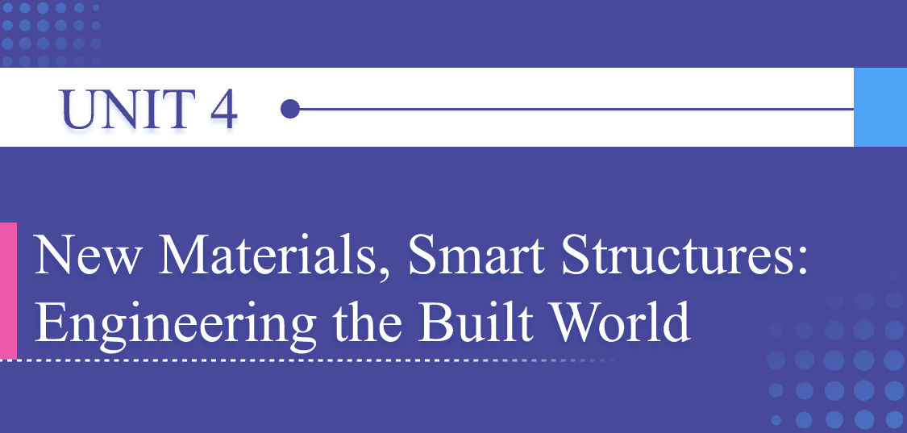
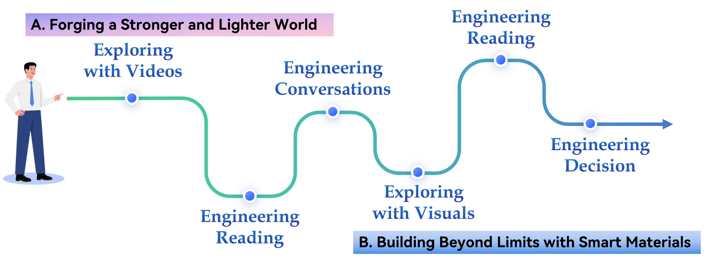

# Unit Preview

中文对照：[[英语资料#第4单元 · 单元预览|第4单元 · 单元预览]]

### Learning Objectives

Use key technical vocabulary to describe material properties and structural behaviour.

Practise understanding information from multimodal sources on materials science and structural engineering topics.

Analyse and evaluate engineering solutions involving material selection and structural design in group discussion.

Design an academic poster introducing a Chinese achievement in materials or structural engineering with effective language.

### Unit Challenge

China has become a global innovator in materials and structural engineering. Technologies such as ultra-high-performance concrete and record-breaking bridge design demonstrate how engineering is transforming infrastructure.

Your mission: Work in groups. Select one recent Chinese achievement in materials or structural engineering and prepare an academic poster that 1) explains what problems the achievement addresses; 2) shows how the material, structure, or smart system works; 3) includes data points or visual pieces of evidence; 4) explains why the achievement matters for infrastructure, public benefits, sustainability, or national engineering innovation.

### Learning Journey

