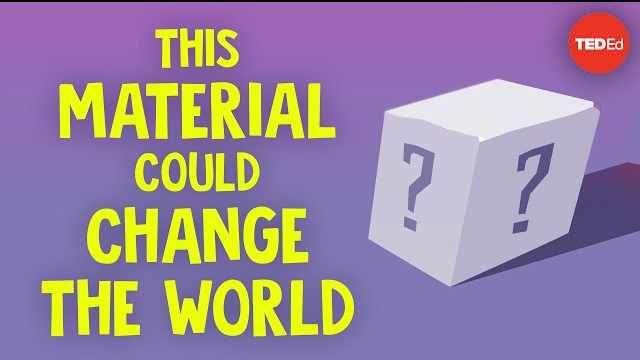

# A. Forging a Stronger and Lighter World

中文对照：[[英语资料#第4单元 · A. 锻造更强更轻的世界|第4单元 · A. 锻造更强更轻的世界]]

### Exploring with Videos

Imagine you are on a Mars mission. Look around and choose five common materials (e.g., wood, glass, plastic, metal, rubber, ceramics, leather).

Rank these five materials according to what you would worry about most if they were used on Mars. Explain your ranking briefly (consider extreme cold, dust storms, impacts, temperature changes, etc.).

Concrete is one of the most widely used materials in the world, forming the backbone of modern infrastructure such as roads, bridges, and buildings. In this video, you will explore why concrete is both essential and problematic, and how scientists are working to develop more sustainable alternatives.

> [!note] Video: This Material Could Change the World
> [Watch the video on the platform](https://reader-v2.tdtianwen.com/ed-svc2/fp/book-file/01a02849-eac1-79b8-a191-74ef087fc574.mp4?t=oss_download&pack_id=01a0b332-5e0c-7783-8f78-485f17f3f2a0&platform=td)
> ![[U04-视频-这种材料可能改变世界.mp4]]

> [!note] Interactive Exercise: Video Comprehension Check
> [Do this exercise on the platform](https://reader-v2.tdtianwen.com/lg-viewer-v2/reader/standard?platform=td&pack_id=01a0b332-5e0c-7783-8f78-485f17f3f2a0&bookid=01a013c4-e4f0-750f-be8a-7de89b6353d1&section_id=01a013f5-f96d-7189-9183-353c35fa1951)

### Engineering Reading

Read the passage to understand how advanced materials are transforming engineering from the molecular level up.

### New Materials, New Possibilities

Every structure begins with a choice of material. The steel beam supporting a bridge, the glass panel on a skyscraper, the polymer lining inside a water pipe—each was selected because its properties matched a specific engineering demand. For most of the twentieth century, that selection process drew on a relatively stable menu: steel for strength, concrete for compression, aluminium for lightness, and glass for transparency. But the 21st century has rewritten the menu entirely. Researchers are now engineering materials at the atomic and molecular level, creating substances that are lighter, stronger, and more versatile than anything available a generation ago.

Think about carbon fibre. Originally developed for aerospace, this material consists of thin filaments of carbon atoms bonded together in a crystal structure. The result is a material roughly five times stronger than steel yet only a fraction of its weight. Carbon-fibre-reinforced polymers (CFRPs) are now standard in racing cars, bicycle frames, and aircraft fuselages. More recently, civil engineers have begun using CFRP tendons to reinforce bridge decks and parking structures, replacing traditional steel rebar that corrodes over time.

At an even smaller scale, graphene—a single layer of carbon atoms arranged in a two-dimensional honeycomb—has captured enormous research attention since its isolation in 2004. Graphene is extraordinarily strong for its thickness. It conducts electricity and heat with remarkable efficiency, and is nearly transparent. Researchers at several Chinese universities have developed graphene-enhanced concrete that shows improved compressive strength and reduced cracking. While large-scale production remains expensive, pilot applications in anti-corrosion coatings and conductive films suggest that graphene will eventually move from the laboratory into everyday construction.

Not all innovation focuses on making materials stronger. Some of the most exciting work involves making them smarter. Self-healing materials contain embedded capsules of a healing agent—often an epoxy resin or a bacterial solution—that is released when a crack forms. The agent fills and seals the crack, restoring structural integrity without human intervention. Researchers at Delft University have developed a self-healing concrete that uses limestone-producing bacteria, and Chinese teams at Southeast University are testing similar systems for highway pavements, where the cost of manual repair is enormous.

Shape-memory alloys (SMAs) represent another branch of smart materials. These metal alloys—typically nickel–titanium—can be deformed and then return to their original shape when heated. Engineers are embedding SMA wires in bridge cables and building joints so that, after an earthquake, the structure can partially “reset” itself. In Japan and China, SMA-based dampers have been installed in high-rise buildings to reduce seismic vibration without the bulk and maintenance of traditional hydraulic systems.

Bio-inspired materials push innovation in yet another direction. Nature has spent millions of years optimizing structures for strength, flexibility, and resource efficiency. Nacre, the iridescent lining of mollusc shells, is a natural composite made of brittle aragonite tablets bonded by a thin organic layer. Despite using relatively weak components, nacre is remarkably tough due to its layered micro-architecture deflects and absorbs cracks. Materials scientists have replicated this “brick-and-mortar” structure using alumina and polymers to produce synthetic nacre that is being explored for lightweight armour, protective casings, and impact-resistant panels in electric vehicles.

Sustainability is also reshaping material choices. Ultra-high-performance concrete (UHPC), for instance, achieves compressive strengths above 150 megapascals—roughly six to ten times stronger than conventional concrete—by optimizing particle packing at the micro-level. Engineers can only use far less UHPC because it’s so strong, resulting in the birth of thinner, lighter structural elements that require less raw material and generate less carbon. China’s Changsha Kaifu District Pedestrian Bridge, built with UHPC panels, weighs significantly less than a conventional concrete equivalent while maintaining the same load capacity.

The emerging field of programmable matter takes material science further still. Researchers are developing materials whose properties—shape, stiffness, thermal conductivity—can be changed on demand through external stimuli such as heat, light, or an electric field. Another remarkable scientific payoff is four-dimensional (4D) printing, an extension of additive manufacturing, produces objects from smart polymers that can fold, curve, or expand after printing. Although most 4D-printed structures are currently small-scale prototypes, the technology has clear potential for making deployable shelters, self-assembling furniture, and adaptive building façades that respond to weather conditions.

All these advances share a common thread: they dissolve the old boundary between a material and the structure it serves. A self-healing concrete slab is not just a building component, instead, it is a maintenance system. An SMA cable is not merely a structural member—it is a safety device. As materials are becoming active participants in engineering performance rather than passive ingredients, the very concept of “structure” must expand to include behaviour over time, not just strength at a single moment.

For undergraduate engineers, this convergence means that materials science is no longer a prerequisite to be completed and forgotten. It is a kind of live, evolving discipline that intersects with structural analysis, environmental engineering, digital fabrication, and even biology. The students who understand not only what a material can do but why it behaves that way—down to the molecular scale—will be the ones who forge a stronger, lighter, and more sustainable built world.

(word count: 842)

### Understanding Information

> [!note] Interactive Exercise: TASK 1: Use 1-3 English words to fill in each blank.
> [Do this exercise on the platform](https://reader-v2.tdtianwen.com/lg-viewer-v2/reader/standard?platform=td&pack_id=01a0b332-5e0c-7783-8f78-485f17f3f2a0&bookid=01a013c4-e4f0-750f-be8a-7de89b6353d1&section_id=01a013f5-f96d-7189-9183-353c35fa1951)

> [!note] Interactive Exercise: TASK 2: Choose the best answer to each of the following questions about details of the passage.
> [Do this exercise on the platform](https://reader-v2.tdtianwen.com/lg-viewer-v2/reader/standard?platform=td&pack_id=01a0b332-5e0c-7783-8f78-485f17f3f2a0&bookid=01a013c4-e4f0-750f-be8a-7de89b6353d1&section_id=01a013f5-f96d-7189-9183-353c35fa1951)

### Thinking Like an Engineer

Read two short reports on recent breakthroughs in advanced materials. Analyze the performance variables and potential applications. 

Report 1

In 2024, a team from Tianjin University announced a breakthrough in graphene semiconductors. Using an original technique called “quasi-equilibrium annealing”, the researchers overcame graphene’s “zero band gap” problem — the property that had prevented graphene from functioning as a semiconductor. The team achieved a 0.6 eV band gap on a silicon carbide substrate, with room-temperature electron mobility exceeding 5,000 cm2/Vs — roughly ten times that of silicon and twenty times that of conventional two-dimensional materials. This result opens a path toward nanoscale chips with performance improvements of tenfold or more, offering a solution for post-Moore’s Law chip materials.

Report 2

In 2025, a cross-disciplinary team published in Nature a study on ultra-high-energy lithium metal batteries. Through an innovative “delocalized electrolyte” design, the team achieved 600 Wh/kg in pouch cells and 480 Wh/kg at the module level — among the highest energy densities ever reported. The batteries have already been deployed in three models of micro unmanned aerial vehicles (UAVs), extending flight endurance by 2.8 times. A pilot production line has been established with a fully self-controlled supply chain from materials to finished cells.

Discuss in pairs. Choose one material from the reports above. Explore answers to one (or more) aspect listed below. 

(1) Safety and standards: What could go wrong if the material fails, degrades, overheats, cracks, or performs differently from expected?

(2) Cost and maintenance: What costs will appear after installation, such as inspection, repair, replacement, or monitoring?

(3) Transferability: Which design choices would need to change if the material were used in chips, UAVs, bridges, buildings, or underwater systems?

> [!note] Extended Reading: Reference Answers
> [View it on the platform](https://reader-v2.tdtianwen.com/lg-viewer-v2/reader/standard?platform=td&pack_id=01a0b332-5e0c-7783-8f78-485f17f3f2a0&bookid=01a013c4-e4f0-750f-be8a-7de89b6353d1&section_id=01a013f5-f96d-7189-9183-353c35fa1951)

### Engineering Conversations

### What Makes Materials Smart

> [!note] Audio: What Makes Materials Smart
> [Listen to the audio on the platform](https://reader-v2.tdtianwen.com/ed-svc2/fp/book-file/01a02325-9de0-73db-addc-5191692e9c27.mp3?t=oss_download&pack_id=01a0b332-5e0c-7783-8f78-485f17f3f2a0&platform=td)
> ![[U04-音频1-是什么让材料智能.mp3]]

> [!note] Interactive Exercise: TASK 1: Comprehension check
> [Do this exercise on the platform](https://reader-v2.tdtianwen.com/lg-viewer-v2/reader/standard?platform=td&pack_id=01a0b332-5e0c-7783-8f78-485f17f3f2a0&bookid=01a013c4-e4f0-750f-be8a-7de89b6353d1&section_id=01a013f5-f96d-7189-9183-353c35fa1951)

> [!note] Interactive Exercise: TASK 2: Vocabulary Extension
> [Do this exercise on the platform](https://reader-v2.tdtianwen.com/lg-viewer-v2/reader/standard?platform=td&pack_id=01a0b332-5e0c-7783-8f78-485f17f3f2a0&bookid=01a013c4-e4f0-750f-be8a-7de89b6353d1&section_id=01a013f5-f96d-7189-9183-353c35fa1951)

> [!note] Interactive Exercise: TASK 3: Talking About Your University Life
> [Do this exercise on the platform](https://reader-v2.tdtianwen.com/lg-viewer-v2/reader/standard?platform=td&pack_id=01a0b332-5e0c-7783-8f78-485f17f3f2a0&bookid=01a013c4-e4f0-750f-be8a-7de89b6353d1&section_id=01a013f5-f96d-7189-9183-353c35fa1951)

## Vocabulary and Expressions

| Term | Part of Speech | Definition |
| --- | --- | --- |
| polymer | n. | a substance consisting of large molecules made from combinations of small simple molecules 聚合物 |
| property | n. | a quality or characteristic that something has 性质；特性 |
| compression | n. | the state of being subjected to such squeezing force 受压、挤压 |
| versatile | adj. | able to adapt or be used for many different purposes  多功能的；用途广泛的 |
| filament | n. | a very thin thread or fibre of natural or synthetic material 细丝；细线 |
| fuselage | n. | the main central body of an aircraft 机身、机体 |
| tendon | n. | a high-strength tension-resisting structural element, usually made of steel or advanced composite materials 索筋；预应力钢束 |
| rebar | n. | steel bars used to reinforce concrete structures 钢筋 |
| graphene | n. | a single layer of carbon atoms forming a two-dimensional lattice 石墨烯 |
| conductive | adj. | able to transmit heat or electricity 导电的；导热的 |
| self-healing | adj. | able to repair damage automatically without external intervention 自愈合的 |
| epoxy | n. | a type of strong adhesive resin used in engineering 环氧树脂 |
| integrity | n. | the state of being whole, sound, and unimpaired 完整性；结构完好 |
| damper | n. | a device that reduces vibration or oscillation in a structure 阻尼器；减震器 |
| seismic | adj. | relating to earthquakes or earth vibrations 地震的 |
| composite | n. | a material made from two or more substances with different properties 复合材料 |
| deflect | v. | to change direction or make something change direction 偏移、转向 |
| megapascal | n. | a unit of pressure equal to one million pascals (MPa) 兆帕斯卡 |
| stiffness | n. | the ability of a material or structure to resist elastic deformation 刚度；刚性 |
| façade | n. | the front face or outer surface of a building 建筑立面；外壁 |
| slab | n. | a thick flat piece of stone, wood or other hard material 厚板 |
| fabrication | n. | the process of making or producing goods, equipment, etc. from various different materials 制造；加工 |

## Platform Interactions

This chapter also has 6 interactive exercises, 1 extended reading, 1 audio track and 1 video. Audio and video are downloaded locally and embedded in these notes for offline playback; only the interactive exercises need the platform: [Open this chapter on the platform](https://reader-v2.tdtianwen.com/lg-viewer-v2/reader/standard?platform=td&pack_id=01a0b332-5e0c-7783-8f78-485f17f3f2a0&bookid=01a013c4-e4f0-750f-be8a-7de89b6353d1&section_id=01a013f5-f96d-7189-9183-353c35fa1951)
