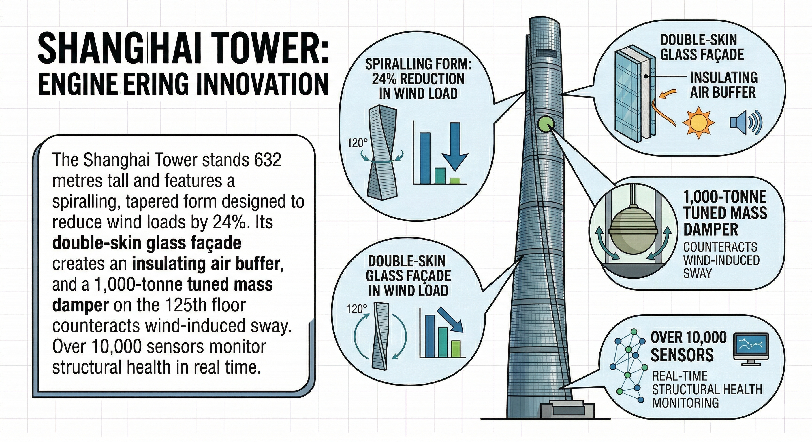

# B. Building Beyond Limits with Smart Materials

中文对照：[[英语资料#第4单元 · B. 用智能材料突破建造极限|第4单元 · B. 用智能材料突破建造极限]]

### Exploring with Visuals

Study the visual and answer the questions.

1) What design feature reduces wind force on the building? 2) What is the purpose of the tuned mass damper? 3) The tower uses over 10,000 sensors. What kind of information do you think these sensors collect?

> [!note] Extended Reading: Sample Reference Answer
> [View it on the platform](https://reader-v2.tdtianwen.com/lg-viewer-v2/reader/standard?platform=td&pack_id=01a0b332-5e0c-7783-8f78-485f17f3f2a0&bookid=01a013c4-e4f0-750f-be8a-7de89b6353d1&section_id=01a013f6-32ee-74ef-a9c0-99b1dc0a458c)

### Engineering Reading

Read the passage to understand how smart structures integrate sensing, processing, and actuation to create adaptive infrastructure.

### Smart Structures: Buildings That Think

In 2022, the China Academy of Building Research unveiled a demonstration pavilion in Beijing whose walls could adjust their thermal insulation in real time. Embedded sensors measured outdoor temperature, wind speed, and solar radiation every thirty seconds, while a central controller activated micro-channels within the wall panels to circulate either warm or cool fluid. The building consumed roughly 40% less energy for heating and cooling than a conventional structure of the same size. It was not merely a building—it was a machine that could think about its own envelope.

This pavilion represents a broader shift in structural engineering: the rise of smart structures. A smart structure is one that can sense changes in its environment, then process that information, and respond by adjusting its physical properties. The concept is borrowed from biology—just as human skin adjusts pore size to regulate temperature, a smart building adjusts ventilation, shading, and structural stiffness to meet changing conditions. It requires three integrated layers to make this possible: sensing, processing, and actuation.

The sensing layer relies on networks of embedded sensors. Fibre-optic strain sensors, for example, can be woven directly into concrete during casting. Once the concrete cures, these sensors measure internal stress, temperature, and even moisture content continuously. In China’s Hong Kong–Zhuhai–Macau Bridge—one of the longest sea-crossing structures in the world—over 10,000 sensors monitor structural health around the clock. Engineers receive alerts if any section of the bridge experiences unusual stress, enabling them to schedule maintenance before a minor issue becomes a major failure. This practice, known as structural health monitoring (SHM), has transformed the way engineers think about the lifespan of large infrastructure.

The processing layer is where raw sensor data becomes actionable intelligence. Modern smart structures feed data into digital twins—virtual replicas of the physical structure that are updated in real time. A digital twin of a skyscraper, for instance, can simulate how the building will respond to an approaching typhoon hours before the storm arrives, allowing engineers to pre-tension cables, lock elevators at safe floors, or activate supplementary dampers. Machine-learning algorithms further enhance this capability by identifying patterns in sensor data that human operators might miss—a subtle, recurring vibration in a steel joint, for example, that signals the early stages of fatigue cracking.

The actuation layer translates decisions into physical responses. Piezoelectric actuators, which convert electrical signals into precise mechanical movements, can adjust the tension in a cable or the angle of a sun-shading louvre within milliseconds. Electrochromic glass—whose opacity changes when a voltage is applied—allows building façades to shift from transparent to tinted in response to sunlight intensity. In the Shanghai Tower, a tuned mass damper weighing 1,000 tonnes swings on the 125th floor to counteract wind-induced sway, keeping occupant comfort within acceptable limits even during strong gusts.

Smart structures are not limited to skyscrapers. The concept scales downward to bridges, tunnels, and even individual structural components. Self-sensing concrete, for instance, contains conductive carbon fibres that change their electrical resistivity when the concrete is compressed or cracked. By measuring resistance across a slab, engineers can detect damage without any external sensor equipment. Chinese researchers at Harbin Institute of Technology have demonstrated self-sensing concrete panels in highway pavements, where the material simultaneously carries traffic loads and reports its own condition to a central monitoring station.

The integration of smart materials and smart structures creates what some researchers call adaptive infrastructure—systems that evolve their behaviour over time in response to accumulated data. An adaptive bridge, for example, might gradually shift traffic loads from a weakening span to a stronger one, extending the bridge’s service life by decades. An adaptive building envelope might learn the daily routine of its occupants and pre-adjust indoor temperature, lighting, and ventilation before anyone arrives, reducing energy consumption while improving comfort.

Sustainability is a driving motivation behind much of this work. Buildings account for roughly 40% of global energy consumption and nearly one-third of greenhouse gas emissions. Smart structures address this directly by minimizing waste. A façade that tilts its shading louvres in response to the sun’s position eliminates the need for excess air conditioning. A bridge that reports its own condition avoids the enormous material and energy cost of premature replacement. The circular economy principle—designing structures for disassembly, reuse, and recycling—is further enabled when embedded sensors can certify the remaining strength of recovered components.

Challenges remain. Smart systems add complexity, and complexity introduces new failure modes: a sensor that provides false readings can trigger unnecessary and costly interventions, while a cyber-attack on a building’s control network could disable critical safety systems. Engineers must therefore design redundancy into smart structures—backup sensors, manual overrides, and secure communication protocols—to ensure that intelligence does not come at the expense of reliability.

For students entering structural or civil engineering, smart structures represent a fundamental shift in what the discipline demands. A modern structural engineer must understand not only forces and materials but also data science, control systems, and cyber-physical security. The structures of the future will not simply stand; they will sense, think, and adapt—and the engineers who build them will need a vocabulary and a mindset that crosses traditional disciplinary boundaries.

(word count: 862)

### Understanding Information

> [!note] Interactive Exercise: TASK 1: Choose the best answer to each question according to the passage.
> [Do this exercise on the platform](https://reader-v2.tdtianwen.com/lg-viewer-v2/reader/standard?platform=td&pack_id=01a0b332-5e0c-7783-8f78-485f17f3f2a0&bookid=01a013c4-e4f0-750f-be8a-7de89b6353d1&section_id=01a013f6-32ee-74ef-a9c0-99b1dc0a458c)

> [!note] Interactive Exercise: TASK 2: Decide if each of the following statements is True (T) or False (F).
> [Do this exercise on the platform](https://reader-v2.tdtianwen.com/lg-viewer-v2/reader/standard?platform=td&pack_id=01a0b332-5e0c-7783-8f78-485f17f3f2a0&bookid=01a013c4-e4f0-750f-be8a-7de89b6353d1&section_id=01a013f6-32ee-74ef-a9c0-99b1dc0a458c)

> [!note] Interactive Exercise: TASK 3: Match each term or expression from the text with its correct meaning.
> [Do this exercise on the platform](https://reader-v2.tdtianwen.com/lg-viewer-v2/reader/standard?platform=td&pack_id=01a0b332-5e0c-7783-8f78-485f17f3f2a0&bookid=01a013c4-e4f0-750f-be8a-7de89b6353d1&section_id=01a013f6-32ee-74ef-a9c0-99b1dc0a458c)

### Engineering Decision

Listen to a conversation exploring the tension between ambitious structural design and long-term maintenance reality. 

> [!note] Audio: Who Pays for Year Twenty?
> [Listen to the audio on the platform](https://reader-v2.tdtianwen.com/ed-svc2/fp/book-file/01a023a0-4479-7c5f-992f-53c0cf0ff960.mp3?t=oss_download&pack_id=01a0b332-5e0c-7783-8f78-485f17f3f2a0&platform=td)
> ![[U04-音频2-第二十年的钱谁来出.mp3]]

> [!note] Interactive Exercise: TASK 1: Comprehension check
> [Do this exercise on the platform](https://reader-v2.tdtianwen.com/lg-viewer-v2/reader/standard?platform=td&pack_id=01a0b332-5e0c-7783-8f78-485f17f3f2a0&bookid=01a013c4-e4f0-750f-be8a-7de89b6353d1&section_id=01a013f6-32ee-74ef-a9c0-99b1dc0a458c)

> [!note] Interactive Exercise: TASK 2: Make your decision in a similar situation
> [Do this exercise on the platform](https://reader-v2.tdtianwen.com/lg-viewer-v2/reader/standard?platform=td&pack_id=01a0b332-5e0c-7783-8f78-485f17f3f2a0&bookid=01a013c4-e4f0-750f-be8a-7de89b6353d1&section_id=01a013f6-32ee-74ef-a9c0-99b1dc0a458c)

### Communication & Reflection

### Building Your Unit Challenge Product

Return to the Unit Challenge and begin building the academic poster. Your poster should include:

(1) Title and Authors: A clear, specific title and your group members.

(2) Introduction: Two to three sentences explaining the problem your chosen technology addresses.

(3) Technical Explanation: How the technology works, using clear language, diagrams, or illustrations.

(4) Key Data: Data points (performance figures, cost comparisons, efficiency percentages) presented in a chart, table, or data box.

(5) Significance: Why this achievement matters — connect it to sustainability, cost-effectiveness, maintainability, or China’s innovation strategy.

> [!note] Extended Reading: Sample Reference Answer
> [View it on the platform](https://reader-v2.tdtianwen.com/lg-viewer-v2/reader/standard?platform=td&pack_id=01a0b332-5e0c-7783-8f78-485f17f3f2a0&bookid=01a013c4-e4f0-750f-be8a-7de89b6353d1&section_id=01a013f6-32ee-74ef-a9c0-99b1dc0a458c)

### Portfolio Reflection

> [!note] Interactive Page: Portfolio Reflection
> [Open the interactive page](https://zhihuiware.com/api/webapp/embed/bd180b0b-b76b-425c-93a0-4addc3cca068)

## Vocabulary and Expressions

| Term | Part of Speech | Definition |
| --- | --- | --- |
| pavilion | n. | a light, open‑sided or semi‑enclosed building, often used for public activities and exhibitions 展馆；临时展厅 |
| insulation | n. | material or method used to prevent heat, sound, or electricity from escaping or entering 绝缘；隔热 |
| panel | n. | a flat, rigid piece of material forming a section of a wall 板材；面板 |
| envelope | n. | the outer shell of a building that separates interior from exterior 建筑围护结构 |
| actuation | n. | the process of causing a machine or device to operate 驱动；执行 |
| embedded | adj. | fixed firmly and deeply within a surrounding mass 嵌入式的 |
| cure | v. | to keep newly‑placed concrete moist and under controlled temperature. 熟化（获得强度与刚度的过程） |
| digital twin | n. | a virtual replica of a physical object updated with real-time data 数字孪生 |
| replica | n. | a very good or exact copy of something 复制品；仿制品 |
| algorithm | n. | a set of rules followed in calculations or problem-solving 算法 |
| fatigue | n. | weakening of a material caused by repeated stress cycles 疲劳（材料） |
| piezoelectric | adj. | generating voltage when mechanical pressure is applied 压电的 |
| opacity | n. | the degree to which light is blocked by a material  不透明度 |
| resistivity | n. | a measure of how strongly a material opposes electric current 电阻率 |
| adaptive | adj. | able to adjust to new conditions or requirements 自适应的 |
| ventilation | n. | the exchange of indoor and outdoor air 通风、换气 |
| excess | adj. | in addition to an amount that is necessary 过量的 |
| redundancy | n. | the inclusion of backup components to ensure reliability 冗余设计 |

## Platform Interactions

This chapter also has 5 interactive exercises, 2 extended readings, 1 audio track and 1 interactive page. Audio and video are downloaded locally and embedded in these notes for offline playback; only the interactive exercises need the platform: [Open this chapter on the platform](https://reader-v2.tdtianwen.com/lg-viewer-v2/reader/standard?platform=td&pack_id=01a0b332-5e0c-7783-8f78-485f17f3f2a0&bookid=01a013c4-e4f0-750f-be8a-7de89b6353d1&section_id=01a013f6-32ee-74ef-a9c0-99b1dc0a458c)
