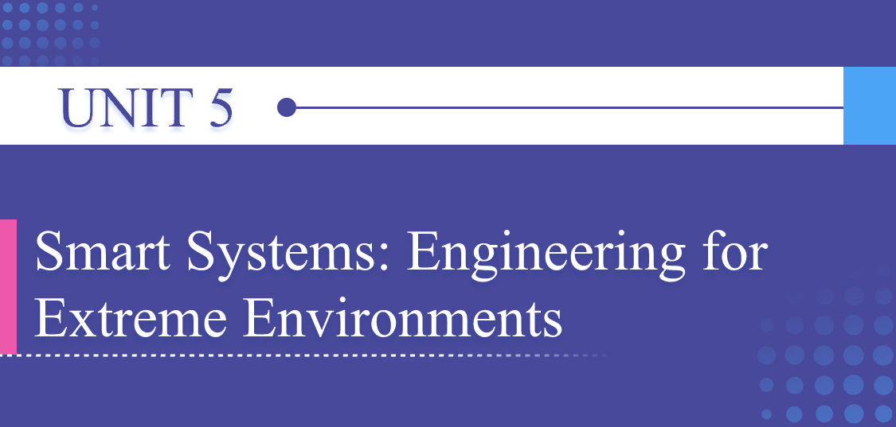
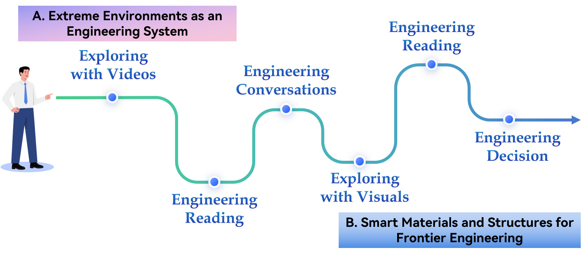

# Unit Preview

中文对照：[[英语资料#第5单元 · 单元预览|第5单元 · 单元预览]]

### Learning Objectives

Use key language related to extreme-environment engineering and mechanical systems accurately in spoken and written English.

Practise understanding information from multimodal sources about extreme-environment engineering, including videos, recordings, technical readings, and infographics.

Collaborate effectively in interdisciplinary teams to discuss how mechanical design, materials, and sensors work together in complex engineering tasks.

Deliver a presentation on a Chinese contribution to extreme-environment engineering, using appropriate language and visuals.

### Unit Challenge

Extreme-environment engineering pushes knowledge and technology into places that are difficult, dangerous, or impossible to reach. Some Chinese achievements include the Jiaolong and Fendouzhe manned submersibles, the Shenhai Yongshi deep-sea vehicle, Haiyan underwater glider series, deep-Earth drilling and underground engineering projects, lunar and Mars exploration missions, and polar research platforms. Although these missions take place in different environments, they share similar engineering challenges in pressure, temperature, energy supply, communication limits, navigation, and so on.

Your mission: Work in groups. Choose one Chinese achievement in extreme-environment engineering and prepare a 3-minute presentation.

### Learning Journey

