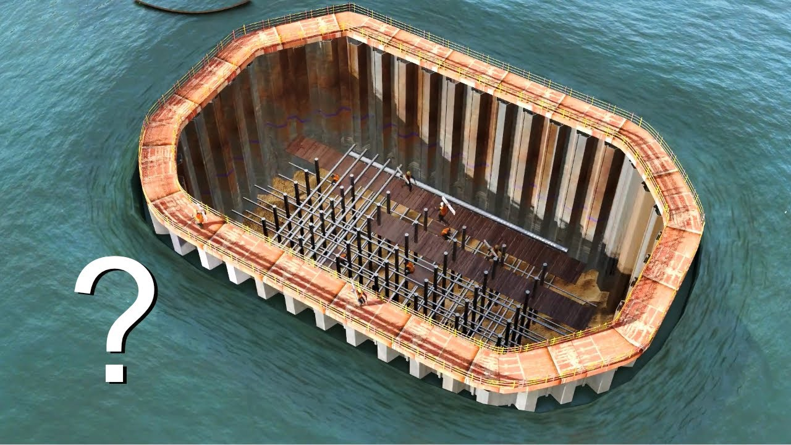

# A. Extreme Environments as an Engineering System

中文对照：[[英语资料#第5单元 · A. 作为工程系统的极端环境|第5单元 · A. 作为工程系统的极端环境]]

### Exploring with Videos

Imagine you are designing a small underwater robot. Its job is to travel 2 km below the ocean surface to take photos and return with the data. Choose one of the following problems that you think would be the hardest to solve and briefly explain why. 1) Keeping the robot from being crushed by the water pressure; 2) Making sure the robot does not run out of power before it returns; 3) Helping the robot find its way in total darkness, with no GPS signal underwater.

Complex engineering techniques are used to build underwater structures like bridge piers, among which the “Coffer Dam” method is most well known. Watch a short video on underwater construction technology, and be ready to answer the questions.

> [!note] Video: Underwater Constructions | How do Engineers Make Them?
> [Watch the video on the platform](https://reader-v2.tdtianwen.com/ed-svc2/fp/book-file/01a09e53-7cd0-74a5-bd00-c0868a9d3a3d.mp4?t=oss_download&pack_id=01a0b332-5e0c-7783-8f78-485f17f3f2a0&platform=td)
> ![[U05-视频-水下建筑如何建造.mp4]]

> [!note] Interactive Exercise: Video Comprehension Check
> [Do this exercise on the platform](https://reader-v2.tdtianwen.com/lg-viewer-v2/reader/standard?platform=td&pack_id=01a0b332-5e0c-7783-8f78-485f17f3f2a0&bookid=01a013c4-e4f0-750f-be8a-7de89b6353d1&section_id=01a013f7-2f45-721a-8106-4e268404f96c)

### Engineering Reading

Read the passage to understand why ocean exploration matters, what makes it difficult, and how mapping and underwater technologies are expanding scientific knowledge.

### Exploring the Depths: Unveiling the Mysteries of Our Ocean

Despite its vastness, much of the ocean remains a mystery. Although life thrives throughout these depths, scientists still have only a limited understanding of this complex ecosystem. The need to explore the ocean is greater than ever because it plays a vital role in regulating Earth’s climate, supporting biodiversity, and providing resources that benefit humanity. However, exploring this largely unknown world presents both immense challenges and remarkable opportunities.

Exploring the ocean is critical for several reasons. The ocean influences global climate systems by redistributing heat and moisture, playing a significant role in the carbon cycle. It regulates temperature patterns and weather systems that impact everything from agriculture to human livelihoods. Additionally, the ocean’s resources are essential for human survival. Marine organisms produce biochemical compounds with potential applications in medicine, including cancer treatments and anti-ageing drugs. By exploring the ocean, we open the door to discoveries that could revolutionise our understanding of life on Earth and improve the future of humanity.

However, exploring the ocean is an incredibly complex and technically demanding task. One of the main barriers to ocean exploration is its size and depth. More than 90% of the ocean is classified as “deep ocean”, with depths greater than 200 metres. The conditions at these depths—such as extreme pressure, low temperatures, and total darkness—pose significant challenges to researchers and explorers. Although technology has advanced over the years, it remains difficult and costly to explore these extreme environments. Submersibles and remotely operated vehicles (ROVs) are essential tools in ocean exploration. These vehicles allow scientists to collect samples and observe marine life at depths that were once inaccessible. However, despite advances in technology, only a small fraction of the ocean has been explored in detail.

Mapping the ocean floor is a crucial first step in exploration. While satellites can provide broad images of the ocean’s surface, they do not offer the level of detail needed to understand what lies beneath. Seafloor mapping, which uses sonar technology to create detailed images of the ocean floor, is the primary method for exploring the underwater world. As of June 2025, about 27.3% of the global seafloor has been mapped using high-resolution sonar technology, such as multibeam sonar systems. These systems are mounted on ships and provide a detailed view of underwater features like seamounts (underwater mountains) and trenches. Despite this progress, significant portions of the seafloor remain unmapped, especially in remote areas. Although modern mapping technology has made great strides, it is important to recognise that high-resolution mapping is still in its early stages. Only a small portion of the deep ocean has been mapped in fine detail. More detailed mapping is essential for understanding the ocean’s geological features and its ecosystems. By mapping the ocean floor, scientists can identify areas that are rich in biodiversity, such as hydrothermal vents or coral reefs, which support unique marine life. These areas may also be rich in resources like minerals, oil, and natural gas. Mapping also helps identify geological hazards, such as underwater volcanoes or fault lines, which can inform predictions about natural disasters like earthquakes and tsunamis. Despite the technological advances, it is clear that more work is needed to fully understand the shape and structure of the ocean floor.

The deep ocean is particularly interesting to scientists because it is home to some of the most unique and mysterious life forms on Earth. Organisms living in the deep ocean must adapt to extreme pressures, freezing temperatures, and complete darkness. Some of these organisms have evolved fascinating biological adaptations, such as bioluminescence, which allows them to produce their own light. Understanding how life thrives in these conditions could offer insights into the adaptability of life in other extreme environments, including the possibility of life on other planets.

In addition to its biological richness, the ocean holds the key to understanding Earth’s past. The ocean floor contains layers of sediment that preserve records of past climate events, such as ice ages, volcanic eruptions, and changes in sea levels. By studying these sediments, scientists can gain a better understanding of how the Earth’s climate has evolved over millions of years. The ocean also holds historical treasures, such as ancient shipwrecks and submerged cities that can provide valuable insights into human history and culture. Exploring these submerged archaeological sites helps us understand our past and the long history of human interaction with the sea.

Successful exploration depends on how these technologies work together. A submersible may carry cameras and sensors, but it needs reliable power, navigation, communication, and recovery systems. Engineers must test each component and the interfaces between them, because a failure in one part can limit the whole mission. This systems approach turns observations into dependable scientific evidence.

Despite the challenges, progress in ocean exploration is being made. New technologies, such as autonomous underwater vehicles (AUVs), are making it easier for humans to explore remote parts of the ocean. These vehicles can travel long distances without human intervention, collecting data and samples along the way. In addition, international collaborations between governments, research institutions, and private companies are driving ocean exploration efforts forward.

(word count: 850)

### Understanding Information

 

> [!note] Interactive Exercise: TASK 1: Use 1-3 English words to fill in each blank.
> [Do this exercise on the platform](https://reader-v2.tdtianwen.com/lg-viewer-v2/reader/standard?platform=td&pack_id=01a0b332-5e0c-7783-8f78-485f17f3f2a0&bookid=01a013c4-e4f0-750f-be8a-7de89b6353d1&section_id=01a013f7-2f45-721a-8106-4e268404f96c)

> [!note] Interactive Exercise: TASK 2: Choose the best answer to each of the following questions about details of the passage.
> [Do this exercise on the platform](https://reader-v2.tdtianwen.com/lg-viewer-v2/reader/standard?platform=td&pack_id=01a0b332-5e0c-7783-8f78-485f17f3f2a0&bookid=01a013c4-e4f0-750f-be8a-7de89b6353d1&section_id=01a013f7-2f45-721a-8106-4e268404f96c)

### Thinking Like an Engineer

Read the two short reports below on Chinese contributions to extreme-environment engineering. Think: When engineers design systems for places humans cannot easily reach, what challenges do these systems share? 

Report 1

Developed by Tianjin University through years of collaborative research, the Haiyan (Petrel) underwater glider series has significantly enhanced deep-sea observation capability. The glider can travel long distances with low energy consumption by changing buoyancy and gliding through the water instead of using a propeller all the time. The Haiyan series has improved China’s ability to conduct long-duration, large-depth, and wide-area ocean observation, making it useful for abyssal observation, environmental monitoring, and international ocean research. Yet engineers must still manage four groups of challenges: structural durability (pressure resistance, sealing, and corrosion); system reliability (sensors, batteries, and navigation); mission operations (data transmission and recovery); and responsible deployment (environmental impact, maintenance, and cost).

Report 2

Deep-Earth exploration is another important field of extreme-environment engineering. China’s Shendi Take 1 Well, drilled in the Tarim Basin, is the country’s first scientific exploration well to reach more than 10,000 metres underground. The project was designed to support ultra-deep geological research, explore Earth’s internal structure and evolution, and test key technologies and equipment for deep-Earth drilling. In February 2025, the well was completed at a depth of 10,910 metres, creating several engineering records and providing valuable geological data from the ultra-deep subsurface. Engineers must manage four groups of challenges: the physical environment (high temperature, pressure, and complex rock formations); equipment durability (vibration and tool wear); monitoring and control (limited downhole communication and real-time data); and responsible operation (safety, environmental impact, and cost).

Discuss in pairs. Choose one project from the reports above. Explore one or more of the aspects listed below.

(1) Pressure and structural strength: Analyse how pressure and structural loads affect deep-sea and deep-Earth projects.

(2) Temperature and material resistance: Analyse how temperature and material resistance affect deep-sea and deep-Earth projects.

(3) Energy supply and long-term operation: Analyse how energy constraints affect the design and long-term operation of deep-sea and deep-Earth projects.

> [!note] Extended Reading: Reference Answers
> [View it on the platform](https://reader-v2.tdtianwen.com/lg-viewer-v2/reader/standard?platform=td&pack_id=01a0b332-5e0c-7783-8f78-485f17f3f2a0&bookid=01a013c4-e4f0-750f-be8a-7de89b6353d1&section_id=01a013f7-2f45-721a-8106-4e268404f96c)

### Engineering Conversations

### Balancing Entertainment and Professionalism in a Presentation

> [!note] Audio: Balancing Entertainment and Professionalism in a Presentation
> [Listen to the audio on the platform](https://reader-v2.tdtianwen.com/ed-svc2/fp/book-file/01a02374-3ef9-7004-a319-291539a686cb.mp3?t=oss_download&pack_id=01a0b332-5e0c-7783-8f78-485f17f3f2a0&platform=td)
> ![[U05-音频1-演示中平衡趣味性与专业性.mp3]]

> [!note] Interactive Exercise: TASK 1: Comprehension check
> [Do this exercise on the platform](https://reader-v2.tdtianwen.com/lg-viewer-v2/reader/standard?platform=td&pack_id=01a0b332-5e0c-7783-8f78-485f17f3f2a0&bookid=01a013c4-e4f0-750f-be8a-7de89b6353d1&section_id=01a013f7-2f45-721a-8106-4e268404f96c)

> [!note] Interactive Exercise: TASK 2: Vocabulary Extension
> [Do this exercise on the platform](https://reader-v2.tdtianwen.com/lg-viewer-v2/reader/standard?platform=td&pack_id=01a0b332-5e0c-7783-8f78-485f17f3f2a0&bookid=01a013c4-e4f0-750f-be8a-7de89b6353d1&section_id=01a013f7-2f45-721a-8106-4e268404f96c)

> [!note] Interactive Exercise: TASK 3: Talking About Your University Life
> [Do this exercise on the platform](https://reader-v2.tdtianwen.com/lg-viewer-v2/reader/standard?platform=td&pack_id=01a0b332-5e0c-7783-8f78-485f17f3f2a0&bookid=01a013c4-e4f0-750f-be8a-7de89b6353d1&section_id=01a013f7-2f45-721a-8106-4e268404f96c)

## Vocabulary and Expressions

| Term | Part of Speech | Definition |
| --- | --- | --- |
| vastness | n. | The very large size or area of something 巨大 |
| redistribute | v. | to change the way that something is shared among a particular group of people 重新分配 |
| compound | n. | a substance formed when two or more elements are chemically combined 化合物 |
| revolutionise | v. | to completely change the way that something is done 彻底改变；彻底改革 |
| barrier | n. | a problem that makes something impossible障碍；壁垒 |
| submersible | n. | a small vehicle that can travel underwater, especially one used for research or exploration  潜水器 |
| seafloor | n. | the bottom of the ocean or sea 海底；海床 |
| mount | v. | to fix something into position on something安装；装载 |
| trench | n. | a long narrow deep hole in the ocean floor 海沟 |
| stride | n. | an improvement in the way something is developing 进展；发展 |
| hydrothermal | adj. | connected with the heat of water inside the earth 热液的；水热的 |
| hazard | n. | a thing that can be dangerous or cause damage 危险；危害 |
| adaptation | n. | a change in behaviour or structure by which a species becomes better suited to its environment 适应；适应性变化 |
| bioluminescence | n. | the production of light by living creatures such as fireflies and deep-sea fish 生物发光 |
| sediment | n. | the solid material that settles at the bottom of a liquid 沉积物；沉淀物 |
| shipwreck | n. | a ship that has been lost or destroyed at sea 沉船 |

## Platform Interactions

This chapter also has 6 interactive exercises, 1 extended reading, 1 audio track and 1 video. Audio and video are downloaded locally and embedded in these notes for offline playback; only the interactive exercises need the platform: [Open this chapter on the platform](https://reader-v2.tdtianwen.com/lg-viewer-v2/reader/standard?platform=td&pack_id=01a0b332-5e0c-7783-8f78-485f17f3f2a0&bookid=01a013c4-e4f0-750f-be8a-7de89b6353d1&section_id=01a013f7-2f45-721a-8106-4e268404f96c)
