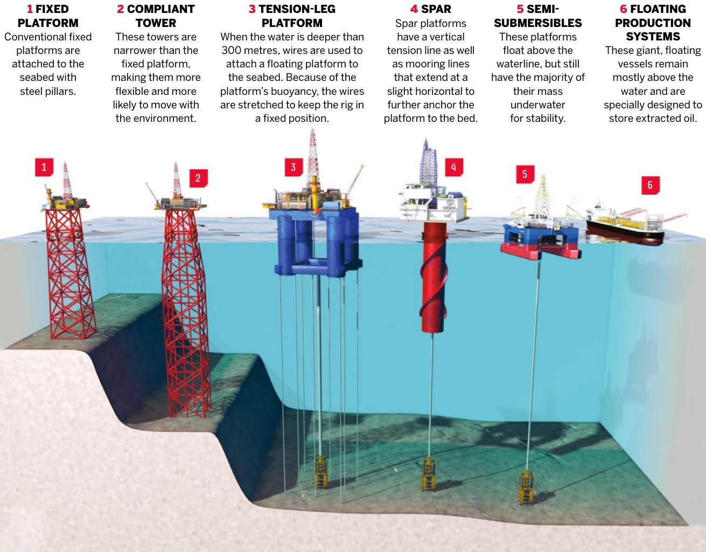

# B. Smart Materials and Structures for Frontier Engineering

中文对照：[[英语资料#第5单元 · B. 面向前沿工程的智能材料与结构|第5单元 · B. 面向前沿工程的智能材料与结构]]

### Exploring with Visuals

Study the visual and answer the questions.

1) What are the unique features of each drilling-platform type? 2) Based on the design features shown, what technologies might make these platforms safer and more reliable in extreme ocean conditions?

> [!note] Extended Reading: Sample Reference Answer
> [View it on the platform](https://reader-v2.tdtianwen.com/lg-viewer-v2/reader/standard?platform=td&pack_id=01a0b332-5e0c-7783-8f78-485f17f3f2a0&bookid=01a013c4-e4f0-750f-be8a-7de89b6353d1&section_id=01a013f7-4944-7322-a403-cee36befc5d6)

### Engineering Reading

Read the following passage to explore how innovative technologies are transforming ocean exploration. 

### Revolutionising Ocean Exploration with Smart Steel and Technology

The ocean covers more than 70% of Earth’s surface, yet the deep ocean remains one of its least understood frontiers. Reaching it requires materials and machines that can survive pressure, darkness, cold, saltwater, and isolation. New structures and digital tools therefore play a pivotal role in ocean exploration. Smart steel, advanced offshore platforms, submersibles, underwater drones, and connected sensors now help engineers reach deeper regions, collect scientific evidence, and conduct resource extraction with greater control. The central challenge is not simply to go farther, but to make exploration safer, more informative, and more responsible.

Offshore structures must operate for years under heavy loads, violent weather, and corrosive saltwater. Conventional inspection may find damage only after it becomes visible, while sending crews to remote platforms is costly and risky. Smart steel addresses this problem by combining load-bearing material with embedded sensors. These sensors measure temperature, pressure, vibration, and stress, giving operators continuous information about structural integrity. Repeated loads can cause fatigue, while small areas of corrosion may weaken joints or protective surfaces. If readings show an unusual change, engineers can inspect the affected area or adjust operations before a small defect becomes a serious failure. This approach does not eliminate maintenance, but it makes maintenance more targeted. It can extend platform life, reduce unexpected shutdowns, and improve the safety of offshore rigs.

Modern platforms also support research as well as production. Floating production storage and offloading (FPSO) units and drilling platforms can work in water too deep for fixed structures. While supporting offshore extraction, they collect information about currents, salinity, temperature, seafloor conditions, and marine life. Underwater sensors and data analytics turn these measurements into evidence that scientists can compare across time and location. The resulting high-resolution data improves seafloor maps and can reveal features such as seamounts, trenches, and fault zones. Measurements collected repeatedly can also reveal seasonal changes that a single expedition would miss. This evidence helps researchers examine how industrial activity and natural change affect ocean environments.

Exploration vehicles have advanced alongside platforms. Crewed submersibles and remotely operated or autonomous underwater drones use strong pressure-resistant hulls, cameras, sampling tools, and navigation systems to work thousands of metres below the surface. Lightweight composites increase strength without adding unnecessary mass, while corrosion-resistant materials protect components during long missions. These choices improve structural integrity and leave more capacity for batteries, sensors, and scientific instruments. Redundant seals, backup power, and emergency recovery devices are important because a minor failure may be impossible to repair during a dive. The vehicles can survey unfamiliar terrain, collect water or rock samples, and observe organisms that cannot survive near the surface. Their value therefore depends on the whole system: materials, energy, sensing, control, communication, and recovery planning must work together.

Data collection has changed just as rapidly. IoT (Internet of Things) sensors installed on platforms, vehicles, and buoys can measure temperature, salinity, pressure, currents, and chemical conditions. Real-time transmission creates continuous streams of data instead of isolated observations from occasional research cruises. AI and machine-learning systems can then identify patterns, detect anomalies, and support forecasts of ocean currents or environmental change. Combining readings from different instruments also reduces the risk of interpreting one faulty sensor as a real event. These tools improve emergency response. When sensors detect an oil leak, abnormal pressure, or underwater seismic activity, operators can investigate sooner and limit damage. Because communication underwater is difficult, some processing may occur on the vehicle itself, allowing it to select important information before transmitting it.

Environmental protection must be considered together with exploration. Carbon capture and storage (CCS), when implemented in offshore platforms, captures carbon dioxide and injects it into suitable geological formations beneath the seabed. Its main purpose is to reduce emissions rather than lower extraction costs. Such systems still require careful site selection, monitoring, and risk management to ensure that stored carbon remains contained. At the same time, environmental sensors can track changes around a platform and show whether operations are affecting water quality or marine ecosystems. Technical capability therefore has to be matched by environmental responsibility.

Energy design is another part of sustainability. Some modern platforms combine efficient equipment with renewable sources such as wind turbines and solar panels. Renewable power cannot always meet every operational demand, but it can reduce fuel use and support sensors, communication equipment, or auxiliary systems. Batteries and energy-management software can store power and direct it to the most important functions when conditions change. Engineers must balance energy availability, reliability, maintenance access, and environmental impact instead of treating any one technology as a complete solution.

Together, smart materials, advanced vehicles, connected sensing, and cleaner energy are making ocean exploration a safer and more scientifically valuable endeavour. They do not make the deep ocean simple or risk-free. Rather, they give engineers better evidence for managing pressure, corrosion, energy limits, equipment failure, and environmental effects. Every improvement also introduces questions about cost, maintenance, data quality, and unintended impact. By harnessing these technologies as parts of an integrated system, people can study the ocean and use its resources more responsibly while protecting marine ecosystems for future generations. Responsible integration remains essential.

(word count: 850)

### Understanding lnformation

> [!note] Interactive Exercise: TASK 1: Choose the best answer to each question based on the passage.
> [Do this exercise on the platform](https://reader-v2.tdtianwen.com/lg-viewer-v2/reader/standard?platform=td&pack_id=01a0b332-5e0c-7783-8f78-485f17f3f2a0&bookid=01a013c4-e4f0-750f-be8a-7de89b6353d1&section_id=01a013f7-4944-7322-a403-cee36befc5d6)

> [!note] Interactive Exercise: TASK 2: Decide if each of the following statements is True (T) or False (F).
> [Do this exercise on the platform](https://reader-v2.tdtianwen.com/lg-viewer-v2/reader/standard?platform=td&pack_id=01a0b332-5e0c-7783-8f78-485f17f3f2a0&bookid=01a013c4-e4f0-750f-be8a-7de89b6353d1&section_id=01a013f7-4944-7322-a403-cee36befc5d6)

> [!note] Interactive Exercise: TASK 3: Match each term or expression from the text with its correct meaning.
> [Do this exercise on the platform](https://reader-v2.tdtianwen.com/lg-viewer-v2/reader/standard?platform=td&pack_id=01a0b332-5e0c-7783-8f78-485f17f3f2a0&bookid=01a013c4-e4f0-750f-be8a-7de89b6353d1&section_id=01a013f7-4944-7322-a403-cee36befc5d6)

### Engineering Decision

Listen to the conversation and choose the best answer to each question.

> [!note] Audio: Understanding Engineering Similarities and Differences
> [Listen to the audio on the platform](https://reader-v2.tdtianwen.com/ed-svc2/fp/book-file/01a023c3-e32a-7973-8dfc-cc64b77ed49a.mp3?t=oss_download&pack_id=01a0b332-5e0c-7783-8f78-485f17f3f2a0&platform=td)
> ![[U05-音频2-理解工程的同与异.mp3]]

> [!note] Interactive Exercise: TASK 1: Comprehension check
> [Do this exercise on the platform](https://reader-v2.tdtianwen.com/lg-viewer-v2/reader/standard?platform=td&pack_id=01a0b332-5e0c-7783-8f78-485f17f3f2a0&bookid=01a013c4-e4f0-750f-be8a-7de89b6353d1&section_id=01a013f7-4944-7322-a403-cee36befc5d6)

> [!note] Interactive Exercise: TASK 2: Make your decision in a similar situation
> [Do this exercise on the platform](https://reader-v2.tdtianwen.com/lg-viewer-v2/reader/standard?platform=td&pack_id=01a0b332-5e0c-7783-8f78-485f17f3f2a0&bookid=01a013c4-e4f0-750f-be8a-7de89b6353d1&section_id=01a013f7-4944-7322-a403-cee36befc5d6)

### Communication & Reflection

### Building Your Unit Challenge Product

It is time to share the presentation you have been preparing throughout this unit. Your presentation should:

(1) introduce one Chinese achievement in extreme-environment engineering;

(2) explain the mission it serves and why the mission matters;

(3) identify the structure, vehicle, platform, or equipment that makes the mission possible;

(4) analyse it as an interdisciplinary mechanical system by explaining how materials, sensors, energy systems, control methods, data systems, and safety measures work together; and

(5) identify one major technical constraint and explain how engineers respond to it.

> [!note] Extended Reading: Sample Reference Answer
> [View it on the platform](https://reader-v2.tdtianwen.com/lg-viewer-v2/reader/standard?platform=td&pack_id=01a0b332-5e0c-7783-8f78-485f17f3f2a0&bookid=01a013c4-e4f0-750f-be8a-7de89b6353d1&section_id=01a013f7-4944-7322-a403-cee36befc5d6)

### Portfolio Reflection

> [!note] Interactive Page: Portfolio Reflection
> [Open the interactive page](https://zhihuiware.com/api/webapp/embed/8ffa1e89-8479-4f5f-813c-7ab496119c51)

## Vocabulary and Expressions

| Term | Part of Speech | Definition |
| --- | --- | --- |
| pivotal | adj. | of great importance because other things depend on it 关键性的；核心的 |
| offshore | adj. | happening or existing in the sea, not far from the land 海上的；近海的 |
| extraction | n. | the act or process of removing or obtaining something from somewhere 提取；开采 |
| corrosive | adj. | tending to destroy something slowly, especially by chemical action 腐蚀性的；侵蚀性的 |
| integrity | n. | the condition of being whole, sound, and able to perform safely 完整；完好 |
| rig | n. | a large structure that is used for getting oil or gas out of the ground or the sea 钻塔；钻井设备 |
| analytics | n. | the discovery and communication of meaningful patterns in data 分析学；数据分析 |
| resolution | n. | the degree of detail that can be seen or recorded in an image or dataset 清晰度；分辨率 |
| composite | n. | something made by putting together different parts or materials 合成物；复合材料 |
|  |  | IoT (Internet of Things)  a network of objects that are connected to the internet and can share data with each other 物联网 |
| buoy | n. | a floating object used to mark locations or carry monitoring equipment at sea 浮标；航标 |
| stream | n. | a steady flow of something 流；流动 |
| implement | v. | to make something that has been officially decided start to happen or be used 实施；使生效 |
| turbine | n. | a machine or an engine that receives power from a flow of liquid, gas or air 涡轮机；汽轮机 |
| endeavour | n. | an attempt to do something, especially something new or difficult 努力 |
| harness | v. | to control and use the force or strength of something to produce power or to achieve something 控制；利用 |

## Platform Interactions

This chapter also has 5 interactive exercises, 2 extended readings, 1 audio track and 1 interactive page. Audio and video are downloaded locally and embedded in these notes for offline playback; only the interactive exercises need the platform: [Open this chapter on the platform](https://reader-v2.tdtianwen.com/lg-viewer-v2/reader/standard?platform=td&pack_id=01a0b332-5e0c-7783-8f78-485f17f3f2a0&bookid=01a013c4-e4f0-750f-be8a-7de89b6353d1&section_id=01a013f7-4944-7322-a403-cee36befc5d6)
