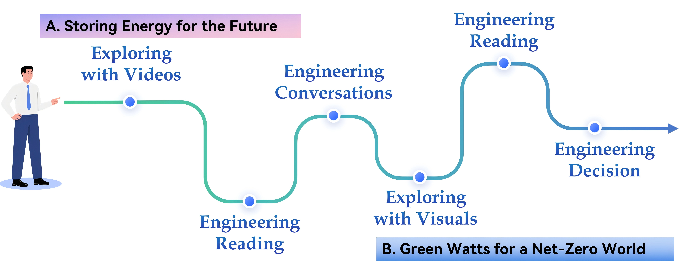

# Unit Preview

中文对照：[[英语资料#第6单元 · 单元预览|第6单元 · 单元预览]]

### Learning Objectives

Use key technical vocabulary related to energy storage and net-zero emissions accurately in spoken and written English.

Extract, summarise, and compare information from videos, audio recordings, technical readings, and infographics on energy systems.

Analyse and evaluate energy-engineering solutions and their real-world trade-offs using evidence in group discussion.

Develop and deliver a three-minute presentation proposing an energy-storage plan for a selected community.

### Unit Challenge

Your university has partnered with a clean-energy initiative to help two remote communities improve electricity reliability. One is a desert-edge community in Ningxia with abundant sunlight but limited grid capacity. The other is an island community in Zhejiang with steady coastal winds, costly diesel generation, and limited grid access.

Your mission: Work in groups as an energy-engineering team. Choose one community and propose a solution using one storage technology from this unit. Prepare a three-minute presentation that explains the need, the technology, supporting evidence, and the main engineering trade-off.

### Learning Journey

