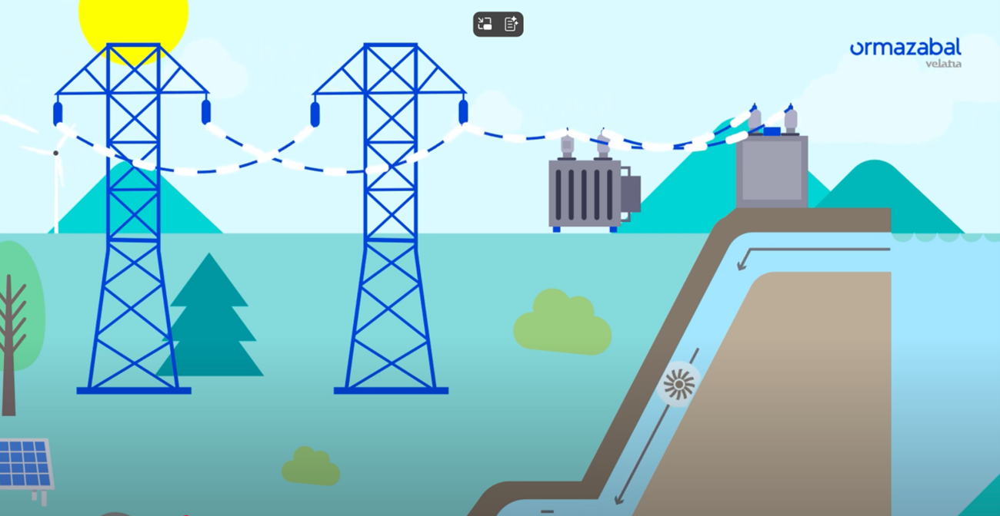

# A. Storing Energy for the Future

中文对照：[[英语资料#第6单元 · A. 为未来储能|第6单元 · A. 为未来储能]]

### Exploring with Videos

Imagine your city suddenly loses power for 48 hours. Look around and choose three devices or appliances you would worry about most (e.g., your phone, computer, the elevator, the air conditioner).

Rank these three devices according to how soon the loss of electricity would become a serious problem. Explain your ranking briefly and consider what happens when backup power runs out.

Did you know that people have been “saving” energy for centuries—from ice houses to smartphone batteries? Watch the short video on storage tech, and be ready to answer questions.

> [!note] Video: How Do Energy Storage Systems Work?
> [Watch the video on the platform](https://reader-v2.tdtianwen.com/ed-svc2/fp/book-file/01a02852-37ac-7303-a0bb-564c67212e5c.mp4?t=oss_download&pack_id=01a0b332-5e0c-7783-8f78-485f17f3f2a0&platform=td)
> ![[U06-视频-储能系统如何工作.mp4]]

> [!note] Interactive Exercise: Video Comprehension Check
> [Do this exercise on the platform](https://reader-v2.tdtianwen.com/lg-viewer-v2/reader/standard?platform=td&pack_id=01a0b332-5e0c-7783-8f78-485f17f3f2a0&bookid=01a013c4-e4f0-750f-be8a-7de89b6353d1&section_id=01a013f8-23e3-7264-8685-86b4b54d891f)

### Engineering Reading

Read the passage to understand the current landscape and future prospects of energy storage.

### Energy Storage: The Hidden Power Behind Clean Energy’s Future

Solar output is concentrated in daylight hours, wind output varies with weather, and electricity demand often peaks at different times. Bridging the gap between when energy is produced and when it is needed is therefore a central challenge in clean power systems. Energy storage can help, but no single method suits every situation. Engineers compare storage duration, power, capacity, efficiency, safety, cost, location, and environmental effects before selecting a technology.

The oldest and most widely used grid-scale method is pumped hydro. When excess electricity is available, water is pumped from a lower reservoir to an upper one; when demand rises, water flows back through turbines to generate electricity. Round-trip efficiency is commonly about 70–85%, and plants can operate for decades. Pumped hydro can provide hours or longer of storage, but suitable sites, environmental review, long construction periods, and high initial capital limit where it can be built.

Lithium-ion batteries were commercialised for portable electronics and later adopted widely in electric vehicles and grid storage. Many grid systems provide roughly one to eight hours of flexibility, with two to four hours common in current projects. Lithium ions move between electrodes as energy is stored and released. Their modularity allows systems to be scaled by adding units. However, cell chemistry, temperature control, ageing, and thermal-runaway risk require careful design, monitoring, and fire protection.

Sodium-ion batteries use abundant sodium and may reduce dependence on lithium and some other critical materials. Their energy density is generally lower than that of leading lithium-ion cells, but weight and volume are less restrictive in many stationary applications. Some sodium-ion chemistries also offer useful low-temperature performance. Cost, cycle life, safety, and manufacturing scale still vary by design.

For longer discharge periods, flow batteries can be attractive. In a vanadium redox flow battery, two liquid electrolytes are stored in separate tanks and pumped through a cell stack. Because tanks and stacks are sized separately, energy capacity and power can be expanded more independently than in conventional batteries. System efficiency is often around 65–85%, depending on design and operating conditions, and long cycle life is possible with limited capacity degradation.

Compressed-air energy storage can provide long-duration storage where suitable underground caverns or engineered vessels are available. Surplus electricity compresses air; during discharge, the air expands to drive power equipment. Performance depends strongly on how heat from compression is managed. Conventional plants have relatively modest round-trip efficiency, while advanced designs aim to recover and reuse heat to improve efficiency and reduce or avoid fuel use.

For storage measured in weeks or seasons, hydrogen is one candidate. Surplus low-emissions electricity can split water into hydrogen and oxygen through electrolysis; the hydrogen is then stored and later used in fuel cells, turbines, or industrial processes. Converting electricity to hydrogen and back has low round-trip efficiency, so it is usually unsuitable for routine overnight cycling. Its value is the ability to store large quantities for long periods and to move energy between power, industry, transport, and fuel markets, provided infrastructure and safety requirements are met.

Not all storage returns electricity. Thermal storage keeps energy as heat or cold for later use. Molten salt, ceramic bricks, water, ice, or sand can store thermal energy for buildings and industrial processes. Heat-to-heat efficiency can be high, but it is not directly comparable with electricity-to-electricity round-trip efficiency. The best design depends on temperature, duration, insulation losses, and whether users need heat, cooling, or electricity.

All these technologies rely on control systems that decide when to charge, discharge, and hold energy. By combining weather forecasts, demand data, equipment limits, and market signals, operators can schedule storage while protecting safety and asset life. Digital twins—virtual models updated with operating data—can support scenario testing, maintenance planning, and fault diagnosis, but their recommendations remain only as reliable as the models and data beneath them.

For anyone eager to contribute to this field, the opportunities reach well beyond electrical engineering. Chemists develop electrolytes that remain stable across wide temperature ranges, while materials scientists study electrodes, membranes, corrosion, and recycling. Mechanical and civil engineers design pressure vessels, caverns, reservoirs, heat exchangers, foundations, and fire-protection systems. Control engineers and software specialists build forecasting, optimisation, communications, and cybersecurity tools. Technicians and operators need procedures for inspection, testing, emergency response, and safe isolation. Economists, planners, and regulators assess market rules, permits, land and water use, supply chains, and who pays for upgrades. Communities also need clear information about benefits, risks, construction impacts, and end-of-life responsibilities. This multidisciplinary work matters because a device with good laboratory efficiency can still fail as a real project if spare parts, maintenance skills, financing, safety standards, or public acceptance are missing. Successful storage therefore depends on both technology and the institutions that keep it operating over time. Field demonstrations must also test performance under local temperatures, duty cycles, grid conditions, and maintenance practices before a design is scaled widely.

From pumped hydro to emerging batteries and hydrogen systems, storage technologies answer different questions about duration, scale, response time, efficiency, safety, location, and cost. Continued research and careful system design can make renewable electricity more reliable and can expand access, but every project still requires evidence-based trade-offs.

(word count: 858)

### Understanding Information

> [!note] Interactive Exercise: TASK 1: Use 1-3 English words to fill in each blank.
> [Do this exercise on the platform](https://reader-v2.tdtianwen.com/lg-viewer-v2/reader/standard?platform=td&pack_id=01a0b332-5e0c-7783-8f78-485f17f3f2a0&bookid=01a013c4-e4f0-750f-be8a-7de89b6353d1&section_id=01a013f8-23e3-7264-8685-86b4b54d891f)

> [!note] Interactive Exercise: TASK 2: Choose the best answer to each of the following questions about details of the passage.
> [Do this exercise on the platform](https://reader-v2.tdtianwen.com/lg-viewer-v2/reader/standard?platform=td&pack_id=01a0b332-5e0c-7783-8f78-485f17f3f2a0&bookid=01a013c4-e4f0-750f-be8a-7de89b6353d1&section_id=01a013f8-23e3-7264-8685-86b4b54d891f)

### Thinking Like an Engineer

Read the two short reports below. Analyse how utility-scale and distributed storage differ as system solutions.

Report 1

Utility-scale battery storage, such as the 150-megawatt Hornsdale Power Reserve in South Australia, operates at grid level. These systems can store surplus electricity and respond rapidly when supply and demand diverge. Fast response supports frequency control and short-term grid stability, while stored energy can be shifted to peak periods. Such facilities can reduce reliance on some fossil-fuel peaking generation, but their value depends on duration, market design, network constraints, and the services required by the grid.

Report 2

Distributed storage places smaller units—home batteries, community systems, or suitably enabled electric-vehicle batteries—near electricity users. A household with rooftop solar can store daytime electricity for evening use. When many devices are coordinated, they may operate as a virtual power plant and provide services during peak periods. Distributed systems can improve local resilience where circuits and controls permit islanded operation. Their trade-offs include higher coordination complexity, varied ownership, cybersecurity, battery availability, and the need for interoperable software and market rules.

> [!note] Interactive Exercise: Choose the storage model for each of the following statements.
> [Do this exercise on the platform](https://reader-v2.tdtianwen.com/lg-viewer-v2/reader/standard?platform=td&pack_id=01a0b332-5e0c-7783-8f78-485f17f3f2a0&bookid=01a013c4-e4f0-750f-be8a-7de89b6353d1&section_id=01a013f8-23e3-7264-8685-86b4b54d891f)

### Engineering Conversations

### Finding a Way Through an Energy Storage Course

> [!note] Audio: Finding a Way Through an Energy Storage Course
> [Listen to the audio on the platform](https://reader-v2.tdtianwen.com/ed-svc2/fp/book-file/01a0232c-f35b-7f04-b371-8e9ecf831d61.mp3?t=oss_download&pack_id=01a0b332-5e0c-7783-8f78-485f17f3f2a0&platform=td)
> ![[U06-音频1-攻克储能课程.mp3]]

> [!note] Interactive Exercise: TASK 1: Comprehension check
> [Do this exercise on the platform](https://reader-v2.tdtianwen.com/lg-viewer-v2/reader/standard?platform=td&pack_id=01a0b332-5e0c-7783-8f78-485f17f3f2a0&bookid=01a013c4-e4f0-750f-be8a-7de89b6353d1&section_id=01a013f8-23e3-7264-8685-86b4b54d891f)

> [!note] Interactive Exercise: TASK 2: Vocabulary Extension
> [Do this exercise on the platform](https://reader-v2.tdtianwen.com/lg-viewer-v2/reader/standard?platform=td&pack_id=01a0b332-5e0c-7783-8f78-485f17f3f2a0&bookid=01a013c4-e4f0-750f-be8a-7de89b6353d1&section_id=01a013f8-23e3-7264-8685-86b4b54d891f)

> [!note] Interactive Exercise: TASK 3: Build a Study Strategy Card
> [Do this exercise on the platform](https://reader-v2.tdtianwen.com/lg-viewer-v2/reader/standard?platform=td&pack_id=01a0b332-5e0c-7783-8f78-485f17f3f2a0&bookid=01a013c4-e4f0-750f-be8a-7de89b6353d1&section_id=01a013f8-23e3-7264-8685-86b4b54d891f)

## Vocabulary and Expressions

| Term | Part of Speech | Definition |
| --- | --- | --- |
| power system | n. | a network that generates, transmits, distributes, stores, and uses electricity 电力系统 |
| pumped hydro | n. | a type of energy storage system using two reservoirs 抽水蓄能 |
| excess | adj. | more than is needed or can be used 富余的；过剩的 |
| lithium | n. | a soft, light, silver-white chemical element used in batteries and alloys 锂 |
| electrode | n. | a conductor through which electric current enters or leaves a battery or another electrical device 电极 |
| modularity | n. | the quality of being built from separate standard units (modules) that can be combined or replaced. 模块化 |
| thermal runaway | n. | rapid self-heating that may lead to battery fire or failure 热失控 |
| sodium | n. | a soft silver-white metal that is found naturally in compounds, such as salt. 钠 |
| flow battery | n. | a rechargeable battery that stores liquid electrolytes in external tanks 液流电池 |
| vanadium | n. | a metallic element used in the electrolytes of some flow batteries 钒 |
| electrolyte | n. | a substance containing mobile ions that conducts electricity when dissolved or molten 电解质 |
| round-trip efficiency | n. | the proportion of stored energy recovered after charging and discharging 往返效率 |
| hydrogen | n. | a chemical element. A gas that is the lightest of all the elements. 氢；氢气 |
| electrolysis | n. | the process of separating a liquid into its chemical parts by passing an electric current through it 电解 |
| thermal storage | n. | storing energy as heat or cold for later use 热能存储 |
| molten salt | n. | salt heated to a liquid state, used for thermal energy storage in power systems 熔盐（用于电力系统热能储能） |
| operator | n. | a company or person that runs power plants, energy systems or power grids 运营商 |
| digital twin | n. | a virtual model updated with data from a physical system 数字孪生 |
| end-of-life responsibility | n. | responsibility for reuse, recycling, or safe disposal when equipment is retired 报废阶段责任 |
| multidisciplinary | adj. | involving several academic or professional fields 多学科的 |
| evidence-based trade-off | n. | a choice between competing benefits and costs made using relevant evidence 基于证据的权衡 |

## Platform Interactions

This chapter also has 7 interactive exercises, 1 audio track and 1 video. Audio and video are downloaded locally and embedded in these notes for offline playback; only the interactive exercises need the platform: [Open this chapter on the platform](https://reader-v2.tdtianwen.com/lg-viewer-v2/reader/standard?platform=td&pack_id=01a0b332-5e0c-7783-8f78-485f17f3f2a0&bookid=01a013c4-e4f0-750f-be8a-7de89b6353d1&section_id=01a013f8-23e3-7264-8685-86b4b54d891f)
