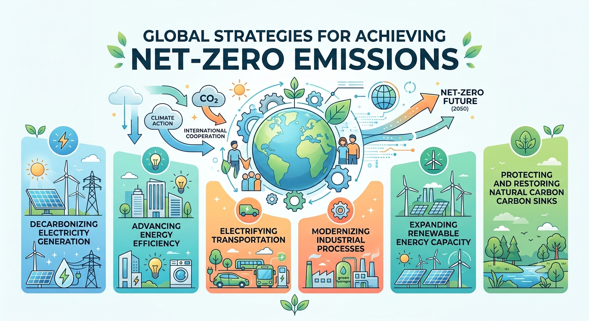

# B. Green Watts for a Net-Zero World

中文对照：[[英语资料#第6单元 · B. 迈向净零世界的绿色电力|第6单元 · B. 迈向净零世界的绿色电力]]

### Exploring with Visuals

Study the visual and answer the questions.

(1) What actions are shown in the six strategy areas for reaching net-zero emissions? (2) Which two areas should be prioritised in your region, and why?

> [!note] Extended Reading: Sample Reference Answer
> [View it on the platform](https://reader-v2.tdtianwen.com/lg-viewer-v2/reader/standard?platform=td&pack_id=01a0b332-5e0c-7783-8f78-485f17f3f2a0&bookid=01a013c4-e4f0-750f-be8a-7de89b6353d1&section_id=01a013f8-5ca1-7551-a46a-f6c47714f8a7)

### Engineering Reading

Read the following passage to understand existing solutions towards net-zero emissions.

### Green Watts for a Net-Zero World

As the world grapples with the urgent need to combat climate change, the transition to green energy is essential for creating a sustainable future.

The Road to Net-Zero Emissions

Achieving net-zero greenhouse-gas emissions requires deep reductions across energy, industry, transport, buildings, and agriculture. Any residual emissions that cannot yet be eliminated must be balanced by durable removals, which may include ecosystem restoration or engineered approaches such as direct air capture with storage. Carbon capture and storage (CCS) can also reduce emissions from some industrial sources, but it does not remove the need for direct reductions. The transition therefore changes how societies produce, store, move, and use energy.

Green Energy: The Backbone of a Net-Zero World

In everyday use, green energy usually refers to renewable or other low-emissions energy sources. Wind, solar, and hydropower produce little or no greenhouse-gas emissions during operation, although manufacturing, construction, land use, and supply chains still create life-cycle impacts. Reaching carbon-neutrality goals requires both cleaner supply and an energy system that remains affordable, reliable, and environmentally responsible.

Solar, wind, hydropower, and other low-emissions technologies can replace substantial fossil-fuel generation. The engineering challenge is to keep the system reliable as variable renewable energy is incorporated into the grid. Solar output follows daylight and weather; wind output changes with atmospheric conditions. Power systems therefore need a portfolio of flexibility options, including stronger networks, storage, flexible generation, demand response, and better forecasting.

The Role of Energy Storage and Smart Grids

Energy storage can absorb electricity when supply is abundant and release it when demand is higher or generation falls. Batteries are especially useful for fast response and short-duration flexibility, while other technologies can serve longer durations. Storage can support frequency control, reduce curtailment, and strengthen reliability, but it does not by itself turn every renewable resource into constant baseload generation or guarantee that blackouts will be prevented.

Beyond storage, the evolution of smart grids is another game-changing development in the transition to net zero. Smart grids are digitalised networks that use advanced sensors and data analytics to manage the flow of electricity, optimise energy distribution, and enhance the integration of renewable energy. They enable more efficient management of electricity generation and consumption, allowing for better demand response and minimising energy waste. Moreover, smart grids allow for better integration of distributed renewable energy sources, helping balance supply and demand in real time, improving grid stability while optimising energy use across sectors.

Green Energy and the EV Industry

Transport electrification can reduce oil use and tailpipe emissions, but the full climate benefit of an electric vehicle depends on the electricity mix, vehicle efficiency, battery production, vehicle size, use patterns, and end-of-life management. As power systems become cleaner, electrified cars, buses, and trucks can deliver larger life-cycle emissions reductions. Charging infrastructure and managed charging are therefore important parts of both transport and electricity planning.

Electric vehicles and power systems can also interact. Managed charging can shift demand away from stressed hours, and vehicle-to-grid systems may allow suitable parked vehicles to provide limited grid services where hardware, battery warranties, market rules, and user needs permit. These links create potential synergy, but they require standards, cybersecurity, consumer consent, and careful assessment of battery degradation.

China's large electric-vehicle and battery industries illustrate how transport, manufacturing, and electricity storage can develop together. Grid batteries can help integrate variable renewable generation, while electric vehicles can reduce direct dependence on gasoline and diesel. The overall contribution to China's 2060 carbon-neutrality goal, however, depends on cleaner electricity, efficient vehicles, responsible supply chains, battery reuse or recycling, and credible measurement of emissions.

Challenges in Achieving Net-Zero and the Path Forward

The potential for green energy is substantial, but access to finance, technology, reliable networks, and skilled workers remains uneven. Energy equity asks who receives reliable and affordable energy, who bears environmental and financial costs, and who participates in decisions. Low- and middle-income regions may need concessional finance, local capacity building, and solutions designed for their own resources and institutions rather than copied from another setting.

Large investments are also needed in transmission and distribution networks, storage, renewable generation, charging systems, efficient buildings, and industrial equipment. Funding alone is not enough. Projects require planning, permits, technical standards, trained workers, reliable supply chains, and institutions that can operate and maintain assets for decades. Governments can set policy and protect consumers; businesses can develop and finance projects; international organisations can support knowledge transfer and concessional funding; and communities can identify local needs and risks. Cost allocation matters because poorly designed tariffs or subsidies may place a disproportionate burden on low-income users. Coordinated action must therefore connect infrastructure delivery with affordability, resilience, workforce development, environmental protection, and transparent measurement of results.

Building a Sustainable Future

Net zero is not achieved by one technology or one sector. It requires rapid emissions reductions, cleaner electricity, efficiency, electrification, storage and other flexibility resources, sustainable fuels where appropriate, carbon management for difficult residual emissions, and international cooperation. The aim is a lower-emissions, more resilient, and more inclusive energy system. Whether that aim is reached depends on evidence-based policy, responsible engineering, investment, and continued public participation.

(word count: 847)

### Understanding Information

> [!note] Interactive Exercise: TASK 1: Choose the best answer to each question according to the passage.
> [Do this exercise on the platform](https://reader-v2.tdtianwen.com/lg-viewer-v2/reader/standard?platform=td&pack_id=01a0b332-5e0c-7783-8f78-485f17f3f2a0&bookid=01a013c4-e4f0-750f-be8a-7de89b6353d1&section_id=01a013f8-5ca1-7551-a46a-f6c47714f8a7)

> [!note] Interactive Exercise: TASK 2: Decide if each of the following statements is True (T) or False (F).
> [Do this exercise on the platform](https://reader-v2.tdtianwen.com/lg-viewer-v2/reader/standard?platform=td&pack_id=01a0b332-5e0c-7783-8f78-485f17f3f2a0&bookid=01a013c4-e4f0-750f-be8a-7de89b6353d1&section_id=01a013f8-5ca1-7551-a46a-f6c47714f8a7)

> [!note] Interactive Exercise: TASK 3: Technical Vocabulary. Match each term or expression from the text with its correct meaning.
> [Do this exercise on the platform](https://reader-v2.tdtianwen.com/lg-viewer-v2/reader/standard?platform=td&pack_id=01a0b332-5e0c-7783-8f78-485f17f3f2a0&bookid=01a013c4-e4f0-750f-be8a-7de89b6353d1&section_id=01a013f8-5ca1-7551-a46a-f6c47714f8a7)

### Engineering Decision

Listen to a conversation exploring the tension between advanced clean-energy systems and real-world energy equity.

> [!note] Audio: The Net-Zero Dilemma
> [Listen to the audio on the platform](https://reader-v2.tdtianwen.com/ed-svc2/fp/book-file/01a0235f-1d1b-7ad0-8086-abe2b351ca78.mp3?t=oss_download&pack_id=01a0b332-5e0c-7783-8f78-485f17f3f2a0&platform=td)
> ![[U06-音频2-净零困境.mp3]]

> [!note] Interactive Exercise: TASK 1: Comprehension check
> [Do this exercise on the platform](https://reader-v2.tdtianwen.com/lg-viewer-v2/reader/standard?platform=td&pack_id=01a0b332-5e0c-7783-8f78-485f17f3f2a0&bookid=01a013c4-e4f0-750f-be8a-7de89b6353d1&section_id=01a013f8-5ca1-7551-a46a-f6c47714f8a7)

> [!note] Interactive Exercise: TASK 2: Make your decision in a similar situation
> [Do this exercise on the platform](https://reader-v2.tdtianwen.com/lg-viewer-v2/reader/standard?platform=td&pack_id=01a0b332-5e0c-7783-8f78-485f17f3f2a0&bookid=01a013c4-e4f0-750f-be8a-7de89b6353d1&section_id=01a013f8-5ca1-7551-a46a-f6c47714f8a7)

### Communication & Reflection

### Building Your Unit Challenge Product

Return to the Unit Challenge and prepare your 3-minute presentation for the Island & Desert Energy Plan. Your presentation should include:

1) Three PowerPoint Slides:

(1) The Community and Need: Identify the setting, its electricity problem, and the users affected.

(2) The Storage Plan: Explain how the selected technology works and why it fits local resources, climate, geography, and grid access.

(3) Evidence and Practical Reality: Include at least one relevant data point, identify a key trade-off, and explain installation, operation, maintenance, safety, and workforce needs.

2) Three-Minute Pitch: Use at least three technical terms from this unit accurately and finish with a clear recommendation.

> [!note] Extended Reading: Sample Reference Answer
> [View it on the platform](https://reader-v2.tdtianwen.com/lg-viewer-v2/reader/standard?platform=td&pack_id=01a0b332-5e0c-7783-8f78-485f17f3f2a0&bookid=01a013c4-e4f0-750f-be8a-7de89b6353d1&section_id=01a013f8-5ca1-7551-a46a-f6c47714f8a7)

### Portfolio Reflection

> [!note] Interactive Page: Portfolio Reflection
> [Open the interactive page](https://zhihuiware.com/api/webapp/embed/b1860410-0fb7-4114-8eb6-7a2d0ca20b24)

## Vocabulary and Expressions

| Term | Part of Speech | Definition |
| --- | --- | --- |
|  |  | grapple with to deal with a difficult problem or challenge 竭力应对 |
| combat | v. | to take action to stop or deal with a problem 应对；解决 |
| residual emissions | n. | emissions that remain after feasible reductions have been made 剩余排放 |
| removals | n. | processes that remove carbon dioxide from the atmosphere 碳移除 |
| life-cycle | n. | across all stages of a product or system 全生命周期 |
| incorporate | v. | to include something as part of a larger group or system 纳入；整合 |
| flexibility | n. | the ability of a power system to respond to changing supply and demand 灵活性 |
| curtailment | n. | the reduction of available electricity generation because it cannot be used or delivered 弃电；限发 |
| reliability | n. | the ability of a system to provide dependable service 可靠性 |
| baseload | n. | the constant minimum electricity demand of a power grid 基础负荷 |
| managed charging | n. | shifting electric-vehicle charging to times that better suit the power system 智能有序充电 |
| vehicle-to-grid | n. | a system allowing suitable electric vehicles to provide power-system services 车网互动 |
| synergy | n. | the extra energy, power, success, etc. achieved by two or more people or things working together 协同作用，协同增效作用 |
| energy equity | n. | fair access to reliable and affordable energy and fair sharing of costs 能源公平 |
| cost allocation | n. | the way project or system costs are shared among users or groups 成本分摊 |
| coordinated action | n. | joint action organised so that different groups work effectively together 协同行动 |
| resilient | adj. | able to recover quickly from difficulties or shocks 有韧性的 |

## Platform Interactions

This chapter also has 5 interactive exercises, 2 extended readings, 1 audio track and 1 interactive page. Audio and video are downloaded locally and embedded in these notes for offline playback; only the interactive exercises need the platform: [Open this chapter on the platform](https://reader-v2.tdtianwen.com/lg-viewer-v2/reader/standard?platform=td&pack_id=01a0b332-5e0c-7783-8f78-485f17f3f2a0&bookid=01a013c4-e4f0-750f-be8a-7de89b6353d1&section_id=01a013f8-5ca1-7551-a46a-f6c47714f8a7)
