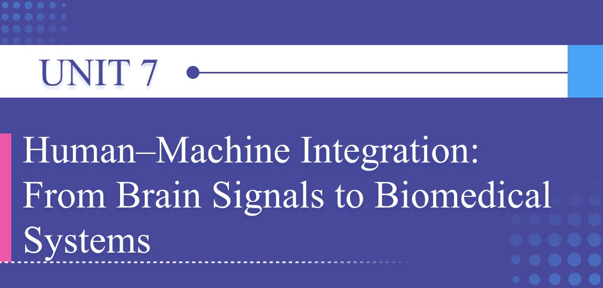
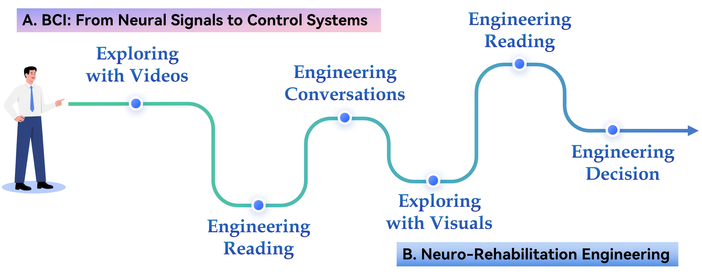

# Unit Preview

中文对照：[[英语资料#第7单元 · 单元预览|第7单元 · 单元预览]]

### Learning Objectives

Use key technical vocabulary related to brain–computer interfaces (BCIs) and biomedical rehabilitation systems in communicative contexts.

Extract, summarise, and compare information from multimodal sources on human–machine integration and neuro-rehabilitation.

Analyse engineering trade-offs in neuro-rehabilitation technologies, including invasiveness, cost-effectiveness, and patient safety.

Design an infographic that introduces a Chinese achievement in BCI or neuro-rehabilitation engineering through effective language and visuals.

### Unit Challenge

China has become an important contributor to BCI research and neuro-rehabilitation engineering. Technologies such as Tianjin University’s Shengong rehabilitation robot, the BrainTalker BCI chip, hospital-based stroke rehabilitation platforms, wearable rehabilitation devices, and smart medical equipment show how brain signals can be translated into clinical and assistive applications. These achievements are exciting, but engineers must consider four connected areas: patient experience (dignity and comfort); clinical responsibility (safety, privacy, and validation); access (affordability, hospital availability, and family support); and implementation (staffing, maintenance, and long-term use).

Your Mission: Work in groups. Select one recent Chinese achievement in BCI technology or neuro-rehabilitation engineering. Create an infographic that explains how the technology works, why it matters, and how it contributes to the future of health care.

### Learning Journey

