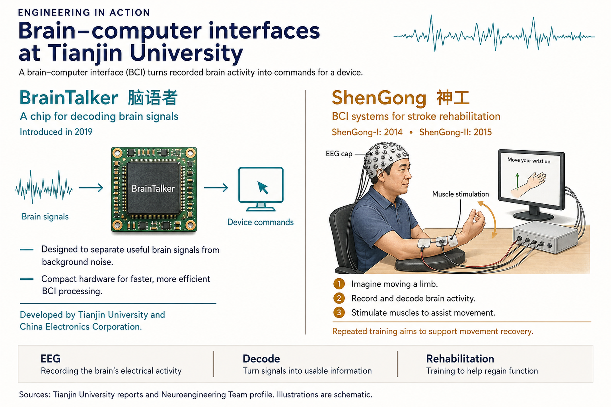

# B. Neuro-Rehabilitation Engineering

中文对照：[[英语资料#第7单元 · B. 神经康复工程|第7单元 · B. 神经康复工程]]

### Exploring with Visuals

Study the visual and answer the questions.

1) What are the key features of the BrainTalker?  2) How do the Shengong series attempt to help patients recover from neural malfunctions?

> [!note] Extended Reading: Sample Reference Answer
> [View it on the platform](https://reader-v2.tdtianwen.com/lg-viewer-v2/reader/standard?platform=td&pack_id=01a0b332-5e0c-7783-8f78-485f17f3f2a0&bookid=01a013c4-e4f0-750f-be8a-7de89b6353d1&section_id=01a013f9-58b1-7962-9266-5ab5af00abff)

### Engineering Reading

Read the passage to understand how brain–computer interfaces are applied in neuro-rehabilitation and assistive technologies.

### Neuro-Rehabilitation Engineering: From Control Systems to Functional Recovery

In a rehabilitation ward at Tianjin Huanhu Hospital, a 58-year-old stroke survivor sits before a screen wearing a lightweight EEG cap. A robotic exoskeleton supports her right arm, which she has not moved voluntarily for six months. An animated hand appears. She imagines opening her fist; seconds later, the device extends her fingers. For the first time since her injury, brain and body work together again, with a machine acting as the bridge.

This scene is made possible by neuro-rehabilitation engineering, which uses brain–computer interfaces not only to replace lost function but to help the nervous system recover it. If the brain can re-establish connections with damaged motor pathways, some voluntary movement may return. The engineering challenge is to create systems precise, responsive, and safe enough for repeated therapy.

Intention-Driven Therapy

Traditional rehabilitation often relies on passive movement: a therapist physically moves the patient’s limb through a range of motion. While this maintains joint flexibility, it does relatively little to rebuild the neural pathways that control voluntary movement. BCI-driven rehabilitation takes a fundamentally different approach. Patients must actively engage their brain — imagining or attempting the movement — and the assistive device responds only when it detects a genuine motor intention in the neural signal. This intention–action coupling is what makes BCI rehabilitation active rather than passive, and it is this active engagement that is believed to drive neuroplasticity.

Tianjin University’s “Shengong” (神工) rehabilitation robot exemplifies this approach. The system uses a non-invasive EEG cap to detect event-related desynchronisation (ERD) — a specific change in brainwave patterns that occurs when a person imagines moving a limb. When the system detects ERD above a set threshold, it activates the robotic exoskeleton to assist the corresponding movement. The patient sees and feels their arm move in response to their own mental effort, closing the feedback loop and reinforcing the neural connection.

Beyond the Arm: Diverse Applications

Neuro-rehabilitation extends well beyond upper-limb recovery. BCI-driven gait training systems use lower-limb exoskeletons to help patients with spinal cord injuries practise walking. The patient’s brain signals trigger each step, while the exoskeleton provides the physical support needed to bear weight and maintain balance. Early studies suggest that sustained BCI-assisted gait training can improve both walking ability and proprioception — the body’s sense of its own position in space.

Speech and communication represent another frontier. For patients who have lost the ability to speak due to neurological damage, BCI spellers allow them to select letters or words on a screen using brain signals alone. Tianjin University’s SSVEP-based speller system, which detects brain responses to flickering visual stimuli, has achieved command sets exceeding 200 distinct inputs — among the largest in the world. More recently, invasive BCIs have enabled patients with severe dysarthria to produce recognisable speech through neural decoding of speech-related brain activity.

Wearable Sensors and Everyday Monitoring

Not all neuro-rehabilitation happens in hospitals. A growing category of wearable devices extends monitoring and therapy into daily life. Non-invasive wearable blood pressure patches, developed by Chinese research teams, use flexible sensors to track cardiovascular health continuously without a cuff. Terahertz photoacoustic sensors — another Chinese innovation — enable non-invasive blood sodium measurement, which is critical for patients on long-term medication. Swallowable optoelectronic capsules can image the gastrointestinal tract from inside, transmitting data wirelessly to external receivers.

These wearable and ingestible devices share a design philosophy with BCI rehabilitation systems: they aim to make the human body’s internal state observable and actionable in real time. When a wearable sensor detects an abnormal reading, it can alert both patient and clinician, enabling early intervention before a crisis develops.

The Clinical Evidence

Does BCI rehabilitation actually work? The clinical evidence is growing. Multiple randomised controlled trials have shown that BCI-assisted training produces greater improvement in motor function than conventional therapy alone for stroke patients. A key finding is that the benefit is greatest when training is intensive, sustained over several weeks, and closely supervised by therapists who adjust difficulty as the patient improves. The Shengong system has been deployed in over twenty hospitals across China, generating a substantial clinical dataset that researchers are now analysing to identify which patient populations respond best.

Challenges and the Road Ahead

Significant challenges remain despite promising results. BCI rehabilitation systems are expensive, and not all hospitals have the trained staff to operate them effectively. Signal quality in non-invasive systems can vary between patients — some individuals produce clear, easily decoded brain signals, while others do not, a phenomenon researchers call “BCI illiteracy”. Device usability is another concern: a system that requires thirty minutes of setup before each session may not be practical in a busy rehabilitation ward.

Looking forward, researchers envision fully integrated neuro-rehabilitation platforms that combine BCI control, robotic assistance, virtual reality environments, and real-time physiological monitoring into a single system. The goal is personalised rehabilitation — therapy that adapts automatically to each patient’s progress, brain state, and clinical needs. Achieving this will require engineers who understand not only signal processing and control theory, but also human physiology, clinical workflows, and the ethical responsibilities that come with technologies that interact directly with the human nervous system. Such teamwork demands careful communication with patients and clinicians.

(word count: 855)

### Understanding Information

> [!note] Interactive Exercise: TASK 1: Choose the best answer to each question according to the passage.
> [Do this exercise on the platform](https://reader-v2.tdtianwen.com/lg-viewer-v2/reader/standard?platform=td&pack_id=01a0b332-5e0c-7783-8f78-485f17f3f2a0&bookid=01a013c4-e4f0-750f-be8a-7de89b6353d1&section_id=01a013f9-58b1-7962-9266-5ab5af00abff)

> [!note] Interactive Exercise: TASK 2: Decide if each of the following statements is True (T) or False (F).
> [Do this exercise on the platform](https://reader-v2.tdtianwen.com/lg-viewer-v2/reader/standard?platform=td&pack_id=01a0b332-5e0c-7783-8f78-485f17f3f2a0&bookid=01a013c4-e4f0-750f-be8a-7de89b6353d1&section_id=01a013f9-58b1-7962-9266-5ab5af00abff)

> [!note] Interactive Exercise: TASK 3: Match each term or expression from the text with its correct meaning.
> [Do this exercise on the platform](https://reader-v2.tdtianwen.com/lg-viewer-v2/reader/standard?platform=td&pack_id=01a0b332-5e0c-7783-8f78-485f17f3f2a0&bookid=01a013c4-e4f0-750f-be8a-7de89b6353d1&section_id=01a013f9-58b1-7962-9266-5ab5af00abff)

### Engineering Decision

Listen to the conversation and choose the best answer to each question.

> [!note] Audio: Who Gets the Upgrade?
> [Listen to the audio on the platform](https://reader-v2.tdtianwen.com/ed-svc2/fp/book-file/01a026d7-5a1c-780e-88c5-fc1451bfa91e.mp3?t=oss_download&pack_id=01a0b332-5e0c-7783-8f78-485f17f3f2a0&platform=td)
> ![[U07-音频2-升级名额给谁.mp3]]

> [!note] Interactive Exercise: TASK 1: Comprehension check
> [Do this exercise on the platform](https://reader-v2.tdtianwen.com/lg-viewer-v2/reader/standard?platform=td&pack_id=01a0b332-5e0c-7783-8f78-485f17f3f2a0&bookid=01a013c4-e4f0-750f-be8a-7de89b6353d1&section_id=01a013f9-58b1-7962-9266-5ab5af00abff)

> [!note] Interactive Exercise: TASK 2: Make your decision in a similar situation
> [Do this exercise on the platform](https://reader-v2.tdtianwen.com/lg-viewer-v2/reader/standard?platform=td&pack_id=01a0b332-5e0c-7783-8f78-485f17f3f2a0&bookid=01a013c4-e4f0-750f-be8a-7de89b6353d1&section_id=01a013f9-58b1-7962-9266-5ab5af00abff)

### Communication & Reflection

### Building Your Unit Challenge Product

It is time to create your infographic. An infographic is not a mini-essay with pictures — it is a visual document designed to communicate a complex idea quickly and clearly. Your reader should be able to understand the main message within two minutes.

Structure Guide

(1) Title: A concise, attention-grabbing title (e.g., “From Thought to Movement: China’s Shengong Rehabilitation Robot”).

(2) The Challenge: A short section (1–2 sentences or a captioned icon) explaining the medical or engineering challenge the technology addresses.

(3) How It Works: A simplified visual diagram or numbered step-by-step flow (with icons or illustrations) showing the technology’s core mechanism. Use labels and annotations.

(4) Key Data: Use a comparison bar, a highlighted number, a before/after graphic, or a simple chart.

(5) Why It Matters: A brief statement (2–3 sentences or a callout box) connecting the technology to broader themes: patient access, cost-effectiveness, sustainability, or national innovation.

> [!note] Extended Reading: Sample Reference Answer
> [View it on the platform](https://reader-v2.tdtianwen.com/lg-viewer-v2/reader/standard?platform=td&pack_id=01a0b332-5e0c-7783-8f78-485f17f3f2a0&bookid=01a013c4-e4f0-750f-be8a-7de89b6353d1&section_id=01a013f9-58b1-7962-9266-5ab5af00abff)

### Portfolio Reflection

> [!note] Interactive Page: Portfolio Reflection
> [Open the interactive page](https://zhihuiware.com/api/webapp/embed/8906ccec-c58b-481a-bad6-32236a5f0c08)

## Vocabulary and Expressions

| Term | Part of Speech | Definition |
| --- | --- | --- |
| ward | n. | a separate room or area in a hospital for people with the same medical condition 病房 |
| stroke | n. | a sudden serious illness when a blood vessel in the brain bursts or is blocked 脑卒中；中风 |
| exoskeleton | n. | an external supportive framework worn on the body to assist or augment movement 外骨骼 |
| neuro-rehabilitation | n. | the process of restoring function to the nervous system after injury or disease 神经康复 |
| motor intention | n. | the brain’s plan or desire to produce a specific movement 运动意图 |
| exemplify | v. | to be a typical example of something 是……的典型 |
| event-related desynchronisation (ERD) | n. | a decrease in brainwave power that occurs when a person imagines or performs a movement 事件相关去同步 |
| threshold | n. | the minimum level of a signal that must be reached to trigger a response 阈值 |
| gait training | n. | therapy designed to improve a patient’s walking ability 步态训练 |
| proprioception | n. | the body’s ability to sense its own position and movement in space 本体感觉 |
| frontier | n. | the limit of what is known about a particular subject or activity（学科的）前沿 |
| speller | n. | a BCI system that allows users to select letters or words using brain signals 拼写器 |
| dysarthria | n. | a speech disorder caused by weakness of the muscles used for speaking 构音障碍 |
| wearable | adj. | /n. designed to be worn on the body; a device worn on the body 可穿戴的；可穿戴设备 |
| cardiovascular | adj. | relating to the heart and the blood vessels 心血管的 |
| transmit | v. | to send an electronic signal, radio or television broadcast, etc. 传送；发射 |
| intervention | n. | an action taken to improve a medical condition 干预 |
|  |  | randomised controlled trial an experiment in which participants are randomly assigned to groups to test a treatment’s effectiveness 随机对照试验 |
| illiteracy | n. | the fact of knowing very little about a subject area（对某学科）外行的 |
| usability | n. | the ease with which a device or system can be used effectively 可用性 |
| therapy | n. | the treatment of a physical problem or an illness治疗；疗法 |

## Platform Interactions

This chapter also has 5 interactive exercises, 2 extended readings, 1 audio track and 1 interactive page. Audio and video are downloaded locally and embedded in these notes for offline playback; only the interactive exercises need the platform: [Open this chapter on the platform](https://reader-v2.tdtianwen.com/lg-viewer-v2/reader/standard?platform=td&pack_id=01a0b332-5e0c-7783-8f78-485f17f3f2a0&bookid=01a013c4-e4f0-750f-be8a-7de89b6353d1&section_id=01a013f9-58b1-7962-9266-5ab5af00abff)
