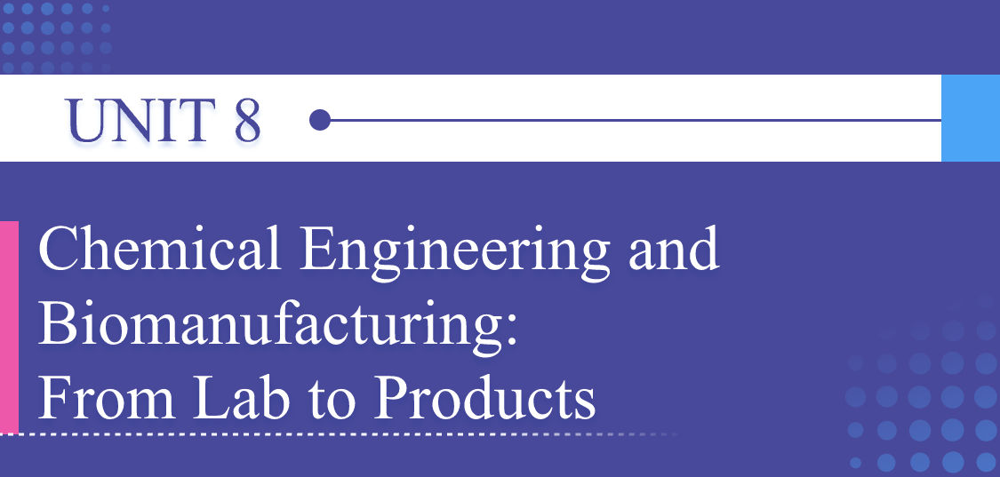
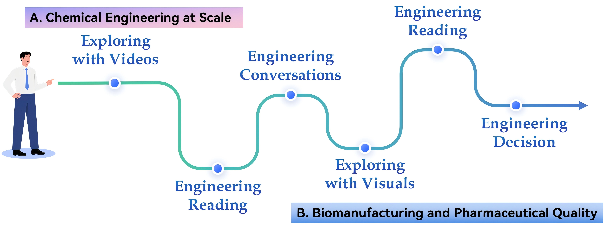

# Unit Preview

中文对照：[[英语资料#第8单元 · 单元预览|第8单元 · 单元预览]]

### Learning Objectives

Use key vocabulary related to chemical-process scale-up, biomanufacturing, and pharmaceutical engineering in spoken and written English.

Extract and verify information from multimodal sources on chemical engineering, biomanufacturing, synthetic biology, and safe product deployment.

Analyse engineering trade-offs in process design, including yield, safety, cost, validation, sustainability, user experience, and public trust.

Develop a responsible lab-to-market plan using language and visuals.

### Unit Challenge

A promising idea from the laboratory must go through a carefully controlled engineering process before it can reach hospitals, clinics, communities, or the general public. In China, chemical and pharmaceutical engineering has played an increasingly important role in public health, biomanufacturing, emergency response, and medical innovation. From large-scale vaccine production and diagnostic reagents to enzyme manufacturing, drug delivery systems, and health-related materials, engineers help transform laboratory discoveries into reliable products that can serve real social needs.

Your mission: Work in groups. Choose a chemical or pharmaceutical engineering scenario, such as a rapid diagnostic reagent, an enzyme product, a vaccine component, a bio-manufactured medicine, a 3D-printed dosage form, or a public-health emergency material. Prepare a lab-to-market plan for your chosen scenario.

### Learning Journey

