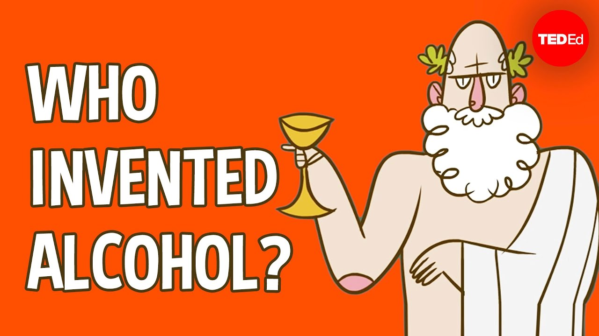

# A. Chemical Engineering at Scale

中文对照：[[英语资料#第8单元 · A. 规模化化学工程|第8单元 · A. 规模化化学工程]]

### Exploring with Videos

Imagine you are to turn 100 kg of corn into ethanol. You know corn contains starch, and starch can become sugar, and sugar can become alcohol.(1) How would you begin? Would you leave the corn whole, break it apart, or change it in some other way? (2) What would happen in the middle? Would you need to add water? Heat things up? Add something to help the reaction along? (3) Once you have a liquid that contains alcohol, how would you separate the alcohol from everything else? What would you do to make sure the final product is pure enough to burn in a car engine?

Watch a video about how alcohol is produced through fermentation, a basic biomanufacturing process. Then answer the questions.

> [!note] Video: A Brief History of Alcohol
> [Watch the video on the platform](https://reader-v2.tdtianwen.com/ed-svc2/fp/book-file/01a08044-ea29-7d41-97eb-8929164b4816.mp4?t=oss_download&pack_id=01a0b332-5e0c-7783-8f78-485f17f3f2a0&platform=td)
> ![[U08-视频-酒精简史.mp4]]

> [!note] Interactive Exercise: Video Comprehension Check
> [Do this exercise on the platform](https://reader-v2.tdtianwen.com/lg-viewer-v2/reader/standard?platform=td&pack_id=01a0b332-5e0c-7783-8f78-485f17f3f2a0&bookid=01a013c4-e4f0-750f-be8a-7de89b6353d1&section_id=01a013fa-27ec-7f00-8763-dd829be9302f)

### Engineering Reading

Read the passage to understand how laboratory reactions become reliable production processes, and why scale-up, separation, process control, and trade-offs matter in engineering decisions.

### Chemical Engineering at Scale: From Reaction to Reliable Production

Chemical engineering tends to begin with a deceptively simple question: if a useful reaction works in a beaker, can it be made to work safely, repeatedly, and economically for thousands or millions of people? Before becoming an actual product, the reaction must be scaled up, controlled, tested, packaged, transported, and brought into regulatory compliance. Chemical engineering, in short, translates molecular change into reliable production at the scale society requires.

In China, the discipline has developed alongside national industrial growth for almost a century. Having supported refining, fertiliser production, and heavy industry in earlier decades, it now extends into new-energy materials, lithium batteries, carbon capture, fine chemicals, and biomanufacturing. The objects of study have changed; the underlying questions have not. How does a process behave? Can it be controlled? Is it safe at scale?

Chemical Engineering Across Disciplines

This process-oriented perspective proves particularly valuable. A chemical-engineering student focuses on the reactor and reaction kinetics; a mechanical student notices pumps, heat exchangers, and pressure vessels; an automation student traces sensors and feedback loops; a materials student attends to purity and particle size; an environmental student asks where emissions and wastewater go. In a real plant these concerns converge within one connected system, and chemical engineering—through concepts such as unit operations and process flow—provides a shared language for connecting them.

At small scale, chemists can reasonably focus on whether a reaction proceeds and what product it yields. Chemical engineers must ask further questions. How rapidly does the reaction proceed, and does it release or absorb heat? Can that temperature still be controlled once the reactor is a hundred times larger? Which impurities form, and how readily can they be removed? Can the solvent be recovered? What happens if a pump fails or a sensor reports an incorrect reading? Such questions determine whether a process can be trusted outside the laboratory.

Scale-Up: From Flask to Plant

Scale-up is one of the discipline's defining challenges. In a small flask, heat dissipates rapidly; in a large industrial reactor heat removal becomes a serious engineering problem. A reaction that behaves mildly on the bench may turn hazardous if heat accumulates faster than cooling can carry it away. Engineers therefore rely on pilot plants—intermediate-scale versions of the process—before committing to full industrial production.

Separation and Purification

Separation and purification deserve equal attention. In many processes, making the target product accounts for only half the work; what remains is to separate it from unreacted feedstock, catalysts, solvents, by-products, and waste streams. Distillation, filtration, crystallisation, extraction, membrane separation, and chromatography each offer distinct strategies, with their own trade-offs in energy use and selectivity. In pharmaceutical and fine-chemical production, even a trace impurity may compromise safety or efficacy; in battery materials and electronic chemicals, subtle shifts in purity or particle size can noticeably alter performance. Separation is therefore not an afterthought but an integral part of product design.

Process Control and Quality Management

Process control is what makes modern continuous production possible. Sensors monitor temperature, pressure, flow rate, pH, and concentration in real time, while control systems automatically adjust valves, pumps, heating, cooling, and feed rates to keep the process inside a safe operating window. More advanced plants employ process analytical technology (PAT), which measures critical quality attributes during production rather than only at the end, and underpins quality by design (QbD)—an approach in which quality is engineered into the process from the outset rather than verified by final inspection alone.

Safer and Greener Processes

Safety and sustainability shape every responsible process. Engineers must reckon with fire, explosion, toxicity, corrosion, pressure, waste, and worker exposure, as well as with life-cycle impacts: raw-material sourcing, energy use, waste treatment, and carbon emissions. Green chemical engineering seeks to design processes that rely on safer solvents, generate less waste, improve atom economy, and create a lower environmental burden.

Economic Decisions Under Constraints

Economic decisions are, in practice, engineering decisions too. A process delivering excellent purity may prove too costly if it depends on rare solvents or extremely high energy input. Engineers compare alternatives using material and energy balances, equipment costs, risk assessments, and quality data rather than intuition. These balances reveal where materials and energy enter, leave, accumulate, or become waste, helping engineers compare efficiency before choosing a production process. A sound technical recommendation must make clear what is gained, what is sacrificed, and why the resulting trade-off can be defended. Seen in this light, the chemical engineer’s work serves as a bridge between scientific discovery and society. A scientist may identify a promising molecule, but it falls to engineers to decide whether it can become a dependable product.

From Discovery to Dependable Production

Chemical engineering is, at its core, a way of thinking about transformation under constraints: it asks how matter changes, how systems behave, and how decisions shape cost, quality, safety, and sustainability. Whether the final product is a fine chemical, a carbon-capture material, a battery component, or a biologically produced medicine, the engineering task is the same—to move from a promising idea to a process that performs reliably in practice. The next passage shows how this same way of thinking carries over into biomanufacturing and pharmaceutical quality, where the “reactor” may be a living cell and the “product” is something a patient will eventually take into their body.

(word count: 852)

### Understanding Information

> [!note] Interactive Exercise: TASK 1: Use 1-3 English words to fill in each blank.
> [Do this exercise on the platform](https://reader-v2.tdtianwen.com/lg-viewer-v2/reader/standard?platform=td&pack_id=01a0b332-5e0c-7783-8f78-485f17f3f2a0&bookid=01a013c4-e4f0-750f-be8a-7de89b6353d1&section_id=01a013fa-27ec-7f00-8763-dd829be9302f)

> [!note] Interactive Exercise: TASK 2: Choose the best answer to each of the following questions about details of the passage.
> [Do this exercise on the platform](https://reader-v2.tdtianwen.com/lg-viewer-v2/reader/standard?platform=td&pack_id=01a0b332-5e0c-7783-8f78-485f17f3f2a0&bookid=01a013c4-e4f0-750f-be8a-7de89b6353d1&section_id=01a013fa-27ec-7f00-8763-dd829be9302f)

### Thinking Like an Engineer

Read the two short reports below. Identify the real-world factors behind the technical decision, evaluate the possible trade-offs, and recommend a responsible first action.

Report 1

A team has developed a rapid test kit for a new respiratory infection. In the lab, the test is fast and accurate. During pilot use in community clinics, however, some problems appear. In one clinic, the storage room becomes hot and humid, and the result lines become unclear. Some users also read the result too early because the instructions are difficult to follow. The team must decide whether to release the kits immediately, improve the design first, or use them only in clinics with proper storage and trained staff.

Report 2

During a public-health emergency, hospitals need more diagnostic reagent for test kits. Normally, the reagent is produced in a large factory, tested by quality-control staff, kept cold, and then delivered to hospitals. To make supply faster, the hospital network wants to prepare small batches in temporary clean rooms near major hospitals. However, problems may happen easily in the process. The large factory is slower but more reliable. The small local rooms are faster but harder to control. The team must decide whether to use the large factory only, use small local rooms, or combine both.

Discuss in pairs. Choose one report from the above. Explore answers to one (or more) aspect listed below.

(1) Identify the failure points: In the system you chose, what are the specific points where things can go wrong? Consider not only the technology itself but also the environment, the people using it, and the supply chain.

(2) Evaluate the trade-offs: What is the central conflict in the decision your team faces, for example, speed versus accuracy, cost versus reliability, or accessibility versus strict control? Which side would you prioritize, and why?

(3) Propose a responsible action: Based on your analysis, what would be the most responsible first step: release now, redesign first, or restrict use to certain conditions? Explain your reasoning clearly, and name one risk you are still willing to accept.

> [!note] Extended Reading: Reference Answers
> [View it on the platform](https://reader-v2.tdtianwen.com/lg-viewer-v2/reader/standard?platform=td&pack_id=01a0b332-5e0c-7783-8f78-485f17f3f2a0&bookid=01a013c4-e4f0-750f-be8a-7de89b6353d1&section_id=01a013fa-27ec-7f00-8763-dd829be9302f)

### Engineering Conversations

### Last-Minute Challenges Before a Competition

> [!note] Audio: Last-Minute Challenges Before a Competition
> [Listen to the audio on the platform](https://reader-v2.tdtianwen.com/ed-svc2/fp/book-file/01a01e51-d43e-7592-898d-82b1ab16bc90.mp3?t=oss_download&pack_id=01a0b332-5e0c-7783-8f78-485f17f3f2a0&platform=td)
> ![[U08-音频1-竞赛前的最后挑战.mp3]]

> [!note] Interactive Exercise: TASK 1: Comprehension check
> [Do this exercise on the platform](https://reader-v2.tdtianwen.com/lg-viewer-v2/reader/standard?platform=td&pack_id=01a0b332-5e0c-7783-8f78-485f17f3f2a0&bookid=01a013c4-e4f0-750f-be8a-7de89b6353d1&section_id=01a013fa-27ec-7f00-8763-dd829be9302f)

> [!note] Interactive Exercise: TASK 2: Vocabulary Extension
> [Do this exercise on the platform](https://reader-v2.tdtianwen.com/lg-viewer-v2/reader/standard?platform=td&pack_id=01a0b332-5e0c-7783-8f78-485f17f3f2a0&bookid=01a013c4-e4f0-750f-be8a-7de89b6353d1&section_id=01a013fa-27ec-7f00-8763-dd829be9302f)

> [!note] Interactive Exercise: TASK 3: Discussing Competition Preparation
> [Do this exercise on the platform](https://reader-v2.tdtianwen.com/lg-viewer-v2/reader/standard?platform=td&pack_id=01a0b332-5e0c-7783-8f78-485f17f3f2a0&bookid=01a013c4-e4f0-750f-be8a-7de89b6353d1&section_id=01a013fa-27ec-7f00-8763-dd829be9302f)

## Vocabulary and Expressions

| Term | Part of Speech | Definition |
| --- | --- | --- |
| deceptively | adv. | in a way that gives a misleading impression 以误导性的方式 |
| beaker | n. | a wide-mouthed glass container used in laboratories for holding or measuring liquids 烧杯 |
| economically | adv. | in a way that uses money, time, or materials without waste 经济地；节约地 |
| scale up | v. | to increase the size of a chemical process from lab experiments to industrial production 规模化生产 |
| regulatory compliance | n. | the state of adhering to laws and regulations relevant to a business or process 合规 |
| fertiliser | n. | a substance added to soil to increase its fertility and promote plant growth 肥料；化肥 |
| reactor | n. | a vessel or device in which chemical or nuclear reactions occur 反应器；反应堆 |
| reaction kinetics | n. | the study of the rates and mechanisms of chemical reactions 反应动力学 |
| converge | v. | to move toward a common point or meet at a point 汇聚；集中 |
| process flow | n. | the sequence of steps and operations that transform raw materials into finished products 工艺流程 |
| yield | v. | to produce or provide a product 生产；产出 |
| impurity | n. | an unwanted or undesired substance present in a chemical compound or finished product 杂质 |
| solvent | n. | a liquid substance capable of dissolving another substance 溶剂；溶媒 |
| flask | n. | a narrow-necked glass container used in laboratories 烧瓶；细颈瓶 |
| dissipate | v. | to spread out or lose heat through dispersion 消散 |
| pilot plant | n. | a small-scale industrial facility used to test and optimise chemical processes before full-scale commercial production 中试工厂 |
| distillation | n. | the process of separating components of a liquid mixture by vaporization and subsequent condensation 蒸馏 |
| filtration | n. | the process of separating solid particles from a liquid or gas 过滤 |
| crystallisation | n. | the process of forming solid crystals from a solution, melt, or vapour 结晶 |
| extraction | n. | the process of separating a desired component from a mixture by using a selective solvent 萃取；提取 |
| membrane | n. | a thin, semi-permeable material used in chemical separation processes 膜 |
| chromatography | n. | a separation technique that separates components of a mixture 色谱法；层析法 |
| trade-off | n. | a situation in which competing benefits or costs must be balanced 权衡；取舍 |
| pharmaceutical | adj. | relating to the development or manufacture of medicines 制药的；药品的 |
| process analytical technology (PAT) | n. | real-time measurement and control of critical process attributes 过程分析技术 |
| quality by design (QbD) | n. | an approach that builds quality into a process from the outset 质量源于设计 |
| atom economy | n. | the proportion of reactant atoms incorporated into the desired product 原子经济性 |
| material balance | n. | an account of material entering, leaving, accumulating in, or becoming waste in a process 物料衡算 |

## Platform Interactions

This chapter also has 6 interactive exercises, 1 extended reading, 1 audio track and 1 video. Audio and video are downloaded locally and embedded in these notes for offline playback; only the interactive exercises need the platform: [Open this chapter on the platform](https://reader-v2.tdtianwen.com/lg-viewer-v2/reader/standard?platform=td&pack_id=01a0b332-5e0c-7783-8f78-485f17f3f2a0&bookid=01a013c4-e4f0-750f-be8a-7de89b6353d1&section_id=01a013fa-27ec-7f00-8763-dd829be9302f)
