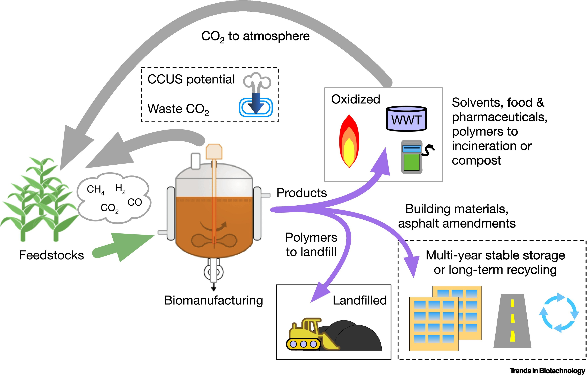

# B. Biomanufacturing and Pharmaceutical Quality

中文对照：[[英语资料#第8单元 · B. 生物制造与药品质量|第8单元 · B. 生物制造与药品质量]]

### Exploring with Visuals

Study the visual and answer the questions.

(1) What are the main inputs, processes, and outputs shown in the schematic? (2) What may happen to the products and carbon during use and disposal?

> [!note] Extended Reading: Sample Reference Answer
> [View it on the platform](https://reader-v2.tdtianwen.com/lg-viewer-v2/reader/standard?platform=td&pack_id=01a0b332-5e0c-7783-8f78-485f17f3f2a0&bookid=01a013c4-e4f0-750f-be8a-7de89b6353d1&section_id=01a013fa-5140-7924-95f8-b849bfdd25d4)

### Engineering Reading

Read the following passage to understand how biomanufacturing moves from lab bench to real-world rapid response.

### Biomanufacturing and Pharmaceutical Quality

Biomanufacturing extends a question long central to chemical engineering: how can raw materials be transformed into useful products through a controlled and reproducible process? Today the production system may include living cells, enzymes, engineered genetic circuits, or cell-free machinery. Seen by an engineer, a cell is a tiny factory: it takes in nutrients, follows genetic instructions, and makes proteins, vaccines, drug substances, food components, or specialty chemicals. Operating this factory responsibly still requires the classical tools of mass transfer, heat transfer, reaction engineering, separation, process control, quality assurance, and scale-up. The substrate may be biological, but the central questions remain: Can the process be controlled, repeated, and scaled safely? These questions become more demanding when the final product will enter a patient’s body. It must also be trusted there.

A Meeting Point of Disciplines

Because it draws on many tools, biomanufacturing is not a narrow specialty for biology students. It is a meeting point for several engineering traditions. Chemical engineers contribute reactor design and separation; pharmaceutical engineers bring quality and regulatory awareness; AI specialists analyse data and optimise metabolic pathways; instrumentation engineers design sensors; and mechanical and automation engineers improve equipment, robotics, and sterile operations. Together, these competencies turn a biological idea into an engineered production route. No single discipline can manage all of these dependencies alone.

Upstream Processing: Cells in a Bioreactor

Upstream processing begins with selecting cells or microbes, engineering them when necessary, and cultivating them in a bioreactor under controlled nutrient supply, oxygen, temperature, pH, mixing, and sterility. Stressed or contaminated cells may produce less target product and a different impurity pattern. Moreover, a culture that thrives in a laboratory flask may fail at industrial scale. Oxygen transfer, mixing time, shear stress, foam, and heat removal all change as equipment grows. Small changes in one parameter can affect cell growth and later purification. Although the reactor contains living cells, these are familiar chemical-engineering problems that must be solved before production can be reliable.

Downstream Processing and Pharmaceutical Quality

Downstream processing recovers and purifies the target molecule from a complex mixture of cells, proteins, DNA fragments, salts, nutrients, and by-products. For a biopharmaceutical, purification protects patients, not merely product appearance. Engineers may use centrifugation, filtration, chromatography, precipitation, or ultrafiltration to remove unwanted material and concentrate the product. Every added step may increase purity, but it can also lower yield, increase cost, or damage a sensitive molecule. A decision here can also constrain formulation and final product quality. A well-designed process therefore balances purity, recovery, time, cost, and robustness instead of maximising a single measure.

Pharmaceutical engineering adds strict quality requirements before a product reaches patients. Good manufacturing practice (GMP) requires clear procedures, trained operators, validated equipment, controlled environments, complete batch records, and data integrity: records must be complete, consistent, attributable, and protected from improper change. Tests must confirm identity, potency, purity, sterility, stability, and, when relevant, dissolution or release. These controls prevent contaminated, weak, overly strong, unstable, or incorrectly labelled medicines from reaching users. Quality is therefore both a technical duty and an ethical responsibility.

Synthetic Biology, AI, and the Design-Build-Test-Learn Cycle

Synthetic biology allows engineers to redesign microbes, build genetic circuits, and replace harsh chemical steps with mild enzymatic ones. AI tools help predict DNA sequences, optimise metabolic pathways, and interpret data, while automation speeds up design-build-test-learn (DBTL) cycles, in which engineers design, build, test, and refine biological systems using data. Yet faster design does not remove the need for validation. Biological systems may mutate, behave differently after scale-up, or interact with their environment in ways a model did not predict. Engineering judgment must therefore combine computational guidance with controlled experiments and evidence from the intended production conditions.

The end user is never abstract. A weak or contaminated batch may delay treatment, harm patients, and damage confidence in a public-health response. Engineers must connect process data with human consequences. A temperature excursion in the cold chain—temperature-controlled storage and transport—or a missing batch record or an unvalidated recipe change may determine whether a product is released. Traceability supports release decisions and later investigation. Responsible engineering requires technical precision, ethical caution, and traceable decisions.

Sustainability and Public-Health Response

Biological routes may reduce dependence on petroleum-based feedstocks, harsh reaction conditions, and toxic reagents. Enzymes can work at mild temperatures and pressures, while fermentation can convert renewable resources into valuable chemicals. However, biomanufacturing still uses water, energy, nutrients, sterile materials, and purification resources; it also produces waste and contamination risks. A process is not automatically green because it uses cells. Energy, water, and material recovery can improve environmental performance. Engineers must assess its full life cycle and compare alternatives using evidence.

Public-health emergencies sharpen the tension between speed and rigour. Demand for a vaccine, biologic medicine, diagnostic reagent, or emergency drug may rise suddenly, but urgency cannot replace safety evidence. Engineers can compare modular production, local manufacturing, scale-out, and hospital-linked preparation. Centralised plants offer mature quality control but may respond slowly; smaller units may serve patients faster but need strong validation, trained staff, cold-chain control, and reliable data. The responsible choice depends on the product, risk, supply chain, regulatory expectations, and public trust. Whatever the model, engineers must plan monitoring, maintenance, operator training, and transparent communication so that rapid access does not weaken long-term quality assurance.

(word count: 850)

### Understanding Information

> [!note] Interactive Exercise: TASK 1: Choose the best answer to each question according to the passage.
> [Do this exercise on the platform](https://reader-v2.tdtianwen.com/lg-viewer-v2/reader/standard?platform=td&pack_id=01a0b332-5e0c-7783-8f78-485f17f3f2a0&bookid=01a013c4-e4f0-750f-be8a-7de89b6353d1&section_id=01a013fa-5140-7924-95f8-b849bfdd25d4)

> [!note] Interactive Exercise: TASK 2: Decide if each of the following statements is True (T) or False (F).
> [Do this exercise on the platform](https://reader-v2.tdtianwen.com/lg-viewer-v2/reader/standard?platform=td&pack_id=01a0b332-5e0c-7783-8f78-485f17f3f2a0&bookid=01a013c4-e4f0-750f-be8a-7de89b6353d1&section_id=01a013fa-5140-7924-95f8-b849bfdd25d4)

> [!note] Interactive Exercise: TASK 3: Match each term or expression from the text with its correct meaning.
> [Do this exercise on the platform](https://reader-v2.tdtianwen.com/lg-viewer-v2/reader/standard?platform=td&pack_id=01a0b332-5e0c-7783-8f78-485f17f3f2a0&bookid=01a013c4-e4f0-750f-be8a-7de89b6353d1&section_id=01a013fa-5140-7924-95f8-b849bfdd25d4)

### Engineering Decision

Listen to the conversation and choose the best answer to each question.

> [!note] Audio: Deploy Fast vs Prove Safe
> [Listen to the audio on the platform](https://reader-v2.tdtianwen.com/ed-svc2/fp/book-file/01a021cf-741f-7d20-8ae3-3f1952a8e337.mp3?t=oss_download&pack_id=01a0b332-5e0c-7783-8f78-485f17f3f2a0&platform=td)
> ![[U08-音频2-快速部署VS证明安全.mp3]]

> [!note] Interactive Exercise: TASK 1: Comprehension check
> [Do this exercise on the platform](https://reader-v2.tdtianwen.com/lg-viewer-v2/reader/standard?platform=td&pack_id=01a0b332-5e0c-7783-8f78-485f17f3f2a0&bookid=01a013c4-e4f0-750f-be8a-7de89b6353d1&section_id=01a013fa-5140-7924-95f8-b849bfdd25d4)

> [!note] Interactive Exercise: TASK 2: Make your decision in a similar situation
> [Do this exercise on the platform](https://reader-v2.tdtianwen.com/lg-viewer-v2/reader/standard?platform=td&pack_id=01a0b332-5e0c-7783-8f78-485f17f3f2a0&bookid=01a013c4-e4f0-750f-be8a-7de89b6353d1&section_id=01a013fa-5140-7924-95f8-b849bfdd25d4)

### Communication & Reflection

### Building Your Unit Challenge Product

It is time to develop your lab-to-market plan.

Preparation Checklist:

(1) Product and User Need. Introduce the product and explain who needs it, such as hospitals, clinics, laboratories, community health centres, emergency-response teams, or the general public.

(2) Quality and Safety Plan. Identify quality or safety checks, such as identity, purity, potency, stability, contamination control, storage condition, batch consistency, or user safety.

(3) Scaling Strategy. Explain how the product could move from small-scale laboratory production to pilot production or larger-scale manufacturing. Identify one possible bottleneck, such as raw materials, purification capacity, equipment, cold-chain transport.

(4) Risk and Mitigation. Identify one major risk and explain how engineers or decision-makers could manage it. Possible risks include contamination, unstable active ingredients, incorrect use, misleading communication, supply shortage, cold-chain failure, data integrity problems, or unequal access.

> [!note] Extended Reading: Sample Reference Answer
> [View it on the platform](https://reader-v2.tdtianwen.com/lg-viewer-v2/reader/standard?platform=td&pack_id=01a0b332-5e0c-7783-8f78-485f17f3f2a0&bookid=01a013c4-e4f0-750f-be8a-7de89b6353d1&section_id=01a013fa-5140-7924-95f8-b849bfdd25d4)

### Portfolio Reflection

> [!note] Interactive Page: Portfolio Reflection
> [Open the interactive page](https://zhihuiware.com/api/webapp/embed/e1ce422b-b00f-4ca1-83f9-49dc71e81234)

## Vocabulary and Expressions

| Term | Part of Speech | Definition |
| --- | --- | --- |
| reproducible | adj. | able to be repeated consistently to obtain the same results 可再现的 |
| enzyme | n. | a biological catalyst produced by living organisms that accelerates chemical reactions 酶；酵素 |
| nutrient | n. | substances that provide nourishment essential for the growth of living organisms 营养物质；养分 |
| substrate | n. | (1) the substance on which an enzyme acts; (2) the material or surface on which cells grow or attach 基质；培养基 |
| specialty | n. | a narrow branch of study or work 专业领域；细分学科 |
| metabolic | adj. | relating to the chemical processes that occur within a living organism to maintain life 新陈代谢的 |
| sterile | adj. | free from bacteria, viruses and fungi 无菌的 |
| microbe | n. | a microscopic organism, including bacteria, fungi, archaea and viruses 微生物 |
| bioreactor | n. | a device or system used to grow cells, microorganisms or tissues 生物反应器 |
| culture | n. | a population of cells or microorganisms grown in a controlled nutrient medium 培养物 |
| shear stress | n. | the force per unit area acting parallel to a surface, generated by stirring or fluid flow in bioreactors 剪切应力 |
| mixture | n. | a combination of substances that are not chemically combined and can be separated by physical means 混合物；混合液 |
| centrifugation | n. | a separation technique that uses centrifugal force to separate components of a mixture 离心分离 |
| precipitation | n. | a process in which a dissolved substance is converted into an insoluble solid form 沉淀作用 |
| robustness | n. | the ability to maintain performance despite variations in environmental conditions 稳健性 |
| potency | n. | a measure of the biological activity of a drug, enzyme or product 生物活性；效力 |
| pathway | n. | a series of chemical reactions that occur within a living organism to convert a starting molecule into a final product 通路；代谢通路 |
| mutate | v. | to change the genetic material of an organism 变异；突变 |
| batch | n. | a quantity of material produced in a single manufacturing run under identical conditions 批次；批量 |
| excursion | n. | a temporary deviation of a process parameter 偏离；参数漂移 |
| feedstock | n. | the raw material or starting material used to supply a biological or chemical process 原料；底物原料 |
| reagent | n. | a substance used in a chemical reaction to detect, measure or produce another substance 试剂 |
| fermentation | n. | a metabolic process in which microorganisms convert substances into desired products 发酵 |
| rigour | n. | the strictness and thoroughness applied to scientific research 严谨性；严密性 |

## Platform Interactions

This chapter also has 5 interactive exercises, 2 extended readings, 1 audio track and 1 interactive page. Audio and video are downloaded locally and embedded in these notes for offline playback; only the interactive exercises need the platform: [Open this chapter on the platform](https://reader-v2.tdtianwen.com/lg-viewer-v2/reader/standard?platform=td&pack_id=01a0b332-5e0c-7783-8f78-485f17f3f2a0&bookid=01a013c4-e4f0-750f-be8a-7de89b6353d1&section_id=01a013fa-5140-7924-95f8-b849bfdd25d4)
